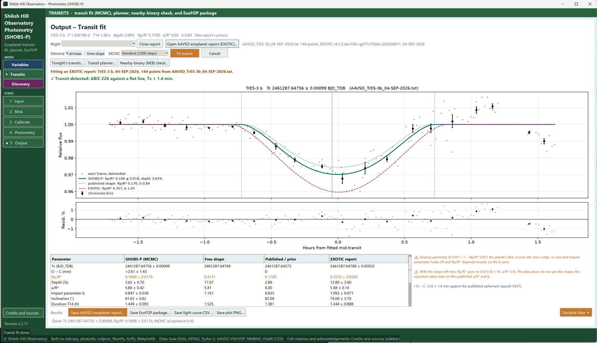

# SHOBS-P — Shiloh Hill Observatory Photometry

A Windows desktop app for differential aperture photometry with one-shot-color (OSC) and monochrome
astronomical cameras. It takes you from raw FITS frames to a calibrated light curve and an AAVSO-ready report in
one window.

## Three modes

| Mode | What it does |
|---|---|
| **Variables** | Light curves, Lomb-Scargle period search with day-alias and leave-one-night-out checks, color terms, comparison-star health, multi-night series, AAVSO Extended reports |
| **Transits** | Exoplanet lookup (NASA Exoplanet Archive), MCMC transit fit with a detected / inconclusive / none verdict, transit planner, AAVSO exoplanet reports |
| **Discovery** | Scans the whole field for stars that vary |

All three share the same steps: **Input → Blink → Calibrate → Photometry → Output**.

## What each mode does

**Variables mode** is for following a known variable star, one night or many. You type the star's name and
SHOBS-P looks up its position in SIMBAD and VSX, along with its catalogued period if it has one. After calibration,
the image **solves itself**, and every catalog (the AAVSO comparison sequence, Gaia DR3, APASS and Tycho-2) is merged into one star list: click any star and its name and magnitude fill in. The best comparison stars, AAVSO sequence stars first, close to the target in brightness and colour, are ringed in green. You mark the target, up to ten comparison stars and a check star, and SHOBS-P measures every frame. It lines
frames up across meridian flips, and flags saturated frames, cloud and drift.

The result is a **light curve with honest error bars**: photon and sky noise in electrons (from the camera gain,
binning, debayer and flat) plus atmospheric scintillation, so they match the real scatter. A **period search**
(Lomb-Scargle) reports how significant its best period is, warns about one-day aliases, and checks that no single
night, and no night-to-night airmass trend, is driving the answer. Nights build up into a
**series**, with a comparison-star health check along the way. When you're happy, it writes an **AAVSO Extended
report** ready to submit.

**Transits mode** is for catching an exoplanet crossing its star. Type the planet's name, in any of its catalogue
spellings (KOI, Kepler, TOI, TIC…), or just the host star. SHOBS-P pulls its period, timing, depth and shape from
the NASA Exoplanet Archive, choosing the most precise published ephemeris. **Tonight's transits** lists every
transit visible from your site tonight, complete with its baseline before and after, and SHOBS-P warns you if your
frames don't actually cover a predicted transit.

After photometry, the **transit fit** detrends for airmass and runs an MCMC fit, guided by the planet's published
shape. It scales the error bars for red (correlated) noise and gives a plain verdict: **detected, inconclusive, or
no transit**. It doesn't just accept any dip: it tests whether a simple jump at a gap in the data, or a one-sided
baseline, explains the dip just as well. You also get the O − C timing against the ephemeris, a free-shape fit as
a cross-check, and a nearby-eclipsing-binary check. You can open an **EXOTIC report** to see both fits side by
side. Results go out as an **AAVSO exoplanet report** and an **ExoFOP package**.

**Discovery mode** is designed so you can take a series of images, with calibration frames, of any patch of sky you
choose, no target star needed. SHOBS-P works out where the frames point, from the plate solution in the FITS header or by matching the
star pattern. It checks that spot for known variables using VSX and SIMBAD, and marks them.

When you run a **field scan**, SHOBS-P performs photometry on every star in the field. Before scoring, it lines up
each star's light curve across meridian flips and rotator moves, so a flip can't masquerade as a variable star. It
then compares each star's scatter with that of other stars of the same brightness. Stars that vary at least **3
times more than normal** for their brightness (the level is adjustable) are flagged as candidates, and each is
labelled new, known, or "check first" (for example, near a bright star or at the edge of the frame).

Interesting stars can be put on a **watch list**. Every later night you add to that field's series measures the
watched stars automatically, building up their light curves over time.

Highlights: bias/dark/flat calibration with superpixel debayering, frame alignment through meridian flips,
comparison-star ensembles, catalog comps from the AAVSO sequence, Gaia DR3, APASS and Tycho-2 (Johnson V/B/R and
Sloan g′r′i′), and error bars from the CCD equation plus scintillation (Merline & Howell 1995; Osborn et al. 2015).

## Requirements

- Windows 10 or 11
- Python 3.11 or newer from [python.org](https://www.python.org/downloads/) (check "Add python.exe to PATH")
- Packages (installed automatically): numpy, scipy, matplotlib, astropy, photutils, ccdproc

*TrES-3 b, 4 Sep 2026: SHOBS-P refitting an EXOTIC report. The SHOBS-P fit (green) stays close to the published
transit shape (blue dotted); the report's own fit (red dashed) runs about twice as deep.*

<!-- More screenshots to come: docs/light_curve.png (Variables), docs/field_scan.png (Discovery). -->

## Install

1. Install **Python 3.11 or newer** from [python.org](https://www.python.org/downloads/). On the first installer
   screen, tick **"Add python.exe to PATH"**.
2. Download **`SHOBS-P_v<version>.zip`** from the latest [release](../../releases/latest) and unzip it somewhere
   permanent (for example `C:\Astro`). It makes a `clearv_photometry` folder.
3. In that folder, double-click **`Create shortcuts.bat`**. It installs the Python packages (a few minutes the first
   time) and puts a SHOBS-P icon on the Desktop and in the Start menu.
4. Double-click **`Run self-test.bat`**. It changes nothing, takes a minute, and should end with
   `RESULT: ALL PASSED` in `selftest_log.txt`.

## Quick start

**First, try it on sample data.** Start SHOBS-P, and on the Input page press **Try it with sample data…** and pick an
empty folder. It writes a small synthetic night (a 0.12-day variable star), fills in every box and marks the stars.
Then go through the steps on the left: **Blink → Calibrate → Photometry → Output**.

**Then your own frames:**

1. **Input:** choose the folders of bias, dark, flat and light frames (FITS or PixInsight XISF), and press **Scan
   folders**. Type your site (latitude, longitude, elevation) and your optics once; SHOBS-P remembers them, and fills
   them from your FITS headers when the camera software writes them. Type the target's name (or the planet's, in
   Transits mode) and press Enter: RA and Dec are looked up for you.
2. **Blink:** step through the lights and reject anything with trails, clouds or bad guiding.
3. **Calibrate:** check the camera (Bayer pattern for a colour camera, MONO for a monochrome one; SHOBS-P reads it
   from the headers or the flats when it can) and press **Build masters and calibrate**.
4. **Photometry:** the image solves itself; click the target, pick one
   or more comparison stars (green rings are good choices; you can also type a name) and a check star, then **Run photometry**.
5. **Output:** the light curve, period search and AAVSO report (Variables); the MCMC transit fit and AAVSO
   exoplanet report (Transits); or the list of stars that vary (Discovery).

Every page and button is described in **[README.txt](README.txt)** (also in the zip).

## Known limitations

- **Made for Windows** (10 or 11). It is plain Python and also runs on a Mac (python.org Python, which includes Tk; start it with `python clearv_app.py`); the Mac is lightly tested so far.
- **Colour (OSC) cameras are the most tested.** Monochrome cameras are supported (V, B, R, clear and LRGB imaging
  filters, and Sloan g′ r′ i′ z′ u′ since 2.2.17); that path is newer, so reports from mono users are especially welcome.
- **Johnson/Cousins I is not supported yet**: the comparison-star catalogs used carry B, V, R and Sloan only.
- **An internet connection is needed** for target, planet and catalog lookups (SIMBAD, VSX, NASA Exoplanet
  Archive, AAVSO VSP, Gaia, APASS, Tycho-2). Calibration and photometry themselves run offline.
- Magnitudes are **untransformed** (no transformation coefficients yet).

## Reporting a problem or an idea

Please open an [Issue](../../issues/new/choose). The forms ask for what helps most: the SHOBS-P version (bottom of
the sidebar), your camera, the mode and step, what you expected and what happened, a screenshot, and the log file.
Two files help with almost any problem: `selftest_log.txt` from **Run self-test.bat**, and `.shobs_p.log` in your
user folder (`C:\Users\<you>`).

## Documentation

**[The SHOBS-P User's Manual](docs/manual/README.md)** (draft, written for 2.2.17) walks you through the program task
by task: installing, your first night, reducing a variable star, fitting a transit, scanning a field, and what every
message means.

**[README.txt](README.txt)** is the full reference: every page and button, what is new in each version, the version
history, and the credits for every catalog, service and published method the app uses.

## Status

SHOBS-P is under active development and in regular use for variable-star and exoplanet-transit observing.
Bug reports and suggestions are welcome in [Issues](../../issues).

## Citing SHOBS-P

If you use SHOBS-P in published work, please cite it. GitHub's **Cite this repository** button (right-hand
sidebar) gives the reference in APA and BibTeX from [CITATION.cff](CITATION.cff). Each release is archived on
Zenodo with its own DOI, so you can cite the exact version you used; [10.5281/zenodo.23417064](https://doi.org/10.5281/zenodo.23417064) always points to the latest version.

## How it was made

SHOBS-P was designed, tested and validated against real observations at Shiloh Hill Observatory. Most of the code
was written with the help of an AI assistant (Anthropic's Claude), working to the observatory's specifications and
checked against its data.

## License

Copyright © 2026 Shiloh Hill Observatory.

SHOBS-P is free software: you can redistribute it and/or modify it under the terms of the GNU General Public
License as published by the Free Software Foundation, either version 3 of the License, or (at your option) any
later version. It is distributed in the hope that it will be useful, but WITHOUT ANY WARRANTY. See the
[LICENSE](LICENSE) file for details.
