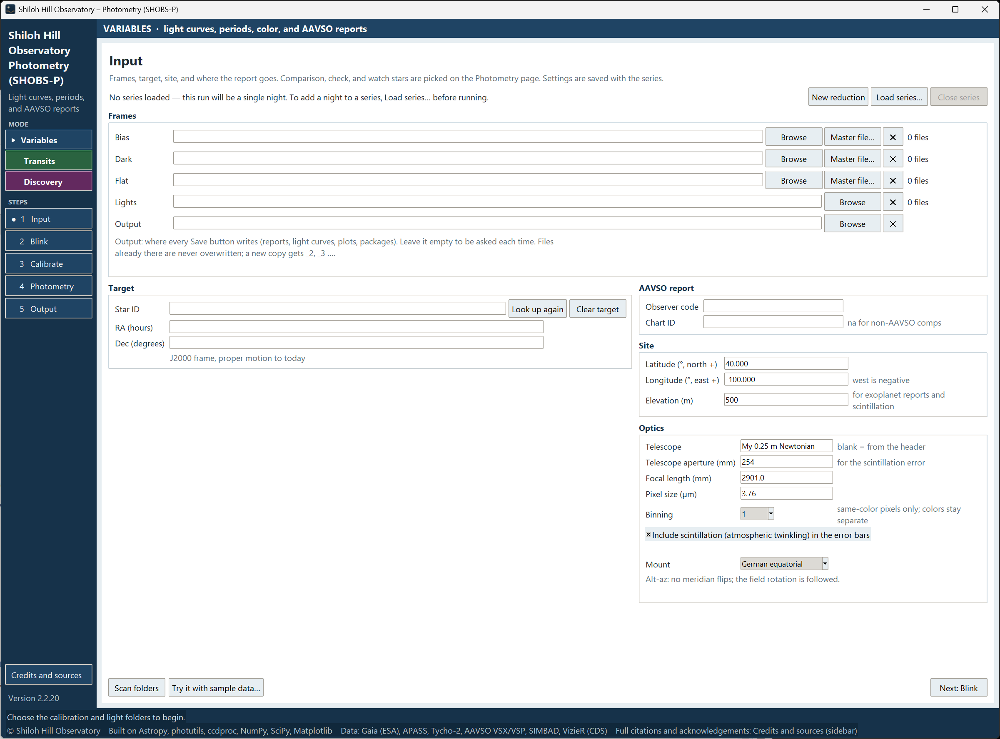

# 2. Installing and starting

SHOBS-P is a Python program. You install Python once, unzip SHOBS-P, and run one file that sets everything else up.
It takes about ten minutes, most of it waiting for downloads.

## What you need

- Windows 10 or 11, a Mac (macOS 12 Monterey or newer), or Linux. The Windows steps come first; Linux and the Mac have their own sections
  below.
- An internet connection (for the install, and later for star and catalog lookups).
- **Python 3.11 or newer.** Python from python.org is the simplest. Anaconda or Miniconda also works. On Linux,
  Python 3.13 is the best choice; on the Mac, Python 3.14 (see below).

## Install Python (Windows)

1. Go to [python.org/downloads](https://www.python.org/downloads/) and download the latest Python for Windows.
2. Run the installer. On the first screen, tick **Add python.exe to PATH**. This matters: the SHOBS-P start files
   find Python this way.
3. Click **Install Now** and wait for it to finish.

> **Tip:** If you already have Python 3.11 or newer (from python.org, Anaconda or Miniconda), you can skip this.
> SHOBS-P checks each Python it finds and uses the first one that has everything it needs, including Tkinter, the
> window toolkit. SHOBS-P makes its own environment from it (see below), so your Python is normally left as it is.

## Install SHOBS-P on Windows

1. Open the SHOBS-P releases page at
   [github.com/SHOBS-S/SHOBS-P/releases](https://github.com/SHOBS-S/SHOBS-P/releases).
2. Under the latest release, download the file **SHOBS-P_v*version*.zip** (for example `SHOBS-P_v2.3.0.zip`).
3. Unzip it somewhere permanent, for example `C:\Astro`. Avoid your Downloads folder: the shortcuts point at this
   folder, so it should not move.
4. Open the folder the zip made. It holds files such as `clearv_app.py`, `Create shortcuts.bat`,
   `Run self-test.bat`, `run_windows.bat` and `README.txt`.
5. Double-click **Create shortcuts.bat**. A black window opens. The first time it:
   - says `Looking for a Python that can run SHOBS-P...` and lists each Python it tries, ending with
     `usable:` and the one it picked;
   - sets up SHOBS-P's own Python environment in `%LOCALAPPDATA%\SHOBS-P\python-env` (your own Python is left
     untouched);
   - says `Checking the Python packages SHOBS-P needs...` and downloads them (NumPy, SciPy, Matplotlib, Astropy,
     photutils, ccdproc and tzdata, the time zone list). This takes a few minutes.
6. When it says `Done. Start SHOBS-P from the Desktop icon or the Start menu.`, press any key to close the window.

You now have a SHOBS-P icon on the Desktop and in the Start menu.

If the window instead says `The shortcuts could not be made. Leave this window open and copy the message above.`,
the lines above it say why. If it says `SHOBS-P could not find a Python it can use.`, every Python it tried is listed
with the reason it was not usable. Install Python from python.org (tick **Add python.exe to PATH**) and run
**Create shortcuts.bat** again.

> **Tip:** To pin SHOBS-P to the taskbar, open the Start menu, right-click **SHOBS-P** and choose **Pin to
> taskbar**. You can also right-click the running program's taskbar button. The pin keeps the SHOBS-P icon.

If you ever move the SHOBS-P folder, double-click **Create shortcuts.bat** again so the shortcuts point at the new
place.

## Install on Linux

1. Install Python with Tkinter, the window toolkit. Python 3.13, 3.12 or 3.11 is best. Most distributions already
   have Python; add Tkinter (and, on Debian-based systems, the venv package) with your package manager:
   - Debian, Ubuntu, Mint: `sudo apt install python3-tk python3-venv`
   - Fedora: `sudo dnf install python3-tkinter`
   - Arch: `sudo pacman -S tk`
2. Unzip SHOBS-P anywhere in your home folder.
3. Open a terminal in that folder and type `./run_linux.sh`.
   The first start finds a Python that works, makes SHOBS-P's own environment in
   `~/.local/share/SHOBS-P/python-env` (your own Python is left untouched) and downloads the packages. This takes a
   few minutes. The messages are the same as on a Mac (see "What the first start says" below). Later starts skip the
   download, unless a new version needs other packages.
4. For an entry in your applications menu, type `./run_linux.sh --desktop` once. It needs no `sudo`. It also puts
   an icon on your Desktop, if you have one. Run it again if you move the SHOBS-P folder.
5. To check the install, type `./run_selftest.sh` (see the self-test below).

If the terminal says `✖ SHOBS-P could not find a Python it can use`, every Python it tried is listed above that line
with the reason. When Tkinter is missing, it names the package to install. Install it and run `./run_linux.sh` again.

## Install on a Mac

1. Install **Python 3.14** from [python.org/downloads/macos](https://www.python.org/downloads/macos/). It includes
   Tk, the window toolkit. Pick 3.14 even if a newer Python is offered: a brand-new Python often does not have
   ready-made copies of all the packages SHOBS-P needs yet (see below). Python 3.13 works too, but python.org has
   no Mac installers for 3.13 after **3.13.17**, so take 3.13.17 if you want 3.13. (A Homebrew Python works too,
   with `brew install python-tk@3.14` for a Python 3.14.)
2. Unzip SHOBS-P somewhere permanent, for example in Documents.
3. Double-click **Start SHOBS-P.command**. The first time, macOS may refuse to open a file from an unidentified
   developer. Right-click (or Control-click) the file, choose **Open**, then **Open** again. You only do this once.
   On macOS 15 and newer there may be no **Open**: then go to System Settings → Privacy & Security, scroll down and
   press **Open Anyway**. Or, in Terminal in the SHOBS-P folder, type
   `xattr -d com.apple.quarantine *.command *.sh`; that clears every SHOBS-P start file at once.
4. The first start makes SHOBS-P's own environment in `~/Library/Application Support/SHOBS-P/python-env` and
   downloads the packages, which takes a few minutes. Keep the Terminal window open while SHOBS-P runs; closing it
   closes the program.
5. To check the install, double-click **Run self-test.command**.
6. For a SHOBS-P app with its icon (from 2.3.2), double-click **Create shortcut.command** once. It makes
   **SHOBS-P.app** with the SHOBS-P logo in Applications (the one in your home folder if you may not write to the
   main one) and puts **SHOBS-P** on your Desktop; drag it to the Dock to keep it there. The app starts SHOBS-P from
   this folder without a Terminal window. If SHOBS-P has not been set up yet, and at the first start of a new version
   or folder, the app opens **Start SHOBS-P.command** in Terminal instead, so you can watch the setup. While SHOBS-P
   runs, its Dock icon is Python's (the program is Python's window), and opening the app again does nothing until
   SHOBS-P is closed. If SHOBS-P stops with an error, its messages open in
   TextEdit (`app_start_log.txt` in `~/Library/Application Support/SHOBS-P`). Run **Create shortcut.command** again
   if you move the SHOBS-P folder or unzip a new version somewhere else.

SHOBS-P opens at a size that fits the screen between the menu bar and the Dock (from 2.3.2); make it bigger or
press the green button to fill the screen.

### What the first start says (Linux and Mac)

The Terminal window tells you what it is doing. A first start looks like this (your paths and version numbers will
differ):

    Looking for a Python that can run SHOBS-P...
      Trying /Library/Frameworks/Python.framework/Versions/3.13/bin/python3...
        usable: Python 3.13.1

    Setting up SHOBS-P's own Python environment with Python 3.13.1 (/Library/Frameworks/...)
    in /Users/you/Library/Application Support/SHOBS-P/python-env
    (that Python itself is left untouched). The first time this downloads the packages: a few minutes...
    Installing the Python packages SHOBS-P needs...
        getting numpy
        getting scipy
        ...
    ✔ SHOBS-P is set up with Python 3.13.1.
    Using Python: /Users/you/Library/Application Support/SHOBS-P/python-env/bin/python3

Then the SHOBS-P window opens. A Python that cannot be used says `not usable:` and why, and SHOBS-P tries the next one.

**Which Python SHOBS-P picks.** It tries the Pythons it finds in the order 3.13, 3.12, 3.11, then newer ones. It only
installs ready-made copies of the packages, so it never has to compile anything, and a Mac never asks you to install
Apple's developer tools. A brand-new Python (for example 3.15) often has no ready-made copies yet. Then SHOBS-P says:

    ⚠ Some packages SHOBS-P needs have no ready-made copy for Python 3.15.0 yet
      (they would have to be compiled, and SHOBS-P never compiles).
      Trying the next Python.

That is not an error. SHOBS-P simply moves on. If you also have 3.13 (or 3.12 or 3.11), it uses that one. If the
new Python was the only one, the window ends with:

    ✖ SHOBS-P could not set up its packages with any Python on this computer (each one is listed above).
      Python 3.15.0 has no ready-made copies of some packages yet.

and says what to do: on a Mac, install Python 3.14 from python.org and double-click again (your other Pythons can
stay); on Linux, install Python 3.13, 3.12 or 3.11 with Tkinter. Nothing else needs to change.

**When something fails.**

- `✖ SHOBS-P could not find a Python it can use` means none of the Pythons found has Tkinter or is new enough
  (3.11 or newer). Each one is listed above that line with the reason. On a Mac, install Python 3.14 from python.org.
- `✖ The packages could not be downloaded. Check the internet connection and try again.` means just that.
- pip, the tool that downloads the packages, writes its own detailed messages to **pip_log.txt** next to the
  environment: `~/Library/Application Support/SHOBS-P/pip_log.txt` on a Mac, `~/.local/share/SHOBS-P/pip_log.txt` on
  Linux. If you report a setup problem, attach this file. Chapter 24 has more.

## Check the install with the self-test

1. In the SHOBS-P folder, double-click **Run self-test.bat** (Windows) or **Run self-test.command** (Mac). On Linux,
   type `./run_selftest.sh` in a terminal in that folder.
2. Wait a minute or two. The transit fits are the slow part. The test changes no settings and no data. A SHOBS-P
   window may open and close by itself; that is part of the test.
3. The last line should read `RESULT: ALL PASSED`.

The test writes its log to `selftest_log.txt` in the SHOBS-P folder, and a copy to `SHOBS-P_selftest_log.txt` in your
Downloads folder (on Linux and the Mac, when you have one). If you ever report a problem, attach this file.

A line such as `(no sample transit reports to run on: skipped)` or `(NASA Exoplanet Archive not reachable: skipped)`
is normal: that part of the test is simply skipped.

> **Tip:** The transit part of the test runs on sample AAVSO exoplanet reports, and none come with SHOBS-P. To run
> it, make a folder named `selftest_reports` next to `selftest.py` and put reports named `AAVSO_TrES-3b_*.txt`,
> `AAVSO_KOI-217b_*.txt` or `AAVSO_WASP-12b_*.txt` in it.

If the result says `FAILED`, the lines marked `FAIL` say which part. See chapter 24, Troubleshooting.

## Start SHOBS-P

Double-click the **SHOBS-P** icon on the Desktop, or choose it from the Start menu. The program opens without a
console window. On Linux, type `./run_linux.sh` or choose SHOBS-P from the applications menu; on a Mac, open **SHOBS-P**
from the Desktop, the Dock or Applications (made by **Create shortcut.command**), or double-click
**Start SHOBS-P.command**. Any error is shown in the program itself and written to a log file (see "When something goes wrong"
below).

The first time, SHOBS-P opens:

- in **Variables** mode (navy),
- on the **Input** page,
- with the status bar at the bottom saying **Choose the calibration and light folders to begin.**

The window fills most of the screen. You can resize it or maximize it like any other window.

## Try it with sample data

Before you open your own frames, try a practice night. It shows every step without any risk.

1. Make an empty folder, for example `C:\Astro\SHOBS-P sample`.
2. On the Input page, press **Try it with sample data…** (bottom of the page).
3. Pick the empty folder. SHOBS-P writes a small synthetic night into it: bias, darks, flats and 40 lights of a
   made-up variable star.
4. All the folder boxes, the target, the comparison and check stars are filled in for you.
5. Press the steps on the left in turn: **2 Blink**, **3 Calibrate**, **4 Photometry**, **5 Output**. On the
   Calibrate page press **Build masters and calibrate**; on the Photometry page press **Run photometry**.

The sample frames are tiny and carry no sky position, so the Photometry page will say the image is not solved.
That is expected here; the stars are already marked for you.

## Other ways to start

- **run_windows.bat** starts SHOBS-P with a black console window beside it, using the same Python as the shortcuts.
  It also checks the Python packages first.
  Use it when the program will not start from the icon: the console shows the error, and the window stays open with
  `The app did not start. Leave this window open and copy the message above.`
- **On Linux or a Mac**, use the start files described above (`run_linux.sh`, **Start SHOBS-P.command**). The
  terminal window shows any error, and says `SHOBS-P did not start, or stopped with an error. Copy the message
  above.`

### Starting afresh

If the install gets into a muddle, delete SHOBS-P's own environment and let the next start set it up again. On
Windows, delete the `SHOBS-P` folder in `%LOCALAPPDATA%` and run **Create shortcuts.bat** again. On Linux, delete the `SHOBS-P` folder in `~/.local/share`; on a Mac,
delete the `SHOBS-P` folder in `~/Library/Application Support`. Your settings are not in that folder, so they are
kept.

## Updating to a new version

1. Download the new zip from the releases page.
2. Unzip it. You can replace the old folder or unzip beside it.
3. On Windows, run **Create shortcuts.bat** in the new folder. (On Linux or a Mac, just start the new version with
   its start file; run `./run_linux.sh --desktop` again for the menu entry, or on a Mac **Create shortcut.command**
   for the app.) It points the shortcuts at the new version and installs any new
   packages it needs. SHOBS-P's own Python environment is shared by every version, so this is quick. (The first time
   you run it after updating from 2.2.18 or older, it sets that environment up and downloads the packages once.)

Your settings (site, telescope, and so on) are kept in your user folder (your home folder), not in the SHOBS-P folder, so an
update does not lose them. Chapter 3 lists what is remembered.

## When something goes wrong

- If something fails inside the program, a box says **Something went wrong:** with the error, and the details go to
  `.shobs_p.log` in your user folder (`C:\Users\<you>` on Windows, your home folder `~` on Linux and the Mac).
- `.shobs_p.log` also holds every line of the Log window, each with the date and time in front. When it grows past
  5 MB it is renamed `.shobs_p.log.1` (one old file is kept) and a new log starts.
- The version is shown at the bottom of the left-hand sidebar (for example **Version 2.3.0**).
- To report a problem, open an Issue on the SHOBS-P GitHub page and attach `selftest_log.txt` and `.shobs_p.log`,
  with a screenshot.

---

Previous: [1. Welcome](01-welcome.md) · Next: [3. A tour of the window](03-tour-of-the-window.md)
