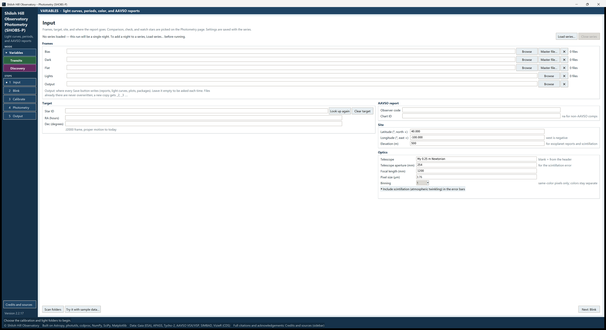

# 2. Installing and starting

SHOBS-P is a Python program. You install Python once, unzip SHOBS-P, and run one file that sets everything else up.
It takes about ten minutes, most of it waiting for downloads.

## What you need

- Windows 10 or 11.
- An internet connection (for the install, and later for star and catalog lookups).
- **Python 3.11 or newer** from python.org.

## Install Python

1. Go to [python.org/downloads](https://www.python.org/downloads/) and download the latest Python for Windows.
2. Run the installer. On the first screen, tick **Add python.exe to PATH**. This matters: the SHOBS-P start files
   find Python this way.
3. Click **Install Now** and wait for it to finish.

> **Tip:** If you already have Python 3.11 or newer from python.org, you can skip this. Python from other sources
> (for example a version bundled with another program) may lack parts SHOBS-P needs, such as Tkinter, the window
> toolkit.

## Install SHOBS-P

1. Open the SHOBS-P releases page at
   [github.com/SHOBS-S/SHOBS-P/releases](https://github.com/SHOBS-S/SHOBS-P/releases).
2. Under the latest release, download the file **SHOBS-P_v*version*.zip** (for example `SHOBS-P_v2.2.18.zip`).
3. Unzip it somewhere permanent, for example `C:\Astro`. Avoid your Downloads folder: the shortcuts point at this
   folder, so it should not move.
4. Open the folder the zip made. It holds files such as `clearv_app.py`, `Create shortcuts.bat`,
   `Run self-test.bat`, `run_windows.bat` and `README.txt`.
5. Double-click **Create shortcuts.bat**. A black window opens and says
   `Checking the Python packages SHOBS-P needs...`. The first time, it downloads the packages SHOBS-P uses (NumPy,
   SciPy, Matplotlib, Astropy, photutils and ccdproc). This takes a few minutes.
6. When it says `Done. Start SHOBS-P from the Desktop icon or the Start menu.`, press any key to close the window.

You now have a SHOBS-P icon on the Desktop and in the Start menu.

If the window instead says `The shortcuts could not be made. Leave this window open and copy the message above.`,
the lines above it say why. The usual cause is Python not being on the PATH: run the Python installer again, choose
**Modify**, and tick **Add Python to environment variables**.

> **Tip:** To pin SHOBS-P to the taskbar, open the Start menu, right-click **SHOBS-P** and choose **Pin to
> taskbar**. You can also right-click the running program's taskbar button. The pin keeps the SHOBS-P icon.

If you ever move the SHOBS-P folder, double-click **Create shortcuts.bat** again so the shortcuts point at the new
place.

## Check the install with the self-test

1. In the SHOBS-P folder, double-click **Run self-test.bat**.
2. Wait a minute or two. The transit fits are the slow part. The test changes no settings and no data. A SHOBS-P
   window may open and close by itself; that is part of the test.
3. The last line should read `RESULT: ALL PASSED`.

The test writes its log to `selftest_log.txt` in the SHOBS-P folder, and a copy to `SHOBS-P_selftest_log.txt` in your
Downloads folder. If you ever report a problem, attach this file.

A line such as `(no sample transit reports to run on: skipped)` or `(NASA Exoplanet Archive not reachable: skipped)`
is normal: that part of the test is simply skipped.

> **Tip:** The transit part of the test runs on sample AAVSO exoplanet reports, and none come with SHOBS-P. To run
> it, make a folder named `selftest_reports` next to `selftest.py` and put reports named `AAVSO_TrES-3b_*.txt`,
> `AAVSO_KOI-217b_*.txt` or `AAVSO_WASP-12b_*.txt` in it.

If the result says `FAILED`, the lines marked `FAIL` say which part. See chapter 24, Troubleshooting.

## Start SHOBS-P

Double-click the **SHOBS-P** icon on the Desktop, or choose it from the Start menu. The program opens without a
console window. Any error is shown in the program itself and written to a log file (see "When something goes wrong"
below).

The first time, SHOBS-P opens:

- in **Variables** mode (navy),
- on the **Input** page,
- with the status bar at the bottom saying **Choose the calibration and light folders to begin.**

The window fills most of the screen. You can resize it or maximize it like any other window.

## Try it with sample data

Before you open your own frames, try a practice night. It shows every step without any risk.

1. Make an empty folder, for example `C:\Astro\SHOBS-P sample`.
2. On the Input page, press **Try it with sample data…** (bottom of the page).
3. Pick the empty folder. SHOBS-P writes a small synthetic night into it: bias, darks, flats and 40 lights of a
   made-up variable star.
4. All the folder boxes, the target, the comparison and check stars are filled in for you.
5. Press the steps on the left in turn: **2 Blink**, **3 Calibrate**, **4 Photometry**, **5 Output**. On the
   Calibrate page press **Build masters and calibrate**; on the Photometry page press **Run photometry**.

The sample frames are tiny and carry no sky position, so the Photometry page will say the image is not solved.
That is expected here; the stars are already marked for you.

## Other ways to start

- **run_windows.bat** starts SHOBS-P with a black console window beside it. It also checks the Python packages first.
  Use it when the program will not start from the icon: the console shows the error, and the window stays open with
  `The app did not start. Leave this window open and copy the message above.`
- **On a Mac**, install Python from python.org (it includes Tkinter), install the packages with
  `python3 -m pip install -r requirements.txt` in the SHOBS-P folder, then start the program with
  `python3 clearv_app.py`.

## Updating to a new version

1. Download the new zip from the releases page.
2. Unzip it. You can replace the old folder or unzip beside it.
3. If the folder's location changed, run **Create shortcuts.bat** again. It also installs any new packages the new
   version needs.

Your settings (site, telescope, and so on) are kept in your Windows user folder, not in the SHOBS-P folder, so an
update does not lose them. Chapter 3 lists what is remembered.

## When something goes wrong

- If something fails inside the program, a box says **Something went wrong:** with the error, and the details go to
  `.shobs_p.log` in your user folder (`C:\Users\<you>`).
- `.shobs_p.log` also holds every line of the Log window, each with the date and time in front. When it grows past
  5 MB it is renamed `.shobs_p.log.1` (one old file is kept) and a new log starts.
- The version is shown at the bottom of the left-hand sidebar (for example **Version 2.2.18**).
- To report a problem, open an Issue on the SHOBS-P GitHub page and attach `selftest_log.txt` and `.shobs_p.log`,
  with a screenshot.

---

Previous: [1. Welcome](01-welcome.md) · Next: [3. A tour of the window](03-tour-of-the-window.md)
