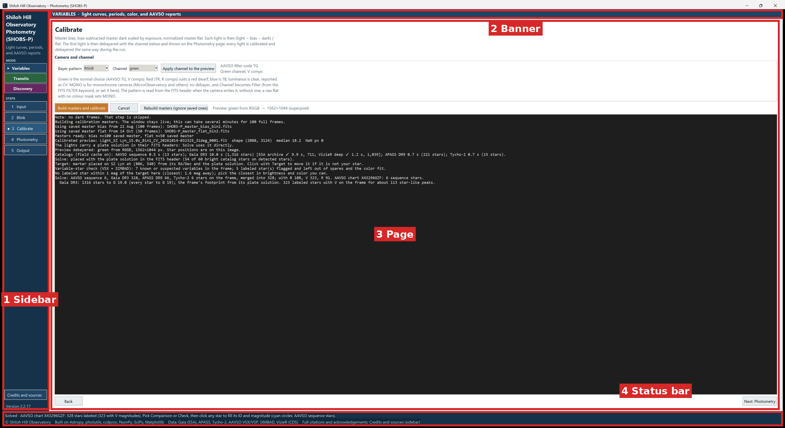

# 3. A tour of the window

SHOBS-P has one main window. A sidebar on the left chooses the mode and the step; the page on the right is where you
work; a status bar along the bottom tells you what just happened.

## The sidebar

From top to bottom:

1. **The program name** and a one-line description of the current mode.
2. **MODE**: three buttons, **Variables**, **Transits** and **Discovery**. The active one has a ▶ in front of it.
3. **STEPS**: five buttons, **1 Input**, **2 Blink**, **3 Calibrate**, **4 Photometry**, **5 Output**. The page you
   are on has a ● in front of it.
4. At the bottom: **Credits and sources**, and the version number (for example **Version 2.2.18**).

## The three modes and their colors

Each mode colors the whole window, so you can always see which one you are in:

| Mode | Color | Banner across the top |
|---|---|---|
| **Variables** | navy | VARIABLES · light curves, periods, color, and AAVSO reports |
| **Transits** | green | TRANSITS · transit fit (MCMC), planner, nearby-binary check, and ExoFOP package |
| **Discovery** | plum | DISCOVERY · measure every star in the field and flag the ones that vary |

To switch modes, click another mode button. Things to know:

- **Your work carries over.** Calibrated frames and marked stars are kept, and you stay on the step you were on. The
  status bar says, for example, **Transits mode. Calibrated frames and marked stars are kept.**
- **You cannot switch while something is running.** SHOBS-P says **Wait for the current run to finish (or cancel it)
  before switching modes.**
- **A series belongs to one mode.** If a Variables series is open and you switch to Transits (or the other way), SHOBS-P
  asks first. Switching closes the series in the program; the file on disk is not changed. If it has unsaved nights,
  you are offered a save first.

What changes between modes:

- **Input**: Variables and Transits have a **Target** box; Transits adds a **Planet (Transits)** box; Discovery has
  no target, only a field center when your headers do not give one.
- **Photometry**: Variables and Transits mark a target, comparison stars and a check star, then **Run photometry**.
  Discovery has **Scan field** instead.
- **Output**: Variables shows **Output – Variability**, Transits shows **Output – Transit fit**, Discovery shows
  **Output – Field scan**.

## The five steps

Every mode works through the same five steps:

| Step | What you do there |
|---|---|
| **1 Input** | Choose the folders of frames, name the target, check your site and optics. |
| **2 Blink** | Play through the raw frames and reject bad ones (trails, cloud, poor guiding). |
| **3 Calibrate** | Build master bias, dark and flat frames and calibrate the lights. |
| **4 Photometry** | The image is solved; mark the stars and measure every frame. |
| **5 Output** | Light curve, period search and reports; or the transit fit; or the field-scan results. |

You can click any step at any time; none is ever locked. Some steps also move you on by themselves: a successful
calibration goes straight to Photometry, and a finished photometry run goes straight to Output.

Most pages also have **Back** and **Next: …** buttons at the bottom.

## Page titles and hints

Each page starts with its title in large type (for example **Calibrate**) and a short gray hint under it saying what
the page does. Smaller gray hints sit next to many boxes, for example "west is negative" beside the longitude.
Read them the first time; they answer most questions.

## The status bar

The bottom of the window has two lines:

- **The status line** shows the latest message: what just happened, or what to do next. Long messages are cut off
  here; the full text is always in the log (see below). After you save a report, a button may appear beside the
  message that opens the matching upload page (for example the AAVSO's). It goes away with the next message.
- **The credits line** (dimmer) names the libraries and catalogs SHOBS-P is built on.

## The log

The Calibrate page has a large dark log box, and the Photometry page has a smaller copy of it (**Hide log** /
**Show log**). Every message SHOBS-P writes goes there, with more detail than the status line has room for. When
something looks wrong, read the log first.

## Warnings, cautions and questions

SHOBS-P tells you about problems in a few ways, from mild to serious:

- **Notes in the log** start with "Note:" and are for your information.
- **Cautions** start with "Caution:" or "⚠", and are printed in orange or red in the panels. They mean "this result
  may be affected; look at it". The program carries on.
- **Questions** open a small window with **Yes** / **No** (sometimes **Cancel**). Each question explains both
  answers, for example:

  > Yes: calibrate without the dark this time (bias only). …
  > No: use these darks anyway.
  > Cancel: stop, and pick darks closer to the lights' exposure on the Input page.

  Read the whole question before answering: the right answer depends on your night, and the question says what
  each choice does.
- **Errors** open a window with only **OK**. Nothing was done; the message says what to fix.

While a job runs (calibration, photometry, a solve), the cursor shows that the program is busy, but the window stays
live. Starting a second job meanwhile gives **Another step is still running. Wait for it to finish.**

## The Credits page

**Credits and sources** at the bottom of the sidebar opens a page listing every library, catalog, service and
published method SHOBS-P uses. The quoted sentences are the acknowledgements each source asks for: please include them
when you publish results made with SHOBS-P.

- **Save credits as text…** saves the list as `SHOBS-P_credits.txt`.
- **Back** returns to the step you came from.

## What SHOBS-P remembers, and what it does not

SHOBS-P keeps a small settings file in your Windows user folder (`C:\Users\<you>\.shobs_p_settings.json`). It is not
in the program folder, so updates do not touch it.

**Remembered between sessions:**

- the mode you used last;
- your site: **Latitude**, **Longitude** and **Elevation**, once you type them;
- your **Telescope** name, **Telescope aperture (mm)**, **Focal length (mm)**, **Pixel size (µm)** and **Mount**, and
  the **Include scintillation** checkbox;
- your **Observer code**;
- the Blink **Speed** and the display **Stretch** on the Blink and Photometry pages;
- whether the Photometry tips are shown, and where you last put the popped-out image window;
- a monochrome **Filter** you picked by hand on the Calibrate page;
- the Discovery period range and watch list (chapters 20 and 21);
- header values you said **No** to (so SHOBS-P does not ask again);
- the folder you last used for series files.

**Not remembered between sessions** (they start empty or at their defaults each time):

- all five folders on the Input page, including **Output**;
- the target and **Chart ID**;
- **Binning**, the **Bayer pattern** and the **Channel**;
- the aperture sizes, marked stars and rejected frames.

All of these except the folders are saved in a **series file** when you save a series, and come back when you load
it (chapter 10). That is why the Input page says "Settings are saved with the series". The folders you must choose
again each night.

Until you type your own, **Focal length (mm)** and **Pixel size (µm)** start at 2900 mm and 3.76 µm. If the boxes
still hold these starting values (or are empty), the lights' FITS headers fill them in.

**Never stored anywhere unless you type it:** your site. SHOBS-P ships with the Site boxes empty, and it never saves
a site read from somebody else's frames as yours without asking you first. In the same way, the optics of a loaded
series or of another telescope's frames are never saved as yours.

---

Previous: [2. Installing and starting](02-installing-and-starting.md) · Next: [4. Before your first night](04-before-your-first-night.md)
