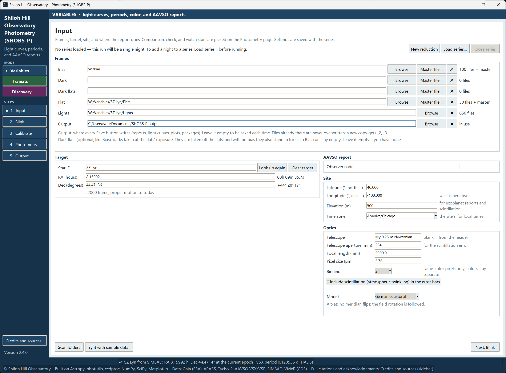

# 5. Input

The Input page is where every night starts. You tell SHOBS-P where the frames are, which star (or planet) you
observed, and where reports should go. When you press **Scan folders**, SHOBS-P reads your FITS headers and checks
that everything fits together.

## The page at a glance

From top to bottom:

- **The series line**, with **New reduction**, **Load series…** and **Close series** on the right.
- **Frames**: six rows, **Bias**, **Dark**, **Dark flats**, **Flat**, **Lights** and **Output**, with hint lines under
  them.
- On the left: **Target** (Variables and Transits), **Planet (Transits)** (Transits only), or **Field center (only
  needed when the headers do not say)** (Discovery, only when needed).
- On the right: **AAVSO report**, **Site** and **Optics**.
- At the bottom: **Scan folders**, **Try it with sample data…** and **Next: Blink**.

## Choose the folders

Each row of the **Frames** box has a path box, a **Browse** button, a **✕** button that empties the row, and a count
on the right.

To choose your frames:

1. Press **Browse** on the **Bias** row and pick the folder of bias frames.
2. Do the same for **Dark**, **Flat** and **Lights**, and for **Dark flats** if you took them (see below).
3. Optionally, choose an **Output** folder (see below).
4. Press **Scan folders**.

You can also type or paste a path into the box. The count updates by itself a moment after you stop typing (and at
once when you press Enter or leave the box), just as after **Browse**. While the path does not name an existing
folder yet, the count says **no such folder**.

What the counts mean:

- **51 files**: 51 frames SHOBS-P can read.
- **51 files + master**: the folder also holds a master SHOBS-P built earlier; it will be reused if the frames have not
  changed.
- **master file**: the row points at one master file (see below).
- On the **Lights** row after scanning: **(+3 cal skipped)** means three bias, dark or flat frames were found among
  the lights and are not measured as lights (when the matching Bias, Dark or Flat row is empty, Calibrate offers to
  use them; chapter 7); **(12 set aside: another field)** means frames of another field were set aside (see
  "The checks SHOBS-P makes" below).

SHOBS-P reads FITS (`.fits`, `.fit`, `.fts`, also gzip and fpack-compressed) and PixInsight XISF files. If a folder
holds only files it cannot read, such as camera RAW or TIFF, the log says so.

**The calibration plan.** Once **Lights** and at least one of Bias, Dark, Dark flats and Flat are filled, a gray line
under the Frames box says how these frames will be calibrated (from 2.4.0), for example **Plan: lights = light − bias
− (dark − bias); flats = flat − dark flat.** It is the same sentence the Calibrate log starts with, so you can check
the plan before you calibrate. When the darks' exposure differs from the lights', the line adds it: **Darks 60 s,
lights 120 s: the master dark is scaled ×2; 120 s darks are better.** That is fine for a cooled camera. Once you have
chosen at Calibrate to scale darks that are far off, it adds **✔ … as you chose at Calibrate.**

A second line appears under the plan only when something is wrong:

- **✖ Darks 30 s, lights 180 s: the master dark would be scaled ×6, which stamps its noise on every light. Point Dark
  at 180 s darks (Calibrate asks otherwise).** (red) The dark would be scaled more than 3 times.
- **⚠ Darks can't be scaled correctly without bias or dark flats: add bias frames or dark flats, or use 55 s darks.**
- **⚠ Dark flats 2 s, flats 0.5 s: dark flats should match the flats' exposure. Take dark flats at 0.5 s.**
- **⚠ Flats 0.5 s, darks 55 s and no bias: the master flat comes out wrong. Put dark flats in the Dark flats box, or
  add bias frames.**

Chapter 7 explains each of them.

Any of Bias, Dark, Dark flats and Flat may be left empty. That step is simply skipped. Press **✕** to empty a row; the
status bar says, for example, **Dark folder cleared. Calibration will skip it.**

**Dark flats.** The **Dark flats** row sits between **Dark** and **Flat** and works like the others (**Browse**,
**Master file…**, **✕** and a file count). It is optional, like Bias. A hint line under the Frames box says: *"Dark
flats (optional, like Bias): darks taken at the flats' exposure. They are taken off the flats, and with no bias they
also stand in for it, so Bias can stay empty. Leave it empty if you have none."* If you have bias, darks and flats,
leave it empty: nothing changes. Like the other frame folders it starts empty every time SHOBS-P starts, and it is not
saved in a series. Chapter 7 says how the dark flats are used.

**Using a saved master.** Bias, Dark, Dark flats and Flat each have a **Master file…** button. Use it to pick one master file that
SHOBS-P built on an earlier night (they are in the `SHOBS-P masters` subfolder of your calibration folders). Masters
from other programs are refused with a message explaining why.

> **Tip:** Folders are not remembered between sessions. If you reduce the same target often, load its series
> (chapter 10) instead: it brings back most of the setup.

### The Output folder

The **Output** row chooses where every Save button writes: reports, light curves, plots and packages.

- **With an Output folder**, each Save writes straight into it, without a dialog. Files already there are never
  overwritten: a new copy gets `_2`, `_3` and so on. The status bar says **Save buttons now write into …** when you
  choose it.
- **Without one**, every Save asks where to put the file.
- **A folder that cannot be used** (2.4.0): SHOBS-P checks the folder when you choose it, or a moment after you
  stop typing, without creating anything. A network folder (`\\server\share`, or a mapped network drive) is not
  checked then (a drive that is offline could keep the window waiting): the row says **checked when you save**. When
  a folder cannot be written to (a read-only folder, a file of that name, a drive that is not there), the
  row says **cannot be used** instead of **in use**, and each Save opens the save dialog; the status bar says *The
  output folder … cannot be used (…): choose where to save.* (no message box: nothing is lost).

## Name the target

In Variables and Transits mode, the **Target** box names the star you observed.

1. Click in **Star ID** and type the star's name, for example `SZ Lyn` or `HD 219134`.
2. Press **Enter** (or just click somewhere else). SHOBS-P looks the star up in SIMBAD and the AAVSO's VSX.
3. **RA (hours)** and **Dec (degrees)** fill in, with the same position in hours-minutes-seconds beside them. The
   status bar shows where they came from and, for a known variable, its VSX period and type, for example
   **✔ SZ Lyn from SIMBAD: RA … h, Dec …° …**.

Things to know:

- The lookup happens only when you press Enter or leave the box, not as you type.
- While it runs, the busy bar at the bottom of the window says **Looking up SZ Lyn at SIMBAD and VSX…** (chapter 3,
  "The busy bar"). In Transits mode it goes on to the star's planets at the NASA Exoplanet Archive. If SIMBAD and VSX
  have not answered within 60 seconds, a red line under RA/Dec says so, for example **✖ SZ Lyn: the SIMBAD and VSX
  did not answer within 60 s — type RA/Dec, or Look up again.** Type RA and Dec yourself, or press **Look up again**
  later. (If the answer still comes in after that, it is used.)
- If the name is only spelled a little differently from the AAVSO's version (spaces or capitals), an orange line
  appears, such as **AAVSO spells this "HD 219134"**, with a **Use it** button. Using the AAVSO spelling keeps your
  reports matching the AAVSO's records.
- **Look up again** repeats the lookup, for example after the internet was down. It is greyed while the Star ID box
  is empty (hover over it: *Type a Star ID or designation first.*).
- While a job runs (calibration, photometry, a solve), the **Star ID** and **Planet** boxes, their **Look up
  again** buttons and **Clear target** are greyed (2.4.0): a star change in the middle of a run would not apply to it. They come back when
  the job ends.
- If the lookup fails, the status bar says **Could not look up …** You can type RA and Dec yourself, or leave them
  empty and let the plate solution fill them in later.
- RA is in decimal **hours** and Dec in decimal **degrees** (J2000).

**Changing to another target.** Press **New reduction** on the series line. It starts over for another star, as if
you had just started SHOBS-P: the open series is closed (you are offered a save first), and the target, planet,
comparison stars, check star, watch stars, **Use comps** choice, VSX period and rejected frames are cleared. The
**Notes** box on the Output page goes back to its default, **OSC reduced; not transformed** (or **Monochrome camera;
not transformed**), so the old star's notes cannot end up in the new star's report; if you had typed your own notes,
the log lists "the Output page notes" among what was cleared. The last run's line on the Photometry page ("Photometry
done in …") is cleared too. A report left open on the Transit fit page (chapter 19) is closed, so its planet can
never stand in for the new night's. The frame folders, site and optics stay. SHOBS-P asks
first: **Start a new reduction?** Then type the new name and press Enter.

**Lights from another camera (2.4.0).** Keeping the frame folders, the aperture and the ADU limits is handy for the
next night on the same camera, and wrong when the camera changes. So when the **Lights** box gets new frames (Browse,
a typed path, **Scan folders** or **Calibrate**), SHOBS-P compares their camera with the last lights' camera: the
header's `INSTRUME`, the frame size, `XBINNING` and the bit depth. The same camera: everything stays, as before.
Another camera:

- **Bias**, **Flat** and **Dark flats** left over from the last camera are emptied. **Dark** is kept only when its
  frames have the new lights' size and exposure; otherwise it is emptied too. A box you filled after the last
  night (after **New reduction**, say) is yours and is left alone.
- **Aperture r**, **sky in** and **sky out** (Photometry page) go back to 8, 14 and 22 px, and are set from the new
  frames' star sizes as soon as the image is calibrated: the sizes **Suggest…** would propose (chapter 8). This
  happens before the solve and before **Run photometry** read the boxes. Sizes you type in between are kept.
- **raw sat ADU** and **linear ADU** are set for the new camera: from its SHOBS-FLUX camera profile when there is
  one; else what you last used with that camera; else the camera's bit-depth maximum (4,095 for a 12-bit camera;
  60,000 for a 16-bit file, a little under 65,535 because cameras scale their data up) with **linear ADU** empty.
  On MicroObservatory frames **raw sat ADU** is set with the MicroObservatory setup, as before.
- **Only what the last night left is reset.** If you typed an aperture or a limit after the last night, or loaded a
  series since (Load series fills these boxes from the series), that box is not the last camera's any more and
  SHOBS-P leaves it alone. The line says so: *Aperture and sky ring left as they are: they were set (typed, or by a
  loaded series) after the last camera's night.* The same goes for **raw sat ADU** and **linear ADU**, each on its
  own. What a loaded series set is the series' own whatever the number: a series at the default 8, 14 and 22 px
  keeps them (they are not replaced by the star-size suggestion), and so does one whose sizes happen to equal
  last night's. Once you calibrate or run these lights, the boxes go with their camera again.
- **A series from another camera.** The series' aperture and raw sat ADU are kept only when tonight's lights come
  from the camera of the series' latest night. Lights from another camera reset them like any camera change, and the
  log says *The series' aperture and raw sat ADU were for its … nights; these lights are from …, so they are reset as
  for any camera change.* An older series that doesn't say which camera took it keeps them. Whenever the series'
  values are kept, a raw sat ADU above what tonight's camera can record (60,000 on a 12-bit camera that stops at
  4,095) gets a ⚠ in the Findings list, because saturated stars would never be flagged; it goes away when you type a
  new raw sat ADU. Closing the series ends all of this.
- **Back to the camera before.** If you picked a folder from another camera by mistake and then choose the first
  camera's lights again in the same session, the aperture and sky ring are put back as that camera's lights last
  used them (*Aperture and sky ring put back to r 6, sky 11–17 px, as last used with this camera in this
  session.*), and the ADU limits come back as last used with that camera. Sizes you typed in between are kept.

SHOBS-P says what it did in three plain lines, in the log and under the Frames boxes while those lights are in the
**Lights** box, for example:

*These lights come from another camera than the last ones (ZWO ASI2600MC Duo, 6248×4176 before, 650×500, binned 2x2,
12-bit now): Bias and Flat emptied, because they belong to the last camera. Dark emptied too: its frames (6248×4176,
120 s) are not these lights' (650×500, 60 s).*

Then choose the new camera's own calibration frames (or leave a box empty: calibration skips it). The first lights
after you start SHOBS-P are compared with the last session's camera for the aperture and the ADU limits only (the
frame boxes start empty anyway, and sizes you already typed are kept).

This matters: without it, one star's comparison stars (or its **Use comps** choice) could be applied to another star's
night. **Clear target** still empties only the Star ID, RA and Dec and the comparison and check stars.

### Transits mode: the planet

In Transits mode, a **Planet (Transits)** box appears under the Target. Type the planet's name under any of its names
(for example `TrES-3 b`, `TOI-2046 b` or `KELT-16 b`) and press Enter. SHOBS-P fills in the period, the transit time,
duration, depth and shape from the NASA Exoplanet Archive, and also the host star's name and position. While it
looks the planet up, the busy bar says, for example, **Looking up planet K2-29 b at the NASA Exoplanet Archive…**;
the boxes stay as they are until the values come. You can also type the host star in **Star ID** and press Enter: the
busy bar then looks up the star, its planets and the planet in turn, for example **Looking up TrES-3's planets at the
NASA Exoplanet Archive…**. The planet's **Look up again** is greyed while the Planet box is empty; hovering over it
gives the examples above. Chapter 16 covers this box in detail.

If the planet orbits another star than the one on the page and a series is open, SHOBS-P asks whether to start a new
reduction. **No** keeps the old star and its series, and the other star's planet does not stay in the Planet boxes:
the planet you had before comes back, or, if there was none, the value boxes are left empty (your typed name stays).
A fit can then never use the other star's ephemeris. The line under the boxes says what to do to be asked again.

### Discovery mode: the field center

Discovery mode has no target. SHOBS-P finds the field from the plate solution or pointing in your FITS headers. Only
if your lights have neither does a **Field center (only needed when the headers do not say)** box appear. Type roughly
where the frames point; a few arcminutes off is fine.

## The AAVSO report box

- **Observer code**: your AAVSO observer code. It goes into every AAVSO report. It is remembered between sessions,
  and saved with a series too.

The **Chart ID** is not on this page any more (from 2.4.0). Nothing could fill it here, before the image was solved.
It now shows beside the comparison stars on the Photometry page, and again when you save the AAVSO report, each with
an **Edit…** button (chapter 9 and chapter 15). A series saved by an older version still brings its chart ID with
it.

## Site and Optics

These boxes are described in chapter 4, including the **Mount** choice. They are usually filled already: the site,
time zone, telescope, focal length, pixel size and mount are remembered, and **Scan folders** fills empty boxes from your FITS
headers for the frames at hand. What you type is remembered as yours. What a header filled in is not (from 2.4.0):
it is used for these frames, and saved only when you press **Save as my setup** in the **Setup for these frames** box
(see "Setup for these frames" below). Before 2.4.0 a focal length, pixel size or mount read from your lights' headers
was saved as yours without asking.

**Time zone** (in the Site box) is the site's time zone, for example `America/New_York`. Every local time in
SHOBS-P uses it, labeled like **Local time (UTC−5)**. Type part of a name (`Phoenix`, `Warsaw`) to narrow the list,
then pick one. A name SHOBS-P does not know is not used: the status bar says so, and this computer's zone is used
until you pick one from the list. A series file keeps its site's time zone; a series saved before version 2.2.21 has
none, so the box keeps the zone it already shows (the log says so).

## Press Scan folders

**Scan folders** reads your folders and the first light's FITS header. Always press it after choosing your folders.
It is what:

- counts the frames and skips calibration frames found among the lights;
- reads the Bayer pattern (or detects a monochrome camera from the flats or the lights' sky) and the filter;
- finds color images that are already debayered and asks which channel to measure;
- reads the mount from the headers when they make it clear;
- takes the site and optics from the header for these frames, and says what it took in the **Setup for these
  frames** box;
- runs the checks below.

**Scan folders** and **Try it with sample data…** are greyed while a job runs (from 2.4.0), like the other buttons
that start something.

When it is done, the status bar says **Folders scanned.** (or what it found).

> **Caution:** **Next: Blink** does not scan. If you skip **Scan folders**, the checks below are not made until you
> calibrate: from 2.3.2, **Build masters and calibrate** runs them first when the Lights folder was not scanned (after
> a restart, say), and the log says so.

## The checks SHOBS-P makes on your headers

Most nights, none of these appear. When one does, read the question; each one says what Yes and No do.

**Frames of two fields in one folder.** If the Lights folder holds frames pointing at more than one place, SHOBS-P
lists them, for example "40 frames at … (OBJECT SZ Lyn)" and "12 frames at …", and asks whether to use only the frames
near your target. **Yes** sets the others aside as rejected frames; you can bring any of them back on the Blink page.

**The frames are another star.** If the lights point well away from the target on the Input page (at least a degree,
and more than the frame's own size), SHOBS-P asks as soon as you choose the Lights folder, for example:

> These frames are DY Peg, not BL Cam.
> …
> Start a new reduction? …

**Yes** starts a new reduction (see "Changing to another target" above): the open series is closed (with a save
offered), the old star's target, planet, comps, check and watch stars are cleared, the Output page notes go back to
their default, and the star named in the frames' `OBJECT` keyword is looked up. Rejected frames of the new Lights folder are kept. Answer **No** if you meant it (for
example, the target is near the edge of a wide field); you will not be asked again for that pair. If `OBJECT` names
the Input page's own star but the frames point elsewhere, SHOBS-P asks nothing and the log suggests checking the RA
and Dec instead.

**A mislabeled OBJECT.** Capture programs often write a plan name or an old target name into `OBJECT`. If the frames
point at your target anyway, SHOBS-P only notes in the log that "the OBJECT keyword looks mislabeled" and carries
on. If the `OBJECT` names a different star in another place, it asks the same **These frames are …, not …** question
(the default answer is **No**).

**Setup for these frames** (from 2.4.0). After **Scan folders**, a box of that name above the Site box says which
site and optics are in use for the lights in the Lights row, and where they came from. It replaces four questions
SHOBS-P used to ask (*Is that your own site?*, *Use the site and optics in these frames?*, *Use that telescope's setup
for these frames?* and *Use the header values?*). Nothing in it needs an answer before you go on, and nothing is saved
as your setup unless you press **Save as my setup**.

- **Your own frames.** The box says **Your own setup: site 35.3030, -81.9400, 280 m; focal length 2900 mm, pixel
  3.76 µm, aperture 356 mm.** If an empty Site or Optics box was filled from the header, it adds **From the lights'
  headers, not saved as yours: focal length 2098; …** with a **Save as my setup** button. The mount the headers show
  for sure is listed there too while no mount of yours is saved. If the header's latitude, longitude, elevation,
  aperture, focal length or pixel size differs from your boxes, it adds **The lights' headers differ: Latitude yours
  35.303, header 35.34; …** with a **Use the header values** button. Your own values are used until you press it; the
  header values it puts in the boxes are then used for these frames, and saved only by **Save as my setup**.
- **Frames from another site.** If the header's site is more than 50 km from yours (a remote telescope, a friend's
  data), or the header has a site and no site of yours is saved yet, SHOBS-P uses the frames' site and optics for
  them at once. The box says, for example, **site 31.6800, -110.8800, 1268 m; focal length 560 mm, pixel 13.5 µm.
  From the lights' headers (… / …), 2843 km from your site. In use for these frames only: nothing is saved as
  yours.** Your own site, optics and camera settings are set aside and come back by themselves the next time you scan
  a folder of your own lights. Two buttons:
  - **Save as my setup**: these are your own frames (your first night, or you moved). The site, time zone, optics
    and the mount the headers show are saved as yours; SHOBS-SCHED reads them too.
  - **Use my own setup**: your saved site and optics are used for these frames after all. SHOBS-P remembers that
    for this telescope at this site, says so in the box and the log each time its lights are scanned, and offers
    **Use the frames' setup** to go back.
- **No elevation in the header.** The box (and the status line) says **Elevation is not in the header: type it in
  the Elevation box.** The scintillation error and the AAVSO exoplanet report use it. Type it once: after a
  photometry run it comes back by itself the next time that telescope's lights from that site are scanned, with a
  focal length, pixel size or time zone you had to type for them.
- **MicroObservatory frames** get that telescope's setup the same way, without a question (see below). **Save as my
  setup** is greyed for them: it is MicroObservatory's telescope, not yours.
- **A site you typed for these frames only** (next paragraph) shows here too, with the same two buttons.

> **Caution:** This changes results for frames from another site (from 2.4.0). The site sets the airmass and the BJD
> times. Before, the frames' site was used only after you answered **Yes**; now it is used unless you press **Use my
> own setup**. If you used to answer **No** for some frames, press **Use my own setup** for them once.

FITS headers do not say the site's time zone, so SHOBS-P looks the zone up from the frames' site's latitude and
longitude (offline, with the tzfpy package, see chapter 26) and sets the **Time zone** box; one log line names it, for
example *Time zone set to America/Phoenix from the frames' site's latitude and longitude: local times (and trims
typed as clock times) use it.* Your own zone comes back with your own setup. The zone matters for results where you
type a trim as a clock time (it decides which points an HHMM trim takes). An install without that package (an install
set up before 2.4.0: run the setup again, see chapter 2) keeps the 2.2.21 behavior: the log reminds you to check the
**Time zone** box, and you pick the frames' site zone there so their local times are right.

**A site you typed that is not your saved one.** When you type a site into the Site boxes for someone else's frames
(a friend's data, or frames whose headers have no site), SHOBS-P does not save it while you type. When you leave the
box (or press **Scan folders**, **Calibrate** or **Run photometry**) and the typed site is more than 50 km from your
saved site, or its elevation is more than 100 m off, SHOBS-P asks:

> The Site boxes now hold latitude …, longitude … (… km from your saved site; yours is …).
>
> Is this your own site from now on? …

**My site from now on** saves it, with the Optics boxes, as your setup (SHOBS-SCHED reads the same setup). **These
frames only** (the default) uses it for these frames only: your saved site, optics and camera settings are kept, and nothing you type into the Site or Optics boxes
is saved while the typed site is in use. If you saved an Optics value earlier in the same session (for example the
other telescope's aperture before its site), it goes back too, and the log names it. The typed site stays in use for
that Lights folder when its header has no site; your own setup comes back the next time you scan a folder of your own
lights, or when you press **Use my own setup** in the **Setup for these frames** box. Small changes at your own site
(a corrected elevation, a fourth decimal) are saved without a question.

**Monochrome camera.** If there is no Bayer keyword and the raw flats show no color mask, the status bar says
**Monochrome camera found (no color mask in the flat): Bayer pattern MONO.** Without flats, SHOBS-P tests the lights'
sky background instead (it needs bias or dark frames, or a bright sky); then the status bar says **Monochrome camera
found (no color mask in the lights' sky background): Bayer pattern MONO.** If neither can tell, SHOBS-P asks once
for these lights: **Color or monochrome camera?** If your camera really is a color camera, choose the pattern on the
Calibrate page. The other way round, a color mask seen while the **Bayer pattern** says **MONO**, is a ⚠ line in the
log at the scan, and from 2.4.0 **Build masters and calibrate** stops on it and asks which camera took the frames
(chapter 7).

**Color images, already debayered.** If the lights have three color channels, SHOBS-P asks which channel to measure:
**Green (TG)**, **Red (TR)**, **Blue (TB)** or **Luminance (CV)**. It asks once per lights folder; the status bar then
says, for example, **40 lights: color images, green (TG) channel measured.** These lights are not debayered or
calibrated again (chapter 4).

**The mount.** If the headers clearly show the mount (for example a meridian flip, or a derotator), that mount is
used for these lights, and the hint under **Mount** says so. If it differs from your **Mount** box, the hint suggests
changing the box when this is your own telescope. From 2.4.0 the headers' mount is no longer saved as yours by
itself: **Save as my setup** in the **Setup for these frames** box does that.

**MicroObservatory frames** are recognized, and SHOBS-P uses that telescope's known setup for them: site, optics,
monochrome camera, clear filter, binning 1 and a 4000 ADU saturation level. From 2.4.0 it does so without asking; the
**Setup for these frames** box and the log say what was set, and **Use my own setup** puts your site and optics back
(the Bayer pattern stays MONO, since the frames are monochrome). Newer
MicroObservatory files have neither `MOBS_` in the name nor a MicroObservatory keyword; SHOBS-P recognizes them by
their site, focal length and frame size. The optics are focal length 560 mm and
**pixel 6.8 µm**, the camera's own pixel. The camera bins it 2×2 (the header says `XBINNING = 2`), so the frames are
**about 5.0″ per pixel**, and the log line says so. (Before 2.4.0 the box got 13.6 µm, the binned pixel, which the
solve then multiplied by the header's binning again: 10″ per pixel, and the frames did not solve unless you typed
6.8 µm yourself. Older MicroObservatory files that name no binning still get 13.6 µm, which is right for them.)
The site comes from the header too, including its elevation (`HEIGHT`, 1268 m at Whipple Observatory's base camp;
from 2.4.0, GitHub #108, before which SHOBS-P used an approximate 2340 m). Files with no elevation still get 2340 m.
The elevation goes into the scintillation part of the error bars (thinner air above a higher site, less
scintillation), so on MicroObservatory nights that part is about 14 % larger than in 2.3.x: a results change, not a
mistake. If you open a series saved before 2.4.0 over current MicroObservatory frames, its Pixel size of 13.6 µm (the
binned pixel) is changed to 6.8 µm when it loads, and the Log says so, so the frames still come out at about 5.0″ per
pixel.
Their site and optics are never saved as yours. Their time zone is set to
`America/Phoenix` (Arizona, no daylight saving), and yours comes back with your own setup.

**Binning.** SHOBS-P never takes **Binning** from the header: it is SHOBS-P's own setting. When your camera itself
binned the color frames, the log notes it after calibration (chapter 7). Changing **Binning** after calibrating means
calibrating again; the masters must match. From 2.4.0 a **Binning** change says so at once, with a plain line on the
status bar, for example *Binning changed from 1 to 2: the masters were built at bin 1. Calibrate again to rebuild
them at bin 2, or set Binning back to 1.* The masters are kept, marked with the bin they were built at: while
**Binning** says another bin, **Run photometry**, **Scan field** and **Stack** are greyed (hover: *The masters were
built at bin 1: Calibrate again (or set Binning back to 1).*), and they are live again as soon as you set **Binning**
back. **Binning** itself is greyed while a job runs.

## The series line

The line under the page title says which series the night will join:

- **No series loaded — this run will be a single night. To add a night to a series, Load series… before running.**
- or the name of the open series, how many nights it has, and its last date.

**Load series…** opens a series file you saved before. **Close series** puts the open series aside (the file on disk is
not changed; you are offered a save first if it has unsaved changes). Chapter 10 covers series in full. **Close series**
is greyed when no series is open, and **New reduction**, **Load series…** and **Close series** are all greyed while a
job runs (2.4.0; hover over one to see why).

Closing the SHOBS-P window asks the same way, but only when a series file has unsaved changes or a series of two or
more nights has never been saved: **Yes** saves first, **No** closes without saving, **Cancel** keeps SHOBS-P open.

> **Tip:** To add tonight to an existing series, load the series **before** you run photometry. After the run,
> SHOBS-P asks whether to add the night.

## Try it with sample data…

**Try it with sample data…** writes a small practice night into an empty folder you choose and fills in every box.
See chapter 2.

---

Previous: [4. Before your first night](04-before-your-first-night.md) · Next: [6. Blink](06-blink.md)
