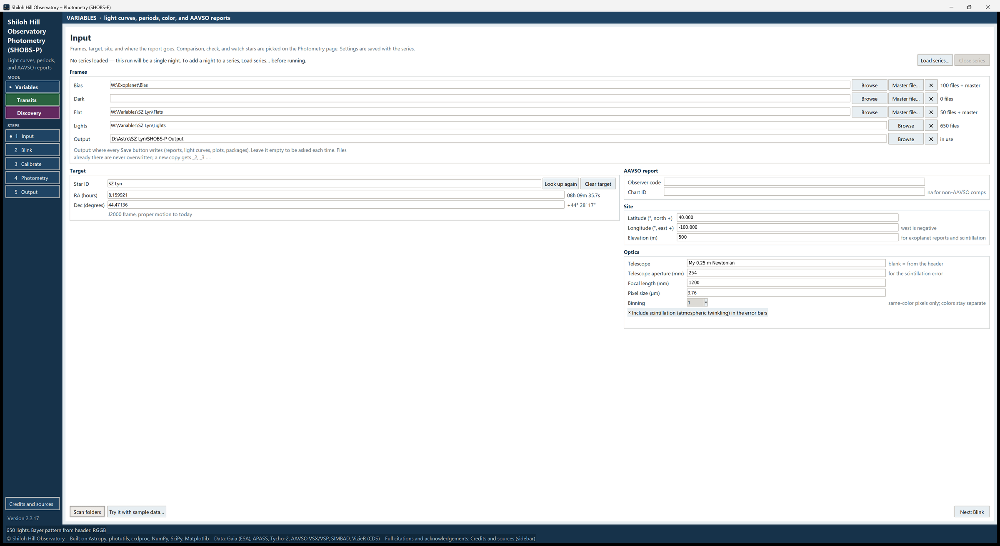

# 5. Input

The Input page is where every night starts. You tell SHOBS-P where the frames are, which star (or planet) you
observed, and where reports should go. When you press **Scan folders**, SHOBS-P reads your FITS headers and checks
that everything fits together.

## The page at a glance

From top to bottom:

- **The series line**, with **Load series…** and **Close series** on the right.
- **Frames**: five rows, **Bias**, **Dark**, **Flat**, **Lights** and **Output**.
- On the left: **Target** (Variables and Transits), **Planet (Transits)** (Transits only), or **Field center (only
  needed when the headers do not say)** (Discovery, only when needed).
- On the right: **AAVSO report**, **Site** and **Optics**.
- At the bottom: **Scan folders**, **Try it with sample data…** and **Next: Blink**.

## Choose the folders

Each row of the **Frames** box has a path box, a **Browse** button, a **✕** button that empties the row, and a count
on the right.

To choose your frames:

1. Press **Browse** on the **Bias** row and pick the folder of bias frames.
2. Do the same for **Dark**, **Flat** and **Lights**.
3. Optionally, choose an **Output** folder (see below).
4. Press **Scan folders**.

You can also type or paste a path into the box.

What the counts mean:

- **51 files**: 51 frames SHOBS-P can read.
- **51 files + master**: the folder also holds a master SHOBS-P built earlier; it will be reused if the frames have not
  changed.
- **master file**: the row points at one master file (see below).
- On the **Lights** row after scanning: **(+3 cal skipped)** means three bias, dark or flat frames were found among
  the lights and will be left out; **(12 set aside: another field)** means frames of another field were set aside (see
  "The checks SHOBS-P makes" below).

SHOBS-P reads FITS (`.fits`, `.fit`, `.fts`, also gzip and fpack-compressed) and PixInsight XISF files. If a folder
holds only files it cannot read, such as camera RAW or TIFF, the log says so.

Any of Bias, Dark and Flat may be left empty. That step is simply skipped. Press **✕** to empty a row; the status bar
says, for example, **Dark folder cleared. Calibration will skip it.**

**Using a saved master.** Bias, Dark and Flat each have a **Master file…** button. Use it to pick one master file that
SHOBS-P built on an earlier night (they are in the `SHOBS-P masters` subfolder of your calibration folders). Masters
from other programs are refused with a message explaining why.

> **Tip:** Folders are not remembered between sessions. If you reduce the same target often, load its series
> (chapter 10) instead: it brings back most of the setup.

### The Output folder

The **Output** row chooses where every Save button writes: reports, light curves, plots and packages.

- **With an Output folder**, each Save writes straight into it, without a dialog. Files already there are never
  overwritten: a new copy gets `_2`, `_3` and so on. The status bar says **Save buttons now write into …** when you
  choose it.
- **Without one**, every Save asks where to put the file.

## Name the target

In Variables and Transits mode, the **Target** box names the star you observed.

1. Click in **Star ID** and type the star's name, for example `SZ Lyn` or `HD 219134`.
2. Press **Enter** (or just click somewhere else). SHOBS-P looks the star up in SIMBAD and the AAVSO's VSX.
3. **RA (hours)** and **Dec (degrees)** fill in, with the same position in hours-minutes-seconds beside them. The
   status bar shows where they came from and, for a known variable, its VSX period and type.

Things to know:

- The lookup happens only when you press Enter or leave the box, not as you type.
- If the name is only spelled a little differently from the AAVSO's version (spaces or capitals), an orange line
  appears, such as **AAVSO spells this "HD 219134"**, with a **Use it** button. Using the AAVSO spelling keeps your
  reports matching the AAVSO's records.
- **Look up again** repeats the lookup, for example after the internet was down.
- If the lookup fails, the status bar says **Could not look up …** You can type RA and Dec yourself, or leave them
  empty and let the plate solution fill them in later.
- RA is in decimal **hours** and Dec in decimal **degrees** (J2000).

**Changing to another target.** Press **Clear target**. It empties the Star ID, RA and Dec, **and also all comparison
stars and the check star**, so nothing from the old field is carried over. Then type the new name and press Enter.

### Transits mode: the planet

In Transits mode, a **Planet (Transits)** box appears under the Target. Type the planet's name under any of its names
(for example `TrES-3 b`, `TOI-2046 b` or `KELT-16 b`) and press Enter. SHOBS-P fills in the period, the transit time,
duration, depth and shape from the NASA Exoplanet Archive, and also the host star's name and position. Chapter 16
covers this box and **Tonight's transits…** in detail.

### Discovery mode: the field center

Discovery mode has no target. SHOBS-P finds the field from the plate solution or pointing in your FITS headers. Only
if your lights have neither does a **Field center (only needed when the headers do not say)** box appear. Type roughly
where the frames point; a few arcminutes off is fine.

## The AAVSO report box

- **Observer code**: your AAVSO observer code. It goes into every AAVSO report. It is remembered between sessions,
  and saved with a series too.
- **Chart ID**: the AAVSO chart (sequence) your comparison stars come from. You usually don't need to type it: when
  you pick an AAVSO sequence star as a comparison or check star, SHOBS-P fills it in. When none of your comparison
  or check stars are AAVSO sequence stars, it is `na`.

## Site and Optics

These boxes are described in chapter 4, including the **Mount** choice. They are usually filled already: the site,
telescope, focal length, pixel size and mount are remembered, and **Scan folders** fills empty boxes from your FITS
headers.

## Press Scan folders

**Scan folders** reads your folders and the first light's FITS header. Always press it after choosing your folders.
It is what:

- counts the frames and skips calibration frames found among the lights;
- reads the Bayer pattern (or detects a monochrome camera from the flats or the lights' sky) and the filter;
- finds color images that are already debayered and asks which channel to measure;
- reads the mount from the headers when they make it clear;
- fills empty Site and Optics boxes from the header;
- runs the checks below.

When it is done, the status bar says **Folders scanned.** (or what it found).

> **Caution:** **Next: Blink** does not scan. If you skip **Scan folders**, the checks below are not made.

## The checks SHOBS-P makes on your headers

Most nights, none of these appear. When one does, read the question; each one says what Yes and No do.

**Frames of two fields in one folder.** If the Lights folder holds frames pointing at more than one place, SHOBS-P
lists them, for example "40 frames at … (OBJECT SZ Lyn)" and "12 frames at …", and asks whether to use only the frames
near your target. **Yes** sets the others aside as rejected frames; you can bring any of them back on the Blink page.

**The frames point somewhere else.** If the lights point well away from the target on the Input page (at least a degree,
and more than the frame's own size),
SHOBS-P asks whether to clear the old target and look up the star named in the frames' `OBJECT` keyword instead. Answer
**No** if you meant it (for example, the target is near the edge of a wide field); you will not be asked again for
that pair.

**A mislabeled OBJECT.** Capture programs often write a plan name or an old target name into `OBJECT`. If the frames
point at your target anyway, SHOBS-P only notes in the log that "the OBJECT keyword looks mislabeled" and carries
on. If the `OBJECT` names a different star in another place, it asks whether to switch targets (the default answer is
**No**).

**Frames from another site.** If the header's site is more than 50 km from yours, SHOBS-P asks whether to use the
site and optics in the frames for this night. This is handy for remote telescopes or a friend's data. **Yes** borrows
their setup; your own comes back automatically the next time you scan a folder of your own lights.

**Header values that differ from yours.** If the header's latitude, longitude, elevation, aperture, focal length or
pixel size differs from your boxes, SHOBS-P lists the differences and asks **Use the header values?** **No** keeps
yours, and SHOBS-P will not ask again about those same values.

**Your Site boxes are empty.** If the header has a site and yours is empty, SHOBS-P asks **Is that your own site?**
**Yes** saves it as yours; **No** uses it for these frames only.

**Monochrome camera.** If there is no Bayer keyword and the raw flats show no color mask, the status bar says
**Monochrome camera found (no color mask in the flat): Bayer pattern MONO.** Without flats, SHOBS-P tests the lights'
sky background instead (it needs bias or dark frames, or a bright sky); then the status bar says **Monochrome camera
found (no color mask in the lights' sky background): Bayer pattern MONO.** If neither can tell, SHOBS-P asks once
for these lights: **Color or monochrome camera?** If your camera really is a color camera, choose the pattern on the
Calibrate page.

**Color images, already debayered.** If the lights have three color channels, SHOBS-P asks which channel to measure:
**Green (TG)**, **Red (TR)**, **Blue (TB)** or **Luminance (CV)**. It asks once per lights folder; the status bar then
says, for example, **40 lights: color images, green (TG) channel measured.** These lights are not debayered or
calibrated again (chapter 4).

**The mount.** If the headers clearly show the mount (for example a meridian flip, or a derotator), that mount is
used for these lights, and the hint under **Mount** says so. If it differs from your **Mount** box, the hint suggests
changing the box when this is your own telescope.

**MicroObservatory frames** are recognized, and SHOBS-P offers to use that telescope's known setup for them.

**Binning.** SHOBS-P never takes **Binning** from the header: it is SHOBS-P's own setting. When your camera itself
binned the frames, the log notes it after calibration (chapter 7). Changing **Binning** after calibrating means
calibrating again; the masters must match.

## The series line

The line under the page title says which series the night will join:

- **No series loaded — this run will be a single night. To add a night to a series, Load series… before running.**
- or the name of the open series, how many nights it has, and its last date.

**Load series…** opens a series file you saved before. **Close series** puts the open series aside (the file on disk is
not changed; you are offered a save first if it has unsaved changes). Chapter 10 covers series in full.

Closing the SHOBS-P window asks the same way, but only when a series file has unsaved changes or a series of two or
more nights has never been saved: **Yes** saves first, **No** closes without saving, **Cancel** keeps SHOBS-P open.

> **Tip:** To add tonight to an existing series, load the series **before** you run photometry. After the run,
> SHOBS-P asks whether to add the night.

## Try it with sample data…

**Try it with sample data…** writes a small practice night into an empty folder you choose and fills in every box.
See chapter 2.

---

Previous: [4. Before your first night](04-before-your-first-night.md) · Next: [6. Blink](06-blink.md)
