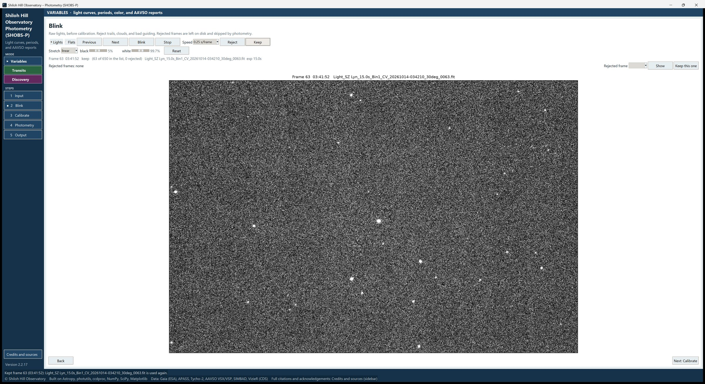
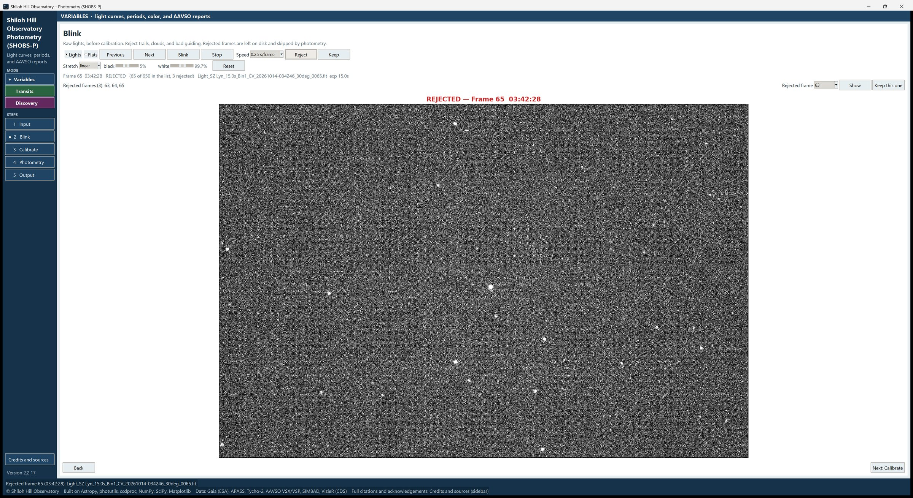

# 6. Blink

Blink shows your raw frames one after another, like a flip book, so you can spot and reject the bad ones: satellite
and aircraft trails, passing cloud, frames where the guiding slipped. Rejected frames are left on disk; SHOBS-P just
skips them.

Blink is optional. SHOBS-P also flags cloud and saturation by itself during photometry. But a minute here catches
trails and bad guiding, which the flags may not.

## The page at a glance

- **Lights** / **Flats**: which folder to show. Lights is the usual choice.
- **Previous**, **Next**: one frame back or forward.
- **Blink**, **Stop**: play the frames automatically, and stop.
- **Speed**: how long each frame stays on screen: **0.25 s/frame**, **0.5 s/frame**, **1 s/frame** or
  **2 s/frame**.
- **Reject**, **Keep**: reject the frame on screen, or bring it back.
- The **Stretch** row: how bright the picture looks (display only).
- The frame line, the rejected-frames line, and the picture.

The frames shown are **raw**: not calibrated. Hot pixels, gradients and dust shadows are normal here.

## Look through the frames

1. Go to **2 Blink** in the sidebar (or press **Next: Blink** on the Input page). The first frame appears.
2. Press **Blink** to play the frames. Press **Blink** again to pause, or **Stop** to stop.
3. Use **Previous** and **Next** to step one frame at a time. At the end, the list wraps round to the start.

SHOBS-P reads frames ahead in the background, so after the first pass, blinking is quick.

The line above the picture describes the frame on screen, for example:

    Frame 222  21:53:12   keep   (61 of 300 in the list, 3 rejected)   Light_SZ Lyn_120s_0222.fit  exp 120.0s

- **Frame 222** is the frame's own number, taken from the digits at the end of its file name. The same number is used
  in the log and in the light-curve file, so you can find a frame again later.
- **21:53:12** is the local time the exposure started.
- **keep** or **REJECTED** shows whether the frame will be used.
- **(61 of 300 in the list, …)** is its place in the list and how many frames are rejected so far.

A rejected frame's title over the picture turns red: **REJECTED — Frame 222 …**

## Reject a frame

1. Stop on the bad frame (pause with **Blink**, or use **Previous** / **Next**).
2. Press **Reject**.

The status bar confirms it, for example **Rejected frame 222 (21:53:12): Light_SZ Lyn_120s_0222.fit.** Pressing
**Reject** again on a frame that is already rejected changes nothing; it only reminds you that **Keep** brings it back.

What makes a frame worth rejecting:

- a trail across or near your target, comparison or check stars;
- obvious cloud: the stars fade or the background brightens suddenly;
- elongated or doubled stars from a guiding error or wind;
- a frame taken while the mount was still settling, for example right after a meridian flip.

Don't reject frames just because the star looks a little fainter; that may be the variation you are measuring.

> **Tip:** You may reject the frame you marked the stars on (for example all the frames before a meridian flip). The
> next photometry run then makes the first kept frame its reference and carries the markers over to it, and the log
> says so: **Reference: the frame the stars were marked on (…) is rejected, so the first kept frame (…) is the
> reference; the markers were carried over to it…**

## Bring a frame back

There are two ways:

- **The frame is on screen:** press **Keep**. The status bar says **Kept frame 222 (…): … is used again.**
- **From the list:** the line **Rejected frames (3): 63, 64, 65** lists every rejected frame by number. On the right,
  pick a number in the **Rejected frame** box, then:
  - **Show** jumps to that frame so you can look at it again;
  - **Keep this one** brings it back without showing it.

Frames set aside on the Input page (frames of another field) appear in the same list and can be brought back the same
way.

## Change how the picture looks

The **Stretch** row changes only the display. Measurements always use the original pixels.

- **Stretch**: **linear**, **log** or **asinh**. **log** and **asinh** show faint stars and the background better.
- **black**: the percentage of pixels shown as black. Raise it to darken the background.
- **white**: the percentage below which pixels are not yet pure white. Lower it to brighten faint stars.
- **Reset**: back to linear, black 5%, white 99.5%.

The stretch is remembered, separately for the Blink and Photometry pages.

## Blink the flats

Choose **Flats** at the left of the tool row to look through the flat frames the same way. This is a quick way to find
a flat with a shadow (a hand, a cable) or one taken at the wrong brightness. Flats you reject here are left out of the
master flat. The list then reads **Rejected flats …**.

## Things to know

- **Rejections are not saved on their own.** They are kept while SHOBS-P is open, and they are saved with a series
  (chapter 10). If you close SHOBS-P without saving a series, they are gone next time.
- **The Blink speed and stretch are remembered** between sessions.
- **Blink always shows what is in the folder now.** If you change the Lights folder on the Input page, Blink loads the
  new list next time you open it.
- **Rejected frames belong to their folder.** When you choose another Lights or Flat folder, the frames you rejected
  in the old one are forgotten, so a new night never starts with another night's rejections. **New reduction** on the
  Input page clears every rejected frame.

---

Previous: [5. Input](05-input.md) · Next: [7. Calibrate](07-calibrate.md)
