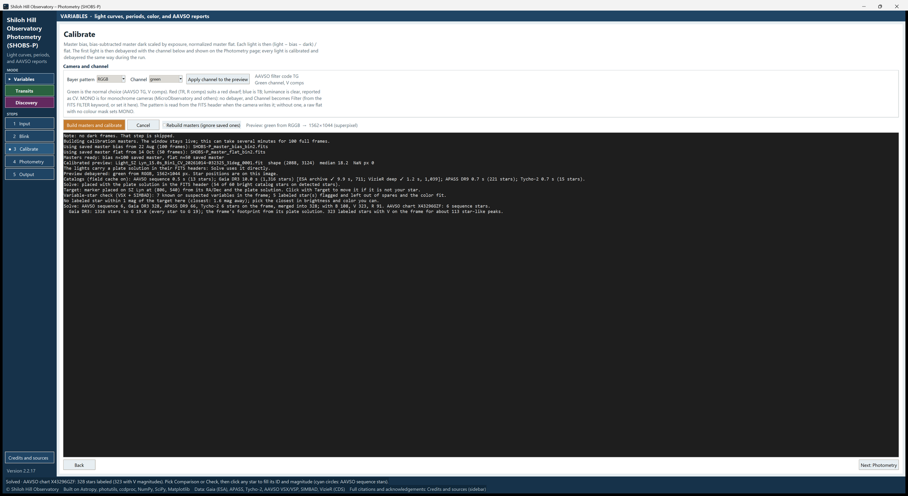

# 7. Calibrate

Calibration removes the camera's own signature from your lights: the bias pedestal, dark current, and the uneven
illumination and dust shadows that the flat records. SHOBS-P builds a master bias, dark and flat, calibrates the first
light so you can see it, and then moves on to the Photometry page by itself.

<!-- SCREENSHOT 07-calibrate-done: Variables mode, Calibrate page right after Build masters and calibrate on a real OSC night (then click back to Calibrate): Camera and channel showing RGGB / green / "AAVSO filter code TG", the Preview line ("Preview: green from RGGB → … (superpixel)"), and the log showing "Using saved master …" / "Masters ready: …" / "Preview debayered …". Whole window. -->

## Calibrate a night

1. Go to **3 Calibrate** in the sidebar (or press **Next: Calibrate** on the Blink page).
2. Check the **Camera and channel** box:
   - **Color camera**: **Bayer pattern** shows your sensor's pattern (RGGB, BGGR, GRBG or GBRG), and **Channel** is
     usually **green**.
   - **Monochrome camera**: **Bayer pattern** shows **MONO**, and **Filter** shows the filter (from the FITS header,
     or the one you chose).

   The two grey lines to the right say what will be reported, for example "AAVSO filter code TG" and "Green
   channel, V comps". Chapter 4 explains the choices.
3. Press **Build masters and calibrate**.
4. Watch the log. Building masters from scratch can take a few minutes for a hundred full frames; reusing saved
   masters takes seconds. The window stays usable meanwhile.
5. When it is done, SHOBS-P switches to the **Photometry** page by itself and starts solving the image. The status
   bar says **Calibrated and debayered. The image is being solved; …**

You normally do not need **Next: Photometry**: a successful calibration takes you there.

To stop a calibration, press **Cancel**. SHOBS-P stops after the current frame, and any masters you had before are
left unchanged.

## What happens

1. **Masters.** For each of bias, dark and flat, SHOBS-P either reuses the master it saved last time, or median-combines
   the raw frames into a new one and saves it in the `SHOBS-P masters` subfolder of that folder. The log says which,
   for example "Using saved master flat …" or "Median-combining 30 flat frames".
2. **Each light** is then calibrated as (light − bias − dark) / flat, with the dark scaled to the light's exposure.
3. **The first light** is calibrated and split into its colors (for a color camera), and shown on the Photometry page.
   The other lights are calibrated the same way, one by one, when you run photometry.

The log ends with lines such as:

    Masters ready: bias n=51 saved master, dark n=20 exp=120s, flat n=30
    Preview debayered: green from RGGB, 3120×2080 px. Star positions are on this image.

The line beside the buttons (**No preview yet.** before the first calibration) then shows the picture you will work
on, for example "Preview: green from RGGB → 3120×2080 (superpixel)".

**Why the picture is half size (color cameras).** SHOBS-P combines each 2×2 group of the color mask into one pixel
(a "superpixel"), so each color keeps its own pixels and is never mixed with its neighbors. The calibrated image is
therefore half the width and height of the raw frame. This is normal.

## Masters and reusing them

SHOBS-P reuses a saved master as long as nothing it was built from has changed: the same frames (names, sizes, dates
and count), the same **Binning**, and the same bias and dark underneath it. Change any of these and the master is
rebuilt and replaced.

- **Rebuild masters (ignore saved ones)**: tick this to force a fresh stack, for example if you replaced some frames
  and are not sure SHOBS-P noticed.
- **Binning**: masters are made for one binning. If you change **Binning** on the Input page, calibrate again; the
  masters for the other binning stay on disk for later.
- **One master file**: on the Input page, **Master file…** points a row at one master SHOBS-P built earlier, instead
  of a folder of frames.

Before using a master, SHOBS-P checks it against the lights. A master of the wrong size or binning cannot be used, and
calibration stops with a message ending "Pick the matching frames, or tick Rebuild masters." Smaller differences are
noted as cautions in the log: a different Bayer pattern, gain, offset, a sensor temperature more than 3 °C apart, a
flat taken at another rotator angle, or a flat more than 30 days from the lights.

## Changing the channel

To measure another color of a color camera, choose it in **Channel** and press **Apply channel to the preview**. The
image is split again with the new color and you go back to the Photometry page. Nothing is recalibrated, so this is
quick. The image is solved again, because it is a new picture.

## Questions you may be asked

These questions appear before the masters are built. Each one explains what **Yes** and **No** do.

**The darks don't match the lights' exposure.** If the darks are more than 3 times shorter or longer than the lights,
SHOBS-P asks:

- **Yes**: calibrate without the dark this time (bias only). A cooled camera's dark current is usually tiny, and the
  bias still removes the pedestal.
- **No**: use these darks anyway, scaled.
- **Cancel**: stop, so you can choose darks closer to the lights' exposure.

**The flats were taken at another camera angle.** If your headers record the rotator angle and the flats differ from
the lights by more than 2°, SHOBS-P asks whether to calibrate with them anyway. **No** stops, so you can pick flats
taken at the lights' angle or clear the **Flat** row. A meridian flip does not count as a different angle (chapter 4).

**The Flat folder mixes camera angles.** One master built from flats at several angles matches none of them exactly.
**No** stops so you can keep only the flats taken at the lights' angle.

**The lights look already calibrated.** If the lights were calibrated by another program (file names with `cal` or
PixInsight's `_c`, floating-point pixels, or calibration keywords in the header), SHOBS-P asks **Skip bias, dark, and
flat for this run? (Recommended)**. Answer **Yes**; otherwise the bias and dark are taken out twice and the flat is
divided in twice.

**Some files can't be read.** If a folder holds files SHOBS-P cannot read (RAW, TIFF, JPEG), it lists them and asks
whether to calibrate without that step. If no light can be read, it stops.

## Messages in the log

You may see these after calibration. None stops you; they explain what SHOBS-P noticed.

- **"Flats look already calibrated …: used as they are"**: your flats came from another program already calibrated;
  SHOBS-P does not subtract bias or dark from them again.
- **"Meridian flip before frame 222 (30° to 210°) …"**: the rotator reading changed by 180° at a flip. The same flats
  fit both sides. Each star may show a small step at the flip; SHOBS-P lines this up later.
- **"Note: the camera rotator moved during these lights …"**: the camera really turned during the night. One set of
  flats can only match one angle, so expect steps in the light curve there.
- **"Note: the camera binned these frames (XBINNING=2) …"**: your camera did the binning. Some capture programs mix
  red, green and blue when they bin a color sensor; capture unbinned and set **Binning** in SHOBS-P instead.
- **"The lights carry a plate solution in their FITS headers: Solve uses it directly."**: good news; the solve will
  be quick.
- **"Caution: the FITS FILTER is 'Ha', which SHOBS-P cannot calibrate …"**: see chapter 4, "Filters SHOBS-P cannot
  use".

## When calibration fails

A window says **Calibration failed:** and the reason. The most common ones:

| Message | What to do |
|---|---|
| **No light frames found.** | Check the **Lights** row on the Input page, and that the frames are FITS or XISF. |
| **The masters do not fit these lights: …** | A master of another size or binning. Pick the matching calibration frames, set **Binning** back, or tick **Rebuild masters (ignore saved ones)**. |
| **… is not a master SHOBS-P built.** | You chose another program's master with **Master file…**. Choose the folder of raw frames instead. |

The full details are always in the log on this page.

> **Caution:** A monochrome camera that writes no Bayer keyword, with no flats in the **Flat** row, cannot be detected.
> The pattern then stays at **RGGB** and every frame is split as if it had a color mask. Set **Bayer pattern** to
> **MONO** before calibrating.

---

Previous: [6. Blink](06-blink.md) · Next: [8. Photometry page basics](08-photometry-basics.md)
