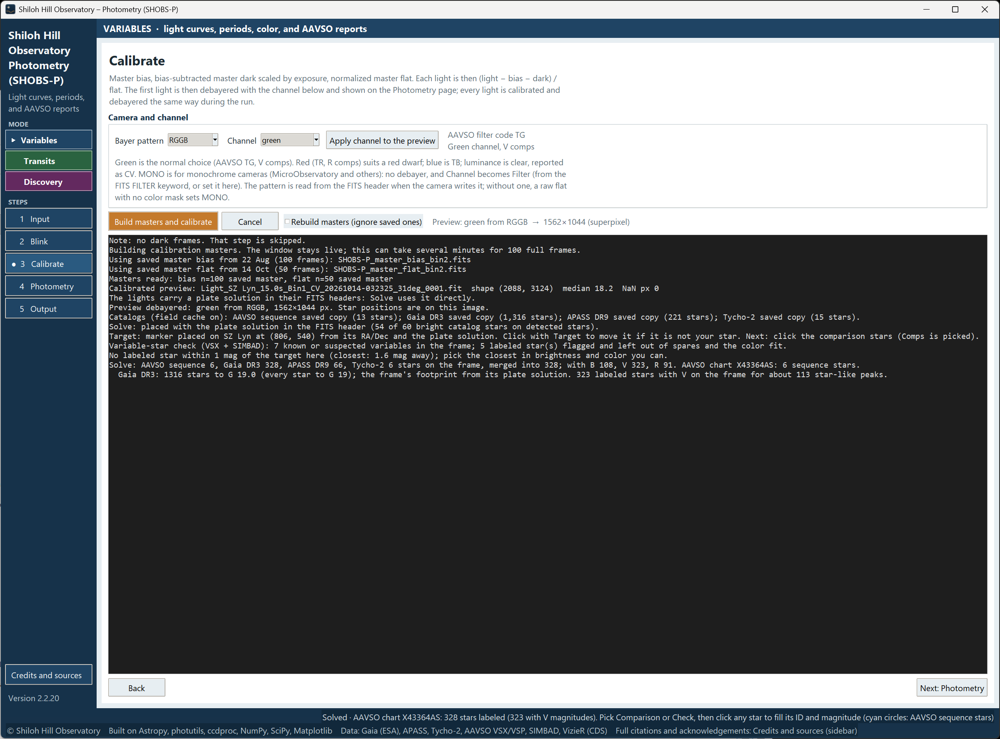

# 7. Calibrate

Calibration removes the camera's own signature from your lights: the bias pedestal, dark current, and the uneven
illumination and dust shadows that the flat records. SHOBS-P builds a master bias, dark, dark flat and flat (from the
rows you filled in), calibrates the first light so you can see it, and then moves on to the Photometry page by itself.

## Calibrate a night

1. Go to **3 Calibrate** in the sidebar (or press **Next: Calibrate** on the Blink page).
2. Check the **Camera and channel** box:
   - **Color camera**: **Bayer pattern** shows your sensor's pattern (RGGB, BGGR, GRBG or GBRG), and **Channel** is
     usually **green**.
   - **Monochrome camera**: **Bayer pattern** shows **MONO**, and **Filter** shows the filter (from the FITS header,
     or the one you chose).
   - **Color images that are already debayered** (three channels): **Bayer pattern** shows **MONO**, and **Filter**
     shows the channel you chose when you scanned the folders (see "Already-debayered color images" below).

   The two gray lines to the right say what will be reported, for example "AAVSO filter code TG" and "Green
   channel, V comps". Chapter 4 explains the choices.
3. Press **Build masters and calibrate**.
4. Watch the log, and the busy bar at the bottom of the window (chapter 3). Its words follow the steps:
   **Building calibration masters…**, then for example **Building calibration masters: median-combining 40 bias
   frames…** (and the same for the darks and flats), then **Calibrating the first light…**. Building masters from
   scratch can take a few minutes for a hundred full frames; reusing saved masters takes seconds. The window stays
   usable meanwhile.
5. When it is done, SHOBS-P switches to the **Photometry** page by itself and starts solving the image. The status
   bar says **Calibrated and debayered. The image is being solved; …**

You normally do not need **Next: Photometry**: a successful calibration takes you there.

To stop a calibration, press **Cancel**. SHOBS-P stops after the current frame, and any masters you had before are
left unchanged.

## What happens

1. **The plan.** Before the masters are built, one log line says how the lights and flats will be calibrated, for
   example *"Calibration: lights = light − dark (the darks match the lights' exposure, so no bias is needed); flats =
   flat − dark flat."* Indented notes and ⚠ warnings may follow it (see "Dark flats" below).
2. **Masters.** For each of bias, dark, dark flat and flat, SHOBS-P either reuses the master it saved last time, or
   median-combines the raw frames into a new one and saves it in the `SHOBS-P masters` subfolder of that folder. The
   log says which, for example "Using saved master flat …" or "Median-combining 30 flat frames".
3. **Each light** is then calibrated as (light − bias − dark) / flat, with the dark scaled to the light's exposure.
   Without bias frames, the dark flats take the bias's place (below).
4. **The first light** is calibrated and split into its colors (for a color camera), and shown on the Photometry page.
   The other lights are calibrated the same way, one by one, when you run photometry.

The log ends with lines such as:

    Masters ready: bias n=51 saved master, dark n=20 exp=120s, flat n=30
    Preview debayered: green from RGGB, 3120×2080 px. Star positions are on this image.

The line beside the buttons (**No preview yet.** before the first calibration) then shows the picture you will work
on, for example "Preview: green from RGGB → 3120×2080 (superpixel)".

**Why the picture is half size (color cameras).** SHOBS-P combines each 2×2 group of the color mask into one pixel
(a "superpixel"), so each color keeps its own pixels and is never mixed with its neighbors. The calibrated image is
therefore half the width and height of the raw frame. This is normal.

## Masters and reusing them

SHOBS-P reuses a saved master as long as nothing it was built from has changed: the same frames (names, sizes, dates
and count), the same **Binning**, and the same bias and dark underneath it. Change any of these and the master is
rebuilt and replaced.

- **Rebuild masters (ignore saved ones)**: tick this to force a fresh stack, for example if you replaced some frames
  and are not sure SHOBS-P noticed.
- **Binning**: masters are made for one binning. If you change **Binning** on the Input page, calibrate again; the
  masters for the other binning stay on disk for later.
- **One master file**: on the Input page, **Master file…** points a row at one master SHOBS-P built earlier, instead
  of a folder of frames.

Before using a master, SHOBS-P checks it against the lights. A master of the wrong size or binning cannot be used, and
calibration stops with a message ending "Pick the matching frames, or tick Rebuild masters." Smaller differences are
noted as cautions in the log: a different Bayer pattern, gain, offset, a sensor temperature more than 3 °C apart, a
flat taken at another rotator angle, or a flat more than 30 days from the lights.

## Dark flats

Dark flats are darks taken at the flats' exposure. Many capture programs offer them in place of bias frames. Put them
in the **Dark flats** row on the Input page (chapter 5). The row is optional: with bias, darks and flats and no dark
flats, nothing changes.

What SHOBS-P does with them:

- **Flats**: each flat becomes flat − dark flat, exactly.
- **No bias frames**: the dark flats also stand in for the bias (the camera's zero-exposure offset).
  - With darks that match the lights' exposure, the lights become light − dark exactly, with no warning.
  - With darks that must be scaled, the lights become light − dark flat − (dark − dark flat) × t_light / t_dark, so
    only the darks' own signal is scaled. The log says so in a note under the "Calibration:" line.
  - The log line "Note: no bias frames. That step is skipped." does not appear when dark flats are given.
- **Bias and dark flats both given**: the dark flats are used for the flats, and the bias for the lights and darks.
  The log says *"Bias and dark flats are both given: …"*.
- **Flats that are already calibrated** (for example PixInsight `_c` files): the dark flats are not used, and the log
  says so.

The master is saved as `SHOBS-P masters/SHOBS-P_master_darkflat_bin<b>_<exp>s.fits` in the dark-flat folder and reused
like the other masters; **Master file…** on the row takes this file. A master flat built with dark flats is reused only
with the same dark flats. The log says, for example, "Median-combining 15 dark flat frames" and "Saved master dark flat
in the dark flat folder's 'SHOBS-P masters' subfolder: …", or "Using saved master dark flat …".

**Dark flats in the Flat folder.** Some programs save the dark flats beside the flats. SHOBS-P knows a dark flat by
its IMAGETYP header ('Dark Flat', 'DARKFLAT', 'Flat Dark', 'FLATDARK', 'Dark-Flat', 'dark_flat' and the like, in any
case) or, with no IMAGETYP, by "darkflat" or "flatdark" in the file name. Such frames are never stacked into the master
flat. With the Dark flats row empty, they are used as the dark flats: *"4 dark flats found in the Flat folder (IMAGETYP
or name): used as the dark flats, and left out of the master flat."* Blink's **Flats** view leaves them out too
(chapter 6).

**Dark flats in the Bias row.** The older way, dark flats put in the **Bias** row, still works exactly as before. When
the Bias row's frames say they are dark flats (IMAGETYP), the log adds a note that the **Dark flats** row is now the
place for them.

**No bias and no dark flats.** A dark scaled to another exposure also scales the camera's offset it holds, so the wrong
amount of offset comes off. SHOBS-P warns about it on the Input page (chapter 5) and in the log, for example:

- *"⚠ Darks can't be scaled correctly without bias or dark flats. The darks (110 s) are scaled ×0.5 to the lights
  (55 s), and the camera's offset (pedestal) inside them is scaled too, … Add bias frames or dark flats, or use 55 s
  darks."*
- *"⚠ The flats (0.5 s) get the master dark (55 s) scaled ×0.00909, and with no bias that scales the camera's offset
  too, so the wrong amount of offset comes off and the master flat is wrong. Put dark flats (darks at the flats'
  exposure) in the Dark flats box, or add bias frames."*

And when the dark flats do not match the flats: *"⚠ The dark flats are 2 s and the flats 0.5 s. Dark flats should
match the flats' exposure; … Take dark flats at 0.5 s."*

## Camera binning and the gain

SHOBS-P works out each point's error bar from the photons it collected, so it needs to know how many electrons one
image unit holds. It starts from the camera gain in the headers (EGAIN, in electrons per ADU).

When the **camera** binned the frames (XBINNING above 1), that is not the whole story. EGAIN is the gain of one native
pixel, and capture programs write the same value at every binning. Some cameras (CCDs) **sum** the binned pixels,
and then EGAIN is right as it is. Many CMOS cameras **average** them instead: a stored ADU of a 3×3-binned frame then
holds 9 × EGAIN electrons. Used as it is, EGAIN would make the error bars about 2–3 times too big (and the transit
fit's reduced χ² well under 1).

SHOBS-P tells the two apart from the sky's own noise, which it always measures on the reference frame. The log's
**Photon noise:** line then adds one sentence, for example:

- *"The camera binned 3x3 and averaged the binned pixels (the sky's noise says so), so each stored ADU holds 9 x
  EGAIN electrons: about 6.91 electrons per image unit."*
- *"The camera binned 2x2 and summed the binned pixels (the sky's noise says so): EGAIN is used as it is."*
- With no sky estimate: *"The camera binned 3x3; with no sky estimate SHOBS-P cannot tell whether it summed (EGAIN as
  it is, used) or averaged (9 x EGAIN) the binned pixels. If the Transit fit's reduced chi-square is well under 1, the
  camera averaged."*

The Transit fit's settings record then says, for example, *"Gain 0.768 e-/ADU (header EGAIN); camera bin 3x3
averaged, so 6.91 e- per stored ADU used (from the sky's noise)"*. SHOBS-P's own **Binning** box (processing bin) was
already handled correctly, and unbinned cameras, mono or color, are not affected at all. Nights reduced before 2.3.0
keep their old error bars until you reduce them again.

## Changing the channel

To measure another color of a color camera, choose it in **Channel** and press **Apply channel to the preview**. The
image is split again with the new color and you go back to the Photometry page. Nothing is recalibrated, so this is
quick. The image is solved again, because it is a new picture.

## Already-debayered color images

When the lights are color images that another program already debayered and calibrated, SHOBS-P skips the debayer and
the calibration for them. The log says **These lights are color images (already debayered and calibrated): the bias,
dark and flat entries are not used for them.** No question is asked.

The **Filter** box chooses the channel: **Green imaging (TG)**, **Red imaging (TR)**, **Blue imaging (TB)** or
**Clear / L (CV)** (luminance). Pick another one and press **Build masters and calibrate** again to see it in the
preview. While a step is running the channel cannot change; the log says **The channel of the color images cannot
change while a step is running; choose it again when it has finished.** A Bayer pattern picked for these lights is
put back to **MONO**, because it would debayer them a second time.

## Questions you may be asked

These questions appear before the masters are built. Each one explains what **Yes** and **No** do.

**Calibration frames in the Lights folder.** Some downloads (MicroObservatory's, for example) put the darks in with
the lights. When bias, dark or flat frames are found in the Lights folder and the matching row on the Input page is
empty, SHOBS-P asks, for example:

> 2 dark frames (60 s) are in the Lights folder, and the Dark box is empty.
>
> Use them as darks? (Yes: used for this run; the files stay where they are. No: the run goes on without them.)

The answer is kept for that folder, so you are asked once. Frames you rejected in Blink stay out. Dark-flats are never
taken as flats (or as darks). A master made by another program in the Lights folder is not used, and the log says why.

**The darks don't match the lights' exposure.** If the darks are more than 3 times shorter or longer than the lights,
SHOBS-P asks (the Input page already warned you, chapter 5):

- **Yes**: calibrate without the dark this time (bias only). A cooled camera's dark current is usually tiny, and the
  bias still removes the pedestal.
- **No**: use these darks anyway, scaled.
- **Cancel**: stop, so you can choose darks closer to the lights' exposure.

**The flats were taken at another camera angle.** If your headers record the rotator angle and the flats differ from
the lights by more than 2°, SHOBS-P asks whether to calibrate with them anyway. **No** stops, so you can pick flats
taken at the lights' angle or clear the **Flat** row. On a German equatorial mount a meridian flip does not count as a
different angle (chapter 4).

On an **alt-az** mount without a derotator there is no flip, so readings 180° apart are a real turn; SHOBS-P asks when
the flats and lights are more than 5° apart. With a derotator it never asks: the log says **Caution: flats taken with
the derotator at sky angle …** and explains that this is fine.

**The Flat folder mixes camera angles.** One master built from flats at several angles matches none of them exactly.
**No** stops so you can keep only the flats taken at the lights' angle.

**The lights look already calibrated.** If the lights were calibrated by another program (file names with `cal` or
PixInsight's `_c`, floating-point pixels, or calibration keywords in the header), SHOBS-P asks **Skip bias, dark, and
flat for this run? (Recommended)**. Answer **Yes**; otherwise the bias and dark are taken out twice and the flat is
divided in twice.

**Some files can't be read.** If a folder holds files SHOBS-P cannot read (RAW, TIFF, JPEG), it lists them and asks
whether to calibrate without that step. If no light can be read, it stops.

## Messages in the log

You may see these after calibration. None stops you; they explain what SHOBS-P noticed.

- **"Calibration: lights = …; flats = …"**: how the lights and flats are calibrated, from the rows you filled in (see
  "Dark flats" above). Any ⚠ under it says what to add.
- **"Flats look already calibrated …: used as they are"**: your flats came from another program already calibrated;
  SHOBS-P does not subtract bias, dark or dark flats from them again.
- **"Meridian flip before frame 222 (30° to 210°) …"**: the rotator reading changed by 180° at a flip. The same flats
  fit both sides. Each star may show a small step at the flip; SHOBS-P lines this up later.
- **"Note: the camera rotator moved during these lights …"**: the camera really turned during the night. One set of
  flats can only match one angle, so expect steps in the light curve there. On an alt-az mount every change over 2°
  counts as a move, never as a flip.
- **"Mount: Alt-az …"** (written when you scan the folders): which mount is used for these lights, and whether it came
  from the headers or the **Mount** box.
- **"Zenith keyhole: the field reached altitude …"** (also written at the scan): on an alt-az mount the field went above 85°, where the mount's
  azimuth speed and the field rotation get extreme. Check those frames on the Blink page.
- **"Note: the camera binned these frames (XBINNING=2) …"**: your color camera did the binning. Some capture
  programs mix red, green and blue when they bin a color sensor; capture unbinned and set **Binning** in SHOBS-P
  instead. (Not shown for MicroObservatory frames, which are binned by design, or for a monochrome camera.)
- **"The lights carry a plate solution in their FITS headers: Solve uses it directly."**: good news; the solve will
  be quick.
- **"Caution: the FITS FILTER is 'Ha', which SHOBS-P cannot calibrate …"**: see chapter 4, "Filters SHOBS-P cannot
  use".

## When calibration fails

A window says what went wrong. It starts **Calibration failed:**, and the same line goes into the log. The most
common messages:

| Message | What to do |
|---|---|
| **No light frames found.** | Check the **Lights** row on the Input page, and that the frames are FITS or XISF. |
| **The masters do not fit these lights: …** | A master of another size or binning. Pick the matching calibration frames, set **Binning** back, or tick **Rebuild masters (ignore saved ones)**. |
| **… is not a master SHOBS-P built.** | A row points at another program's master. Choose the folder of raw frames instead. |
| **… is a master dark, not a master flat.** (or similar) | A row points at the wrong kind of master. Pick the right one with **Master file…**. |

The full details are always in the log on this page.

> **Caution:** A monochrome camera that writes no Bayer keyword and has no flats is detected from the lights' sky
> background, which needs bias or dark frames (or a bright sky). If SHOBS-P still cannot tell, it asks **Color or
> monochrome camera?** when you press **Scan folders**. If you skipped the scan, check that **Bayer pattern** says
> **MONO** before calibrating; otherwise every frame is split as if it had a color mask.

---

Previous: [6. Blink](06-blink.md) · Next: [8. Photometry page basics](08-photometry-basics.md)
