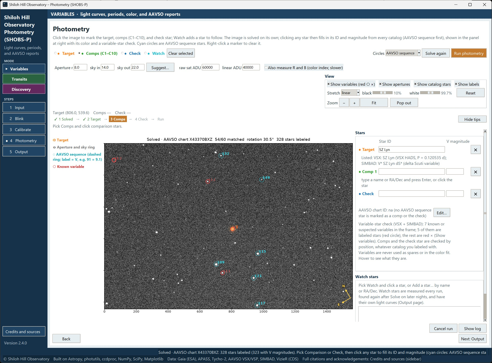
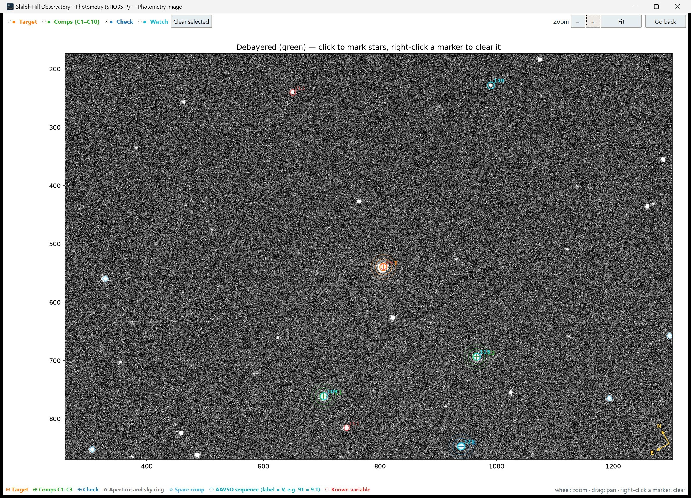
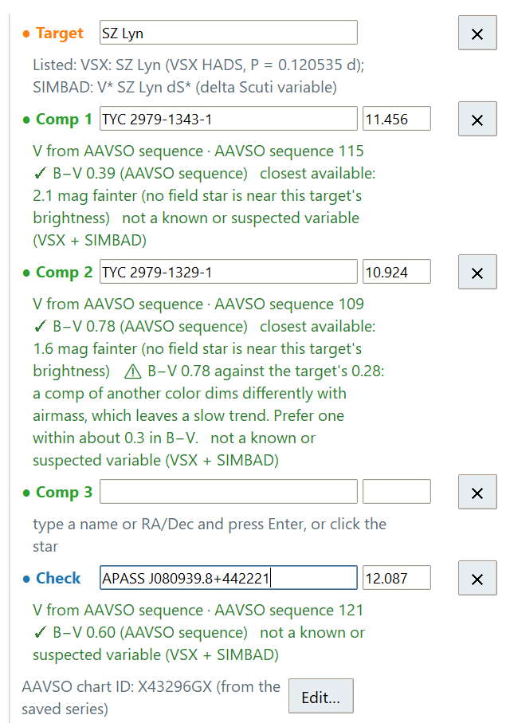
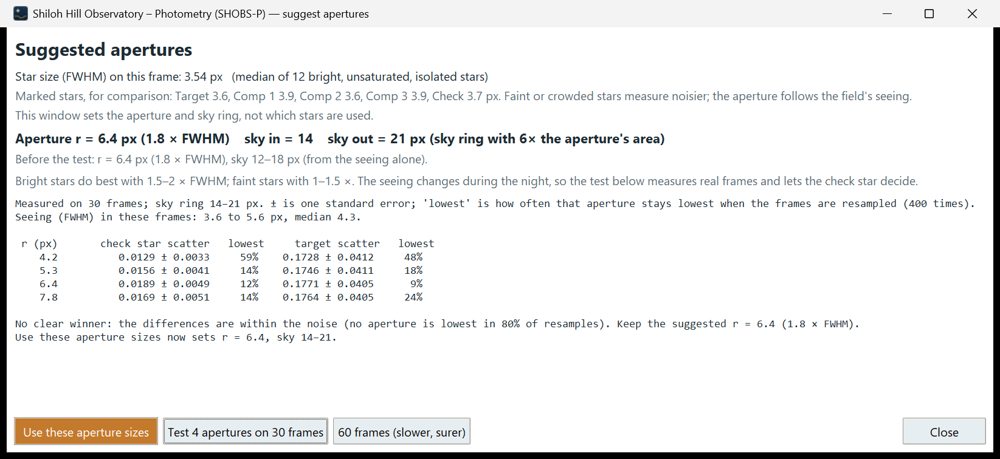
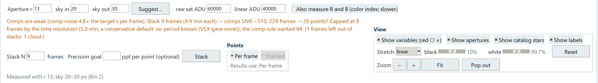
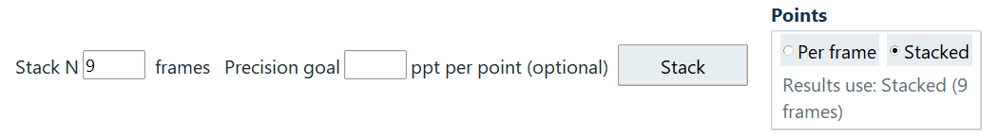

# 8. Photometry page basics

The Photometry page is where you choose which stars to measure and then measure them on every frame. This chapter
covers what works the same in every mode: the automatic solve, the image view, marking stars, apertures, and running
photometry, and stacking frames when the comparison stars are weak. Choosing good comparison stars for a variable is
in chapter 9; transits are in chapters 16 and 17; Discovery's **Scan field** is in chapter 20.

## The page at a glance

From top to bottom:

- **The tools row.** On the left, what a click on the image does: **● Target**, **● Comps (C1–C10)**, **● Check**,
  **● Watch**, and **Clear selected**. On the right: **Circles**, **Solve again** and the orange **Run photometry**
  button.
- **The options row.** On the left, one line under the Target line, the aperture boxes **Aperture r**, **sky in** and
  **sky out**, the **Suggest…** button, **raw sat ADU**, **linear ADU**, and **Also measure R and B (color index;
  slower)**. On the right, the **View** box. Under the aperture boxes, beside the View box, these lines appear only
  when they have something to say (when the window is narrow and the View box moves to a line of its own, they go on
  that line, left of the View box, if they fit there):
  - **The Stack row** (after the first run only): a suggestion line, then **Stack N** [box] **frames   Precision
    goal** [box] **ppt per point (optional)**, the **Stack** button and the small **Points** box (see "Stacking when
    comps are weak" below).
  - **The "Measured with" line**: after a run, a gray line says what the photometry was measured with (see
    "Apertures" below).
  - An orange line when the run skipped frames or left a comp out of some frames (see "Comps near the frame edge"
    below).
- **The step strip**: what is done and what to do next.
- **The image** on the left, with its legend in a column at its left, and the **Stars** and **Watch stars** panels on the right.
- **The run row**: a gray line with the last run's summary (for example "Photometry done in 1:52. 38 points."),
  **Cancel run**, and **Show log** / **Hide log**. The log is hidden at first (from 2.4.0); **Show log** puts it
  under this row, and your choice is remembered. While a run is going, its progress is on the busy bar at the bottom
  of the window (chapter 3).
- **Back** and **Next: Output** at the bottom.

In Discovery mode the page is called **Photometry: field scan**, the left of the tools row reads **Click a star to**
**● Watch it** / **✕ Exclude it**, and **Scan field** replaces **Run photometry**.

## The image solves itself

You don't need to press anything to solve the image. As soon as the page opens with a freshly calibrated image,
SHOBS-P:

1. works out where the frame points: from the plate solution in the FITS header if there is one, otherwise from the
   target's RA and Dec on the Input page (or the header's pointing), and matches the star pattern;
2. asks every catalog at once (the AAVSO comparison-star sequence, Gaia DR3, APASS and Tycho-2) and merges them into
   one list of stars;
3. checks the field against VSX and SIMBAD for known and suspected variables;
4. places the **Target** marker on your target, if the Input page gives its position.

While it works, the busy bar at the bottom of the window (chapter 3) says what the solve is doing. It starts with,
for example, **Solving: fetching AAVSO, Gaia, APASS and Tycho stars (…′ field, V band)…**, then ticks off each catalog
as it answers: **Solving: fetching catalogs: AAVSO ✓ APASS ✓ Tycho ✓ Gaia…**. On a hard field you may also see
**Solving: only N stars on this frame, stacking M frames to find more…**, **Solving: no lock at the target marker,
trying N nearby stars as the target…** or **Solving the field from star patterns…**. You can start marking stars once
the AAVSO sequence and APASS are in; Gaia's faint stars finish in the background.

The first label of the step strip shows how it went: **1 Solving…**, **✓ 1 Solved** or **1 Not solved**.

When solved, the title over the image reads, for example, "Solved · AAVSO chart X12345ABC 43/60 matched rotation
12.3° …", and a small yellow **N** and **E** compass appears in a corner. Before a solve, the corner says
**N/E: orientation unknown until the image is solved**.

**Solve again** repeats the solve, for example after a catalog did not answer, or after you corrected the focal
length.

**When only two catalog stars line up.** On a sparse field (a small frame, or a short exposure) the catalogs may have
only two stars on the frame, and two stars can line up by chance. SHOBS-P then asks, on every solve (also the one that
runs by itself when the page opens): *"The catalogs have only 2 stars here, and both lined up … Are they on real
stars?"* Look at the circles. **On real stars: keep the solve** keeps it; **Not sure: discard it** (the default) drops
the solve and any markers it placed, so nothing is measured at the wrong spots. Then **Solve again**, or click the
stars and type their magnitudes.

**When the header's plate solution disagrees with the Target marker.** If the FITS header carries a plate solution
and it puts your target well away from the Target marker, SHOBS-P asks **Move the Target marker to where the plate
solution puts …?** **Keep it where it is** is the default; **Move it there** moves the marker.

**When the AAVSO sequence is slow.** The AAVSO chart server (VSP, at apps.aavso.org) sometimes answers late or not at
all. SHOBS-P does not hold up the solve for it: it asks again in the background a few times, and the log says exactly
what happened, for example "AAVSO sequence did not answer (503 from apps.aavso.org); asking again in the background
(…)". If it answers later, the log says so and the status bar says **The AAVSO sequence answered after the solve:
Solve again to use it.** Press **Solve again**; the sequence is used at once, with no new request.

**When the target is not on the first frame.** Sometimes the first frames miss the target, for example while the
telescope was still settling. If the plate solution puts the target off the first frame, SHOBS-P looks at the next
frames (up to 10) for the first one that holds it, without solving each one (the busy bar says, for example,
**Looking for SZ Lyn on the next frames… 3 of 10**). That frame becomes the reference: the
image is solved again and the Target marker placed. The log says, for example, "Target: SZ Lyn is on frame 6 (…), not
on frames 1–5. Frame 6 is the reference now; the run skips the 5 frames without SZ Lyn and lists every frame that
misses it." If it cannot find the target, the log says to reject the frames without it in Blink and calibrate again.

> **Tip:** A solve needs only a rough idea of where the frame points: the target's name looked up on the Input page
> is enough. Frames without a plate solution or RA/Dec in their headers are fine.

### When the image is not solved

The automatic solve stays quiet when it fails: the step strip shows **1 Not solved** and the log says why. Press
**Solve again** to see the full explanation in a window. The usual causes:

| What you see | What to do |
|---|---|
| **Solve needs to know roughly where the frame is: …** | Your headers give no position and the Input page has no RA/Dec. Type the target's name on the Input page and press Enter (or, in Discovery, the field center), then **Solve again**. |
| **Star catalogs did not answer, so the frame could not be solved …** with *"Gaia DR3 (HTTP 503) and APASS DR9 (no stars came back) did not answer: a catalog service outage …"* | A catalog server is down (not your settings). **Solve again** in a few minutes. Meanwhile you can mark stars and type comp and check magnitudes by hand. |
| **The catalog stars did not lock onto this frame …** | Usually wrong optics. Check **Focal length (mm)**, **Pixel size (µm)** and **Binning** on the Input page; the window shows the plate scale it used. Also check that the **Target** marker is on your star. |
| "Only N stars were found on this frame" (in the same window) | Very short exposures or a small telescope. Mark the stars by hand and type their names and magnitudes. |
| **Not solved: the catalog request failed.** | The internet or a catalog server was down. **Solve again** later. |

You can still mark stars on an image that is not solved; their names and magnitudes fill in as soon as a solve
succeeds. Or type the magnitudes yourself.

### The Circles box

Every catalog is always used. The **Circles** box only chooses whose circles are drawn on the image: **AAVSO
sequence**, **Gaia DR3**, **APASS DR9** or **Tycho-2**. Where a field has no AAVSO sequence (most exoplanet hosts), SHOBS-P draws another
catalog's circles instead, and the legend says so.

## The image view

### Zoom and pan

- **Mouse wheel** over the image zooms in and out around the pointer.
- **Drag** with the left mouse button to pan.
- In the **View** box: **−** and **+** zoom around the middle of the view, and **Fit** shows the whole frame.

Zoom and pan stay as they are while you mark stars or change the display. Only a new image (a new calibration, binning
or channel) goes back to the whole frame.

On a trackpad without a wheel, use **−**, **+** and **Fit**, or pop the image out.

### Pop out the image

Press **Pop out** in the **View** box to put the image in its own window, which you can make as large as you like or
move to a second monitor. The window has the same **● Target**, **● Comps (C1–C10)**, **● Check**, **● Watch** and
**Clear selected** controls, and **Zoom**, **−**, **+**, **Fit** and **Go back**. The **+** and **−** keys also zoom
there.

**Small image?** On a small frame (MicroObservatory's, for example), or with Windows display scaling at 125 % or 150 %,
the image area can get short and wide. SHOBS-P then gives the image room first: the log under it, when it is shown,
shrinks (down to 3 lines). If the image is still small, press **Pop out** in the View box, or **Hide log**. (Up to 2.3.1 a line under
the image said so; from 2.3.2 that line is gone, so the image gets its height.)

While the image is out, the page shows **Image is in its own window (Bring back in the View box).** and the **Pop out**
button reads **Bring back**. The image comes back when you press **Go back** or **Bring back**, close the window,
start a run, switch modes or leave the Photometry page. SHOBS-P remembers where you put the window.

### What you can show

The **View** box has four switches:

- **Show variables (red ○ ×)**: known and suspected variables from VSX and SIMBAD. A red circle is a catalog star
  that is a variable; a red × is a variable with no catalog circle.
- **Show apertures**: the measuring circle and sky ring around each marked star.
- **Show catalog stars**: the catalog circles.
- **Show labels**: the labels next to circles, and the compass.

(Discovery adds **Suspects only**; see chapter 20.)

Under the switches are the same **Stretch**, **black**, **white** and **Reset** controls as on the Blink page
(chapter 6). They change only the display.

### What the marks mean

The legend at the left of the image (one entry per line) lists only the marks drawn right now. The most common:

| Mark | Meaning |
|---|---|
| Orange **+** with **T** | the target |
| Green **+** with **C1**, **C2** … | comparison stars |
| Blue **+** with **K** | the check star |
| Solid, dashed and dotted rings around a marked star | the aperture, and the inner and outer edges of the sky ring |
| Thin dashed cyan ring with a number | an AAVSO sequence star; the number is its V magnitude without the decimal point (91 = V 9.1) |
| Yellow circle | a star of the catalog chosen in **Circles** |
| Thick green ring with **S1**, **S2** … | a suggested comparison star |
| Small light-blue diamond | a spare comparison star SHOBS-P picked |
| Cyan diamond with **W** | a watch star |

Hold the pointer over any star to see a small box with its name, catalog magnitudes, color and pixel position, and
a warning if it is a known variable.

Suggested comps and AAVSO sequence stars are easy to mix up on a busy field: the legend names both, the suggested comp
as a thick solid ring labeled S1, S2 … and the sequence star as a thin dashed ring labeled with its V (91 = V 9.1).
(Before 2.3.5 a second, smaller key on the image itself repeated these two entries.)

## The step strip

The step strip under the options row shows your progress: **1 Solve → 2 Target → 3 Comps → 4 Check → Run**
(Discovery: **1 Solve → 2 Scan field**). Done steps get a ✓. The line under it says what to do now, for example
**Solved. Pick Target and click the target star.** and finally **Ready: Run photometry.**

**Hide tips** hides the strip once you know your way around; **Show tips** brings it back. SHOBS-P remembers your
choice.

## Mark the stars

You mark stars by choosing what a click means (**● Target**, **● Comps (C1–C10)**, **● Check** or **● Watch**), then
clicking the star on the image.

### The target

If the Input page knows your target's position, SHOBS-P puts the **Target** marker on it after the solve, and the log
says "Target: marker placed on … Click with Target to move it if it is not your star." Check it is the right star.

In Variables and Transits mode, the click choice then moves on to **● Comps (C1–C10)** by itself, and the log adds
"Next: click the comparison stars (Comps is picked)." If you already picked a choice yourself on this image, SHOBS-P
leaves it alone.

To place or move it by hand: choose **● Target** and click the star.

The target's name in the **Stars** panel is the **Star ID** from the Input page. Clicking does not change it.

### Comparison stars and the check star

1. Choose **● Comps (C1–C10)** and click a comparison star. It becomes **Comp 1** (C1 on the image). Click more stars
   to add Comp 2, Comp 3 and so on, up to ten.
2. Choose **● Check** and click a check star: a steady star that is not one of the comps. It tests whether the comps
   are behaving.

Each click snaps the marker onto the star nearest to where you clicked. For comps and the check star, SHOBS-P also
finds the star from a little further out, so a click that is a few pixels off still lands on the star's center. The
status bar says, for example, " Centered on the star (2.3 px from the click)." If there is no star there, it says
" No star found right at the click; the marker is where you clicked." Watch for that one.

**How names and magnitudes fill in.** On a solved image, clicking a comp or the check star fills its row in the
**Stars** panel: the star's name and its catalog magnitude in the band you are
measuring (the column header says which, for example **V magnitude**). AAVSO sequence magnitudes are used first, then
APASS, Gaia and Tycho-2.

**Which name a star gets (from 2.4.0).** A star usually has several names, one per catalog. SHOBS-P shows one, always
in the same order of preference: its AAVSO identifier (AUID) or chart label when it is an AAVSO sequence star, then its
Tycho name (TYC), then its Gaia DR3 name, then its APASS name. So the name no longer depends on which catalog answered
first that night. A star an open series already knows keeps the series' name: the series knows its stars by sky
position, and tonight's catalog name for the same star (within about 1″) is only another name for it.

**The name goes by brightness, not just by the nearest catalog position (from 2.4.0).** When the catalog star nearest
to your marker is not right under it, SHOBS-P compares how bright the star reads on the image with each nearby catalog
star's magnitude. A faint catalog star you cannot even see can therefore no longer give its name and magnitude to the
bright star beside it. The log says so, for example "Comp 1 at (420, 60): named by brightness: the star reads about V
12.6, and 000-BBB-127 is 12.65; the nearer catalog position is Gaia DR3 … (17.98, 7.5 px away), too faint to be this
star." If no catalog star near the marker fits the star's brightness, SHOBS-P takes no name and no magnitude from a
neighbor and says "… No name or magnitude was taken from it; type them, or pick another star." A catalog star right
under the marker is always taken, as before.

If the check star has no catalog name (for example when a catalog did not answer), SHOBS-P
names it by its sky position when you press **Run photometry**, the way APASS names its stars, for example
`J020351.8+464115`. The log says so, and that name goes into the series, the reports and the settings file instead
of a bare "check" (a night added to a series whose check was saved as "check" before 2.3.2 keeps the series' name). The line under each row says where the magnitude came from and adds checks:

- its color (B−V) and a note if it is very red;
- how much brighter or fainter than the target it is, with a note if it is more than about 1 magnitude away;
- "not a known or suspected variable (VSX + SIMBAD)", or a red ⚠ if it is one;
- with a **linear ADU** set, a caution when the star's brightest raw pixel is over or near the linear limit, for
  example "⚠ raw peak 41,200 ADU is over the linear limit (36,000): the camera's response bends there, so this star
  reads too faint — pick a fainter comp." (for the target: "— shorter exposures or more defocus");
- for a comp or check star near the frame edge, how far in a star must be, for example "⚠ only 12 px from the frame
  edge: its sky ring (out to 22 px) needs the star at least 27 px in, with room for drift — pick a star further in".
  For the check star it also names a suggested comp ring farther in, for example "…; S2 (TYC 3089-883-1) is farther
  in and would make a good check".
- (2.4.0) for a comp or check star that is fine on this frame but **drifts toward or off the edge later in the
  night**, the frames where it happens, for example "⚠ drifts toward the frame edge later in the night: 60 px in on
  this frame, but only 32 px on frame #2; stars at least 36 px in all night (3 × the sky-out radius) stay clear of
  the edge and the weakest part of the flat", or "⚠ drifts off the frame later in the night: it is off the frame
  edge on frames 61–84, so it is not measured there — pick a star further in". When only some of the night's frames
  were checked (big frames), the line says so: "(checked on 8 of the night's 300 lights)". See "How S1–S4 are chosen" below for how the drift is found.

**Suggested comparison stars** are drawn as thick green rings labeled **S1**, **S2** …: up to four catalog stars close
to the target in color and brightness, not variable, not near saturation or the linear limit, well inside the frame,
AAVSO sequence stars first. They are good first choices. Under the **Stars** panel, one line per suggestion says what
it is and why, for example "S1 = … V 11.20 (AAVSO sequence 112): 0.3 mag fainter than the target, B−V 0.62 (target
0.60, measured), raw peak 18,400 ADU (51% of the linear limit)", and "— now C2" once you use it. Chapter 9 says more
about choosing comps.

#### How S1–S4 are chosen

From 2.3.4 the rules are:

- **Not a known or suspected variable** (VSX and SIMBAD), and labeled in a catalog with a magnitude in your band.
- **Brightness:** within 1 mag of the target (for a faint target, 0.5 to 2 mag brighter, about 1 mag brighter best).
- **Colour first:** within 0.3 in B−V of the target, and colour counts twice as much as brightness when they are
  ranked. The target's colour is its **measured** B−V when the loaded series has nights with **Also measure R and B**,
  otherwise the catalog's (the line says which). When too few stars pass, stars up to 0.6 apart fill in, and their line
  says **the closest color left here (no more within 0.3)**. A star with no colour in the catalogs only fills in (when the target's colour is known), and its line says so.
- **Linear:** with a **linear ADU** set, the star's brightest raw pixel must stay under 90 % of it on every frame the
  comp survey read, the night's sharpest included (below). Before the survey is back (or with no survey: one light,
  no masters), the frame on the page alone is checked, at 75 %, so the sharpest frames have room.
- **Inside the frame all night (2.4.0):** at least 3 × the sky-out radius from every edge on **every frame of the
  night**, not only on the frame on the page. A star that the night's drift takes nearer the edge than that is
  **never** suggested, however short the field is: you then get fewer than four suggestions, and the Log says which
  stars were left out and how near the edge they come, for example "Only 3 comps suggested: 1 more star of the right
  brightness comes nearer the frame edge during the night than the 42 px a comp needs to stay clear: APASS
  J025600.7-110545 (6 px on frame 67). They are not suggested." The suggestions line ends with how far the field
  drifts, for example "All stay at least 36 px from the frame edge all night (the field drifts up to 78 px; checked
  on all 78 lights)."
  - **How the drift is found.** When the loaded series was measured on these lights, from its own frame positions
    (every frame; nothing is read), as long as it covers nearly all of them (95 %; not a run you canceled partway)
    and was measured at the **Binning** of the image on the page. Otherwise SHOBS-P reads the lights right after
    Calibrate, in the background, and lines up their stars with the frame on the page: **every** light when the
    frames are small, or 8 of them — the night's first and last and six between — for big frames. Measured times:
    about 7 seconds for a MicroObservatory night of 78 frames of 650 × 500 px, about 4 seconds for 8 of 300 frames of
    6248 × 4176 px (on a modest 2-core computer; a fast PC takes less, a slow or network drive more). Meanwhile the
    busy bar in the lower left says *Checking the night's drift… frame 3 of 8*, and any green rings already shown
    stay until the new ones are ready. It is done once per frame on the page. If the drift cannot be found at all
    (too few stars on the frame, or the lights cannot be read or lined up), the Log says *The night's drift could not
    be checked (…); only this frame's edge was checked.*, and the suggestions are checked on the frame on the page
    alone. With 8 frames checked, a frame in
    between can drift a little further (a sudden jump of the mount), which the margin of 3 × the sky-out radius
    covers in most cases; the lines say how many frames were checked.

#### The comp survey (2.4.0)

The rules above use the catalog and the frame on the page. From 2.4.0 SHOBS-P also measures the candidates on the
**night's own frames** before you run, so S1–S4 are chosen on how the stars actually behaved tonight. You never press
anything: once the image is solved and the target is placed, the survey runs in the background and the busy bar in the
lower left counts the frames it reads: *Choosing comps from the night's frames… frame 20 (first pass)*, then
*frame 31 of 37* once the total can no longer change. On a Transits night with a meridian flip it counts without a
total while it looks for the flip (*frame 45 (at the meridian flip)*), because how many frames that takes is only
known as it reads them; the last pass, the baseline frames beside the transit, shows its total again (*frame 52 of
59*). From 2.4.0 nothing is suggested while it
reads (no green rings, no *Suggested comps* line, only the busy bar): the survey's own set comes up when it is done,
in one *Suggested comps* line. The catalog-and-this-frame picks appear only when the survey cannot run or fails (the
Log then says *the suggestions are from the catalog and this frame only*). A loaded series' comps stay in the boxes
as before. When **every** comp the series uses (and its check) is placed on the image, the survey is skipped: there
is nothing for it to suggest, no S rings are drawn, and **Run photometry** starts at once instead of waiting (the Log says *Comp survey
skipped: the loaded series' comps are all placed on this image, so Run photometry can start at once (Comp health
after the run shows how they did)*). If the survey was already reading when the last comp got its marker, pressing
**Run photometry** calls it off and runs. If you
press **Run photometry** while it is still reading, the run waits and starts by itself when the survey is done (the
Log says *Run photometry waits for the comp survey to finish, then starts by itself.*). **Cancel** calls the wait off
(the survey goes on; it only changes the suggestions). The survey is read once per frame on the page and target: when
you change the aperture afterwards it is not read again, it uses the nearest aperture it measured, and the
suggestions line says so (*measured at r 5.4, the nearest it tried*).

**Which frames.** About every 10th light (at least 8, at most 24), always the first and the last, the frame on the
page, then the frames either side of the two sharpest ones read (so the night's brightest peaks are seen), and on a
night with a meridian flip enough frames on each side of it, including the frames where it happened. Each is
calibrated with your masters and lined up like the run itself. Measured on John's 14″ RC with the ASI2600MC
(WASP-49 b, 19 Nov 2026): 36 of the night's 232 frames of 6248 × 4176 px in about 40 seconds, read from his data
drive. Small frames (MicroObservatory) take a few seconds.

**What each candidate must pass** (a star that fails any of these is never suggested, however good it looks
otherwise):

- measured on **every** frame the survey read;
- not **over 90 % of the linear limit** on any of them (with a **linear ADU** set);
- not **scattering like a variable** tonight: more than 3 × the scatter of the stars of about its brightness, and more
  than 5 mmag. (A star a little noisier than that is ranked lower instead.)

The edge, brightness and colour rules above still apply first.

**How the rest are ranked.** By the night's own scatter first (each star against the other candidates, with clouds
and airmass cancelling as they do in the run), then by the brightness and colour rules above. On a night with a
meridian flip, stars nearer the target rank a little higher: after the flip every star lands on the opposite side of
the sensor, so a flat or optics error that does not cancel shows up as a step, and it grows away from the center.

**Choosing the set on a flip night (Transits).** What matters is the step the *target* gets with a set of comps, so
SHOBS-P measures exactly that, the way the transit fit will. Once its every-10th frames show which side of the flip
each frame is on, the survey reads a few more frames to find the flip to the frame, then the 15 frames on each side of
it (on a 232-frame night, about 55 frames in all, some 20–30 seconds more; the steadiness ranking and the aperture
trial still use only the evenly spread frames). It then takes the target against each possible set (2 to 4 of the 8
best-ranked survivors) on **every frame it read away from ingress and egress**, before and after the flip, in transit
too, using the ephemeris and shape from the Input page. "Away from ingress and egress" means more than 10 minutes
(plus 3 × the ephemeris uncertainty) from them, where a small timing error changes the predicted dip fast; a typed T0
has no uncertainty, so 30 minutes more, and without the target's RA and Dec another 10 minutes (the frame times can
then be up to 8 minutes off BJD). Each star is centred on its own light in every frame read,
as the run centres it (first on the reference frame, then on each frame from there). Through those frames it fits
a level, the step at the flip and the transit's depth (the
depth is fitted, not taken from the catalog, as the fit fits it), so the number is a forecast of the step the fit
will find. It keeps the set with the lowest step for the target plus its own noise, so a set has to earn a smaller
step against noisier comps (a fourth comp is preferred over three when the rest is within half a mmag). The
suggestions line ends with, for example, *Chosen on 76 of the night's 232 frames (comp survey: steadiness, the
sharpest frames' peaks, every frame in view; 35 before and 41 after the meridian flip, so steady on both pier sides,
the target's flip step with these comps +6.2 ± 1.4 ppt (fitted as the transit fit finds it: level, step and depth
through the frames read on both sides of the flip, away from ingress and egress)).* The step is in the fit's own units
and sign (ppt of flux, + means brighter after the flip), so you can hold it against the *flip step* the fit reports.
Expect the two to agree within the forecast's ±; the forecast's ± is larger, as it reads a third of the frames.

Why measure the target and not the comps: on WASP-49 b (19 Nov 2026) the four comps on their own stepped −63, −2, +26
and +66 ppt at the flip and cancelled in the set, leaving the target +6.4 ppt. Three stars that agreed with each other
to 3 mmag gave the target a step of −26.5 mmag. 2.4.0's first try forecast the target's step from the stars nearest
it, and on that night it picked a pair that left the target a +35 ppt step over the night. Later tries measured the
target on the 15 frames each side of the flip (+0.1 mmag), then on the baseline frames only, without centring each
star (+1.1 ppt), where the fit found +6.4 ppt with the same comps. From step 6c the stars are centred as the run
centres them (a few tenths of a pixel moved the forecast by 1.5 ppt, as the comps' own steps are so large) and the
step is fitted with a free depth on every frame read away from ingress and egress; on the same frames that gives
about +6.2 ppt.

**When the target's step is not measured.** The set is then chosen on steadiness alone, and a star that jumps at the
flip against the other stars ranks lower. This happens when:
- the mode is not Transits (a variable target's own change would read as a step). The line says *…, the target's
  flip step is not measured (the target's own changes would read as a step outside Transits)*;
- the Input page has no ephemeris and shape (period, T0, Rp/R*, a/R*);
- the frames carry no times, or fewer than 3 frames away from ingress and egress could be read on a side of the flip
  (the line says *too few frames read away from ingress and egress on one side of the flip*);
- the flip falls at ingress or egress with no baseline beyond it (a night that ends in transit): a step after the
  flip then looks just like a deeper transit (*the flip is at ingress or egress with no baseline beyond it, so the
  step cannot be told from the depth*);
- the aperture boxes hold a size the survey did not measure (the step changes a lot with the aperture);

In Transits the line says *…, the flip step is left to the transit fit (the reason)*, and the transit fit's own flip
test handles it (chapter 17).

**A loaded series.** The series' own comps come first when they pass tonight, so the series keeps its comps from night
to night. A series comp that fails is named in the Log: *Series comp TYC … fails tonight: raw peak up to 62,100 ADU on
the sharpest frames (over the linear limit 60,931 on 6 of 30). It is not suggested; Comp health after the run shows
whether to keep it.*

**What the lines say.** Each S line adds what the night's frames showed, for example *…, steady 2.1 mmag on 30
frames, flip step +0.8 mmag (the target against this comp alone), raw peak 41,200 ADU on the sharpest (68% of the
linear limit)*; when the target's step is not measured, the flip step reads *(against the other stars)*. The stars left out are named once in the Log with the reason: *Left out by the comp survey: TYC …
(scatters 4.2 × the stars of its brightness tonight (18.3 mmag): it may vary); APASS … (not measured on frames 41, 42
of the 30 read).*

**Each comp steady on both pier sides (2.4.0).** On a Transits night with a meridian flip the survey also judges each
comp on its own: the target's flip step against that one comp. A comp that jumps more than ±10 ppt at the flip (and
by more than 3 times its own error) is left out, with the reason in the same Log line: *TYC 5936-2126-1 (jumps −58.7
ppt at the meridian flip on its own (the target against it alone; a comp should stay within ±10 ppt on both pier
sides))*. Without this, the set could be two stars that jump the opposite way and cancel: the set's step looks small,
but the result then rests on both of them. On WASP-49 b, 19 Nov 2026, the comps' own steps ran smoothly across the
frame from −59 ppt at one edge to +63 ppt at the other, and a set of one from each end moved the depth from 1.3 % to
over 3 % and Tc by about 55 minutes when either was left out. Stars in the target's own part of the frame stay under
10 ppt. When that, with the other tests (frame edge, linear limit, colour), would leave fewer than three comps, the
steadiest of the stars that jump (smallest own step first, then the steadiest tonight) are let back, one at a time,
until there are three (or none is left), and the S line says so: *…; only 2 comp candidates pass every test (frame
edge, linear limit, colour, own flip step within ±10 ppt), so the steadiest of the others is used too: TYC … (own step
+12.4 ppt)* (or *no comp candidate passes every test …*). A star let back only ever adds to the comps that passed; it
never pushes one of them out. With a series loaded nothing is let back: the series' comps are its record (a
campaign such as HD 219134 keeps the comps its first night chose), so the let-back is there to start a new series off
with three well-chosen comps.
Three, not two: with only two comps, each refit of the Robustness check that leaves one out rests on a single star,
and the two refits just mirror each other. The flip-step set choice then keeps all three rather than going back to
a pair. When nothing passes you get *⚠ No good comp here tonight: …* instead of four poor rings: pick the
steadiest you can by hand and check Comp health after the run.

The survey only changes which stars are **suggested**. The photometry itself is the same, and the comps you mark are
yours: **Use comps…** and Comp health (chapter 11) stay as the safety net.
  - With a single light (or an image from another field) only the frame on the page is checked.
- **AAVSO sequence stars** that pass come first, then other catalog stars.

What a suggestion cannot know yet is how steady the star is: that shows after the run, in **Comp health…**
(chapter 11).

**Variables are caught.** If you click a known or suspected variable as a comp or check star, SHOBS-P asks whether to
use it anyway. **No** removes the marker.

**The check star is never a comp.** If a comp and the check star turn out to be the same star (the same catalog
name, or markers within about 2″ of each other on a solved image; 2 pixels before the solve), SHOBS-P says so at
once, in a box and on the star's line in the Stars panel, for example *"⚠ Comp 2 and the check star are the same star
(Comp 2: 0.3″ apart). The check star tests the comps, so it can't also be one of them. …"*. This catches a position
or name typed into the wrong row as well as a click. Clear one of the two markers (✕ in the Stars panel, or
right-click it) and pick another star. Until then **Run photometry** refuses, with the same words.
If the two have the same name but their markers are clearly apart (10″ or more; 10 px before the solve), they are two
stars that share a name (catalogs sometimes repeat a label), or one marker is on the wrong star: SHOBS-P then says
*"⚠ Comp 2 and the check star have the same name (Comp 2: …, but the markers are 30″ apart). They look like two
different stars, but the results would not tell them apart. …"*. Type another name in one of the boxes (its catalog
number, for example), or clear the marker that is on the wrong star and pick again. **Run photometry** waits for that
too.

### Place a star by name

You can also type a star instead of clicking it:

1. Click in the empty name box of a comp row (its line reads **type a name or RA/Dec and press Enter, or click the
   star**) or the Check row.
2. Type a name, for example an AAVSO identifier, `TYC 4006-1310-1`, a Gaia ID, or a position such as
   `23 13 48.1 +57 07 34`.
3. Press **Enter**. SHOBS-P finds the star on the image, places the marker and fills in the magnitude.

The image must be solved for this to work.

A star the open series already knows is placed from the series' own saved sky position, so it is found even when
tonight's catalogs do not have that name (a catalog that did not answer).

**Centered like a click.** A marker placed from a name or a position starts where the plate solution puts the star,
then is centered on the star itself. Near the frame edge the solution can be several pixels out, so from 2.4.0
SHOBS-P looks further when the first try fails (out to 3 × the star width, or the aperture radius) and takes the
brightest star there, as long as no other catalog star of similar brightness is that close. Because the marker then
moved further than the normal rule allows, the row carries a ⚠ and the line is in the Findings panel: "⚠ Comp 4:
… Centered on the star 6.8 px from the catalog position by a wider search — more than the normal centering allows
(22 px from the top edge). Check it is the right star." Look at the marker once; if it is on the right star there is
nothing more to do.

Two things stop the wider search from landing on a neighbor. For a star of the open series, only tonight's catalog
star at the series' saved position (within about 1″) counts as that star: any other catalog star of similar
brightness within reach is another star, and the marker is not moved. And the star found must have the brightness
the series has for it, read through the field's zero point: within 0.75 mag for the wider search (a neighbor 1.2
magnitudes brighter is not taken). When the image has no field zero point (too few catalog stars, or they
disagree), the brightness cannot be checked, so the wider search does not move the marker at all. In each of these
cases the marker stays where the position falls and SHOBS-P says it could not be centered (next paragraph). The
normal centering, and the naming of a star you click, are as before.

**When it cannot be centered, SHOBS-P says so.** The marker stays at the catalog position and the row, the status
line, the Log and the Findings panel all say, for example, "⚠ Comp 4 APASS J185609.9+692057 is at the catalog position
(300, 29), not centered on a star: no star could be centered within 11 px of it; it is 29 px from the top edge. Click
the star to center it." Do that before you run: a marker beside its star measures the star's wing, and the light curve
can show steps that are not real.

**Not on this frame.** A position that falls off the frame is said with the position: "… is not on this frame: its
position (18h 56m 09.9s +69° 20′ 57″) falls at (250, -40), 40 px beyond the top edge."

### Remove a mark

- **Right-click** a marker on the image to clear it.
- Or press **✕** at the end of its row in the **Stars** panel (it clears the marker, the name and the magnitude).
- Or press **Clear selected**: it clears the marker of the current choice (for Comps, the last one you placed). With
  **● Watch** chosen, it stops watching the star selected in the **Watch stars** list (or, with none selected, the
  watch star you added last on this frame).

To replace a comparison star, remove it first and then click the new one; clicks in Comps mode always add.

**Comps follow Use comps.** When you choose a subset of comps with **Use comps…** (chapter 11), the comp rows and
markers on this page change to the comps in use. The others are not lost: they are still measured on every frame as
spares (small diamonds), and choosing the original set again puts them back where they were. The log says, for
example, "Photometry comps now match Use comps: C1 …, C2 …; … still measured as spare".

### Watch stars

**● Watch** adds a star you want to follow without using it as a comparison star, for example a suspected variable in
the field. Watch stars are measured on every run and get their own light curves on the Output page. Use **Add a
star…** in the **Watch stars** box to add one by name, and **Remove selected** to stop watching it.

## Apertures

SHOBS-P measures each star inside a circle (the aperture) and estimates the sky from a ring around it. The three
boxes are in pixels on the calibrated image:

- **Aperture r**: the radius of the measuring circle.
- **sky in**, **sky out**: the inner and outer radius of the sky ring.

The rings are drawn on the image as you type, so you can see whether a neighbor star falls inside them.

**What was measured.** After a run, a gray line under the aperture boxes says what the photometry was measured with, for
example "Measured with r 8, sky 14–22 px (Bin 1)". If you then change the aperture, sky or **Binning** boxes, the line
changes to: "Aperture changed (now r 6, …): run photometry again to apply it." The new sizes are used only by the
next run.

**Aperture kept from another target.** The aperture boxes keep their values from the last target on the same
camera. On a new image, a caution (Findings list and log) says when they don't fit these stars: an aperture larger
than 2.5 × the stars' FWHM (it adds sky noise and neighbors), or, on defocused stars, one that clips the donut. Each
caution says what **Suggest…** would give. From 2.4.0 the caution goes away as soon as you change the boxes (by hand
or with **Suggest…**) to sizes that fit; if the new sizes still do not fit, it comes back in the new numbers, without
"(kept from before)". Before, it stayed in the Findings list until the next solve.

**A new camera (2.4.0).** When the lights come from another camera than the last ones, the boxes are not kept: they
go back to 8, 14 and 22 px and, on the first calibrated image, are set to what **Suggest…** proposes for these stars
(*"Aperture set for the new camera's frames: r 4.1, sky 8–12 px (stars' FWHM 2.3 px). Suggest… shows the detail and
can test other sizes."*). **raw sat ADU** and **linear ADU** are set for the new camera too. A box you typed in, or
that a loaded series filled, after the last night is left as it is. See "Lights from another camera" in
[5. Input](05-input.md).

**The comp survey's aperture trial (2.4.0).** The comp survey (see "How S1–S4 are chosen") also measures its frames
with a few other apertures: 1.0, 1.2, 1.5, 1.8, 2.2 and 2.5 × the stars' FWHM, each with its own sky ring. It judges
them on the stars most like the target in brightness (within 0.75 mag, else the five nearest), each against the other
candidates. When one aperture scatters at least 10 % less than the one in the boxes, SHOBS-P sets it and says so in
the Log, with the whole trial: *Aperture trial on 30 of the night's frames, 6 stars like the target: r 2.6: 14.1 mmag,
r 3.1: 12.5 mmag, r 4.6: 17.2 mmag, …. r 3.1, sky 7–10 px scatters 27% less than r 4.6 (12.5 mmag against 17.2 mmag),
so it is set (Suggest… shows the FWHM rule's sizes).* This matters most for faint stars on a bright sky, where a
smaller aperture collects less sky noise (Joanna's MicroObservatory WASP-43 b night: r 3 gave half the scatter of the
suggested 4.6). It is never set on a loaded series (its nights keep one aperture), on defocused stars (the 95 % light
rule decides), or when you changed the boxes while the survey ran; then the same line ends *… not set because a
series is open and its nights keep one aperture. Type it in the Aperture boxes to use it.* When no aperture is clearly
better, nothing is said and the boxes stay.

### Defocused stars (donuts)

Many transit observers defocus on purpose, so each star becomes a ring (a "donut"). SHOBS-P decides once per run
whether the field is defocused. If it is, the log says, for example, "Defocused stars (donuts, about 24 px across on
12 of 15 test stars): each star is centered on its light centroid, not on the bright side of its ring." Then:

- every star is centered on the middle of its light, the same way on every frame;
- **Suggest…** sizes the aperture to hold 95 % of the star's light (never smaller than the donut), instead of using
  the FWHM, which means little on a donut;
- **Run photometry** asks first when the aperture would clip the ring (see the questions below);
- after the run, the log reports how much each aperture's center jittered from frame to frame (the rms, in pixels),
  with a caution over 0.5 px.

In-focus fields are measured exactly as before.

### Let SHOBS-P suggest the sizes

1. Press **Suggest…**. SHOBS-P measures the star size (FWHM) on bright, isolated stars and opens the **Suggested
   apertures** window. (On defocused stars it measures the radius that holds 95 % of the light instead.)
2. Read the bold line: the suggested **Aperture r** (1.8 × FWHM, or the 95 % light radius on donuts) and sky ring.
   Notes below it warn about neighbors inside a marked star's aperture.
3. Optional, but worth it on a new setup: press **Test 4 apertures on 30 frames** (or **60 frames (slower, surer)**).
   SHOBS-P measures real frames with four aperture sizes and tells you which gave the least scatter on the check star,
   for example "Clear winner: r = 4.8 …" or "No clear winner: … Keep the suggested r = 5.8". The test needs at least
   one comp, and ideally a check star. Without a check star it judges on the target, and says so ("⚠ No check star:
   judging on the target, which may truly vary …"). In Discovery, which has no comps, it uses bright, isolated,
   unsaturated field stars instead. While the test runs, the busy bar counts the frames, for example **Aperture
   test… 12 of 30**.
4. Press **Use these aperture sizes**. The boxes are filled and the window closes.

> **Tip:** Use the same aperture sizes for every night of a series. SHOBS-P reminds you of this when you set them.

### Raw sat ADU

**raw sat ADU** is the level at which your camera saturates, in the units of the **raw** frame (for most 16-bit
cameras, about 60000 or a little more). SHOBS-P checks every star's peak on the raw frame against it and flags
saturated frames. Set it to your camera's real full-well value if you know it.

### Linear ADU

**linear ADU** is your camera's linear limit, in raw units (chapter 4). From 2.4.0 it comes from your **SHOBS-FLUX
camera profile** whenever there is one for these lights' camera, gain, offset and binning (on a color camera, the
channel you measure), every time the lights are scanned, not only when the camera changes. The small grey word beside
the box says where the number came from: **from SHOBS-FLUX**, **set here** (you typed it), or nothing (empty, or set
before 2.4.0). A number you type wins for those lights until you scan other lights. The Log says when the profile
changed the box: *Linear ADU 60,931 from the SHOBS-FLUX profile for this camera (measured 2026-11-09); it was
40,000.* SHOBS-P only reads profiles; it never writes them, and it works the same without SHOBS-FLUX. Leave the box
empty if you don't know the limit and have no profile; nothing changes then. With a value set below **raw sat ADU**, SHOBS-P cautions when you pick a star whose raw peak is over or
near it (see "Comparison stars and the check star" above), counts after each run the frames where each star went over
it ("⚠ Linear limit 36,000 ADU: raw peak at or above it in … frames …"), and Comp health shows an **Over linear limit**
column (chapter 11).

### Color

**Also measure R and B (color index; slower)** measures the comps and target in the other colors too, so SHOBS-P can
work out color terms. It makes the run slower; leave it off unless you need colors.

## Run photometry

1. Check the step strip says **Ready: Run photometry.**
2. Press **Run photometry**.
3. Answer any questions (below).
4. Watch the busy bar at the bottom of the window. It says **Photometry on 300 lights…**, then counts the frames
   with the time left, for example **Photometry… 120 of 300, about 3:15 left**. The log shows one line per frame with
   the target's magnitude, the star size and how far the frame moved. When the run ends, the gray line beside
   **Cancel run** says how long it took, for example **Photometry done in 1:52. 38 points.**

Every frame is calibrated, lined up with the first one (through shifts, small rotations and meridian flips), and
measured. On an alt-az mount (the **Mount** box on the Input page, or clear evidence in the headers) there are no
flips: the alignment follows the field rotation instead, and the log says how far the field turned, for example
"Field rotation: the field turned by 12.4° on the sensor through the night (alt-az mount); the apertures followed it."
If the field turns by more than 5° on a German equatorial mount, the log suggests setting **Mount** to **Alt-az**. The
other way round, when **Mount** is **Alt-az** but the field turns by about 180° between two frames, the run warns:
*"⚠ The field turned by 180° between frames 314a and 1b — that looks like a meridian flip. Is the Mount set right
(German equatorial)? An alt-az field turns smoothly, not by half a turn between two frames. If it was a flip, set Mount
to German equatorial in the Optics box (Input page) and run photometry again, so the frames after the flip are treated
as after it."* An alt-az field turns smoothly, well under a degree per frame, so ordinary field rotation never sets
this off, not even across a long gap or near the zenith. Frames that cannot be lined up (cloud, trailing) are skipped
and listed in the log. When the run is done, SHOBS-P switches to the Output page.

After a meridian flip, SHOBS-P checks the alignment of each flipped frame on up to 15 stars' own centers, so the comp
and check apertures land on their stars again. If the frame you marked the stars on was rejected in Blink, the first
kept frame becomes the reference (chapter 6). Frames that miss the target are skipped and listed at the end, for
example "SZ Lyn not on the frame in 5 of 142 images (frames 1–5); those frames were skipped."

To stop, press **Cancel run**. Nothing is added: the gray line beside **Cancel run** says, for example, "Photometry
done in 0:12. Canceled; nothing was added."

### The gain behind the error bars

Each point's error bar counts the photons the star and the sky gave, so SHOBS-P needs the camera gain: how many
electrons one image unit holds. When the headers give it (EGAIN, written by NINA, ASIAIR, SharpCap, MaxIm and most
other capture programs), that is used. When they don't (MicroObservatory frames, some older software), SHOBS-P 2.4.0
**measures the gain from the night's own sky** at the start of the run, before the frames are measured:

1. It takes up to 24 pairs of neighbouring frames spread through the night (12 pairs on frames over 8 megapixels),
   calibrated just as the run calibrates them, and looks at a central part of each (about 360,000 pixels; a whole
   MicroObservatory frame).
2. On each frame it fits a smooth background (the sky with its gradients) and takes it off, then finds the stars and
   masks them with a few pixels to spare, together with saturated pixels and the edge. Where the sky itself comes
   within a few times its own noise of the saturation level, that sky is masked too (its brightest noise would be
   cut off and the gain would come out high).
3. It subtracts the two frames of each pair. The sky's photon noise is different in the two frames, but everything
   fixed on the sensor (hot pixels, each pixel's own sensitivity, the master dark and flat) is the same in both and
   cancels. Half the variance of the difference is then the sky's photon noise plus the read noise. As a check that
   what is left really is plain noise, SHOBS-P compares that variance with the one from differences of neighbouring
   pixels: for plain noise the two agree, while a passing cloud, moonlight or other structure the background missed
   adds to the first and hardly to the second. Stars too faint to be masked that moved between the two frames (a
   crowded field that drifts) do the same. A pair where the first is more than 5 % larger is dropped, and the log
   says how many were (*"3 pairs dropped: the sky had structure the background model missed (cloud, moonlight, or
   faint stars that moved between the frames)"*). Frames that other software aligned or registered before SHOBS-P
   have been resampled, which makes neighbouring pixels alike, so nearly every pair is dropped even on a clear night;
   when most pairs are dropped the line says the frames may be resampled or the field very crowded. This check is
   Mike Fitzgerald's too.
4. The read noise comes from two raw darks at the lights' exposure in the **Dark** folder: their difference holds
   exactly the noise the lights carry without light (read noise plus the dark current's noise). Without such darks,
   two bias frames give the read noise alone (the gain then comes out a little low, the safe side). Without either,
   the photon-transfer line (step 5) gives it.
5. Gain = sky level ÷ (variance − read noise²) for each pair. A pair counts only when its sky variance is at least
   twice the read noise² (the sky's noise at least as large as the read noise): on a fainter sky a small error in the
   read noise, for example darks a little warmer than the lights, would move the gain a lot, so SHOBS-P falls back
   instead and says *"the sky is too faint against the read + dark noise …"*. The night's value is the median, with
   the spread of the middle two thirds of the pairs, widened by how well the read noise itself is known. When the
   read noise comes from the photon-transfer line, the log gives the gain as *"… +/- … electrons per image unit"*,
   the line's own uncertainty, and the EGAIN check below uses that. As a cross-check, SHOBS-P fits a **photon-transfer line** (variance against sky
   level across the night: its slope is 1 ÷ gain, its intercept the read noise squared; Janesick 2007). It is
   shown only when the night's sky changed enough to pin the slope down to better than 15 %.

The background model and source mask, and taking the read noise from the darks first, are **Mike Fitzgerald's idea**
(EXOTIC, November 2026).

The log's **Photon noise** line then says, for example (Joanna Puszkarska's WASP-50 b MicroObservatory night):
*"Photon noise: the headers give no EGAIN (camera gain in e-/ADU), so the gain is measured from the night's sky:
39.3 electrons per image unit (from 24 frame pairs, 38.9-39.4; read + dark noise 1.16 units from the darks, about
45.4 e- per camera pixel). Method: background model and source mask, idea by Mike Fitzgerald. Photon-transfer check
across the night: 37.1 +/- 2.7 electrons per image unit (the sky level ranged 1.1x over the pairs)."*

When the gain cannot be measured (fewer than 4 frames, or no darks or bias frames and a sky that hardly changed),
SHOBS-P falls back to the estimate it used before 2.4.0: the sky level ÷ the sky's variance in the stars' sky rings
on one frame. Read noise, faint stars and the pixels' own pattern add variance to that, so it is a **lower limit**
(28.7 on the same night in SHOBS-P 2.3.0) and the error bars come out on the safe (large) side. The line then says *"…so the gain
comes from the sky's own noise on one frame (28.7 electrons per image unit, a lower limit: error bars on the safe
side). It could not be measured from the night's sky: …"* with the reason. Darks at the lights' exposure in the Dark
folder are the easiest way to get a measurement.

With EGAIN in the headers, EGAIN is used and the night's measurement is a check: the line adds, for example, *"The
night's sky measures … electrons per image unit (0.97 x that; from 24 frame pairs)."* When the two differ by more
than 1.5 times either way, and the measurement's own spread does not reach EGAIN's value, a caution goes to the
Findings list (see [23. Messages explained](23-messages-explained.md)). On frames the camera binned, the measurement
also tells whether the camera summed or averaged the binned pixels (see "Camera binning and the gain" in
[7. Calibrate](07-calibrate.md)).

If you use SHOBS-FLUX and it has a camera profile for this camera at the same gain setting, offset and binning, the
log adds a plain note comparing the profile's bench gain and read noise with the night's, for example *"SHOBS-FLUX
camera profile zwo-asi2600mc-air__g100__o50__bin1: gain 0.25 e-/ADU (measured); the night's sky gives 0.26 e-/ADU,
they agree (within 4 %)."*

If the measured gain comes out under the one-frame lower limit (below), which should not happen, the line adds a plain
note: *"Note: this is under the one-frame lower limit (…), which should not happen; …"*. The frames then change from
one to the next by more than the sky's noise (thin clouds, a moving gradient, poor tracking).

**Stacks.** A stack holds the sum of its frames, so each image unit of a stack holds as many electrons as an image unit
of a single frame. When you run photometry on stacks (the Stack step), the gain is therefore measured on the single
frames that went into the stacks, calibrated as single frames, just as the night's own run measures it; the line then
ends *"…, measured on the single frames that went into the stacks (a stack is their sum: the same gain)"*. If those
frames cannot be read (moved or deleted), it is measured on the stacks themselves, read as they are, with the darks'
read + dark noise added up over the frames in a stack (*"… read + dark noise 2.31 units per stack of 4 frames (from
the darks, added up over the 4 frames), about 45.4 e- per camera pixel in a single frame …, measured on the stacks
themselves"*: the units figure is already the stack's, the electrons figure a single frame's). This needs stacks that
say they hold the sum of their frames (SHOBS-P's own do). If the frames were read but the night's sky could not give
the gain (too faint against the read noise, for example), the stacks, which hold the same sky, are not tried: the
one-frame lower limit is used, and the reason starts *"on the single frames that went into the stacks, …"*. If neither
works, the one-frame lower limit is used and the line says why for both.

The measurement takes about 5 seconds on a MicroObservatory night (24 frame pairs) and about as long on 26-megapixel
frames (12 pairs, a central part of each frame), on a fast desktop computer; the log says
*"Measuring the gain from the night's sky (24 frame pairs)…"* when it starts. It runs at the start
of the run (the busy bar says **Photometry on … lights…** meanwhile), on a sample of frames, never as an extra pass
over the whole night. Frames it has to read whole (XISF, compressed FITS, stacks) get at most 12 pairs, as do frames
over 8 megapixels. **Measure skipped frames** measures the same frames as the night's own run, so the added
frames get the same gain.

### Comps near the frame edge

When the field drifts during the night, a comparison star near the edge can slide partly off the frame. SHOBS-P then
leaves that comp out **of that frame only**, and measures the frame with the other comps. This happens when the comp's
aperture is partly off the frame, when its sky ring is mostly (over half) off the frame, or when it has no light
above the sky in that frame. A clipped comp is never measured, so it cannot leak into the results.

- **No step in the light curve.** In a frame without some comps, the comparison is rebuilt from the comps that are
  there, each first put on the night's scale by its own median offset from the others. So the comparison level stays
  the same when a comp leaves or comes back; such a frame is only a little noisier. Frames with every comp are
  measured exactly as before.
- **A comp missing most of the night.** A comp measured in fewer than half of a night's frames (or in fewer than 5)
  is left out of the **whole night**, and the night uses the other comps from start to end. The log says so.
- **The check star** off the edge: that frame has no check value, and the frame is kept.
- **Spares and watch stars** off the edge are simply not measured in that frame. They never cost a frame.
- **The target** off the edge: the frame is skipped, and listed.
- **Every comp lost** in a frame: the frame is skipped, with the reason *"every comp lost (off the frame edge)"*.

After the run, an orange line under the "Measured with" line lists what happened, for example:

- *"⚠ 16 frames skipped: every comp lost (off the frame edge) (frames 25–40)."*
- *"C3 left out of 14 frames (off the frame edge; frames 27–40); those frames use the other comps."*
- *"check star left out of 18 frames (off the frame edge; frames 23–40); no check value there."*
- *"…; out of the whole night (missing in most frames)."* when the whole-night rule applied.

A warning box after the run lists the same lines, and the log has them too, each with its night.

### Measure skipped frames

Since 2.3.0 a comp that leaves the frame (or is clipped, or has no flux) is simply left out of those frames, and the
other comps carry them, so a single edge comp no longer costs frames. A frame is skipped only when **every** comp was
lost in it, for example on a one-comp night when that comp drifts off the edge, or when all the comps sit near the same
edge.

Skipped frames stay skipped when you later drop the comps that caused them with **Use comps…** (chapter 11): Use comps
recalculates the measured points, it does not measure the skipped frames. The orange line then says *"⚠ N frames were
skipped because of …, which is no longer a comp — Run photometry again to measure them."*, and a **Measure skipped
frames** button appears at the right of that line. The log and the status line say it too.

**Measure skipped frames** measures only those frames, with the comps now in use, and adds them to the night. An open
series with a file is saved automatically; in Transits mode the old fit is cleared (press **Fit transit** to fit again). It needs that night's Lights folder
on the Input page and its image loaded; otherwise a box explains this and says to use **Run photometry**. Once the
frames are back, the line and the button go away.

### Questions it may ask

You will not see most of these on most nights. Each window explains its choices.

- **The aperture is much larger (or smaller) than the stars.** Common after switching telescopes. **No** stops so you
  can press **Suggest…**; the window says what it would use.
- **Defocused stars: the aperture clips the ring.** On a defocused field, an aperture smaller than the donut loses a
  different part of the ring in every frame. The question gives the smallest safe r and what **Suggest…** would use.
  **Use r = … and run** (the default) sets those sizes and runs; **Run as is** keeps yours; **Cancel** stops.
- **There is no star under a marker.** A marker on blank sky. **No** (the default) stops so you can move it.
- **Too few stars to align the frames.** When the reference frame shows fewer than 3 stars (clouds, bad focus), the
  other frames cannot be aligned to it, and the apertures would not follow any drift. **Stop** (the default) lets you
  check the frame or reject it in Blink, so another frame becomes the reference; **Run without alignment** goes on.
- **Names without markers.** A comp or check row has a name but no marker on this image (left from an earlier run).
  **Yes** clears those names and continues; **No** continues and leaves them; **Cancel** stops so you can mark them.
- **Stars of the series without a marker (from 2.4.0).** A comp or check of the open series that the solve could not
  place would not be measured tonight. **Go on without them** (the default) runs and keeps their names, so the series
  keeps its stars; **Clear those names and go on** takes them out; **Stop, so I can mark them** lets you click them.
  A series star that is simply off tonight's frame is not asked about: the log notes "Not on this frame tonight, so
  not measured (their names stay): …".
- **Wrong mode.** In Transits mode with a target that looks like a variable star and no transit predicted, SHOBS-P
  offers to **Run in Variables mode instead?**. In Variables mode, when the **Planet (Transits)** box holds a planet of
  this star, or the target is a known planet host (SHOBS-P looks its planets up in the NASA Exoplanet Archive after the
  Star ID lookup), and a transit is predicted during your frames, it offers **Run in Transits mode instead?** (not
  asked while a Variables series is open). **Yes** fills in the planet and runs in Transits mode. Answer the question rather than canceling: the series and
  reports are kept per mode.
- **An ensemble without a check star** (Variables mode, two or more comps, no check): AAVSO requires a check star for
  ensemble reports. **Continue without one?**
- **Color can't be calibrated.** **Also measure R and B** is ticked but too few catalog stars have colors. **Run anyway
  with uncalibrated color?**
- **The open series is in another mode.** SHOBS-P offers to switch modes so the night can be added to it.

**A marker off its star.** Before the run, SHOBS-P checks that each marker sits on its star's center. If one would be
measured beside the star (so it would read faint), the log says, for example, "⚠ Check marker at (512.0, 340.5) is
6.2 px from the center of the star there (…)", and the status bar says **Check the Log: Check is marked off the center
of the star.** From 2.4.0 each such marker is also listed in the Findings panel, and near the frame edge the line says
how far the marker is from the edge ("…; the marker is 22 px from the top edge"). The run always goes on (SHOBS-P
never refuses to run for this); if that is not what you meant, clear the marker, zoom in and click the star again.

Some problems stop the run with a message instead, for example **Mark at least one comparison star (Comps, then click
the star)**, **Need aperture r < sky in < sky out**, or two markers on the same star. Fix what it says and press **Run
photometry** again.

If your **Site** boxes are empty, the log notes that there will be no airmass and no scintillation in the error bars.
Type your site once on the Input page to fix this for good.

### After the run

If a series is open in the same mode, SHOBS-P asks whether to add the night to it (chapter 10). Otherwise the night is
a single night. Either way, nothing is written to disk until you save, unless the open series is saved automatically
(the status bar then names the file).

The run's results are on the Output page: the light curve for Variables (chapter 9), the transit fit for Transits
(chapter 17), or the scan results for Discovery (chapter 20).

## Stacking when comps are weak

The comparison stars set a floor under your error bars. When they are much fainter than the target, their noise, not
the target's, decides how good each point is. More comps help a little; brighter comps help most. When there are none,
SHOBS-P can **stack** the frames: it combines groups of N calibrated frames and measures the stacks. Each stacked
point then has about √N times less photon noise, at the cost of N times fewer points.

> **Caution:** A stack hides anything faster than itself. A stack of 20 one-minute frames cannot show a change that
> takes less than 20 minutes. SHOBS-P keeps its suggestion short enough for the signal you are after (below), but
> check it against your target.

### The suggestion line

After every per-frame run (or **Scan field** in Discovery) the **Stack row** appears under the aperture boxes, beside the View box. Its first
line says whether stacking would help. SHOBS-P compares the target's photon noise with the photon noise of the comp
ensemble, over every good frame, from the run's own error model. The log gets the numbers, for example *"Noise check
(per frame): target 5.4 mmag (SNR 202), comp ensemble 21.5 mmag (SNR 50; each comp 36, 35) over 60 frames; comp noise
4.01× the target's."*

The line reads (N and the numbers are examples):

- **The comps are weak** (a plain note): *"Comps are weak (comp noise 4.7× the target's per frame). Stack 20
  frames (60 s each) → comps SNR ~193; 200 frames → 10 points?"* It may add why N is what it is: *"Capped at 57 frames
  by the time resolution (1/50 of the 2.40-h period = 2.9 min); the comp rule wanted 100."*, *"Kept to 20 frames so the
  night still has at least 10 points."*, *"The 2 ppt goal is not met (about 2.6 ppt per point)."* or *"(3 frames left
  out of stacks: 2 sat, 1 cloud.)"*.
- **The comps are weak but the time cap allows no stacking**: *"Comps are weak (…), but the time resolution allows
  no stacking (…). Brighter comps, or longer exposures, would help."*
- **The comps are fine, but your precision goal is not reached per frame**: *"Per-frame points are about 3.1 ppt;
  your 2 ppt goal needs stacks of 3 frames (9 s each); …"*
- **The comps are fine** (gray): *"Comps are fine per frame: their noise is small beside the scintillation (about 20%
  of each point's error), so stacking is not needed. To stack anyway, type a number of frames in the Stack N box."*
  When the comps are quieter than the target itself, it says *"their noise is below the target's own (about …)"*
  instead.
- **Discovery** has no comps, so the line is never orange: *"Stacking (optional): stacks of 6 frames (18 s each); 60
  frames → 10 points. Time cap 5.0 min: a stack hides events faster than itself."*

### How N is chosen

- **The comp rule** (the default): the smallest N at which a stack's comp-ensemble noise is no more than **half the
  target's noise in one frame**.
- **Precision goal** (optional, empty by default, in ppt per point): N grows until a stacked point's whole error,
  scintillation included, meets the goal.
- **The time cap**, so a stack does not blur the signal:
  - **Transits**: 1/5 of the ingress (or egress) time, from the planet on the Input page (its period, a/R\*, Rp/R\*
    and b, or T14);
  - **Variables**: 1/50 of the VSX period;
  - **Discovery**: 5 minutes;
  - with no planet or no period known: 2 minutes (Transits) or 5 minutes (Variables), and the line says this is *"a
    conservative default"*.
- **At least 10 points** are always left in the night.

The **Stack N** box fills in with the suggestion. If you type your own N, it is kept. Typing a precision goal fills
in the new suggestion.

### Stack

Press **Stack**. It asks first only when it needs to:

- stacks longer than the time cap: *"Stacks of N frames last about …, longer than the time resolution allows (…): they
  may blur the signal. Stack anyway?"*;
- in Transits mode, fewer than 20 stacks: *"That makes only K stacked points; the transit fit needs 20 or more. Stack
  anyway?"*;
- in Discovery, fewer than 10 stacks stops with *"That makes only K stacks; a field scan needs at least 10. Use a
  smaller N."*

Then the busy bar shows two steps: **Stacking… k of K** (each stack is made), then **Photometry on K stacks…** (the
same photometry runs on the stacks; in Discovery, the field scan does). The log says what was done, for example:

    Stacking 200 frames into 10 stacks of up to 20 (sigma-clipped mean; whole-pixel shifts from the measured
    drift; never across a meridian flip or a gap).
    Stacks made: 200 frames → 10 stacks of 20 frames (effective exposure 40 s); 0.012% of the pixel values
    clipped (cosmic rays, satellite trails, hot pixels); shifts up to 2 px.
    Photometry on the stacks done: 10 points (stacks of 20 frames (effective exposure 40 s)), 0 flagged.
    Points: Stacked is selected; Per frame (on the Stack row) switches back.

When some stacks are short, the log adds *"The last stack of a run (before a flip, a gap, or the end) can be
partial."* When the field turned inside a stack (an alt-az mount), it adds a note on how far, for example *"The
field turned by up to 0.30° inside a stack (about 1.4 px at the frame's corners) …"*.

**The aperture on the stacks.** Stacked stars can be a little wider than in one frame. The log line *"Aperture check on
the stacks: …"* compares the stacks' star FWHM with one frame's and gives the suggested r for each. When the stacks'
stars are more than 15 % wider, the line starts with ⚠ and says to run **Suggest…** with **Points: Stacked**: the
aperture test then measures the stacks. If you choose a new aperture, press **Stack** again. The stacks are reused,
so only the photometry is redone.

After a stack run SHOBS-P goes to the Output page, with **Points: Stacked** selected.

### What goes into a stack

- Rejected frames (Blink) are not in the run, so not in a stack.
- Frames the per-frame run flagged (sat, compsat, drift, cloud and the other flags) are left out before stacking.
- Saturation is judged per exposure, so a sum of unsaturated frames stays linear.
- A stack never spans a meridian flip, a rotator move, or a gap of more than 3 frame spacings. Each side of a flip is
  stacked on its own, so the last stack before a flip or gap can be short (partial).
- There is one way to combine: a sigma-clipped **mean** (a plain mean below 5 frames). The clip removes cosmic rays,
  satellite trails and hot pixels, and leaves alone starlight that only changes with the seeing. There is no median,
  no weighting and no drizzle.
- The frames are lined up by whole pixels, from the drift the run already measured (on a color camera, by whole 2×2
  color cells). Mono and color cameras both work, and no plate solution or header pointing is needed.
- Stacks are 32-bit floating point, so they have no 16-bit ceiling.
- Each stack records its mid-time (the mean of its frames' mid-times), its frame count N and its **effective
  exposure** (the sum of its frames' exposures).
- Stacks are kept in SHOBS-P's cache folder (`~/.shobs_p_cache/stacks`), never in your Lights folder. Only the newest
  set is kept, because each stack is a full frame.

### The Points box: Per frame or Stacked

Once a night has been stacked it has two sets of points. The **Points** box, on the Stack row after the **Stack**
button, chooses which set is the night's:

- **Per frame** and **Stacked** (grayed until there are stacks). Switching is instant.
- Under them, **Results use: Per frame** or **Results use: Stacked (20 frames)**. The Output page shows the same text
  at the end of its **View** row, after the **Airmass-corrected night means** box (empty until the night is stacked).

Everything after photometry uses the chosen set: the Output page, the period search and **Time of max/min**, **Comp
health…**, the AAVSO report and light-curve CSV, **Save series**, the transit fit and the ExoClock, EXOTIC and ExoFOP
files. A **Use comps…** choice is applied to whichever set is switched in. With a series file open, a switch saves
the series with the chosen set, as a run does. The series keeps only the chosen set.

When a series is loaded or closed, or the night is removed, the Points box goes back to **Per frame** and **Stacked**
grays out.

### What the reports say

- **AAVSO report**: the NOTES get *"points are stacks of 40 frames (effective exposure 30 s)"*, after any notes you
  typed.
- **Light-curve CSV**: the exptime column holds the effective exposure, and the file and frame columns name the stack
  (stack_0003 is stack 3).
- **Transit fit**: the settings record says *"Stacking: stacks of 40 frames (effective exposure 30 s) (sigma-clipped
  mean, whole-pixel shifts, never across a flip)"*, and the fit uses the effective exposure (chapter 17).
- **Series file**: a stacked night carries its stack size and effective exposure (chapter 22).

---

Previous: [7. Calibrate](07-calibrate.md) · Next: [9. Reduce a variable-star night](09-reduce-a-variable-night.md)
