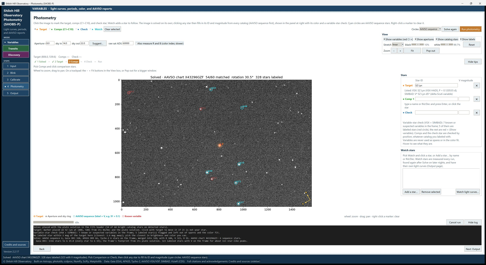
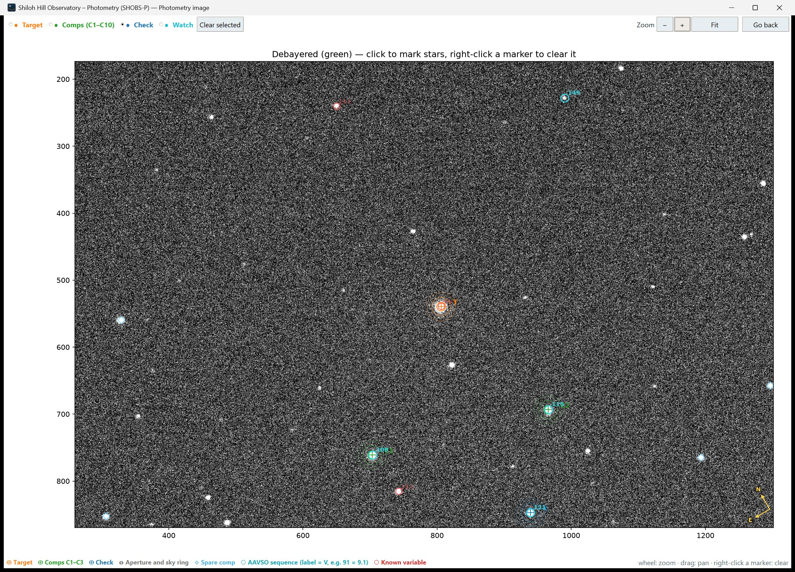
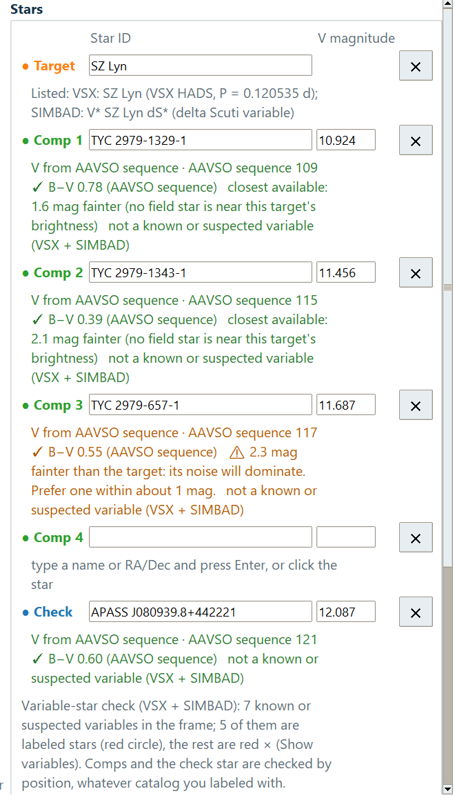
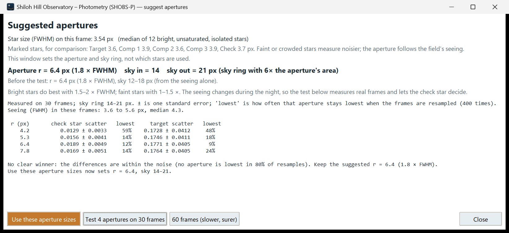

# 8. Photometry page basics

The Photometry page is where you choose which stars to measure and then measure them on every frame. This chapter
covers what works the same in every mode: the automatic solve, the image view, marking stars, apertures, and running
photometry. Choosing good comparison stars for a variable is in chapter 9; transits are in chapter 16; Discovery's
**Scan field** is in chapter 20.

## The page at a glance

From top to bottom:

- **The tools row.** On the left, what a click on the image does: **● Target**, **● Comps (C1–C10)**, **● Check**,
  **● Watch**, and **Clear selected**. On the right: **Circles**, **Solve again** and the orange **Run photometry**
  button.
- **The options row.** The aperture boxes **Aperture r**, **sky in** and **sky out**, the **Suggest…** button,
  **raw sat ADU**, and **Also measure R and B (color index; slower)**. On the right, the **View** box.
- **The step strip**: what is done and what to do next.
- **The image** on the left, with a legend under it, and the **Stars** and **Watch stars** panels on the right.
- **The progress row**: a progress bar, **Cancel run**, and **Hide log** / **Show log**, with the log under it.
- **Back** and **Next: Output** at the bottom.

In Discovery mode the page is called **Photometry: field scan**, the left of the tools row reads **Click a star to**
**● Watch it** / **✕ Exclude it**, and **Scan field** replaces **Run photometry**.

## The image solves itself

You don't need to press anything to solve the image. As soon as the page opens with a freshly calibrated image,
SHOBS-P:

1. works out where the frame points: from the plate solution in the FITS header if there is one, otherwise from the
   target's RA and Dec on the Input page (or the header's pointing), and matches the star pattern;
2. asks every catalog at once (the AAVSO comparison-star sequence, Gaia DR3, APASS and Tycho-2) and merges them into
   one list of stars;
3. checks the field against VSX and SIMBAD for known and suspected variables;
4. places the **Target** marker on your target, if the Input page gives its position.

While it works, the status bar shows each catalog as it answers, for example "Catalogs: AAVSO ✓ APASS ✓ Tycho ✓
Gaia…". You can start marking stars once the AAVSO sequence and APASS are in; Gaia's faint stars finish in the
background.

The first label of the step strip shows how it went: **1 Solving…**, **✓ 1 Solved** or **1 Not solved**.

When solved, the title over the image reads, for example, "Solved · AAVSO chart X12345ABC 43/60 matched rotation
12.3° …", and a small yellow **N** and **E** compass appears in a corner. Before a solve, the corner says
**N/E: orientation unknown until the image is solved**.

**Solve again** repeats the solve, for example after a catalog did not answer, or after you corrected the focal
length.

> **Tip:** A solve needs only a rough idea of where the frame points: the target's name looked up on the Input page
> is enough. Frames without a plate solution or RA/Dec in their headers are fine.

### When the image is not solved

The automatic solve stays quiet when it fails: the step strip shows **1 Not solved** and the log says why. Press
**Solve again** to see the full explanation in a window. The usual causes:

| What you see | What to do |
|---|---|
| **Solve needs to know roughly where the frame is: …** | Your headers give no position and the Input page has no RA/Dec. Type the target's name on the Input page and press Enter (or, in Discovery, the field center), then **Solve again**. |
| **The catalog stars did not lock onto this frame …** | Usually wrong optics. Check **Focal length (mm)**, **Pixel size (µm)** and **Binning** on the Input page; the window shows the plate scale it used. Also check that the **Target** marker is on your star. |
| "Only N stars were found on this frame" (in the same window) | Very short exposures or a small telescope. Mark the stars by hand and type their names and magnitudes. |
| **Not solved: the catalog request failed.** | The internet or a catalog server was down. **Solve again** later. |

You can still mark stars on an image that is not solved; their names and magnitudes fill in as soon as a solve
succeeds. Or type the magnitudes yourself.

### The Circles box

Every catalog is always used. The **Circles** box only chooses whose circles are drawn on the image: **AAVSO
sequence**, **Gaia DR3**, **APASS DR9** or **Tycho-2**. Where a field has no AAVSO sequence (most exoplanet hosts), SHOBS-P draws another
catalog's circles instead, and the legend says so.

## The image view

### Zoom and pan

- **Mouse wheel** over the image zooms in and out around the pointer.
- **Drag** with the left mouse button to pan.
- In the **View** box: **−** and **+** zoom around the middle of the view, and **Fit** shows the whole frame.

Zoom and pan stay as they are while you mark stars or change the display. Only a new image (a new calibration, binning
or channel) goes back to the whole frame.

On a trackpad without a wheel, use **−**, **+** and **Fit**, or pop the image out.

### Pop out the image

Press **Pop out** in the **View** box to put the image in its own window, which you can make as large as you like or
move to a second monitor. The window has the same **● Target**, **● Comps (C1–C10)**, **● Check**, **● Watch** and
**Clear selected** controls, and **Zoom**, **−**, **+**, **Fit** and **Go back**. The **+** and **−** keys also zoom
there.

While the image is out, the page shows **Image is in its own window (Bring back in the View box).** and the **Pop out**
button reads **Bring back**. The image comes back when you press **Go back** or **Bring back**, close the window,
start a run, switch modes or leave the Photometry page. SHOBS-P remembers where you put the window.

### What you can show

The **View** box has four switches:

- **Show variables (red ○ ×)**: known and suspected variables from VSX and SIMBAD. A red circle is a catalog star
  that is a variable; a red × is a variable with no catalog circle.
- **Show apertures**: the measuring circle and sky ring around each marked star.
- **Show catalog stars**: the catalog circles.
- **Show labels**: the labels next to circles, and the compass.

(Discovery adds **Candidates only**; see chapter 20.)

Under the switches are the same **Stretch**, **black**, **white** and **Reset** controls as on the Blink page
(chapter 6). They change only the display.

### What the marks mean

The legend under the image lists only the marks drawn right now. The most common:

| Mark | Meaning |
|---|---|
| Orange **+** with **T** | the target |
| Green **+** with **C1**, **C2** … | comparison stars |
| Blue **+** with **K** | the check star |
| Solid, dashed and dotted rings around a marked star | the aperture, and the inner and outer edges of the sky ring |
| Cyan circle with a number | an AAVSO sequence star; the number is its V magnitude without the decimal point (91 = V 9.1) |
| Yellow circle | a star of the catalog chosen in **Circles** |
| Large green ring | a suggested comparison star |
| Small light-blue diamond | a spare comparison star SHOBS-P picked |
| Cyan diamond with **W** | a watch star |

Hold the pointer over any star to see a small box with its name, catalog magnitudes, color and pixel position, and
a warning if it is a known variable.

## The step strip

The step strip under the options row shows your progress: **1 Solve → 2 Target → 3 Comps → 4 Check → Run**
(Discovery: **1 Solve → 2 Scan field**). Done steps get a ✓. The line under it says what to do now, for example
**Solved. Pick Target and click the target star.** and finally **Ready: Run photometry.**

**Hide tips** hides the strip once you know your way around; **Show tips** brings it back. SHOBS-P remembers your
choice.

## Mark the stars

You mark stars by choosing what a click means (**● Target**, **● Comps (C1–C10)**, **● Check** or **● Watch**), then
clicking the star on the image.

### The target

If the Input page knows your target's position, SHOBS-P puts the **Target** marker on it after the solve, and the log
says "Target: marker placed on … Click with Target to move it if it is not your star." Check it is the right star.

In Variables and Transits mode, the click choice then moves on to **● Comps (C1–C10)** by itself, and the log adds
"Next: click the comparison stars (Comps is picked)." If you already picked a choice yourself on this image, SHOBS-P
leaves it alone.

To place or move it by hand: choose **● Target** and click the star.

The target's name in the **Stars** panel is the **Star ID** from the Input page. Clicking does not change it.

### Comparison stars and the check star

1. Choose **● Comps (C1–C10)** and click a comparison star. It becomes **Comp 1** (C1 on the image). Click more stars
   to add Comp 2, Comp 3 and so on, up to ten.
2. Choose **● Check** and click a check star: a steady star that is not one of the comps. It tests whether the comps
   are behaving.

Each click snaps the marker onto the star nearest to where you clicked. For comps and the check star, SHOBS-P also
finds the star from a little further out, so a click that is a few pixels off still lands on the star's center. The
status bar says, for example, " Centered on the star (2.3 px from the click)." If there is no star there, it says
" No star found right at the click; the marker is where you clicked." Watch for that one.

**How names and magnitudes fill in.** On a solved image, clicking a comp or the check star fills its row in the
**Stars** panel: the star's name (its AAVSO identifier or catalog name) and its catalog magnitude in the band you are
measuring (the column header says which, for example **V magnitude**). AAVSO sequence magnitudes are used first, then
APASS, Gaia and Tycho-2. The line under each row says where the magnitude came from and adds checks:

- its color (B−V) and a warning if it is very red;
- how much brighter or fainter than the target it is, with a warning if it is more than about 1 magnitude away;
- "not a known or suspected variable (VSX + SIMBAD)", or a red ⚠ if it is one.

**Suggested comparison stars** are drawn as large green rings: up to four catalog stars close to the target in
brightness and color, not variable, not near saturation, AAVSO sequence stars first. They are good first choices.
Chapter 9 says more about choosing comps.

**Variables are caught.** If you click a known or suspected variable as a comp or check star, SHOBS-P asks whether to
use it anyway. **No** removes the marker.

### Place a star by name

You can also type a star instead of clicking it:

1. Click in the empty name box of a comp row (its line reads **type a name or RA/Dec and press Enter, or click the
   star**) or the Check row.
2. Type a name, for example an AAVSO identifier, `TYC 4006-1310-1`, a Gaia ID, or a position such as
   `23 13 48.1 +57 07 34`.
3. Press **Enter**. SHOBS-P finds the star on the image, places the marker and fills in the magnitude.

The image must be solved for this to work.

### Remove a mark

- **Right-click** a marker on the image to clear it.
- Or press **✕** at the end of its row in the **Stars** panel (it clears the marker, the name and the magnitude).
- Or press **Clear selected**: it clears the marker of the current choice (for Comps, the last one you placed). With
  **● Watch** chosen, it stops watching the star selected in the **Watch stars** list (or, with none selected, the
  watch star you added last on this frame).

To replace a comparison star, remove it first and then click the new one; clicks in Comps mode always add.

### Watch stars

**● Watch** adds a star you want to follow without using it as a comparison star, for example a suspected variable in
the field. Watch stars are measured on every run and get their own light curves on the Output page. Use **Add a
star…** in the **Watch stars** box to add one by name, and **Remove selected** to stop watching it.

## Apertures

SHOBS-P measures each star inside a circle (the aperture) and estimates the sky from a ring around it. The three
boxes are in pixels on the calibrated image:

- **Aperture r**: the radius of the measuring circle.
- **sky in**, **sky out**: the inner and outer radius of the sky ring.

The rings are drawn on the image as you type, so you can see whether a neighbor star falls inside them.

### Let SHOBS-P suggest the sizes

1. Press **Suggest…**. SHOBS-P measures the star size (FWHM) on bright, isolated stars and opens the **Suggested
   apertures** window.
2. Read the bold line: the suggested **Aperture r** (1.8 × FWHM) and sky ring. Notes below it warn about neighbors
   inside a marked star's aperture.
3. Optional, but worth it on a new setup: press **Test 4 apertures on 30 frames** (or **60 frames (slower, surer)**).
   SHOBS-P measures real frames with four aperture sizes and tells you which gave the least scatter on the check star,
   for example "Clear winner: r = 4.8 …" or "No clear winner: … Keep the suggested r = 5.8". The test needs at least
   one comp, and ideally a check star.
4. Press **Use these aperture sizes**. The boxes are filled and the window closes.

> **Tip:** Use the same aperture sizes for every night of a series. SHOBS-P reminds you of this when you set them.

### Raw sat ADU

**raw sat ADU** is the level at which your camera saturates, in the units of the **raw** frame (for most 16-bit
cameras, about 60000 or a little more). SHOBS-P checks every star's peak on the raw frame against it and flags
saturated frames. Set it to your camera's real full-well value if you know it.

### Color

**Also measure R and B (color index; slower)** measures the comps and target in the other colors too, so SHOBS-P can
work out color terms. It makes the run slower; leave it off unless you need colors.

## Run photometry

1. Check the step strip says **Ready: Run photometry.**
2. Press **Run photometry**.
3. Answer any questions (below).
4. Watch the progress bar: "Photometry: frame 120/300   elapsed 2:10   about 3:15 left". The log shows one line per
   frame with the target's magnitude, the star size and how far the frame moved.

Every frame is calibrated, lined up with the first one (through shifts, small rotations and meridian flips), and
measured. On an alt-az mount (the **Mount** box on the Input page, or clear evidence in the headers) there are no
flips: the alignment follows the field rotation instead, and the log says how far the field turned, for example
"Field rotation: the field turned by 12.4° on the sensor through the night (alt-az mount); the apertures followed it."
If the field turns by more than 5° on a German equatorial mount, the log suggests setting **Mount** to **Alt-az**. Frames that cannot be lined up (cloud, trailing) are skipped and listed in the log. When the run is done,
SHOBS-P switches to the Output page.

To stop, press **Cancel run**. Nothing is added: the progress line says "Canceled; nothing was added."

### Questions it may ask

You will not see most of these on most nights. Each window explains its choices.

- **The aperture is much larger (or smaller) than the stars.** Common after switching telescopes. **No** stops so you
  can press **Suggest…**; the window says what it would use.
- **There is no star under a marker.** A marker on blank sky. **No** stops so you can move it.
- **Names without markers.** A comp or check row has a name but no marker on this image (often left from a series).
  **Yes** clears those names and continues; **No** continues and leaves them; **Cancel** stops so you can mark them.
- **Wrong mode.** In Transits mode with a target that looks like a variable star and no transit predicted, SHOBS-P
  offers to **Run in Variables mode instead?**. In Variables mode, when the **Planet (Transits)** box holds a planet of
  this star, or the target is a known planet host (SHOBS-P looks its planets up in the NASA Exoplanet Archive after the
  Star ID lookup), and a transit is predicted during your frames, it offers **Run in Transits mode instead?** (not
  asked while a Variables series is open). **Yes** fills in the planet and runs in Transits mode. Answer the question rather than canceling: the series and
  reports are kept per mode.
- **An ensemble without a check star** (Variables mode, two or more comps, no check): AAVSO requires a check star for
  ensemble reports. **Continue without one?**
- **Color can't be calibrated.** **Also measure R and B** is ticked but too few catalog stars have colors. **Run anyway
  with uncalibrated color?**
- **The open series is in another mode.** SHOBS-P offers to switch modes so the night can be added to it.

**A marker off its star.** Before the run, SHOBS-P checks that each marker sits on its star's center. If one would be
measured beside the star (so it would read faint), the log says, for example, "⚠ Check marker at (512.0, 340.5) is
6.2 px from the center of the star there (…)", and the status bar says **Check the Log: Check is marked off the center
of the star.** The run goes on; if that is not what you meant, clear the marker, zoom in and click the star again.

Some problems stop the run with a message instead, for example **Mark at least one comparison star (Comps, then click
the star)**, **Need aperture r < sky in < sky out**, or two markers on the same star. Fix what it says and press **Run
photometry** again.

If your **Site** boxes are empty, the log notes that there will be no airmass and no scintillation in the error bars.
Type your site once on the Input page to fix this for good.

### After the run

If a series is open in the same mode, SHOBS-P asks whether to add the night to it (chapter 10). Otherwise the night is
a single night. Either way, nothing is written to disk until you save, unless the open series is saved automatically
(the status bar then names the file).

The run's results are on the Output page: the light curve for Variables (chapter 9), the transit fit for Transits
(chapter 17), or the scan results for Discovery (chapter 20).

---

Previous: [7. Calibrate](07-calibrate.md) · Next: [9. Reduce a variable-star night](09-reduce-a-variable-night.md)
