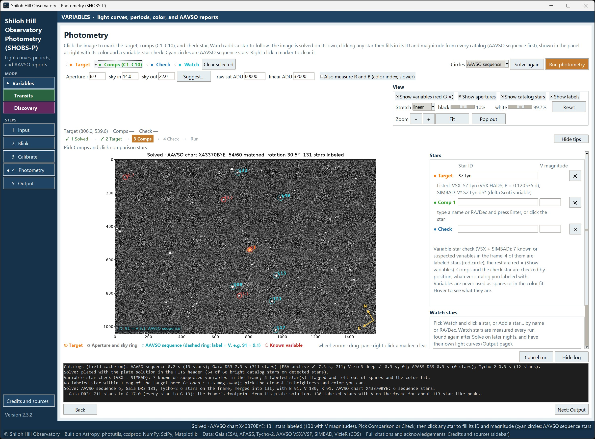
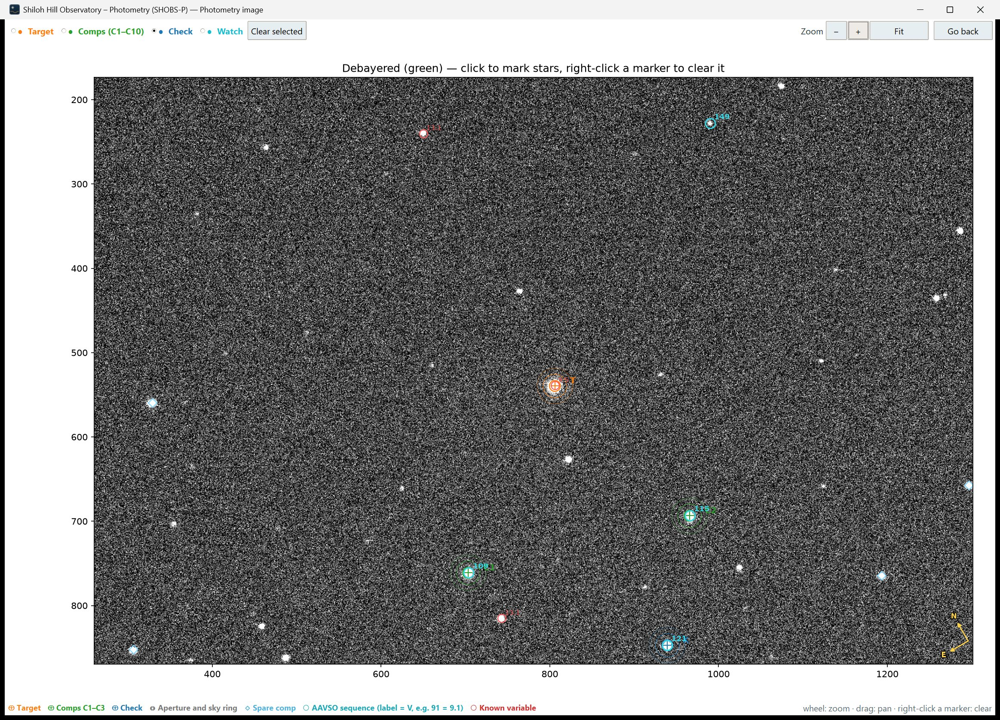
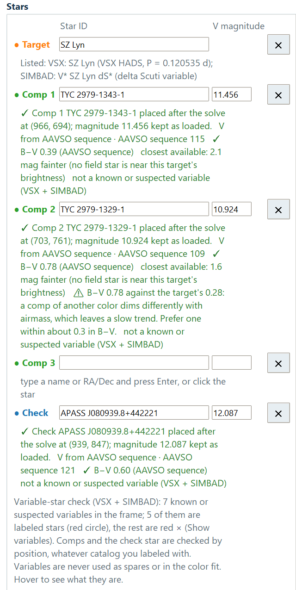
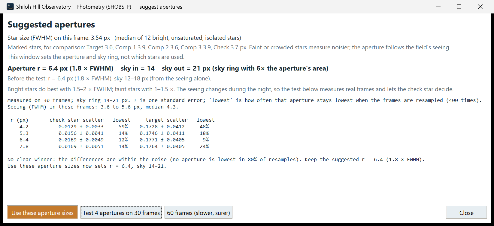
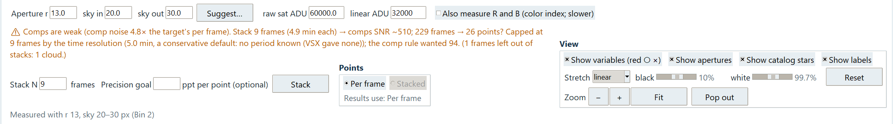
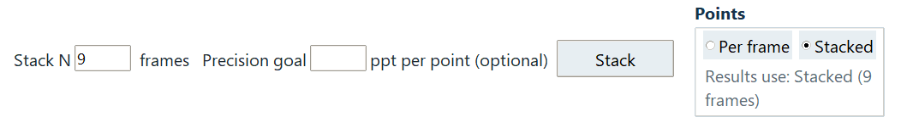

# 8. Photometry page basics

The Photometry page is where you choose which stars to measure and then measure them on every frame. This chapter
covers what works the same in every mode: the automatic solve, the image view, marking stars, apertures, and running
photometry, and stacking frames when the comparison stars are weak. Choosing good comparison stars for a variable is
in chapter 9; transits are in chapters 16 and 17; Discovery's **Scan field** is in chapter 20.

## The page at a glance

From top to bottom:

- **The tools row.** On the left, what a click on the image does: **● Target**, **● Comps (C1–C10)**, **● Check**,
  **● Watch**, and **Clear selected**. On the right: **Circles**, **Solve again** and the orange **Run photometry**
  button.
- **The options row.** The aperture boxes **Aperture r**, **sky in** and **sky out**, the **Suggest…** button,
  **raw sat ADU**, **linear ADU**, and **Also measure R and B (color index; slower)**. On the right, the **View** box.
  After the first run, a small **Points** box sits just left of the View box (see "Stacking when comps are weak"
  below). When the window is narrow and the View box moves to a line of its own, the Points box moves with it.
- **The Stack row** (after the first run only): a suggestion line, then **Stack N** [box] **frames   Precision goal**
  [box] **ppt per point (optional)** and the **Stack** button.
- **The "Measured with" line**: after a run, a gray line says what the photometry was measured with (see "Apertures"
  below). Under it, an orange line appears when the run skipped frames or left a comp out of some frames (see "Comps
  near the frame edge" below).
- **The step strip**: what is done and what to do next.
- **The image** on the left, with a legend under it, and the **Stars** and **Watch stars** panels on the right.
- **The run row**: a gray line with the last run's summary (for example "Photometry done in 1:52. 38 points."),
  **Cancel run**, and **Hide log** / **Show log**, with the log under it. While a run is going, its progress is on the
  busy bar at the bottom of the window (chapter 3).
- **Back** and **Next: Output** at the bottom.

In Discovery mode the page is called **Photometry: field scan**, the left of the tools row reads **Click a star to**
**● Watch it** / **✕ Exclude it**, and **Scan field** replaces **Run photometry**.

## The image solves itself

You don't need to press anything to solve the image. As soon as the page opens with a freshly calibrated image,
SHOBS-P:

1. works out where the frame points: from the plate solution in the FITS header if there is one, otherwise from the
   target's RA and Dec on the Input page (or the header's pointing), and matches the star pattern;
2. asks every catalog at once (the AAVSO comparison-star sequence, Gaia DR3, APASS and Tycho-2) and merges them into
   one list of stars;
3. checks the field against VSX and SIMBAD for known and suspected variables;
4. places the **Target** marker on your target, if the Input page gives its position.

While it works, the busy bar at the bottom of the window (chapter 3) says what the solve is doing. It starts with,
for example, **Solving: fetching AAVSO, Gaia, APASS and Tycho stars (…′ field, V band)…**, then ticks off each catalog
as it answers: **Solving: fetching catalogs: AAVSO ✓ APASS ✓ Tycho ✓ Gaia…**. On a hard field you may also see
**Solving: only N stars on this frame, stacking M frames to find more…**, **Solving: no lock at the target marker,
trying N nearby stars as the target…** or **Solving the field from star patterns…**. You can start marking stars once
the AAVSO sequence and APASS are in; Gaia's faint stars finish in the background.

The first label of the step strip shows how it went: **1 Solving…**, **✓ 1 Solved** or **1 Not solved**.

When solved, the title over the image reads, for example, "Solved · AAVSO chart X12345ABC 43/60 matched rotation
12.3° …", and a small yellow **N** and **E** compass appears in a corner. Before a solve, the corner says
**N/E: orientation unknown until the image is solved**.

**Solve again** repeats the solve, for example after a catalog did not answer, or after you corrected the focal
length.

**When the AAVSO sequence is slow.** The AAVSO chart server (VSP, at apps.aavso.org) sometimes answers late or not at
all. SHOBS-P does not hold up the solve for it: it asks again in the background a few times, and the log says exactly
what happened, for example "AAVSO sequence did not answer (503 from apps.aavso.org); asking again in the background
(…)". If it answers later, the log says so and the status bar says **The AAVSO sequence answered after the solve:
Solve again to use it.** Press **Solve again**; the sequence is used at once, with no new request.

**When the target is not on the first frame.** Sometimes the first frames miss the target, for example while the
telescope was still settling. If the plate solution puts the target off the first frame, SHOBS-P looks at the next
frames (up to 10) for the first one that holds it, without solving each one (the busy bar says, for example,
**Looking for SZ Lyn on the next frames… 3 of 10**). That frame becomes the reference: the
image is solved again and the Target marker placed. The log says, for example, "Target: SZ Lyn is on frame 6 (…), not
on frames 1–5. Frame 6 is the reference now; the run skips the 5 frames without SZ Lyn and lists every frame that
misses it." If it cannot find the target, the log says to reject the frames without it in Blink and calibrate again.

> **Tip:** A solve needs only a rough idea of where the frame points: the target's name looked up on the Input page
> is enough. Frames without a plate solution or RA/Dec in their headers are fine.

### When the image is not solved

The automatic solve stays quiet when it fails: the step strip shows **1 Not solved** and the log says why. Press
**Solve again** to see the full explanation in a window. The usual causes:

| What you see | What to do |
|---|---|
| **Solve needs to know roughly where the frame is: …** | Your headers give no position and the Input page has no RA/Dec. Type the target's name on the Input page and press Enter (or, in Discovery, the field center), then **Solve again**. |
| **The catalog stars did not lock onto this frame …** | Usually wrong optics. Check **Focal length (mm)**, **Pixel size (µm)** and **Binning** on the Input page; the window shows the plate scale it used. Also check that the **Target** marker is on your star. |
| "Only N stars were found on this frame" (in the same window) | Very short exposures or a small telescope. Mark the stars by hand and type their names and magnitudes. |
| **Not solved: the catalog request failed.** | The internet or a catalog server was down. **Solve again** later. |

You can still mark stars on an image that is not solved; their names and magnitudes fill in as soon as a solve
succeeds. Or type the magnitudes yourself.

### The Circles box

Every catalog is always used. The **Circles** box only chooses whose circles are drawn on the image: **AAVSO
sequence**, **Gaia DR3**, **APASS DR9** or **Tycho-2**. Where a field has no AAVSO sequence (most exoplanet hosts), SHOBS-P draws another
catalog's circles instead, and the legend says so.

## The image view

### Zoom and pan

- **Mouse wheel** over the image zooms in and out around the pointer.
- **Drag** with the left mouse button to pan.
- In the **View** box: **−** and **+** zoom around the middle of the view, and **Fit** shows the whole frame.

Zoom and pan stay as they are while you mark stars or change the display. Only a new image (a new calibration, binning
or channel) goes back to the whole frame.

On a trackpad without a wheel, use **−**, **+** and **Fit**, or pop the image out.

### Pop out the image

Press **Pop out** in the **View** box to put the image in its own window, which you can make as large as you like or
move to a second monitor. The window has the same **● Target**, **● Comps (C1–C10)**, **● Check**, **● Watch** and
**Clear selected** controls, and **Zoom**, **−**, **+**, **Fit** and **Go back**. The **+** and **−** keys also zoom
there.

**Small image?** On a small frame (MicroObservatory's, for example), or with Windows display scaling at 125 % or 150 %,
the image area can get short and wide. SHOBS-P then gives the image room first: the log under it shrinks (down to 3
lines). If the image is still drawn small, a line under it says **⚠ Small image? Pop out opens it in its own window
(also in the View box, top right); Hide log gives it more room.**, with its own **Pop out** button.

While the image is out, the page shows **Image is in its own window (Bring back in the View box).** and the **Pop out**
button reads **Bring back**. The image comes back when you press **Go back** or **Bring back**, close the window,
start a run, switch modes or leave the Photometry page. SHOBS-P remembers where you put the window.

### What you can show

The **View** box has four switches:

- **Show variables (red ○ ×)**: known and suspected variables from VSX and SIMBAD. A red circle is a catalog star
  that is a variable; a red × is a variable with no catalog circle.
- **Show apertures**: the measuring circle and sky ring around each marked star.
- **Show catalog stars**: the catalog circles.
- **Show labels**: the labels next to circles, and the compass.

(Discovery adds **Candidates only**; see chapter 20.)

Under the switches are the same **Stretch**, **black**, **white** and **Reset** controls as on the Blink page
(chapter 6). They change only the display.

### What the marks mean

The legend under the image lists only the marks drawn right now. The most common:

| Mark | Meaning |
|---|---|
| Orange **+** with **T** | the target |
| Green **+** with **C1**, **C2** … | comparison stars |
| Blue **+** with **K** | the check star |
| Solid, dashed and dotted rings around a marked star | the aperture, and the inner and outer edges of the sky ring |
| Thin dashed cyan ring with a number | an AAVSO sequence star; the number is its V magnitude without the decimal point (91 = V 9.1) |
| Yellow circle | a star of the catalog chosen in **Circles** |
| Thick green ring with **S1**, **S2** … | a suggested comparison star |
| Small light-blue diamond | a spare comparison star SHOBS-P picked |
| Cyan diamond with **W** | a watch star |

Hold the pointer over any star to see a small box with its name, catalog magnitudes, color and pixel position, and
a warning if it is a known variable.

Suggested comps and AAVSO sequence stars are easy to mix up on a busy field, so a small key on the image itself (in the
corner beside the compass) shows the two: **S1, S2 …  suggested comp** and **91 = V 9.1  AAVSO sequence**. Like the
compass, it follows **Show labels**.

## The step strip

The step strip under the options row shows your progress: **1 Solve → 2 Target → 3 Comps → 4 Check → Run**
(Discovery: **1 Solve → 2 Scan field**). Done steps get a ✓. The line under it says what to do now, for example
**Solved. Pick Target and click the target star.** and finally **Ready: Run photometry.**

**Hide tips** hides the strip once you know your way around; **Show tips** brings it back. SHOBS-P remembers your
choice.

## Mark the stars

You mark stars by choosing what a click means (**● Target**, **● Comps (C1–C10)**, **● Check** or **● Watch**), then
clicking the star on the image.

### The target

If the Input page knows your target's position, SHOBS-P puts the **Target** marker on it after the solve, and the log
says "Target: marker placed on … Click with Target to move it if it is not your star." Check it is the right star.

In Variables and Transits mode, the click choice then moves on to **● Comps (C1–C10)** by itself, and the log adds
"Next: click the comparison stars (Comps is picked)." If you already picked a choice yourself on this image, SHOBS-P
leaves it alone.

To place or move it by hand: choose **● Target** and click the star.

The target's name in the **Stars** panel is the **Star ID** from the Input page. Clicking does not change it.

### Comparison stars and the check star

1. Choose **● Comps (C1–C10)** and click a comparison star. It becomes **Comp 1** (C1 on the image). Click more stars
   to add Comp 2, Comp 3 and so on, up to ten.
2. Choose **● Check** and click a check star: a steady star that is not one of the comps. It tests whether the comps
   are behaving.

Each click snaps the marker onto the star nearest to where you clicked. For comps and the check star, SHOBS-P also
finds the star from a little further out, so a click that is a few pixels off still lands on the star's center. The
status bar says, for example, " Centered on the star (2.3 px from the click)." If there is no star there, it says
" No star found right at the click; the marker is where you clicked." Watch for that one.

**How names and magnitudes fill in.** On a solved image, clicking a comp or the check star fills its row in the
**Stars** panel: the star's name (its AAVSO identifier or catalog name) and its catalog magnitude in the band you are
measuring (the column header says which, for example **V magnitude**). AAVSO sequence magnitudes are used first, then
APASS, Gaia and Tycho-2. The line under each row says where the magnitude came from and adds checks:

- its color (B−V) and a warning if it is very red;
- how much brighter or fainter than the target it is, with a warning if it is more than about 1 magnitude away;
- "not a known or suspected variable (VSX + SIMBAD)", or a red ⚠ if it is one;
- with a **linear ADU** set, a caution when the star's brightest raw pixel is over or near the linear limit, for
  example "⚠ raw peak 41,200 ADU is over the linear limit (36,000): the camera's response bends there, so this star
  reads too faint — pick a fainter comp." (for the target: "— shorter exposures or more defocus");
- for a comp or check star near the frame edge, how far in a star must be, for example "⚠ only 12 px from the frame
  edge: its sky ring (out to 22 px) needs the star at least 27 px in, with room for drift — pick a star further in".

**Suggested comparison stars** are drawn as thick green rings labeled **S1**, **S2** …: up to four catalog stars close
to the target in brightness and color, not variable, not near saturation, AAVSO sequence stars first. They are good
first choices. Under the **Stars** panel, one line per suggestion says what it is and why, for example "S1 = … V 11.20
(AAVSO sequence 112): 0.3 mag fainter than the target, B−V 0.62 (target 0.60)", and "— now C2" once you use it.
Chapter 9 says more about choosing comps.

**Variables are caught.** If you click a known or suspected variable as a comp or check star, SHOBS-P asks whether to
use it anyway. **No** removes the marker.

### Place a star by name

You can also type a star instead of clicking it:

1. Click in the empty name box of a comp row (its line reads **type a name or RA/Dec and press Enter, or click the
   star**) or the Check row.
2. Type a name, for example an AAVSO identifier, `TYC 4006-1310-1`, a Gaia ID, or a position such as
   `23 13 48.1 +57 07 34`.
3. Press **Enter**. SHOBS-P finds the star on the image, places the marker and fills in the magnitude.

The image must be solved for this to work.

### Remove a mark

- **Right-click** a marker on the image to clear it.
- Or press **✕** at the end of its row in the **Stars** panel (it clears the marker, the name and the magnitude).
- Or press **Clear selected**: it clears the marker of the current choice (for Comps, the last one you placed). With
  **● Watch** chosen, it stops watching the star selected in the **Watch stars** list (or, with none selected, the
  watch star you added last on this frame).

To replace a comparison star, remove it first and then click the new one; clicks in Comps mode always add.

**Comps follow Use comps.** When you choose a subset of comps with **Use comps…** (chapter 11), the comp rows and
markers on this page change to the comps in use. The others are not lost: they are still measured on every frame as
spares (small diamonds), and choosing the original set again puts them back where they were. The log says, for
example, "Photometry comps now match Use comps: C1 …, C2 …; … still measured as spare".

### Watch stars

**● Watch** adds a star you want to follow without using it as a comparison star, for example a suspected variable in
the field. Watch stars are measured on every run and get their own light curves on the Output page. Use **Add a
star…** in the **Watch stars** box to add one by name, and **Remove selected** to stop watching it.

## Apertures

SHOBS-P measures each star inside a circle (the aperture) and estimates the sky from a ring around it. The three
boxes are in pixels on the calibrated image:

- **Aperture r**: the radius of the measuring circle.
- **sky in**, **sky out**: the inner and outer radius of the sky ring.

The rings are drawn on the image as you type, so you can see whether a neighbor star falls inside them.

**What was measured.** After a run, a gray line under the options row says what the photometry was measured with, for
example "Measured with r 8, sky 14–22 px (Bin 1)". If you then change the aperture, sky or **Binning** boxes, the line
turns orange: "⚠ Aperture changed (now r 6, …): run photometry again to apply it." The new sizes are used only by the
next run.

**Aperture kept from another target.** The aperture boxes keep their values from the last target. On a new image,
the log cautions when they don't fit these stars: an aperture larger than 2.5 × the stars' FWHM (it adds sky noise and
neighbors), or, on defocused stars, one that clips the donut. Each caution says what **Suggest…** would give.

### Defocused stars (donuts)

Many transit observers defocus on purpose, so each star becomes a ring (a "donut"). SHOBS-P decides once per run
whether the field is defocused. If it is, the log says, for example, "Defocused stars (donuts, about 24 px across on
12 of 15 test stars): each star is centered on its light centroid, not on the bright side of its ring." Then:

- every star is centered on the middle of its light, the same way on every frame;
- **Suggest…** sizes the aperture to hold 95 % of the star's light (never smaller than the donut), instead of using
  the FWHM, which means little on a donut;
- **Run photometry** asks first when the aperture would clip the ring (see the questions below);
- after the run, the log reports how much each aperture's center jittered from frame to frame (the rms, in pixels),
  with a caution over 0.5 px.

In-focus fields are measured exactly as before.

### Let SHOBS-P suggest the sizes

1. Press **Suggest…**. SHOBS-P measures the star size (FWHM) on bright, isolated stars and opens the **Suggested
   apertures** window. (On defocused stars it measures the radius that holds 95 % of the light instead.)
2. Read the bold line: the suggested **Aperture r** (1.8 × FWHM, or the 95 % light radius on donuts) and sky ring.
   Notes below it warn about neighbors inside a marked star's aperture.
3. Optional, but worth it on a new setup: press **Test 4 apertures on 30 frames** (or **60 frames (slower, surer)**).
   SHOBS-P measures real frames with four aperture sizes and tells you which gave the least scatter on the check star,
   for example "Clear winner: r = 4.8 …" or "No clear winner: … Keep the suggested r = 5.8". The test needs at least
   one comp, and ideally a check star. Without a check star it judges on the target, and says so ("⚠ No check star:
   judging on the target, which may truly vary …"). In Discovery, which has no comps, it uses bright, isolated,
   unsaturated field stars instead. While the test runs, the busy bar counts the frames, for example **Aperture
   test… 12 of 30**.
4. Press **Use these aperture sizes**. The boxes are filled and the window closes.

> **Tip:** Use the same aperture sizes for every night of a series. SHOBS-P reminds you of this when you set them.

### Raw sat ADU

**raw sat ADU** is the level at which your camera saturates, in the units of the **raw** frame (for most 16-bit
cameras, about 60000 or a little more). SHOBS-P checks every star's peak on the raw frame against it and flags
saturated frames. Set it to your camera's real full-well value if you know it.

### Linear ADU

**linear ADU** is your camera's linear limit, in raw units (chapter 4). Leave it empty if you don't know it; nothing
changes then. With a value set below **raw sat ADU**, SHOBS-P cautions when you pick a star whose raw peak is over or
near it (see "Comparison stars and the check star" above), counts after each run the frames where each star went over
it ("⚠ Linear limit 36,000 ADU: raw peak at or above it in … frames …"), and Comp health shows an **Over linear limit**
column (chapter 11).

### Color

**Also measure R and B (color index; slower)** measures the comps and target in the other colors too, so SHOBS-P can
work out color terms. It makes the run slower; leave it off unless you need colors.

## Run photometry

1. Check the step strip says **Ready: Run photometry.**
2. Press **Run photometry**.
3. Answer any questions (below).
4. Watch the busy bar at the bottom of the window. It says **Photometry on 300 lights…**, then counts the frames
   with the time left, for example **Photometry… 120 of 300, about 3:15 left**. The log shows one line per frame with
   the target's magnitude, the star size and how far the frame moved. When the run ends, the gray line beside
   **Cancel run** says how long it took, for example **Photometry done in 1:52. 38 points.**

Every frame is calibrated, lined up with the first one (through shifts, small rotations and meridian flips), and
measured. On an alt-az mount (the **Mount** box on the Input page, or clear evidence in the headers) there are no
flips: the alignment follows the field rotation instead, and the log says how far the field turned, for example
"Field rotation: the field turned by 12.4° on the sensor through the night (alt-az mount); the apertures followed it."
If the field turns by more than 5° on a German equatorial mount, the log suggests setting **Mount** to **Alt-az**. The
other way round, when **Mount** is **Alt-az** but the field turns by about 180° between two frames, the run warns:
*"⚠ The field turned by 180° between frames 314a and 1b — that looks like a meridian flip. Is the Mount set right
(German equatorial)? An alt-az field turns smoothly, not by half a turn between two frames. If it was a flip, set Mount
to German equatorial in the Optics box (Input page) and run photometry again, so the frames after the flip are treated
as after it."* An alt-az field turns smoothly, well under a degree per frame, so ordinary field rotation never sets
this off, not even across a long gap or near the zenith. Frames that cannot be lined up (cloud, trailing) are skipped
and listed in the log. When the run is done, SHOBS-P switches to the Output page.

After a meridian flip, SHOBS-P checks the alignment of each flipped frame on up to 15 stars' own centers, so the comp
and check apertures land on their stars again. If the frame you marked the stars on was rejected in Blink, the first
kept frame becomes the reference (chapter 6). Frames that miss the target are skipped and listed at the end, for
example "SZ Lyn not on the frame in 5 of 142 images (frames 1–5); those frames were skipped."

To stop, press **Cancel run**. Nothing is added: the gray line beside **Cancel run** says, for example, "Photometry
done in 0:12. Canceled; nothing was added."

### Comps near the frame edge

When the field drifts during the night, a comparison star near the edge can slide partly off the frame. SHOBS-P then
leaves that comp out **of that frame only**, and measures the frame with the other comps. This happens when the comp's
aperture is partly off the frame, when its sky ring is mostly (over half) off the frame, or when it has no light
above the sky in that frame. A clipped comp is never measured, so it cannot leak into the results.

- **No step in the light curve.** In a frame without some comps, the comparison is rebuilt from the comps that are
  there, each first put on the night's scale by its own median offset from the others. So the comparison level stays
  the same when a comp leaves or comes back; such a frame is only a little noisier. Frames with every comp are
  measured exactly as before.
- **A comp missing most of the night.** A comp measured in fewer than half of a night's frames (or in fewer than 5)
  is left out of the **whole night**, and the night uses the other comps from start to end. The log says so.
- **The check star** off the edge: that frame has no check value, and the frame is kept.
- **Spares and watch stars** off the edge are simply not measured in that frame. They never cost a frame.
- **The target** off the edge: the frame is skipped, and listed.
- **Every comp lost** in a frame: the frame is skipped, with the reason *"every comp lost (off the frame edge)"*.

After the run, an orange line under the "Measured with" line lists what happened, for example:

- *"⚠ 16 frames skipped: every comp lost (off the frame edge) (frames 25–40)."*
- *"C3 left out of 14 frames (off the frame edge; frames 27–40); those frames use the other comps."*
- *"check star left out of 18 frames (off the frame edge; frames 23–40); no check value there."*
- *"…; out of the whole night (missing in most frames)."* when the whole-night rule applied.

A warning box after the run lists the same lines, and the log has them too, each with its night.

### Measure skipped frames

Since 2.3.0 a comp that leaves the frame (or is clipped, or has no flux) is simply left out of those frames, and the
other comps carry them, so a single edge comp no longer costs frames. A frame is skipped only when **every** comp was
lost in it, for example on a one-comp night when that comp drifts off the edge, or when all the comps sit near the same
edge.

Skipped frames stay skipped when you later drop the comps that caused them with **Use comps…** (chapter 11): Use comps
recalculates the measured points, it does not measure the skipped frames. The orange line then says *"⚠ N frames were
skipped because of …, which is no longer a comp — Run photometry again to measure them."*, and a **Measure skipped
frames** button appears at the right of that line. The log and the status line say it too.

**Measure skipped frames** measures only those frames, with the comps now in use, and adds them to the night. An open
series with a file is saved automatically; in Transits mode the fit is refreshed. It needs that night's Lights folder
on the Input page and its image loaded; otherwise a box explains this and says to use **Run photometry**. Once the
frames are back, the line and the button go away.

### Questions it may ask

You will not see most of these on most nights. Each window explains its choices.

- **The aperture is much larger (or smaller) than the stars.** Common after switching telescopes. **No** stops so you
  can press **Suggest…**; the window says what it would use.
- **Defocused stars: the aperture clips the ring.** On a defocused field, an aperture smaller than the donut loses a
  different part of the ring in every frame. The question gives the smallest safe r and what **Suggest…** would use,
  and asks **Run with the current aperture anyway?**
- **There is no star under a marker.** A marker on blank sky. **No** stops so you can move it.
- **Names without markers.** A comp or check row has a name but no marker on this image (often left from a series).
  **Yes** clears those names and continues; **No** continues and leaves them; **Cancel** stops so you can mark them.
- **Wrong mode.** In Transits mode with a target that looks like a variable star and no transit predicted, SHOBS-P
  offers to **Run in Variables mode instead?**. In Variables mode, when the **Planet (Transits)** box holds a planet of
  this star, or the target is a known planet host (SHOBS-P looks its planets up in the NASA Exoplanet Archive after the
  Star ID lookup), and a transit is predicted during your frames, it offers **Run in Transits mode instead?** (not
  asked while a Variables series is open). **Yes** fills in the planet and runs in Transits mode. Answer the question rather than canceling: the series and
  reports are kept per mode.
- **An ensemble without a check star** (Variables mode, two or more comps, no check): AAVSO requires a check star for
  ensemble reports. **Continue without one?**
- **Color can't be calibrated.** **Also measure R and B** is ticked but too few catalog stars have colors. **Run anyway
  with uncalibrated color?**
- **The open series is in another mode.** SHOBS-P offers to switch modes so the night can be added to it.

**A marker off its star.** Before the run, SHOBS-P checks that each marker sits on its star's center. If one would be
measured beside the star (so it would read faint), the log says, for example, "⚠ Check marker at (512.0, 340.5) is
6.2 px from the center of the star there (…)", and the status bar says **Check the Log: Check is marked off the center
of the star.** The run goes on; if that is not what you meant, clear the marker, zoom in and click the star again.

Some problems stop the run with a message instead, for example **Mark at least one comparison star (Comps, then click
the star)**, **Need aperture r < sky in < sky out**, or two markers on the same star. Fix what it says and press **Run
photometry** again.

If your **Site** boxes are empty, the log notes that there will be no airmass and no scintillation in the error bars.
Type your site once on the Input page to fix this for good.

### After the run

If a series is open in the same mode, SHOBS-P asks whether to add the night to it (chapter 10). Otherwise the night is
a single night. Either way, nothing is written to disk until you save, unless the open series is saved automatically
(the status bar then names the file).

The run's results are on the Output page: the light curve for Variables (chapter 9), the transit fit for Transits
(chapter 17), or the scan results for Discovery (chapter 20).

## Stacking when comps are weak

The comparison stars set a floor under your error bars. When they are much fainter than the target, their noise, not
the target's, decides how good each point is. More comps help a little; brighter comps help most. When there are none,
SHOBS-P can **stack** the frames: it combines groups of N calibrated frames and measures the stacks. Each stacked
point then has about √N times less photon noise, at the cost of N times fewer points.

> **Caution:** A stack hides anything faster than itself. A stack of 20 one-minute frames cannot show a change that
> takes less than 20 minutes. SHOBS-P keeps its suggestion short enough for the signal you are after (below), but
> check it against your target.

### The suggestion line

After every per-frame run (or **Scan field** in Discovery) the **Stack row** appears under the settings row. Its first
line says whether stacking would help. SHOBS-P compares the target's photon noise with the photon noise of the comp
ensemble, over every good frame, from the run's own error model. The log gets the numbers, for example *"Noise check
(per frame): target 5.4 mmag (SNR 202), comp ensemble 21.5 mmag (SNR 50; each comp 36, 35) over 60 frames; comp noise
4.01× the target's."*

The line reads (N and the numbers are examples):

- **The comps are weak** (orange, with ⚠): *"⚠ Comps are weak (comp noise 4.7× the target's per frame). Stack 20
  frames (60 s each) → comps SNR ~193; 200 frames → 10 points?"* It may add why N is what it is: *"Capped at 57 frames
  by the time resolution (1/50 of the 2.40-h period = 2.9 min); the comp rule wanted 100."*, *"Kept to 20 frames so the
  night still has at least 10 points."*, *"The 2 ppt goal is not met (about 2.6 ppt per point)."* or *"(3 frames left
  out of stacks: 2 sat, 1 cloud.)"*.
- **The comps are weak but the time cap allows no stacking**: *"⚠ Comps are weak (…), but the time resolution allows
  no stacking (…). Brighter comps, or longer exposures, would help."*
- **The comps are fine, but your precision goal is not reached per frame**: *"⚠ Per-frame points are about 3.1 ppt;
  your 2 ppt goal needs stacks of 3 frames (9 s each); …"*
- **The comps are fine** (gray): *"Comps are fine per frame (comp noise 35% of the target's): stacking is not needed.
  Type N to stack anyway."*
- **Discovery** has no comps, so the line is never orange: *"Stacking (optional): stacks of 6 frames (18 s each); 60
  frames → 10 points. Time cap 5.0 min: a stack hides events faster than itself."*

### How N is chosen

- **The comp rule** (the default): the smallest N at which a stack's comp-ensemble noise is no more than **half the
  target's noise in one frame**.
- **Precision goal** (optional, empty by default, in ppt per point): N grows until a stacked point's whole error,
  scintillation included, meets the goal.
- **The time cap**, so a stack does not blur the signal:
  - **Transits**: 1/5 of the ingress (or egress) time, from the planet on the Input page (its period, a/R\*, Rp/R\*
    and b, or T14);
  - **Variables**: 1/50 of the VSX period;
  - **Discovery**: 5 minutes;
  - with no planet or no period known: 2 minutes (Transits) or 5 minutes (Variables), and the line says this is *"a
    conservative default"*.
- **At least 10 points** are always left in the night.

The **Stack N** box fills in with the suggestion. If you type your own N, it is kept. Typing a precision goal fills
in the new suggestion.

### Stack

Press **Stack**. It asks first only when it needs to:

- stacks longer than the time cap: *"Stacks of N frames last about …, longer than the time resolution allows (…): they
  may blur the signal. Stack anyway?"*;
- in Transits mode, fewer than 20 stacks: *"That makes only K stacked points; the transit fit needs 20 or more. Stack
  anyway?"*;
- in Discovery, fewer than 10 stacks stops with *"That makes only K stacks; a field scan needs at least 10. Use a
  smaller N."*

Then the busy bar shows two steps: **Stacking… k of K** (each stack is made), then **Photometry on K stacks…** (the
same photometry runs on the stacks; in Discovery, the field scan does). The log says what was done, for example:

    Stacking 200 frames into 10 stacks of up to 20 (sigma-clipped mean; whole-pixel shifts from the measured
    drift; never across a meridian flip or a gap).
    Stacks made: 200 frames → 10 stacks of 20 frames (effective exposure 40 s); 0.012% of the pixel values
    clipped (cosmic rays, satellite trails, hot pixels); shifts up to 2 px.
    Photometry on the stacks done: 10 points (stacks of 20 frames (effective exposure 40 s)), 0 flagged.
    Points: Stacked is selected; Per frame (beside the View box) switches back.

When some stacks are short, the log adds *"The last stack of a run (before a flip, a gap, or the end) can be
partial."* When the field turned inside a stack (an alt-az mount), it adds a note on how far, for example *"Note: the
field turned by up to 0.30° inside a stack (about 1.4 px at the frame's corners) …"*.

**The aperture on the stacks.** Stacked stars can be a little wider than in one frame. The log line *"Aperture check on
the stacks: …"* compares the stacks' star FWHM with one frame's and gives the suggested r for each. When the stacks'
stars are more than 15 % wider, the line starts with ⚠ and says to run **Suggest…** with **Points: Stacked**: the
aperture test then measures the stacks. If you choose a new aperture, press **Stack** again. The stacks are reused,
so only the photometry is redone.

After a stack run SHOBS-P goes to the Output page, with **Points: Stacked** selected.

### What goes into a stack

- Rejected frames (Blink) are not in the run, so not in a stack.
- Frames the per-frame run flagged (sat, compsat, drift, cloud and the other flags) are left out before stacking.
- Saturation is judged per exposure, so a sum of unsaturated frames stays linear.
- A stack never spans a meridian flip, a rotator move, or a gap of more than 3 frame spacings. Each side of a flip is
  stacked on its own, so the last stack before a flip or gap can be short (partial).
- There is one way to combine: a sigma-clipped **mean** (a plain mean below 5 frames). The clip removes cosmic rays,
  satellite trails and hot pixels, and leaves alone starlight that only changes with the seeing. There is no median,
  no weighting and no drizzle.
- The frames are lined up by whole pixels, from the drift the run already measured (on a color camera, by whole 2×2
  color cells). Mono and color cameras both work, and no plate solution or header pointing is needed.
- Stacks are 32-bit floating point, so they have no 16-bit ceiling.
- Each stack records its mid-time (the mean of its frames' mid-times), its frame count N and its **effective
  exposure** (the sum of its frames' exposures).
- Stacks are kept in SHOBS-P's cache folder (`~/.shobs_p_cache/stacks`), never in your Lights folder. Only the newest
  set is kept, because each stack is a full frame.

### The Points box: Per frame or Stacked

Once a night has been stacked it has two sets of points. The **Points** box chooses which set is the night's:

- **Per frame** and **Stacked** (grayed until there are stacks). Switching is instant.
- Under them, **Results use: Per frame** or **Results use: Stacked (20 frames)**. The Output page shows the same text
  at the right end of the row with the **Airmass-corrected night means** box (empty until the night is stacked).

Everything after photometry uses the chosen set: the Output page, the period search and **Time of max/min**, **Comp
health…**, the AAVSO report and light-curve CSV, **Save series**, the transit fit and the ExoClock, EXOTIC and ExoFOP
files. A **Use comps…** choice is applied to whichever set is switched in. With a series file open, a switch saves
the series with the chosen set, as a run does. The series keeps only the chosen set.

When a series is loaded or closed, or the night is removed, the Points box goes back to **Per frame** and **Stacked**
grays out.

### What the reports say

- **AAVSO report**: the NOTES get *"points are stacks of 40 frames (effective exposure 30 s)"*, after any notes you
  typed.
- **Light-curve CSV**: the exptime column holds the effective exposure, and the file and frame columns name the stack
  (stack_0003 is stack 3).
- **Transit fit**: the settings record says *"Stacking: stacks of 40 frames (effective exposure 30 s) (sigma-clipped
  mean, whole-pixel shifts, never across a flip)"*, and the fit uses the effective exposure (chapter 17).
- **Series file**: a stacked night carries its stack size and effective exposure (chapter 22).

---

Previous: [7. Calibrate](07-calibrate.md) · Next: [9. Reduce a variable-star night](09-reduce-a-variable-night.md)
