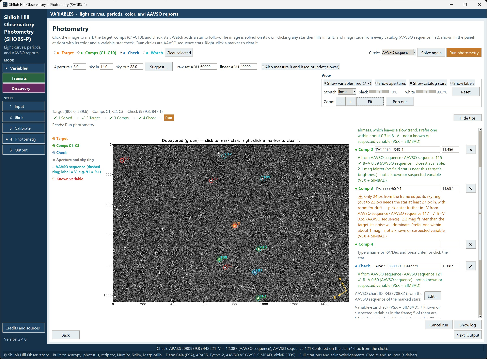
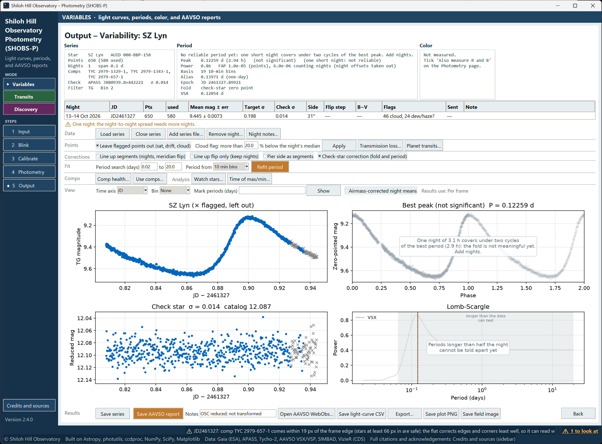
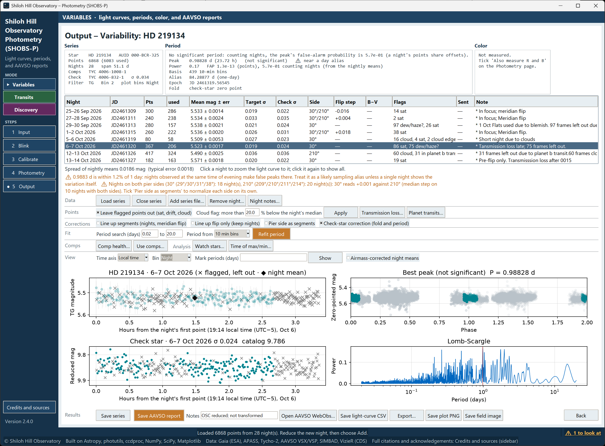

# 9. Reduce a variable-star night

This chapter takes one night of a variable star from folders to a light curve. It assumes you have read chapters 5 to 8, which cover the steps every mode shares. Here we stay in **Variables** mode and focus on what matters for variable-star work: the target, the comparison stars, the check star, and reading the **Output – Variability** page.

If you want to add this night to nights you already have, load the series *before* you run photometry. See chapter 10, [Build a multi-night series](10-build-a-multi-night-series.md).

## Before you start

- Choose **Variables** in the mode list on the left (navy).
- On the Input page, fill in the **AAVSO report** box once: your **Observer code**. The chart ID is not typed there: SHOBS-P fills it in after the solve, and shows it under the comps on the Photometry page (see **The AAVSO chart ID** below).
- Type your site in the **Site** box once. It is remembered. Without it there is no airmass, so the AAVSO report shows AMASS `na`, the error bars leave out scintillation, and the airmass check of the period (chapter 13) cannot run.

## Set the target

1. On the Input page, type the star's name in **Star ID**, for example `SZ Lyn`.
2. Press **Enter** (or click into another box). SHOBS-P looks the star up in SIMBAD and VSX; the busy bar at the bottom of the window says **Looking up SZ Lyn at SIMBAD and VSX…** meanwhile (chapter 3). Then the status bar shows where it found the star (**✔ SZ Lyn from SIMBAD: …**), its RA and Dec, and its VSX period and type when VSX has them.
3. If the lookup failed (no internet, unusual name, or no answer within 60 s), press **Look up again**, or type RA/Dec yourself. You can also go on without them: the plate solution can fill them in later.

> **Tip:** Reducing a different star than last time? Press **New reduction** on the Input page first (chapter 5). It clears the old star's comps, check star and other settings, and puts the Output page's **Notes** back to the default (**OSC reduced; not transformed**), so the old star's notes do not slip into this star's report.

> **Tip:** WebObs matches reports to stars by name. When you type a name that differs from AAVSO's spelling only in spacing or capitals (**hd219134**), the lookup switches the Star ID to AAVSO's spelling by itself and says so in the Log (**Star ID written the way AAVSO spells it: HD 219134 (was hd219134).**).

Then point the Input page at your frames, blink them, and calibrate, as in chapters 5 to 7.

## Mark the target, comps and check star

When the Photometry page opens, the image is solved on its own (chapter 8). The step strip above the image tells you what to do next: **1 Solve → 2 Target → 3 Comps → 4 Check → Run**.

### Target

If the Star ID lookup found RA/Dec, SHOBS-P usually places the Target marker (orange **T**) for you after the solve. The log says which star it used, and the click choice moves on to **●  Comps (C1–C10)** by itself (unless you already picked a choice on this image). Check that the marker is on your star. If it is not, or if no marker appeared:

1. Pick **●  Target** in the tools row.
2. Click the target on the image. The marker snaps to the nearest star.

### Comparison stars: AAVSO sequence first

For AAVSO work, the best comps are the stars of the AAVSO comparison sequence. They are drawn as **thin dashed cyan rings**, labeled with their V magnitude without the decimal point (for example `112` means V 11.2). When you use them, the report names them by their AUID and other observers' data can be compared with yours.

1. Pick **●  Comps (C1–C10)**.
2. Click a comp star. Thick green rings labeled **S1**, **S2** … mark **suggested comps**: stars near the target's brightness and color, with AAVSO sequence stars preferred. A line per suggestion under the **Stars** panel says why it was picked.
3. Look at the comp's row in the **Stars** panel at the right. Its name (AUID or catalog name) and magnitude fill in from the catalogs. The line under it says where the magnitude came from, whether the star is a known variable, and how far it is from the target in brightness and color.
4. Repeat for more comps. Two to five good comps is typical.

Why several comps? With two or more, SHOBS-P averages them into an *ensemble*. One comp's noise or quirks then matter less. Chapter 11 shows how to check them afterwards and swap a bad one out without reducing again.

What to aim for:

- Within about 1 magnitude of the target. A ⚠ note in the panel tells you when a comp is much brighter or fainter. If the field has only much fainter comps, see "Stacking when comps are weak" in chapter 8.
- Not too close to the frame edge. A comp that drifts off the edge in any frame is left out of the whole night (chapter 8, "Comps near the frame edge"). From 2.4.0 the green rings S1, S2 … never include a star that the night's drift takes near the edge, and the Stars panel line of a star you click says when the field drifts it toward or off the edge in later frames (chapter 8, "How S1–S4 are chosen").
- Similar color (B−V within about 0.3; from 2.3.4 the ⚠ note and the suggestions both use 0.3). A comp of another color dims differently with airmass and leaves a slow trend.
- Not a known variable. If you click one, SHOBS-P asks whether to use it anyway. Answer **No** unless you have a good reason.

If a comp has no magnitude in any catalog, the panel says so. Type its magnitude in the box beside the name, or pick another star.

To remove a comp, right-click its marker, or press **✕** in its row.

### Check star

The check star is a steady star measured exactly like the target. It does not go into the comparison. If the check star stays flat, your comps and reduction are behaving. AAVSO requires a check star for any report made with two or more comps.

1. Pick **●  Check**.
2. Click a steady star, ideally another sequence star of similar brightness. Its name and magnitude fill in like a comp's.

### The AAVSO chart ID

Under the comp and check rows of the **Stars** panel, one line shows the chart ID that will go into the AAVSO report, with an **Edit…** button beside it:

- **AAVSO chart ID: X36281ABC (from the AAVSO sequence of the marked stars)**: a marked comp or the check star is an AAVSO sequence star, so the report names that sequence's chart. Nothing to do.
- **AAVSO chart ID: na (no AAVSO sequence star is marked as a comp or the check)**: `na` is right when your comparison magnitudes come from another catalog.
- **… (typed)**: you typed it with **Edit…**. Later solves leave a typed ID alone.
- **… (from the saved series)**: it came with a series you loaded.

Press **Edit…** only when the comparison magnitudes come from an AAVSO chart that SHOBS-P could not fetch itself: the chart server was down at the solve, or you typed the magnitudes from a printed chart. Type the ID printed on the chart. Leave the box empty to go back to SHOBS-P's own value. The chart ID is never empty, and it is shown once more when you save the report (chapter 15).

## Run photometry

1. Check the aperture boxes (chapter 8 covers **Suggest…**). Use the same aperture sizes for every night of a series.
2. Press **Run photometry**.

SHOBS-P may ask a few questions before it starts. The ones you will meet most in Variables mode:

- **With N comps the AAVSO report is an ensemble, and AAVSO requires a check star…** You have no check star marked. Answer **No** and mark one, unless you will never report this night.
- **These have a name but no marker on this image…** A name is left over from an earlier night. **Stop to mark them** (the default) lets you click the stars; **Run without them (names cleared)** clears those names and runs.
- **These stars of the series have no marker on this image…** (from 2.4.0) The solve could not place a comp or the check of the open series. **Go on without them** (the default) keeps their names in the series; **Stop, so I can mark them** lets you click them first (chapter 8).
- **… is a known or suspected variable …** about a comp or the check. See above.
- **Run in Transits mode instead?**, if your target hosts a known transiting planet (from the **Planet (Transits)** box, or looked up in the NASA Exoplanet Archive after the Star ID lookup) and a transit is predicted during your frames. You do not need to have used Transits mode first. For variable-star work, answer **No** (run in Variables mode anyway).
- A ⚠ line in the log saying a marker is some pixels **from the center of the star** (also listed in the Findings panel; the run goes on). See chapter 8.

Chapter 8 lists the other checks. The busy bar at the bottom of the window counts the frames as they are measured (for example **Photometry… 12 of 38, about 1:20 left**), and you can stop with **Cancel run**. Nothing is added to a series if you cancel.

After the run, SHOBS-P may ask more questions:

- **Add these N points as the night of …** appears only if a series is open. See chapter 10.
- A question about dew or haze, or about frames during a planet transit. See chapter 12, [Flags and bad data](12-flags-and-bad-data.md).
- From 2.4.0 there is no warning box after the run. When a comp in use or the check was left out of more than 10 % of the night's frames (it went off the frame edge, for example), or more than 10 % of the night was skipped, the **Findings** list opens by itself with one line per star, and each line says what to do (for the check, which spare would have been better). The same lines are in the Log and stay on the Photometry page. A few skipped frames, or a star left out of a few frames (10 % of the night or less), are a plain note in the Log and on that page line. See chapter 8, "Comps near the frame edge", and chapter 12, "Stars near the frame edge".
- **This night's meridian-flip step is … mag ⚠ …** (from 2.4.0 also **This night's re-center step is … mag ⚠ …**, for a re-center without a flip, chapter 12) appears only when a series is open and saves itself, and the night has a large step at the flip (or re-center) that looks like an aperture problem rather than the star: the check star steps too, or the comp and check apertures jumped together at the flip (or, with no check star, the step is far beyond the night's scatter). **Yes** saves the night into the series file. **No** (the default) keeps the night on screen but out of the file: the night is *held*. Automatic saves after that (a note, a sent mark, changed comps, a night removed or added) still write everything else; the held night stays as the file had it (not at all for a new night, its earlier version if this run replaced one). The series line on the Input page says *"… is held (flip step ⚠), not in the file"* (or *re-center step ⚠*). Press **Save series** to keep it, or **Remove night…** to take it out. Chapter 12 explains flip steps.

Then the **Output – Variability** page opens.

**Weak comps?** The Photometry page now shows a Stack row with a suggestion line. When it says *"Comps are weak …"*, you can press **Stack** there and measure stacks of frames instead of single frames. The **Points** box on the Stack row then switches between **Per frame** and **Stacked**, and a **Results use: …** line says which set the Output page, the period search and the reports use. Chapter 8 explains it, under "Stacking when comps are weak". A stack hides changes faster than itself, so SHOBS-P keeps a stack to 1/50 of the VSX period.

## Read the Output page

The page heading names the star, for example **Output – Variability: SZ Lyn**. The page has, from top to bottom:

1. **Three summary boxes**: **Series**, **Period** and **Color**.
2. **The night table**, one row per night.
3. **Cautions**, in amber, each starting with ⚠.
4. **Seven rows of controls**, one per job, each with a small gray label at its left: **Data**, **Points**, **Corrections**, **Fit**, **Comps**, **Analysis** and **View** (the table below). After a night is stacked, the **View** row ends with **Results use: Stacked (N frames)** or **Results use: Per frame** (see chapter 8).
5. **Four plots**.
6. **The save area**: one **Results** row with the save buttons.

From 2.4.0 the controls are grouped by what they do, in the same rows and the same order as on the Transit fit page (chapter 17):

| Row | What it holds |
|---|---|
| **Data** | **Load series**, **Close series**, **Add series file…**, **Remove night…**, **Night notes…** (chapter 10) |
| **Points** | **Leave flagged points out (sat, drift, cloud)**, **Cloud flag: more than … % below the night's median** with **Apply**, **Transmission loss…**, **Planet transits…**, **Trim** from/to with **Trim** and **Clear trim** (one night at a time; gray until a night is chosen in the night table) (chapter 12) |
| **Corrections** | **Line up segments (nights, flips, re-centers)**, **Line up flip/re-center only (keep nights)**, **Pier side as segments**, **Check-star correction (fold and period)** (chapters 12 and 13) |
| **Fit** | **Period search (days)**, **Period from**, and the colored **Refit period** button (chapter 13) |
| **Comps** | **Comp health…**, **Use comps…** (chapter 11) |
| **Analysis** | **Watch stars…**, **Time of max/min…** (chapters 21 and 14) |
| **View** | **Time axis**, **Plot bins** (called **Bin** until 2.4.0; it bins the plot only), **Mark periods (days)** with **Show**, **Airmass-corrected night means**. These change only how the plots are drawn. |

Hover over a row's label to read what the row is for. A button that cannot work yet is greyed, and hovering over it says why (from 2.4.0): with no light curve, every button that needs one (**Save series**, the saves under the plots, **Export…**, **Comp health…**, **Use comps…**, **Time of max/min…**) is greyed; **Night notes…** and **Remove night…** wait for a night chosen in the night table; and while a step runs (the busy bar), the buttons that start or change one are greyed until it ends. A setting in **Points**, **Corrections** or **Fit** runs the period search again by itself; when the result changes, the **Period** box is highlighted for a moment and its title reads **Period: updated**, so you can see that it did. On a narrow window a row wraps onto a second line.

### The Series box

- **Star**: the star's name, and its AAVSO AUID when VSX knows one.
- **Points**: how many points in total, and how many are used. The rest are flagged (chapter 12).
- **Nights** and the time **span**.
- **Comps**: the comparison stars in use.
- **Check**: the check star and its scatter (σ). A check σ close to the target's scatter on a constant star tells you the noise floor of your setup. If the check star has no catalog magnitude, it says `(instrumental)`.
- **Filter**: the AAVSO filter code (for example TG for the green channel of a color camera, V for a V filter), and the camera binning.

### The night table

| Column | What it shows |
|---|---|
| **Night** | The night as an evening–morning date, e.g. `1–2 Oct 2026` |
| **JD** | The night's key, used in file notes and messages |
| **Pts** / **used** | Points measured, and points used |
| **Mean mag ± err** | The night's mean magnitude |
| **Target σ** | The target's scatter that night |
| **Check σ** | The check star's scatter that night |
| **Side** | Pier side(s), when known; **—** when unknown, and always on an alt-az mount |
| **Flip/re-center step** | The jump at a meridian flip, e.g. `+0.012`; ⚠ when it is large. On a night where the mount re-centered without flipping (from 2.4.0), each step says what it is, e.g. `re-center +0.050 ⚠` or `re-center +0.004, flip +0.012` (chapter 12) |
| **B−V** | The night's color, if you measured it |
| **Flags** | Counts of flagged points, e.g. `12 cloud, 3 sat` |
| **Sent** | Where and when the night's report was sent, e.g. `✓ WebObs 2026-10-18`, or **—** (chapter 15) |
| **Note** | Your night note (chapter 10) |

Click a row to zoom the light curve and check-star plot to that night. Click it again to show all nights.

Two lines can appear under the table: the spread of the nightly means (with two or more nights), and an orange ⚠ line with the series' cautions. From 2.4.0 each takes room only while it has something to say, so the plots are a little taller without them and move down a line when one appears.

> **Caution:** While a night is highlighted, **Save AAVSO report** and **Save light-curve CSV** save that night only: the first box on the **Results** row says **Saving: night …** (open it to choose the whole series instead; chapter 15), and **Save plot PNG** saves what is on screen. Click the row again when you want the whole series.

### The four plots

- **Top left, the light curve.** One color per night. Gray **×** are flagged points, left out. Points ringed **○** come after a meridian flip. If you choose **Plot bins** (for example **Night** or **30 min**), black **◆** show the binned means. The **Time axis** box switches between **JD**, **UTC** and **Local time**. Local time is the site's (the **Time zone** in the Site box), and the axis says its offset, for example **Local time (UTC−5)**. Hover over a point to see its details.
- **Top right, the phase plot.** The used points folded on the best period from the periodogram. Its title says **Folded** only when the period is significant; otherwise it says **Best peak (not significant)**. Chapter 13 explains.
- **Bottom left, the check star.** It should be flat. Its title gives its scatter and catalog magnitude.
- **Bottom right, the periodogram** (Lomb-Scargle). See chapter 13.

On a single night, the fold and periodogram are often grayed with a note that one night covers under two cycles. That is normal: a light curve from one night is still useful, but a period needs more nights.

### What a good night looks like

- The check star plot is flat, with no steps or trends.
- **Check σ** is small and similar to the target's σ if the target is steady over the night.
- Few flagged points, and no ⚠ cautions you do not understand. Chapter 23 explains each caution.

## Save your results

Under the plots is the save area: the **Results** row. It has:

- **Save series**: keeps this night (or the whole series) for later; see chapter 10.
- **Save AAVSO report**: see chapter 15. The **Notes** box beside it holds the report's notes. **Open AAVSO WebObs…** opens the AAVSO's upload page. When VSX knows your star but has no AUID for it, an orange line under this row says **⚠ No AUID: WebObs will reject this report. …** (chapter 15).
- **Save light-curve CSV**: every point, including flagged ones with their flag word. A long series can take a few seconds; the CSV is written in the background, the busy bar says, for example, **Saving the light-curve CSV (412 points)…**, and then the status bar says **✔ Saved …**.
- **Export…**: a CSV for other programs, with a choice of time system (JD, HJD or BJD_TDB), magnitudes or flux, binning, and extra columns. After **Export…** the window itself says what it wrote, for example **Exported 245 rows to …\GSC_03308-00462_HJD_UTC_mag.csv** (from 2.3.3), or why it could not write (a file open in Excel, say).
- **Save plot PNG**: the four plots with the summary boxes and cautions above them.
- **Save field image**: a picture of the reference frame as shot (not turned), with yellow **N** and **E** arrows showing where north and east lie, a scale bar, and the target, comps and check star marked with their apertures. (On an unsolved image the arrows are replaced by "Orientation unknown (the image is not solved)".) The AAVSO chart of the same field is fetched and saved beside it when the AAVSO's chart server answers, so you can compare the two. **Save AAVSO report** saves both by itself, next to the report: the field image comes with the report. After that the button reads **Field image saved ✓** and is grayed out (hover over it for the file's path), so a second, identical image is never made. If the image was saved but the chart server did not answer, the button reads **Fetch AAVSO chart** and fetches only the chart, beside the image. A new night, a new reduction, another series or a changed star marker makes it **Save field image** again.

**Refit period** is now in the **Fit** row above the plots.

If you set an **Output** folder on the Input page, these files go there without a dialog, and the report, CSV, plot and field image of one set of results share a number so they belong together. Without an Output folder, the save dialog opens in the folder you last saved to (this session) with the next free name already filled in. A name typed with a number after the extension (such as `…_SHOBS-P.txt.2`) is tidied to `…_SHOBS-P_2.txt`, and never overwrites a file. Chapter 22 lists every file SHOBS-P writes.

To keep this night for later, press **Save series** (chapter 10). Nothing is written to disk until you save.

> **Caution:** A single night that was never saved as a series closes without a question. If you want to keep it, press **Save series** before you close SHOBS-P. (A series file with unsaved changes, or an unsaved series of two or more nights, is offered a save when you close the window.)

---

Previous: [8. Photometry page basics](08-photometry-basics.md) · Next: [10. Build a multi-night series](10-build-a-multi-night-series.md)
