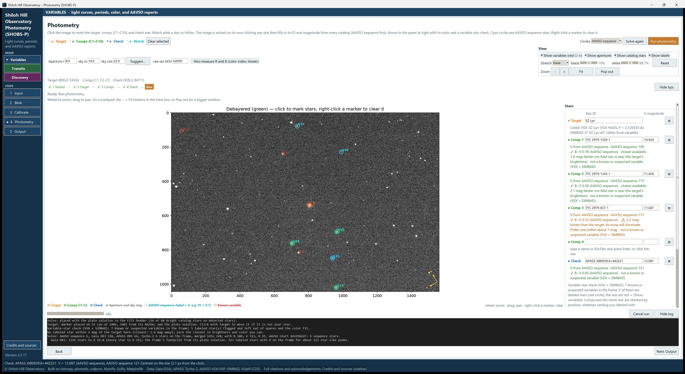
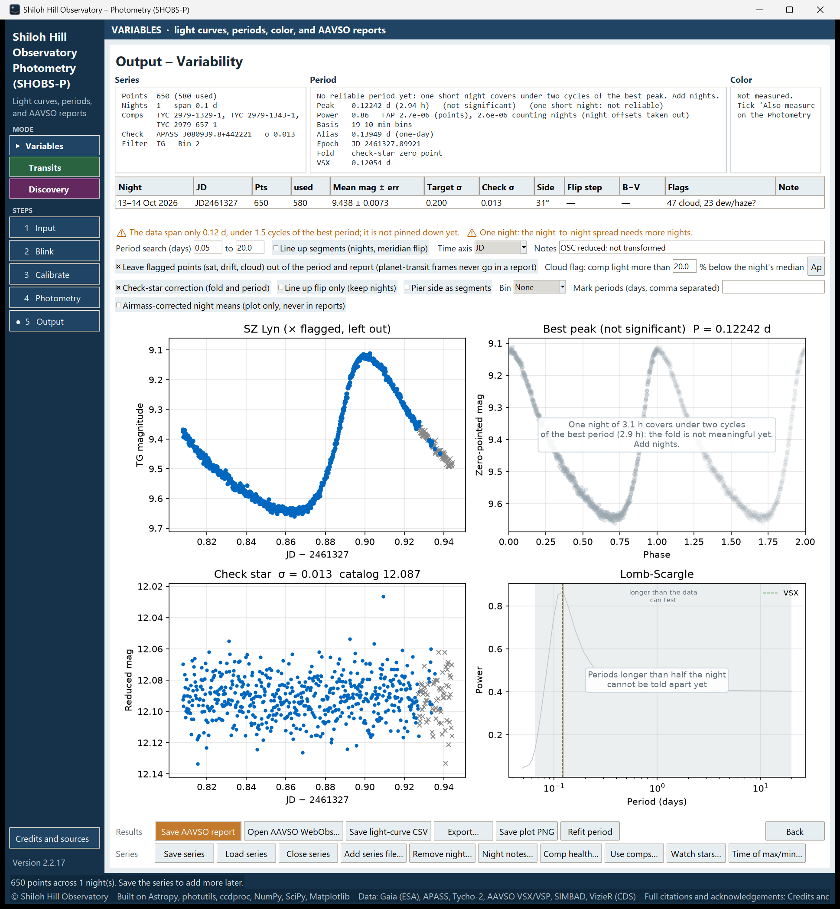
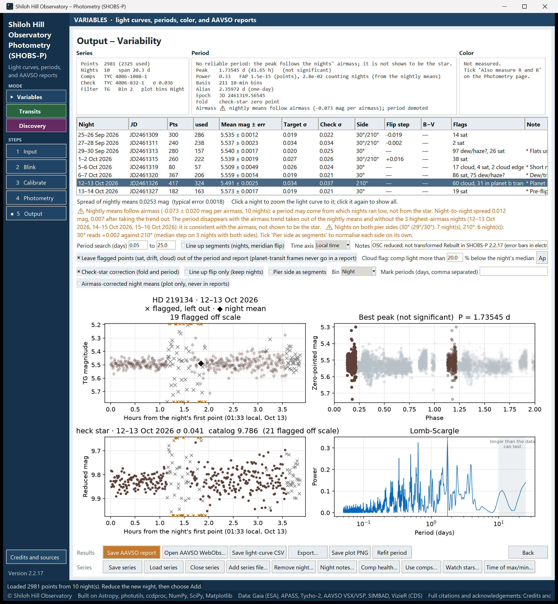

# 9. Reduce a variable-star night

This chapter takes one night of a variable star from folders to a light curve. It assumes you have read chapters 5 to 8, which cover the steps every mode shares. Here we stay in **Variables** mode and focus on what matters for variable-star work: the target, the comparison stars, the check star, and reading the **Output – Variability** page.

If you want to add this night to nights you already have, load the series *before* you run photometry. See chapter 10, [Build a multi-night series](10-build-a-multi-night-series.md).

## Before you start

- Choose **Variables** in the mode list on the left (navy).
- On the Input page, fill in the **AAVSO report** box once: your **Observer code**, and the **Chart ID** if you know it. SHOBS-P fills in the chart ID for you when you use AAVSO sequence stars as comps (see below), so you can leave it empty.
- Type your site in the **Site** box once. It is remembered. Without it there is no airmass, so the AAVSO report shows AMASS `na`, the error bars leave out scintillation, and the airmass check of the period (chapter 13) cannot run.

## Set the target

1. On the Input page, type the star's name in **Star ID**, for example `SZ Lyn`.
2. Press **Enter** (or click into another box). SHOBS-P looks the star up in SIMBAD and VSX. The status bar shows where it found it, its RA and Dec, and its VSX period and type when VSX has them.
3. If the lookup failed (no internet, unusual name), press **Look up again**, or type RA/Dec yourself. You can also go on without them: the plate solution can fill them in later.

> **Tip:** If an amber line appears under Star ID saying how AAVSO spells the name (for example **AAVSO spells this “HD 219134”**), press **Use it**. WebObs matches reports to stars by name, so the AAVSO spelling saves trouble later.

Then point the Input page at your frames, blink them, and calibrate, as in chapters 5 to 7.

## Mark the target, comps and check star

When the Photometry page opens, the image is solved on its own (chapter 8). The step strip above the image tells you what to do next: **1 Solve → 2 Target → 3 Comps → 4 Check → Run**.

### Target

If the Star ID lookup found RA/Dec, SHOBS-P usually places the Target marker (orange **T**) for you after the solve. The log says which star it used, and the click choice moves on to **●  Comps (C1–C10)** by itself (unless you already picked a choice on this image). Check that the marker is on your star. If it is not, or if no marker appeared:

1. Pick **●  Target** in the tools row.
2. Click the target on the image. The marker snaps to the nearest star.

### Comparison stars: AAVSO sequence first

For AAVSO work, the best comps are the stars of the AAVSO comparison sequence. They are drawn as **cyan circles**, labeled with their V magnitude without the decimal point (for example `112` means V 11.2). When you use them, the report names them by their AUID and other observers' data can be compared with yours.

1. Pick **●  Comps (C1–C10)**.
2. Click a comp star. Green rings mark **suggested comps**: stars near the target's brightness and color, with AAVSO sequence stars preferred.
3. Look at the comp's row in the **Stars** panel at the right. Its name (AUID or catalog name) and magnitude fill in from the catalogs. The line under it says where the magnitude came from, whether the star is a known variable, and how far it is from the target in brightness and color.
4. Repeat for more comps. Two to five good comps is typical.

Why several comps? With two or more, SHOBS-P averages them into an *ensemble*. One comp's noise or quirks then matter less. Chapter 11 shows how to check them afterwards and swap a bad one out without reducing again.

What to aim for:

- Within about 1 magnitude of the target. A ⚠ note in the panel tells you when a comp is much brighter or fainter.
- Similar color (B−V within about 0.5). A comp of another color dims differently with airmass and leaves a slow trend.
- Not a known variable. If you click one, SHOBS-P asks whether to use it anyway. Answer **No** unless you have a good reason.

If a comp has no magnitude in any catalog, the panel says so. Type its magnitude in the box beside the name, or pick another star.

To remove a comp, right-click its marker, or press **✕** in its row.

### Check star

The check star is a steady star measured exactly like the target. It does not go into the comparison. If the check star stays flat, your comps and reduction are behaving. AAVSO requires a check star for any report made with two or more comps.

1. Pick **●  Check**.
2. Click a steady star, ideally another sequence star of similar brightness. Its name and magnitude fill in like a comp's.

## Run photometry

1. Check the aperture boxes (chapter 8 covers **Suggest…**). Use the same aperture sizes for every night of a series.
2. Press **Run photometry**.

SHOBS-P may ask a few questions before it starts. The ones you will meet most in Variables mode:

- **With N comps the AAVSO report is an ensemble, and AAVSO requires a check star…** You have no check star marked. Answer **No** and mark one, unless you will never report this night.
- **These have a name in the Stars panel but no marker on this image…** A name is left over from an earlier night. **Yes** clears those names, **Cancel** lets you mark the stars.
- **… is a known or suspected variable …** about a comp or the check. See above.
- **Run in Transits mode instead?**, if your target hosts a known transiting planet (from the **Planet (Transits)** box, or looked up in the NASA Exoplanet Archive after the Star ID lookup) and a transit is predicted during your frames. You do not need to have used Transits mode first. For variable-star work, answer **No** (run in Variables mode anyway).
- A ⚠ line in the log saying a marker is some pixels **from the center of the star**. See chapter 8.

Chapter 8 lists the other checks. The progress bar shows each frame as it is measured, and you can stop with **Cancel run**. Nothing is added to a series if you cancel.

After the run, SHOBS-P may ask more questions:

- **Add these N points as the night of …** appears only if a series is open. See chapter 10.
- A question about dew or haze, or about frames during a planet transit. See chapter 12, [Flags and bad data](12-flags-and-bad-data.md).
- A warning that a comp or the check is near the frame edge or a weak part of the flat. Consider other stars next time.

Then the **Output – Variability** page opens.

## Read the Output page

The page has, from top to bottom:

1. **Three summary boxes**: **Series**, **Period** and **Color**.
2. **The night table**, one row per night.
3. **Cautions**, in amber, each starting with ⚠.
4. **Three rows of settings** (period search, quality control, tools) and one view switch.
5. **Four plots**.
6. **Two button rows**: **Series** and, under it, **Results**.

### The Series box

- **Points**: how many points in total, and how many are used. The rest are flagged (chapter 12).
- **Nights** and the time **span**.
- **Comps**: the comparison stars in use.
- **Check**: the check star and its scatter (σ). A check σ close to the target's scatter on a constant star tells you the noise floor of your setup. If the check star has no catalog magnitude, it says `(instrumental)`.
- **Filter**: the AAVSO filter code (for example TG for the green channel of a color camera, V for a V filter), and the camera binning.

### The night table

| Column | What it shows |
|---|---|
| **Night** | The night as an evening–morning date, e.g. `1–2 Oct 2026` |
| **JD** | The night's key, used in file notes and messages |
| **Pts** / **used** | Points measured, and points used |
| **Mean mag ± err** | The night's mean magnitude |
| **Target σ** | The target's scatter that night |
| **Check σ** | The check star's scatter that night |
| **Side** | Pier side(s), when known; **—** when unknown, and always on an alt-az mount |
| **Flip step** | The jump at a meridian flip; ⚠ when it is large |
| **B−V** | The night's color, if you measured it |
| **Flags** | Counts of flagged points, e.g. `12 cloud, 3 sat` |
| **Sent** | Where and when the night's report was sent, e.g. `✓ WebObs 2026-10-18`, or **—** (chapter 15) |
| **Note** | Your night note (chapter 10) |

Click a row to zoom the light curve and check-star plot to that night. Click it again to show all nights.

> **Caution:** While a night is highlighted, **Save AAVSO report** and **Save light-curve CSV** ask whether to save that night only or the whole series, and **Save plot PNG** saves what is on screen. Click the row again when you want the whole series.

### The four plots

- **Top left, the light curve.** One color per night. Gray **×** are flagged points, left out. Points ringed **○** come after a meridian flip. If you choose a **Bin** (for example **Night** or **30 min**), black **◆** show the binned means. The **Time axis** box switches between **JD**, **UTC** and **Local time**. Hover over a point to see its details.
- **Top right, the phase plot.** The used points folded on the best period from the periodogram. Its title says **Folded** only when the period is significant; otherwise it says **Best peak (not significant)**. Chapter 13 explains.
- **Bottom left, the check star.** It should be flat. Its title gives its scatter and catalog magnitude.
- **Bottom right, the periodogram** (Lomb-Scargle). See chapter 13.

On a single night, the fold and periodogram are often grayed with a note that one night covers under two cycles. That is normal: a light curve from one night is still useful, but a period needs more nights.

### What a good night looks like

- The check star plot is flat, with no steps or trends.
- **Check σ** is small and similar to the target's σ if the target is steady over the night.
- Few flagged points, and no ⚠ cautions you do not understand. Chapter 23 explains each caution.

## Save your results

The **Results** row has:

- **Save AAVSO report**: see chapter 15. **Open AAVSO WebObs…** beside it opens the AAVSO's upload page.
- **Save light-curve CSV**: every point, including flagged ones with their flag word.
- **Export…**: a CSV for other programs, with a choice of time system (JD, HJD or BJD_TDB), magnitudes or flux, binning, and extra columns.
- **Save plot PNG**: the four plots with the summary boxes and cautions above them.
- **Refit period**: runs the period search again.

If you set an **Output** folder on the Input page, these files go there without a dialog, and the report, CSV and plot of one set of results share a number so they belong together. Chapter 22 lists every file SHOBS-P writes.

To keep this night for later, press **Save series** (chapter 10). Nothing is written to disk until you save.

> **Caution:** A single night that was never saved as a series closes without a question. If you want to keep it, press **Save series** before you close SHOBS-P. (A series file with unsaved changes, or an unsaved series of two or more nights, is offered a save when you close the window.)

---

Previous: [8. Photometry page basics](08-photometry-basics.md) · Next: [10. Build a multi-night series](10-build-a-multi-night-series.md)
