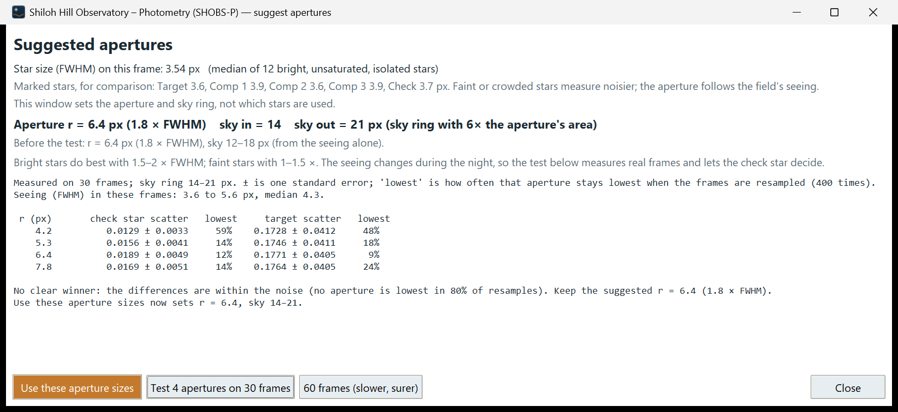
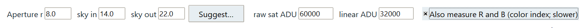
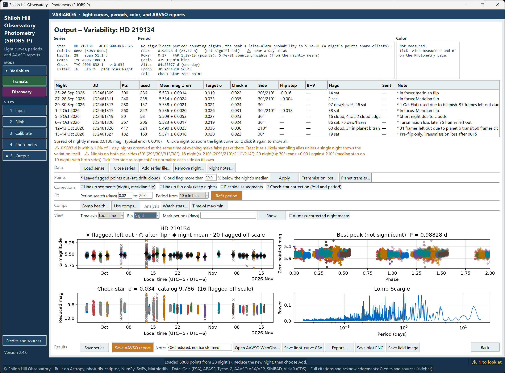

# 10. Build a multi-night series

Most variable-star questions need more than one night: a period, a time of minimum, a slow trend. In SHOBS-P a *series* holds all the nights of one star, in one mode, in a single file ending in `.cvseries`. This chapter shows how to start one, add nights to it, and look after it.

## What a series keeps

A series file keeps every point of every night, with its flags, plus the settings you used: the Star ID, comps and check star with their names and catalog magnitudes, the aperture sizes, the period search range, your night notes, which comps you chose with **Use comps…**, your answers about dew/haze and planet transits, and which nights you have already sent in a report (the **Sent** column, chapter 15). Each night also keeps its mount (alt-az nights have no pier sides) and, for color images that were already debayered, the channel measured.

It does **not** keep star positions on the image, but it does keep each comp's and the check star's position on the sky. On every new night the solve places the target from its RA/Dec and, from 2.3.4, the series' comps and check star from their sky positions, so a series night is usually: calibrate, wait for the solve, **Run photometry**.

### One record per comp and check star

From 2.4.0 the series keeps a small record for every comp and for the check star. The star's **position on the sky** is what identifies it. Two names within about 1″ of each other are the same star, whatever the catalogs call it.

- **Every name is kept.** The Gaia DR3 number, the Tycho (TYC) name, the APASS name, the AAVSO label and AUID, or a position you typed are all names of the one star. Rest the pointer on a comp's or the check's name box on the Photometry page to see its other names and each catalog's magnitude.
- **Every magnitude is kept with its source**, for example APASS DR9 8.728 and Gaia DR3 8.704, plus which one the series uses.
- **The name in the series does not change.** A star already in a series keeps the name the series has always used for it, so every night matches. A star you add for the first time gets its AAVSO AUID if it has one, else its TYC name, else its Gaia name, else its APASS name. It gets the same name whichever catalog happens to answer first that night.

**Older series files are updated by themselves.** The first time you load a series made before 2.4.0, SHOBS-P copies the file as it is to `<name>_backup.cvseries` beside it (or `_backup2`, `_backup3`… if that name is taken; a backup is never overwritten) and the log says **Series updated to the new star format; the original is kept as …_backup.cvseries.** Nothing else changes: the same names, the same magnitudes, the same points. The file itself is written in the new form at its next save. Older SHOBS-P versions can still read it. Loading the same old file again does not make a second copy: when a backup with exactly the file's contents is already there, the log says **…the original is already kept as …_backup.cvseries.**

**Load never changes the comps in use without asking.** A series made before 2.4.0 can list a star in its **Use comps…** choice that no comp box holds: you cleared it, or it moved off the frame. Load series then asks once: *The series' comps in use include …, but no comp box holds it (it was cleared, or moved off the frame).* **Leave it out** (the default: Enter) re-derives every night with the other comps, exactly as **Use comps…** would (from the stored measurements; nothing is measured again), and the series shows as not saved until you save it. **Keep it** (also Escape, or closing the question) leaves the series as it was saved and puts the star back in the comp box. Either way the **Comps loaded:** line in the log says what was done. A series saved by 2.4.0 is not asked about: you were asked when it was saved (see "Comps you clear stay cleared" below). Discovery series are not asked either.

## Starting a new series

The first night sets the rules for every night after it. Changing the aperture, the comps or the check star later means redoing every night, so choose them with care on night 1:

1. **Aperture.** Press **Suggest…** (chapter 8) and keep the aperture radius at least about 1.5 × the FWHM (2 × for bright or defocused stars). Then keep it for the whole series. An aperture of only about 1.1 × the FWHM loses light that changes with the seeing (on GSC 03308-00462 it cost about 0.2 mag and SHOBS-FLUX called it not photometric).
2. **Colour.** Tick **Also measure R and B** on night 1, so the series has the target's own B−V. The suggested comps then use it (see "How S1–S4 are chosen" in chapter 8).
3. **Comps.** Within about 0.2 in B−V and about 1 mag of the target, steady (check them with **Comp health…** after a few nights, chapter 11), and well inside the frame, so a small framing shift on another night does not push them off.
4. **Check star.** Colour-matched too: a check of another colour drifts with airmass on hazy nights and looks like a problem that is not there.
5. **Linear limit.** Comps and the check under the **linear ADU** limit on the sharpest frames, not just the reference frame: a night of better seeing makes the same star peak higher.
6. **Lock it in.** Press **Save series**. If you change any of these later, redo every night with the new choice.

## Start a series

1. Reduce the first night as in chapter 9.
2. On the Output page, press **Save series**.
3. Choose a folder and a name. The default name is the Star ID with spaces turned into underscores, for example `SZ_Lyn.cvseries`.

The status bar then reminds you: **Next night, load this file before reducing**.

## Add a night

The order matters: load first, reduce second.

1. On the Input page, press **Load series…** and open the series file. (The Output page has the same button, **Load series**.) A large series (thousands of points over dozens of nights) takes a few seconds; the busy bar at the lower left says what is being done: **Loading SZ_Lyn.cvseries… reading the file**, then **… the period search**, then **… drawing the light curve**.
2. The log lists what the series brought, for example **Comps loaded: C1 TYC 4006-1008-1 V 8.728 (APASS DR9); check TYC 4006-832-1 V 9.786.** Read it: a comp you did not expect shows here at once. A message also tells you how many points and nights were loaded, and that the comps and check are placed on their stars after the image is solved. If the Photometry page already has a solved image (say you pressed **New reduction** and then loaded the series), SHOBS-P solves it again at once, so the target, the series' comps and check and the suggested comps are placed without pressing **Solve again**. If the image has a plate solution but no catalog stars (the catalogs did not answer), the series' comps and check are placed right away from their saved positions. If a job is running at that moment, the log says they are placed by the next solve (press **Solve again** when the job ends if they are still unmarked).
3. The line at the top of the Input page now reads something like **Series: SZ_Lyn.cvseries — 8 nights, last 13–14 Oct. After the run you'll be asked to add the night.**
4. Point the Input page at the new night's bias, dark, flat and lights, and blink and calibrate as usual.
5. On the Photometry page, wait for the solve. It places the target, the **same comps** and the **same check star** as before, and each row says **✓ placed after the solve …; magnitude … kept as loaded** (the series' magnitude is kept, never replaced by a catalog's).

   **The series owns its stars (from 2.4.0).** Each comp and the check is placed from the sky position the series saved for it, projected through tonight's plate solution and then centered on the star like a click. Tonight's catalogs are not asked who the star is, so a comp saved under a Gaia name is found on a night when Gaia did not answer, and a catalog's different name for the same star (within about 1″) is noted as another name, never a rename. The Log has **one line per star** saying what happened:

   - *Comp 1 TYC 4006-1008-1 placed from the series position, centered (0.8 px from where the position falls); magnitude 8.728 kept as loaded.* The distance is from where the saved position falls on tonight's image to the star's center.
   - *Comp 2 Gaia DR3 … placed from the series position, centered (0.4 px from where the position falls) = APASS J… in tonight's catalogs (the same star; the series' name is kept); magnitude … kept as loaded.*
   - *… centered (3.1 px from where the position falls); tonight's catalog star there is 3.0" from the stored position (more than the 1" that makes it surely the same star): check it is the right star; …* The star was found as usual, but tonight's catalog puts it a little away from where the series saved it. Look at the marker once.
   - *⚠ Comp 4 APASS J185609.9+692057 placed from the series position, centered by a wider search, 6.8 px from where the position falls — more than the normal centering allows (22 px from the top edge). Check it is the right star; magnitude … kept as loaded.* The plate solution was several pixels out there (usual near the frame edge). The line is also in the Findings panel; look at the marker once. SHOBS-P only does this when no other catalog star of similar brightness is that close and the star has the brightness the series has for it.
   - *Comp 3 … is not on this frame tonight: its position (…) falls at (250, -40), 40 px beyond the top edge. It is not measured tonight; its name and magnitude stay.* A star is called off the frame only when its position really is off it (beyond the edge by more than the aperture radius). Its row keeps the name and says **not on this frame tonight**; nothing is measured for it, the other comps measure the night, and the series still has the star for the next night. To use another star tonight, just click it: it goes into the next free comp row.
   - *⚠ Comp 3 … couldn't be placed: no star was found within 11 px of where the series position falls, at (36, 200). Solve again, or click the star.* The solve is weak there, or the star is not where the series says. The name stays; the line is also in the Findings panel.
   - *⚠ Comp 3 … placed from the series position at (x, y) but not centered on a star: … Click the star to center it.* A star is there but SHOBS-P could not tell which one to center on: another catalog star lies within reach (*another catalog star (TYC …) lies within 11 px*), tonight's catalog has this very star more than 1″ from where the series saved it (*tonight's catalog position of this star disagrees with the series' stored position (by 6.3")*), the image has no field zero point so the star's brightness could not be checked (*a star lies 5.7 px from it (farther than the normal centering allows), but no brightness check was possible on this image (no field zero point)*), or the star it found is too bright or too faint to be the series' star (*the brightest star within 11 px reads about V 10.5, too bright to be this star (V 12.00), so the marker was not moved onto it*). Click the right star.
   - *⚠ Comp 1 …: the star centered on looks 2.3 mag fainter than the series' V (V 14.3 on this image, V 12.00 in the series); check it is the right star.* The marker was centered as usual, on a star no catalog has, and that star reads far fainter than the series' magnitude for this comp (2 mag or more). It may be a faint neighbor of a star that is not where the series says. The marker is where it always went; the line is also in the Findings panel. Look at it once, and click the right star if it is wrong.
   - *Comp 1 …: already marked at (x, y), 0.6 px from where its series position falls.* A marker you (or an earlier frame) placed is left alone; the line tells you how well it agrees with the series.

   A name with no saved position (a series from before 2.2.3) is found by its name in tonight's catalogs instead, and the line says so; if that fails too, it asks you to press **Enter** in its box or click the star. A comp or check that is *not* one of the series' stars and is off tonight's frame is still cleared, with **⚠ Not on this frame, so taken out of tonight's comps (not measured): …**. Clicking a star that the series already knows puts it back into its own row, whatever tonight's catalogs call it. If the series has a **Use comps…** choice, the comp rows show the comps in use; the series' other comps are found after the solve and still measured on every frame as spares, so a later **Use comps…** can bring them back (chapter 11).
6. Use the same aperture sizes as the other nights.
7. Press **Run photometry**.
8. When asked **Add these N points as the night of … to the M points already in the series?**, answer **Yes**.

**Yes** adds the night and keeps every earlier night. Because the series file is open, SHOBS-P saves it at once (the status bar says **Auto-saved to …**). The one exception is a night with a large meridian-flip step that looks like an aperture problem: SHOBS-P asks before saving it (chapter 9, "After the run"), and if you answer **No**, the file is left as it was until you press **Save series**.

**Stacked nights.** If you stack a night (chapter 8, "Stacking when comps are weak"), the series keeps only the set
the **Points** box has chosen, **Per frame** or **Stacked**. Switching the Points box saves the series again with the
chosen set, as a run does. Loading or closing a series puts the Points box back to **Per frame**. Nights of one series
can differ: a stacked night carries its stack size and effective exposure, a per-frame night none.

**No** starts a *new* series with this night only. The old file on disk is not changed, but the new series is not saved until you press **Save series** and give it a new name.

> **Tip:** If the Input page says **No series loaded — this run will be a single night**, you forgot to load the series. You can still add the night afterwards: save tonight as its own series, load the main series, and use **Add series file…** (below).

## The warnings in the add-night question

The add-night question may carry one or more warnings. Each one is about something that can put a step between nights that is not the star.

**Careful: the series is V and this night is TG.**
Different filters do not belong in one series. Answer **No** unless you mean to mix them.

**Careful: this night used different stars than the series.**
It lists the series' comps and check and tonight's. Different comps put each night on its own zero point. Usually it is better to answer No, go back to the Photometry page, mark the series' comps, and run again. If a comp was missing tonight (off the frame, for example), you can add the night anyway and then use **Use comps…** (chapter 11) to pick a set every night shares. Comps that simply follow the series' **Use comps…** choice do not count as different stars: the night is put into the series' comp layout by name.

**One star, one name: …**
The same star appears under another name tonight (for example a Gaia name tonight and a Tycho name in the series, or a position you typed because a catalog was down). SHOBS-P compares positions with the ones the series has stored, so a star typed as `02:47:03.45 +50:43:31.2` is recognized as the series' Gaia star at that spot and is not reported as a different star. **Yes** uses the series' names and catalog magnitudes for this night, so every night stays on one zero point. This is almost always what you want.

**Careful: this night comes from other equipment or another observer.**
Untransformed nights from different instruments can sit tenths of a magnitude apart. A separate series is usually better: answer **No**.

**Careful: this night was reduced differently from the series.**
It lists what changed, for example the binning, the aperture, or the channel of already-debayered color images (for example `channel of the color images: green (TG) on this night, red (TR) on …`). Nights reduced differently can sit on different zero points. Consider reducing again with the series' settings.

**The night of … is already in the series.**
**Yes** replaces that night's points with this run. The other nights stay.

## The series' magnitudes win

Once a series has a magnitude for a comp or the check star, every later night uses it. A star click or a catalog lookup that comes back with another value does not replace it. The box keeps the series' value, and the star's row says, for example:

> Series uses 8.728 (APASS DR9); Gaia DR3 says 8.704 (Series magnitudes… below)

A **Series magnitudes…** button appears under the Stars panel. It lists each such star with two choices:

- **Keep series value** leaves everything as it is. This is the usual answer: one magnitude per star keeps every night on one zero point.
- **Use new value (re-calibrates every night)** changes the magnitude for the whole series in one step. SHOBS-P first copies the series file as it is to `<name>_backup.cvseries` (or the next free `_backup2`, `_backup3`…), then shifts every night's magnitudes by exactly the change. Nothing is measured again; errors and flags stay as they were. With several comps each point moves by the change in the average of its comps' catalog magnitudes. If the backup cannot be written, nothing is changed. If the series file itself cannot be written afterwards, a ⚠ box says so: the new values are in SHOBS-P, the file still holds the old ones, and the series shows as not saved until **Save series** works. While SHOBS-P is busy with something else the button does nothing but say so; press it again afterwards.

If you type another magnitude into the box of a series star yourself, the same happens once you leave the box: the series' value comes back and your value is offered under **Series magnitudes…**. A value that cannot be a real magnitude (99.999, or an APASS value brighter than 4) is not offered at all; the log says it was not taken.

The Output page's Series box shows what the series uses in its **Mags** line, in the order of the comps, then the check, for example `Mags    V 8.728 (APASS DR9), check V 9.786 (APASS DR9)`. The same is written in a report's settings file (**Series magnitudes (value and source): …**). A source of *typed* means you typed the value; *from the series file* means an older series held it without saying where it came from.

## Comps you clear stay cleared

The comp slots on the Photometry page are what the series saves. If you clear a comp with its **✕** (or **Clear selected**) and it was one of the series' **Use comps…** stars, the next save of the series (your own **Save series**, or the save after a night is added) asks once, with the same buttons as the Load question: *… is in the series' comps in use, but you cleared its comp box.*

- **Leave it out** (the default: Enter) re-derives every night with the other comps, exactly as **Use comps…** does (chapter 11), and then saves. The saved nights and the saved choice agree, and Load series never puts the star back. The log says **… left out of the series' comps in use (its comp box was cleared): every night is re-derived with …, as Use comps… does.**
- **Keep it** (also Escape) saves the series as it is: the star stays in the comps in use and the nights keep their values. Its comp box stays empty for now; the next Load series puts the star back in its box without asking. The log says **… kept in the series' comps in use (its comp box is empty); the nights are unchanged.**

SHOBS-P never takes a star out of the saved choice without re-deriving the nights: a file whose nights were reduced with three comps but whose choice names two would shift wrongly the next time a catalog magnitude is changed. A comp that only moved off the frame one night is not asked about and stays in the choice. If you put the star back in its box before the save, nothing is asked.

A star can be a comp or a Watch star, not both. Adding a comp to the Watch stars, or marking a Watch star as a comp, is refused with a message that says how to move it (clear the comp slot, or take the star off the Watch list, first).

## Night notes

A note travels with a night: in the night table's **Note** column, in the light-curve CSV and in exports. Use it for anything you want to remember: thin cloud after 2 a.m., focuser slipped, moon nearby.

1. On the Output page, click the night's row in the night table.
2. Press **Night notes…** (gray until a night is chosen; from 2.4.0 there is no list of numbers to type from).
3. Type the note, or leave it empty to remove one.

## Other series tools

All of these are in the **Data** row at the top of the Output page's controls (from 2.4.0; **Save series** stays under the plots, in the **Results** row). When the series has a file, each of them saves the file straight away.

- **Add series file…** merges another saved series into the one that is open, for example a night you saved on its own. You see how many points and which nights will be added, with warnings if the comps or reduction differ. Series from Variables and Transits modes cannot be merged.
- **Remove night…** removes the night chosen in the night table (click its row first; the button is gray until one is chosen, from 2.4.0). The question names the night by its dates and key, for example `22–23 Oct 2026 (JD2461336)`, and its points; confirm. This cannot be undone, except from the backup copy described below.
- **Close series** sets the series aside. The next run is a single night again. The file on disk is not changed.

In Transits mode, a series of one planet with two or more nights can be fitted together: **Fit the series' nights…** on the
Transit fit page's **Analysis** row opens the Multi-night window with every night of the series (chapter 17). The series
also remembers each night's saved fit CSV and AAVSO exoplanet report, and the alternative ephemeris you typed there.

If you load another series, close this one, switch modes, or close the SHOBS-P window while there are unsaved changes, SHOBS-P offers to save first: **Yes** saves, **No** goes on without saving, **Cancel** keeps the series open. When you close the window, it asks only if a series file has unsaved changes or a series of two or more nights has never been saved.

## Switching to another star

Press **New reduction** on the Input page before you start on another star (chapter 5). It closes the open series (offering a save first) and clears the old star's target, planet, comps, check and watch stars, **Use comps…** choice and rejected frames, and puts the Output page's **Notes** back to the default (*"OSC reduced; not transformed"*). Night notes stay with their nights in the series file. SHOBS-P also offers a new reduction by itself when the lights you choose are another star. This keeps one star's comps from being applied to another star's night.

As a last guard, a **Use comps…** choice whose stars were never measured on a new night is not applied to it. The log says, for example, "⚠ Use comps choice (…) not applied to …: … were not measured on any of its frames (another field's comps?). … for another star, use New reduction on the Input page."

When you load a series of a different star, SHOBS-P clears the current target's comps, check star and watch stars, so names from one field never end up in another. If it cannot tell from the positions whether the two names are the same star, it asks; **No** (the default) keeps what is marked.

## Report saves and the series file

Saving a report while a series file is open (**Save AAVSO report**, an AAVSO exoplanet report, **Save for ExoClock**,
an ExoFOP package, or marking nights sent) notes the report in the series, so the series file is rewritten. This is
never silent: the log says *"Series file updated: …"*, and the save's status line ends with **Series file updated:
SZ_Lyn.cvseries.**

The series keeps its own site (latitude, longitude, elevation) and AAVSO observer code; a report save does not
replace them with the Input page's. When the two differ (for example after you switched to another profile), SHOBS-P
asks once:

> This series was observed from 35.37, -81.96, 300 m, observer JABA; the Input page has 40, -100, 500 m, no observer
> code. Keep the series' site?

**Yes** (usually right) keeps the series' site and observer code in the file. **No** writes the Input page's into the
series. The answer is kept for the rest of the session for that series. **Save series** always writes what the Input
page shows.

## The field image of a loaded series

**Save field image** draws the frame on the Photometry page, so it needs a reduction of the series' own star. After
**Load series…** of another star than the one you last reduced (or with no frame at all), it does not draw the other
star's field under this series' name; it says *"Reduce a night of SZ Lyn first; the field image comes from a
reduction (the Photometry page's frame)."* Calibrate a night of the series' star, then save the field image. (After **Save AAVSO report** has saved the
field image with the report, the button reads **Field image saved ✓**; chapter 9.)

## The backup copy (`_prev`)

Every save replaces the series file. To protect you from a mistake, the first time SHOBS-P writes a series file in a session (whether you pressed **Save series** or it saved on its own), it first renames the old file to the same name with `_prev` added, for example `SZ_Lyn_prev.cvseries`. Later saves in the same session leave that copy alone.

So `_prev` is always the series as it was *before this session*. To go back to it:

1. Close SHOBS-P, or close the series.
2. In your file manager, rename or copy `SZ_Lyn_prev.cvseries` to a new name.
3. Load that file.

There is only one `_prev`. The next session replaces it. For a long campaign, it is worth keeping your own dated copies now and then.

> **Caution:** A single night that was never saved as a series closes without a question, and its points are lost. If your series has a file, adding a night saves it for you; a new series must be saved with **Save series**.

---

Previous: [9. Reduce a variable-star night](09-reduce-a-variable-night.md) · Next: [11. Check your comparison stars](11-check-your-comparison-stars.md)

There are two other copies, both made only on special occasions and never overwritten: `<name>_backup.cvseries` when an older series is updated to the 2.4.0 star format on Load (once: loading the same old file again makes no second copy), and again each time you press **Use new value** under **Series magnitudes…** (the next free name, `_backup2`, `_backup3`…). Load one like any series file.
