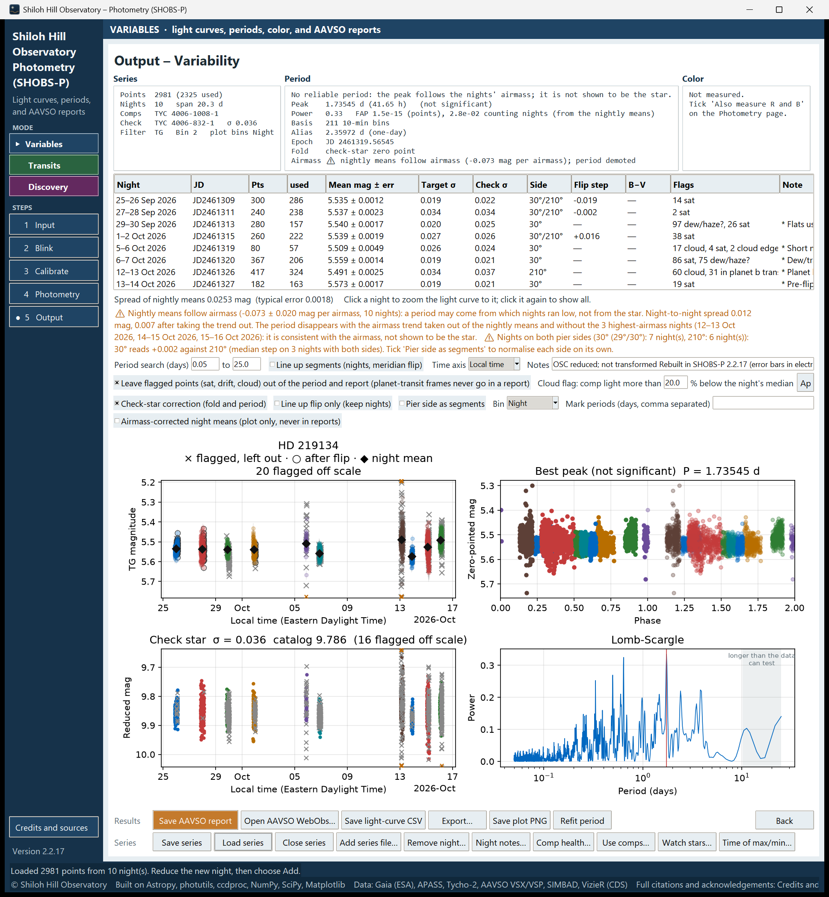

# 10. Build a multi-night series

Most variable-star questions need more than one night: a period, a time of minimum, a slow trend. In SHOBS-P a *series* holds all the nights of one star, in one mode, in a single file ending in `.cvseries`. This chapter shows how to start one, add nights to it, and look after it.

## What a series keeps

A series file keeps every point of every night, with its flags, plus the settings you used: the Star ID, comps and check star with their names and catalog magnitudes, the aperture sizes, the period search range, your night notes, which comps you chose with **Use comps…**, your answers about dew/haze and planet transits, and which nights you have already reported to AAVSO.

It does **not** keep star positions on the image. On every new night you mark the target, comps and check star again (the solve and the Target lookup usually make this quick).

## Start a series

1. Reduce the first night as in chapter 9.
2. On the Output page, press **Save series**.
3. Choose a folder and a name. The default name is the Star ID with spaces turned into underscores, for example `SZ_Lyn.cvseries`.

The status bar then reminds you: **Next night, load this file before reducing**.

## Add a night

The order matters: load first, reduce second.

1. On the Input page, press **Load series…** and open the series file. (The Output page has the same button, **Load series**.)
2. A message tells you how many points and nights were loaded, and that the star positions are not stored.
3. The line at the top of the Input page now reads something like **Series: SZ_Lyn.cvseries — 8 nights, last 13–14 Oct. After the run you'll be asked to add the night.**
4. Point the Input page at the new night's bias, dark, flat and lights, and blink and calibrate as usual.
5. On the Photometry page, mark the target, the **same comps** and the **same check star** as before. Names left over from the series show in the Stars panel with **⚠ not marked on this image**; click each star on the image to mark it again. Clicking a comp that the series already knows puts it back into its old slot.
6. Use the same aperture sizes as the other nights.
7. Press **Run photometry**.
8. When asked **Add these N points as the night of … to the M points already in the series?**, answer **Yes**.

**Yes** adds the night and keeps every earlier night. Because the series file is open, SHOBS-P saves it at once (the status bar says **Auto-saved to …**).

**No** starts a *new* series with this night only. The old file on disk is not changed, but the new series is not saved until you press **Save series** and give it a new name.

> **Tip:** If the Input page says **No series loaded — this run will be a single night**, you forgot to load the series. You can still add the night afterwards: save tonight as its own series, load the main series, and use **Add series file…** (below).

## The warnings in the add-night question

The add-night question may carry one or more warnings. Each one is about something that can put a step between nights that is not the star.

**Careful: the series is V and this night is TG.**
Different filters do not belong in one series. Answer **No** unless you mean to mix them.

**Careful: this night used different stars than the series.**
It lists the series' comps and check and tonight's. Different comps put each night on its own zero point. Usually it is better to answer No, go back to the Photometry page, mark the series' comps, and run again. If a comp was missing tonight (off the frame, for example), you can add the night anyway and then use **Use comps…** (chapter 11) to pick a set every night shares.

**One star, one name: …**
The same star appears under another catalog's name tonight (for example a Gaia name tonight and a Tycho name in the series). **Yes** uses the series' names and catalog magnitudes for this night, so every night stays on one zero point. This is almost always what you want.

**Careful: this night comes from other equipment or another observer.**
Untransformed nights from different instruments can sit tenths of a magnitude apart. A separate series is usually better: answer **No**.

**Careful: this night was reduced differently from the series.**
It lists what changed, for example the binning or aperture. Nights reduced differently can sit on different zero points. Consider reducing again with the series' settings.

**The night of … is already in the series.**
**Yes** replaces that night's points with this run. The other nights stay.

## Night notes

A note travels with a night: in the night table's **Note** column, in the light-curve CSV and in exports. Use it for anything you want to remember: thin cloud after 2 a.m., focuser slipped, moon nearby.

1. On the Output page, press **Night notes…**.
2. Type the number of the night from the list.
3. Type the note, or leave it empty to remove one.

## Other series tools

All of these are in the **Series** row on the Output page. When the series has a file, each of them saves the file straight away.

- **Add series file…** merges another saved series into the one that is open, for example a night you saved on its own. You see how many points and which nights will be added, with warnings if the comps or reduction differ. Series from Variables and Transits modes cannot be merged.
- **Remove night…** removes one night. Type its number from the list and confirm. This cannot be undone, except from the backup copy described below.
- **Close series** sets the series aside. The next run is a single night again. The file on disk is not changed.

If you load another series, close this one, or switch modes while there are unsaved changes, SHOBS-P offers to save first: **Yes** saves, **No** goes on without saving, **Cancel** keeps the series open.

When you load a series of a different star, SHOBS-P clears the current target's comps, check star and watch stars, so names from one field never end up in another. If it cannot tell from the positions whether the two names are the same star, it asks; **No** (the default) keeps what is marked.

## The backup copy (`_prev`)

Every save replaces the series file. To protect you from a mistake, the first time SHOBS-P writes a series file in a session (whether you pressed **Save series** or it saved on its own), it first renames the old file to the same name with `_prev` added, for example `SZ_Lyn_prev.cvseries`. Later saves in the same session leave that copy alone.

So `_prev` is always the series as it was *before this session*. To go back to it:

1. Close SHOBS-P, or close the series.
2. In your file manager, rename or copy `SZ_Lyn_prev.cvseries` to a new name.
3. Load that file.

There is only one `_prev`. The next session replaces it. For a long campaign, it is worth keeping your own dated copies now and then.

> **Caution:** SHOBS-P does not ask before you close the program. Points that are not in a saved series are lost. If your series has a file, adding a night saves it for you; a new series must be saved with **Save series**.

---

Previous: [9. Reduce a variable-star night](09-reduce-a-variable-night.md) · Next: [11. Check your comparison stars](11-check-your-comparison-stars.md)
