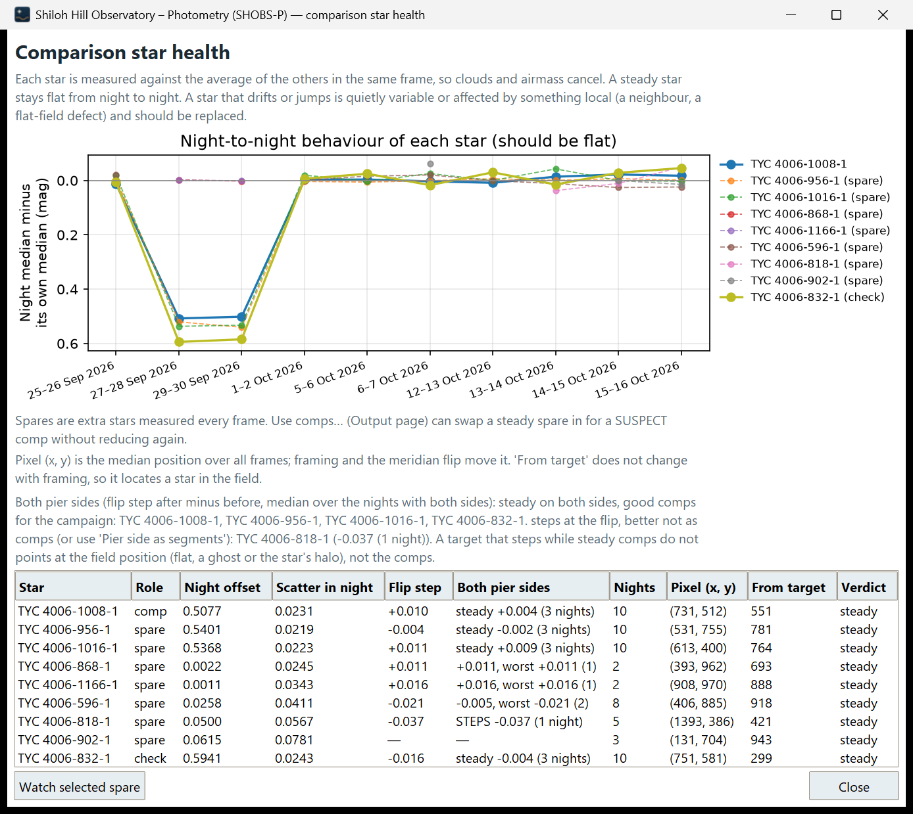
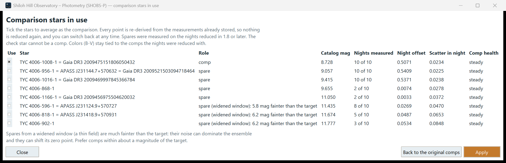

# 11. Check your comparison stars

Every magnitude you report is measured against your comparison stars. If one of them is quietly variable, or sits on a dust shadow in the flat, it puts its own changes into your target's light curve. SHOBS-P gives you two tools to catch that and fix it without reducing any night again: **Comp health…** and **Use comps…**, both in the **Series** row of the Output page.

## Spare comps: measured just in case

When the image is solved, each run also measures up to eight **spare comps**: catalog stars near your comps' brightness that are not known variables. You do not pick them. They show on the Photometry image as small light-blue diamonds (**◇ Spare comp** in the legend).

Spares cost nothing on the night, and they give you choices later. If a comp turns out bad after ten nights, you can swap in a spare that was measured on all ten.

If the field is thin, SHOBS-P widens the brightness window to find spares and says so in the log. Such spares can be much fainter than the target. Treat them with care (see below).

## Comp health

**Comp health…** measures each comp, each spare and the check star against the average of the *other* stars in the same frame. Clouds and airmass affect all stars alike and cancel out. What remains is each star's own behavior.

1. On the Output page, press **Comp health…**.
2. The **Comparison star health** window opens with a plot and a table.

With two or more nights, the plot shows each star's nightly median, relative to its own overall median. A steady star is a flat line. Spares are drawn dashed. With only one night loaded, the plot shows each star through the night instead, and a purple dashed line marks a meridian flip.

Click a row in the table to highlight that star's curve.

### The table

| Column | Meaning |
|---|---|
| **Star** | The star's name |
| **Role** | comp, spare or check |
| **Night offset** | How far the star's nightly level moves (mag) |
| **Scatter in night** | The star's typical scatter within a night (mag) |
| **Flip step** | Its jump at a meridian flip |
| **Both pier sides** | Whether it reads the same on both pier sides, over all nights with a flip |
| **Nights** | Nights it was measured |
| **Pixel (x, y)** | Its median position on the frames |
| **From target** | Its distance from the target in pixels (does not change with framing) |
| **Verdict** | SHOBS-P's judgment |

### Verdicts

- **steady** — good. On one night: **steady tonight (one night)**.
- **SUSPECT: drifts night to night** — its level moves between nights more than the others'. Replace it.
- **SUSPECT: jumps … at the flip** — it changes at the meridian flip while the others do not. Often a flat-field problem at its position on one side of the pier.
- **SUSPECT: noisier than the others tonight** — perhaps a faint star, a close neighbor, or a bad pixel.
- **pair drifts; add a 3rd star to tell which** — with only two stars, SHOBS-P can see that they disagree but not which one is at fault. Add a spare or a third comp. (On one night the same pair reads **one night; steady pair** or **one night; pair jumps at the flip, add a 3rd star to tell which**.)
- **too few points** — not enough data to judge.

When a star is clearly SUSPECT, SHOBS-P leaves it out of the reference for the others and says so (**Left out of the reference so their drift does not echo in the steady stars: …**). Otherwise one bad star makes all the good ones look as if they drift the other way.

On an alt-az mount there are no pier sides or flips, so **Flip step** and **Both pier sides** have nothing to show. The pier-side line under the table names the stars that read the same on both sides of the pier (good comps for a campaign with meridian flips) and those that step at the flip. If the target steps at the flip while steady comps do not, look at the field position (flat, a ghost, a bright star's halo) rather than the comps.

### Watch a spare

If a spare looks interesting, select its row and press **Watch selected spare**. It becomes a *watch star* with its own light curve (Output page, **Watch stars…**). Only spares can be added here: comps and the check star are already measured on every run.

## Use comps: change the comps without reducing again

SHOBS-P stores each comp's and spare's measurement in every frame. **Use comps…** recomputes every point of the series from a different set of comps, in seconds.

1. On the Output page, press **Use comps…**.
2. The **Comparison stars in use** window lists every comp and spare with its **Catalog mag**, **Nights measured** (for example `7 of 8`), **Night offset**, **Scatter in night** and **Comp health** verdict (SUSPECT in red).
3. Tick the stars you want in the comparison. Untick a SUSPECT comp; tick a steady spare measured on every night.
4. Press **Apply**.

The light curve, period and summary update. If the series has a file, it is saved with the new choice. The log lists the comps now in use, and nights you add later use the same choice.

To return to the comps the nights were reduced with, open **Use comps…** again and press **Back to the original comps**, then **Apply**.

Things to know:

- Pick stars measured on **every** night. If a chosen star is missing on some frames, SHOBS-P tells you how many points that affects; they are flagged `nocomp` and left out.
- Every chosen star needs a catalog magnitude. If one has none, you get **No catalog magnitude for …**. You can type
  one in its **Catalog mag** box (below).
- The check star cannot be a comp.
- Colors (B−V) stay tied to the comps each night was reduced with.
- Spares from a widened window are marked in the **Role** column with how much fainter than the target they are. Their noise can dominate the ensemble. Prefer comps within about a magnitude of the target.

### Correct a catalog magnitude

The **Catalog mag** column is editable, for every comp, every spare, and the check star (its row says **check (not a
comp)**). Use it when a star's catalog value is wrong, or when you want the value from another catalog than the
campaign's:

1. Type the new magnitude in the star's **Catalog mag** box.
2. Press **Apply**.

Every point that used that comp shifts by the change in its comps' catalog mean; nothing is measured again. The new
value is used for the whole series, the Photometry page's boxes for the same star follow, and an open series file is
saved. The log lists each change, for example "Catalog magnitudes changed for the whole series: … 8.711 → 8.728. 412
points re-derived (shift +0.0042 mag)." A box that does not hold a number gives **"…" is not a catalog magnitude**.

> **Tip:** Changing comps changes your magnitudes. Do it before you report, and report the whole series with one comp set. The AAVSO report names the comps actually in use.

## The ensemble zero-point warning

An ensemble of comps is only as good as its catalog magnitudes. If one comp's catalog magnitude is off, the whole ensemble shifts the target's level. SHOBS-P checks this: it compares the level your chosen comps give with the level from the comp(s) nearest the target's brightness, night by night.

When they differ by more than 0.025 mag, you see a caution on the Output page (and in **Comp health…**):

> ⚠ Ensemble zero point: the 4 comps in use put the target off the level the comp(s) nearest its brightness give (…) by more than 0.025 mag (…). Compare both sets in Use comps… before reporting.

What to do:

1. Open **Use comps…**.
2. Try the set without the comp that is far from the target in brightness or color, and **Apply**.
3. Compare the light curves and the check star. Keep the set that gives the flatter check star and the smaller night-to-night spread (shown under the night table).

The caution does not stop you from reporting. It tells you the answer depends on the comps, which is worth knowing.

---

Previous: [10. Build a multi-night series](10-build-a-multi-night-series.md) · Next: [12. Flags and bad data](12-flags-and-bad-data.md)
