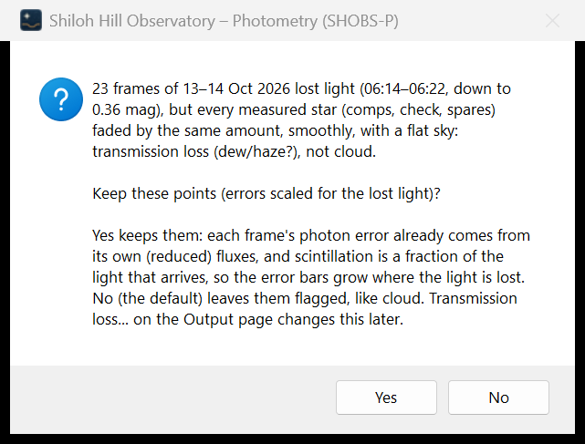
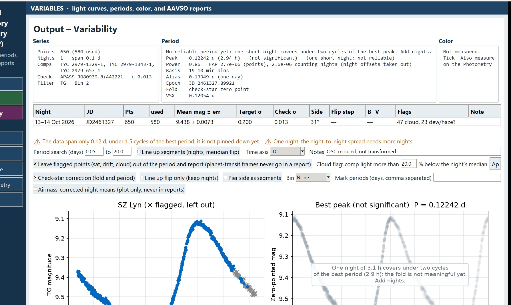

# 12. Flags and bad data

Not every frame deserves to be in your light curve. A passing cloud, a saturated star or a dewed-up corrector can each make points that are not the star. SHOBS-P *flags* such points rather than deleting them. Flagged points stay in the series, are drawn as gray **×** on the plots, and are left out of the period search and the AAVSO report. You can always change your mind.

This chapter explains each flag, how to change the cloud limit, the dew/haze question, frames taken during a planet transit, and pier-side steps.

## Leaving flagged points out

On the Output page, the box **Leave flagged points (sat, drift, cloud) out of the period and report (planet-transit frames never go in a report)** is ticked by default. Leave it ticked.

If you untick it, flagged points go into the period search and the AAVSO report too, each with its flag word in the report's notes. Planet-transit frames stay out of reports either way.

The light-curve CSV (**Save light-curve CSV**) always contains every point, flagged or not, with its flag word, so you can study the flagged points elsewhere.

## The flags

The night table's **Flags** column counts them per night, for example `12 cloud, 3 sat`.

| Shown as | Meaning | What to do |
|---|---|---|
| `sat` | The target's peak reached the saturation level (**raw sat ADU** on the Photometry page) | Shorter exposures next time, or slight defocus. Check that **raw sat ADU** fits your camera. (Frames over the **linear ADU** limit are not flagged; the log and Comp health count them, chapter 8.) |
| `compsat` | A comp's peak reached the saturation level | Choose a fainter comp. |
| `drift` | The target was found farther from its expected position than the aperture radius | Often trailing, wind or a bad alignment. Look at those frames in Blink. |
| `noflux` | No light measured for the target | Usually a frame with no stars (cloud, dome). |
| `cloud` | The comps' light fell more than the cloud limit below the night's median | See below. |
| `cloud edge` | A point just next to a cloud run, far off the night's level | Left out with the cloud frames. |
| `dew/haze?` | All stars faded together, smoothly, with a flat sky | See "Dew and haze" below. |
| `in planet b transit` | The frame falls in a known planet's predicted transit | See "Planet transits" below. |
| `nocomp` | One of the comps chosen with **Use comps…** was not measured on this frame | See chapter 11. |

## Cloud

A cloud dims all the stars, but not quite equally: the target and comps pass under the cloud's edge at slightly different times. So SHOBS-P flags frames where the comps' light drops too far below the night's median.

The limit is the box **Cloud flag: comp light more than … % below the night's median**. The default is 20.

To change it:

1. Type a new percentage in the box.
2. Press **Apply**.

The flags of every night are worked out again. A lower number is stricter (more frames flagged). A higher number keeps more frames but lets more cloud-affected points in. On a night with thin, uniform cirrus, a higher limit can save useful data; on a night with patchy cloud, a lower one cleans up the light curve. Watch the check-star plot as you change it: the right limit is the one that keeps the check star flat.

The limit is saved with the series.

## Dew and haze (transmission loss)

Not all lost light is cloud. When dew forms on the optics, or a uniform haze comes over, *every* star fades by the same amount, slowly and smoothly, and the sky does not brighten. Differential photometry handles that well: the magnitudes stay right, only the noise grows.

SHOBS-P looks for such stretches. It calls them **transmission loss (dew/haze?)**: the question mark is because it cannot be sure that a smooth cloud bank is not to blame.

### The Keep question after a run

When a night has such a stretch, SHOBS-P asks after photometry:

> N frames of … lost light (…, down to 0.94 mag), but every measured star (comps, check, spares) faded by the same amount, smoothly, with a flat sky: transmission loss (dew/haze?), not cloud.
>
> Use these points in the light curve (errors scaled for the lost light), or leave them out?

- **Use these points** keeps the points. Their error bars grow with the light lost, and each kept point also gets the extra star-to-star scatter measured in that stretch, so the errors stay honest.
- **Leave them out** (the default; also Escape or closing the window) leaves them flagged, like cloud.

If you are unsure, choose **Leave them out**. You can change it later. Each answer is written to the log with the night and the time, for example "… transmission loss (dew/haze?) question (after photometry) answered “Leave them out” at 2026-10-16 23:41:07."

If only one star was measured, SHOBS-P cannot tell dew from cloud, so it does not ask: the points are left out, and the log says so.

### Changing your answer later

1. If the series has more than one night, click the night in the night table first.
2. Press **Transmission loss…**.
3. The message says how many frames, when, how deep, and whether they are now used in the light curve or left out. Answer the question again with **Use these points** or **Leave them out**.

Your answer is saved with the series. If no night has transmission loss at the current cloud limit, SHOBS-P says so.

## Planet transits in a variable's frames

Some variable-star targets host transiting planets (HD 219134, for example). During a transit the star dims a little for reasons that have nothing to do with its variability. SHOBS-P follows a simple rule for such campaigns: **no data while a planet transits**.

In Variables mode, after each run and after **Load series…**, SHOBS-P looks up the Star ID's transiting planets at the NASA Exoplanet Archive, in the background. If frames fall inside a predicted transit, it asks:

> Tonight's run (…):
> 5–6 Oct 2026: 9 frames fall in planet b's transit (frames 05:02–05:25 local; transit 05:17–06:14 ±1 min).
>
> Leave those frames out (flagged "transit", like cloud)?

- **Yes** (the default) flags those frames `transit`. They stay in the series but never go in a report.
- **No** keeps them.

The message also says what was assumed, for example **T14 not published; 2.4 h assumed**, or **plus 15 min for JD vs BJD** when the target's RA/Dec are not known (the window is widened to be safe).

Nothing is said if the star has no known transiting planet, if no frame falls in a transit, or if the archive cannot be reached.

To check or change it later:

1. Click the night in the night table if the series has more than one night with transit frames.
2. Press **Planet transits…**.

If no night has been checked yet, the button runs the check on every night. Your answer is saved in the series file at once.

## Pier side and meridian flips

After a meridian flip, the camera sees the field rotated by 180°. Each star now falls on a different part of the sensor and the flat. Small flat-field errors can then make a step in the light curve at the flip, even though the star did not change.

SHOBS-P finds the flip in each night (from the frames' ROTATOR or PIERSIDE header, or from the image itself) and rings points after the flip with **○** in the light curve. The **Flip step** column shows each night's step, with ⚠ when it is large.

You have three ways to take steps out. Each is a checkbox on the Output page. They affect the plots, the period search and **Export…** files. They do not change the stored points or the AAVSO report.

- **Line up flip only (keep nights)** shifts the after-flip part of each night to match its before-flip part. Night-to-night changes are kept. Use it for one night, or when flips happen at different times each night.
- **Pier side as segments** lines up all the frames taken on one pier side with all the frames on the other, across the whole series. Use it for a campaign where every night has a flip. If the pier side is unknown on some nights (no ROTATOR, no PIERSIDE, no flip), those nights are left as they are, and a caution says so.
- **Line up segments (nights, meridian flip)** sets every night and every flip segment to the same level. It removes *all* night-to-night changes, including real ones. Use it only to search for a period much shorter than a night.

If more than one is ticked, **Line up segments** wins over **Pier side as segments**, which wins over **Line up flip only**.

An alt-az mount has no meridian flips and no pier sides, so there is nothing to line up: the **Side** column shows **—**, and **Pier side as segments** says **the mount is alt-az (no pier sides).**

When the series has nights on both pier sides and none of these is ticked, a caution tells you how much each side reads against the other and suggests **Pier side as segments**.

### When the flip step is the apertures, not the star

A step can also come from the apertures landing beside their stars after the flip. SHOBS-P checks each flipped frame's alignment on up to 15 stars' own centers, so this is rare now. After each run it also compares how the comp and check apertures moved at the flip. When they were off their stars together while the target's was not, the log says so:

> ⚠ After the meridian flip the C1 and check apertures were off their stars by about (+3.1, −2.4) px together, while the target's was not: an aperture-placement error at the flip, not a change in the stars …

The check star then looks normal and hides the problem. Look at `comp1_x`/`comp1_y` and `check_x`/`check_y` in the light-curve CSV; if they sit off the stars, reduce the frames after the flip on their own.

Such a night, or one whose check star steps along with the target, is not saved into an open series without asking (chapter 9, "After the run"). A step the check star and comps do not share is taken as the star's, and the series is saved as usual.

> **Caution:** On a star that changes a lot within a night, a "flip step" read from the target's light curve is mostly the star changing. SHOBS-P warns you in that case. Look at **Comp health…** instead: it shows each comp's step at the flip (chapter 11).

## Stars near the frame edge

After a run, SHOBS-P may warn that a comp, spare or check star sat **near the frame edge or a weak part of the flat**. Such stars can drift out of the good part of the image as the night goes on. The warning says how far in a star must be, for example "comes within 9 px of the frame edge (stars at least 66 px in are safe)". Choose other stars next time if you can.

## Frames without the target

When the first frames of a night miss the target (the telescope still settling, for example), SHOBS-P makes the first frame that holds it the reference (chapter 8). The run then skips every frame on which the target is off the frame or too near its edge, and lists them at the end: "SZ Lyn not on the frame in 5 of 142 images (frames 1–5); those frames were skipped." When that is more than a fifth of the night, the line starts with ⚠ and adds a hint: a run of frames at the start points to the pointing, scattered ones to tracking or clouds.

## Centring of defocused stars

On a defocused (donut) field, the log reports after each run how much each aperture's center jittered from frame to frame, for example "Centring (defocused stars): frame-to-frame jitter of each aperture's center (rms): target 0.12 px, C1 0.15 px, …". Over 0.5 px it becomes a ⚠ caution: the aperture cuts a different part of the donut each time, which adds noise the comps do not cancel. Try a larger aperture (**Suggest…**).

---

Previous: [11. Check your comparison stars](11-check-your-comparison-stars.md) · Next: [13. Look for a period](13-look-for-a-period.md)
