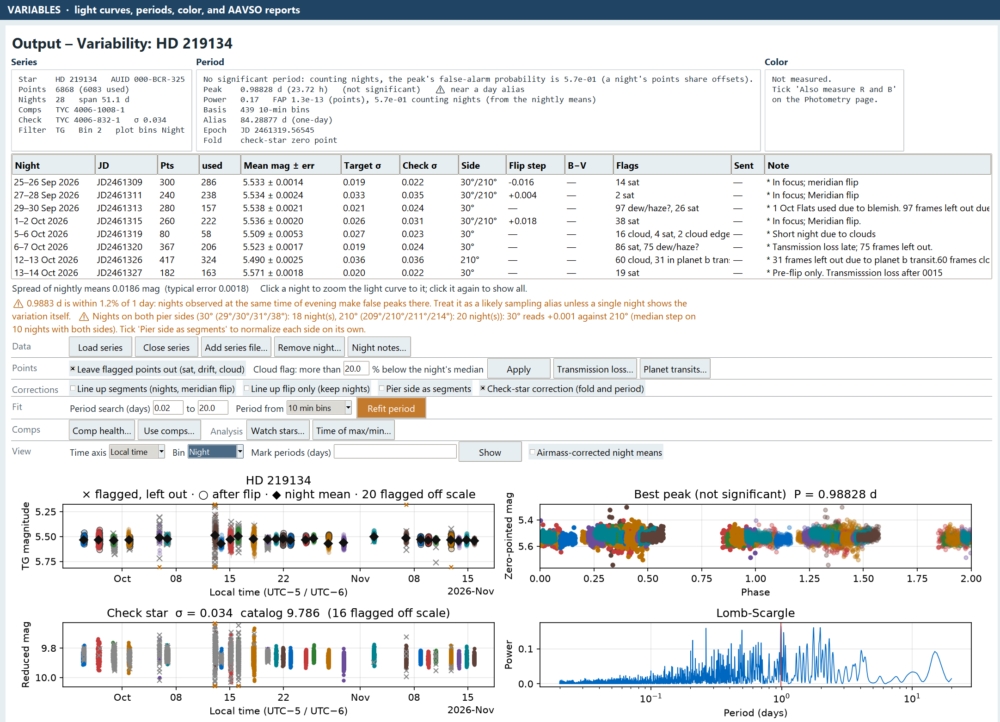

# 13. Look for a period

SHOBS-P searches every light curve for a period with a Lomb-Scargle periodogram, the standard tool for unevenly spaced data. It runs on its own each time the series changes. This chapter explains how to set the search, how to read the result, and, most of all, how SHOBS-P decides whether a peak is real. Ground-based data from one site are full of false periods, and SHOBS-P is built to tell you when it does not trust one.

## Where to look

On the **Output – Variability** page:

- The **Period** summary box gives the numbers.
- The **top-right plot** is the light curve folded on the best period.
- The **bottom-right plot** is the periodogram: power against period, on a log scale. The red line marks the best period.

## Set the search

1. In **Period search (days)**, in the **Fit** row, type the shortest and longest period to try. The defaults are 0.02 to 20 days. (Before
   2.2.19 the shortest was 0.05 d, which missed many short-period pulsators. A series saved with that old default now
   searches from 0.02 d, and the log says so.)
2. Press **Enter**, or click into another box. The search runs again with the new range. (It does not rerun while you
   are still typing, or when you leave a box without changing it.) **Refit period**, the colored button at the end of the same row, also runs it again. When the period line changes, the **Period** box is highlighted for a moment and its title reads **Period: updated**.

Choose a range that fits your star and your data:

- The shortest period needs frames closer together than half of it.
- The longest period your data can really test is about half the span of the data.
- **The search follows the known period (from 2.4.0).** When SHOBS-P knows a period for the star and it lies outside
  your range, or right at one end of it, SHOBS-P widens the two boxes to cover it before it searches. The known
  periods are VSX's (looked up, or kept in the series file), the period of the star's saved times of maximum or
  minimum (chapter 14), and any period you typed in **Mark periods**. The Period box says so in a plain line, for
  example **Range   searched 0.02–28 d: widened from 0.02–20 d to cover VSX 22.1 d**, and the Log has the same line.
  The boxes show the range that was searched. If you narrow them again so that the known period falls outside, they
  widen again at the next search. Because the range can change, the best period found can change too.
- A known period longer than half the span of your points cannot be tested by any range (a Mira's 332 d on three
  nights). The range is left alone and a plain line says **Range   VSX 332 d is outside the search: these points span
  3.0 d, under two cycles, too short to test it. Add nights.** On the periodogram, longer periods are shaded gray and labeled **longer than the data can test**. The search still runs there, but a peak in the gray zone is not to be trusted.

### Period from

The **Period from** box chooses what the search uses: **Every point**, or **5 min bins**, **10 min bins** (the default) or **30 min bins**. Bins make each night count by the hours you observed, not by how many frames you took, and they stop thousands of correlated frames from making a peak look more certain than it is. Keep the default unless you are after a period of less than about an hour; then use **5 min bins** or **Every point**. If there are fewer than 8 bins, SHOBS-P uses every point. The Period box's **Basis** line says what was used.

Bins smear a period shorter than about ten bins. So when the VSX or a marked period is that short, or the best peak
found from bins is, SHOBS-P searches every point instead, and a **Bins** line in the Period box says so (for
example "every point used (10-min bins too coarse for 0.039 d)"). It is a plain note: nothing to do.

### Check-star correction

**Check-star correction (fold and period)** is ticked by default. It uses the check star to take out any shift in level between nights, or between the two sides of a meridian flip. If the check star moves by 0.02 mag on one night, the target's values for that night are moved back by the same amount before the search. This only works with a good, steady check star. If your check star is doubtful, untick the box and see whether the period survives.

The pier-side and line-up checkboxes from chapter 12 also affect the search.

## Read the Period box

| Line | Meaning |
|---|---|
| **Period** | The verdict, in one line (from 2.4.0): **Reliable**, **⚠ Doubtful** with the reasons, or **None** with the reason. See "The verdict line" below. |
| **Best** (or **Peak**) | The best period in days and hours. It reads **Peak** when the peak did not pass the significance tests below. |
| **Power** | The peak's height (0 to 1), and its **FAP**, false-alarm probability, worked out two ways: from the points, and counting nights |
| **Basis** | Every point, or how many bins |
| **Alias** | The one-day alias of the best period (see below) |
| **Epoch** | The time of the fold's zero phase |
| **Fold** | Whether the check-star correction is on |
| **VSX** | The catalog period, when VSX has one. Also drawn as a green dashed line on the periodogram. |
| **Saved** | The period of the star's saved times of maximum or minimum, when it has some (from 2.4.0). |

The FAP is never printed as zero. With thousands of points it can be smaller than the number format can hold; it then
reads **< 1e-99**. The FAP counting nights, when it comes from the nightly means, cannot go below a floor set by the
number of nights (1 in 720 for six nights); a value sitting on that floor says so: **1.4e-03 (the lowest 6 nights can
show)**.

Further lines appear when they apply: **Range   searched …: widened from … to cover …** or **Range … is outside the search …** (see "Choose a range" above), **Edge …** when the best peak sits at one end of the search and no known period says where to look, **Bins every point used …**, **Check depends on … alone**, **Airmass nightly means follow airmass**, and **Marked …** for periods you asked about. These rows are plain: they give the reasons behind the verdict. Only the **⚠ Doubtful** verdict line itself carries a ⚠.

### The verdict line

The first row of the Period box says in one line whether to trust the best period:

- **Period  Reliable: 0.03912 d (FAP 0.1 %)**: the period passed every test below.
- **Period  ⚠ Doubtful: 0.99730 d — near a day alias; depends on 22–23 Oct alone**: a peak stands out, but one or more
  checks speak against it. The reasons are listed worst first. Do not report the period until they are cleared up.
- **Period  None: …** with the reason: no period was found (the star looks constant at this precision, one short
  night, or too few points).

The cautions under the plots say what to do about each reason. The same line is in the saved plot's summary and in
the report's settings file.

## What "significant" means here

A period is shown as **Best**, and the fold is titled **Folded**, only when *all* of these hold:

1. **Its false-alarm probability is 1% or less**, counting the points.
2. **It is still 1% or less counting nights.** Points from one night share that night's offset (a slightly different zero point, sky, or airmass). A thousand points from five nights are not a thousand independent measurements. SHOBS-P works out a second FAP that allows for this.
3. **No single night carries it.** SHOBS-P repeats the search leaving out each night in turn. If the period disappears without one night, that night alone made it, usually by being offset from the others.
4. **The data cover at least two cycles** on a single night.
5. **It does not follow airmass** (see below).

When one night is too short for even the shortest period searched (under two of its cycles; a 50-minute night with
the search starting at 0.02 d), there is nothing to test. The Period box then holds one line and no peak:

- **Period  None: too short for a period search: one night of 0.8 h covers under two cycles of even the shortest
  period searched (0.02 d = 0.5 h). Add nights, or observe longer.**

The fold and the periodogram say the same; no best period is marked.

If any test fails, the verdict line says why, for example:

- **Period  None: one short night covers under two cycles of the best peak (no reliable period yet); add nights.**
  (On such a night the day-alias and search-edge reasons are left out: the peak is not reliable either way.)
- **Period  ⚠ Doubtful: … d — depends on … alone (no reliable period: often an offset between nights, not the star)**
- **Period  ⚠ Doubtful: … d — follows the nights' airmass (no reliable period)**
- **Period  None: no significant period: counting nights, the peak's false-alarm probability is … (a night's points share offsets).**
- **Period  None: no significant period: the star looks constant at this precision (scatter … mag per point, … mag night to night).**

The last one is a result too. For a suspected variable, "constant to 0.005 mag" is worth knowing.

SHOBS-P never calls a star constant while a night clearly changes (from 2.4.0). A W UMa star on two short nights
has no significant period yet, but it may move 0.08 mag within each night. The line then reads **Period  None: no
significant period: the star does change (0.08 mag within 5–6 Oct 2026; point scatter 0.006 mag), but these nights
do not pin a period down. Add nights.** The test compares the night cut into six parts with the scatter from one
point to the next; it is for the wording only and changes no number.

> **Caution:** A periodogram always has a highest peak. **Best peak (not significant)** is *not* the star's period. Do not report it as one.

## Aliases

Observing from one site, you see the star at about the same time each evening. That regular gap of one day creates false peaks: at 1 day, ½ day and ⅓ day themselves, and at *aliases* of the true period. If the true frequency is *f* cycles per day, peaks also appear at *f* + 1 and *f* − 1.

SHOBS-P helps in two ways:

- The **Alias** line gives the one-day alias of the best period. If the periodogram has two peaks of similar height, one at the best period and one at its alias, your data cannot yet tell them apart.
- If the best period is within 5% of 1, ½ or ⅓ day (solar or sidereal), the verdict becomes **⚠ Doubtful … near a day alias** and a caution is added: treat it as a likely sampling alias unless a single night shows the variation itself.

Ways to break an alias:

- Observe at a different time of night: start earlier, or run later.
- Make longer runs, so that one night covers more of the cycle.
- Combine with another observer at a different longitude (as a separate series; see chapter 10 about mixing equipment).

### Mark periods

To see how a particular period fares, for example the VSX period or an alias:

1. Type one or more periods, comma separated, in **Mark periods (days)** in the **View** row, for example `0.12053, 0.13790`.
2. Press **Show**.

Each appears as a purple dotted line on the periodogram, and the Period box gives its power (**Marked … d → power …**).

## Other cautions about the period

- **⚠ Doubtful … at the edge of the search**, with a plain **Edge** row under it: the best period is at the end of your search range and no known period says where to look (a known period widens the range by itself, see above). The true period may lie beyond it, or this is a slow trend. The **Edge** row says which box to change: raise the max period or lower the min period, then press **Refit period**. From 2.4.0 this is a row in the Period box, not a ⚠ line under the night table.
- **The data span only … d, under 1.5 cycles of the best period; it is not pinned down yet.** Add nights.

## The airmass check

At higher airmass, a star of a different color from the comps dims a little more or less than they do. If some nights were observed lower in the sky than others, their means can differ for that reason alone, and a period search may fit the pattern of which nights ran low.

SHOBS-P compares each night's mean with that night's median airmass. If they follow each other, the Period box shows **Airmass nightly means follow airmass (… mag per airmass)** and a caution gives the slope and the night-to-night spread before and after taking the trend out. SHOBS-P then tries the search with the trend taken out, and without the high-airmass nights. If the period does not survive, it is demoted (**; period demoted**) and the verdict reads **⚠ Doubtful … follows the nights' airmass**.

The check needs airmass: from the frames' headers, or worked out from the target's RA/Dec and your site. Without them, the log says the check was skipped. Type your site on the Input page to enable it.

### Airmass-corrected night means (display only)

Tick **Airmass-corrected night means** (in the **View** row; plot only, never in reports) to see the effect on the light curve. Small filled orange diamonds show each night's mean; large hollow ones show the same mean with the airmass trend taken out. Hover over one to see both values. These values are only drawn: they never go into the period search, a report or a CSV.

---

Previous: [12. Flags and bad data](12-flags-and-bad-data.md) · Next: [14. Time a maximum or minimum](14-time-a-maximum-or-minimum.md)
