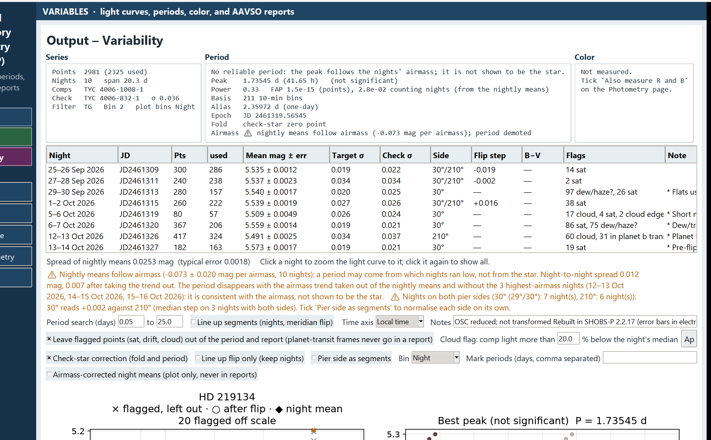

# 13. Look for a period

SHOBS-P searches every light curve for a period with a Lomb-Scargle periodogram, the standard tool for unevenly spaced data. It runs on its own each time the series changes. This chapter explains how to set the search, how to read the result, and, most of all, how SHOBS-P decides whether a peak is real. Ground-based data from one site are full of false periods, and SHOBS-P is built to tell you when it does not trust one.

## Where to look

On the **Output – Variability** page:

- The **Period** summary box gives the numbers.
- The **top-right plot** is the light curve folded on the best period.
- The **bottom-right plot** is the periodogram: power against period, on a log scale. The red line marks the best period.

## Set the search

1. In **Period search (days)**, type the shortest and longest period to try. The defaults are 0.05 to 20 days.
2. Press **Refit period**. (The search does not rerun when you only type in the boxes.)

Choose a range that fits your star and your data:

- The shortest period needs frames closer together than half of it.
- The longest period your data can really test is about half the span of the data. On the periodogram, longer periods are shaded gray and labeled **longer than the data can test**. The search still runs there, but a peak in the gray zone is not to be trusted.

### Period from

The **Period from** box chooses what the search uses: **Every point**, or **5 min bins**, **10 min bins** (the default) or **30 min bins**. Bins make each night count by the hours you observed, not by how many frames you took, and they stop thousands of correlated frames from making a peak look more certain than it is. Keep the default unless you are after a period of less than about an hour; then use **5 min bins** or **Every point**. If there are fewer than 8 bins, SHOBS-P uses every point. The Period box's **Basis** line says what was used.

### Check-star correction

**Check-star correction (fold and period)** is ticked by default. It uses the check star to take out any shift in level between nights, or between the two sides of a meridian flip. If the check star moves by 0.02 mag on one night, the target's values for that night are moved back by the same amount before the search. This only works with a good, steady check star. If your check star is doubtful, untick the box and see whether the period survives.

The pier-side and line-up checkboxes from chapter 12 also affect the search.

## Read the Period box

| Line | Meaning |
|---|---|
| **Best** (or **Peak**) | The best period in days and hours. **Peak … (not significant)** means SHOBS-P does not trust it. |
| **Power** | The peak's height (0 to 1), and its **FAP**, false-alarm probability, worked out two ways: from the points, and counting nights |
| **Basis** | Every point, or how many bins |
| **Alias** | The one-day alias of the best period (see below) |
| **Epoch** | The time of the fold's zero phase |
| **Fold** | Whether the check-star correction is on |
| **VSX** | The catalog period, when VSX has one. Also drawn as a green dashed line on the periodogram. |

Further lines appear when they apply: **Check ⚠ depends on … alone**, **Airmass ⚠ nightly means follow airmass**, and **Marked …** for periods you asked about.

## What "significant" means here

A period is shown as **Best**, and the fold is titled **Folded**, only when *all* of these hold:

1. **Its false-alarm probability is 1% or less**, counting the points.
2. **It is still 1% or less counting nights.** Points from one night share that night's offset (a slightly different zero point, sky, or airmass). A thousand points from five nights are not a thousand independent measurements. SHOBS-P works out a second FAP that allows for this.
3. **No single night carries it.** SHOBS-P repeats the search leaving out each night in turn. If the period disappears without one night, that night alone made it, usually by being offset from the others.
4. **The data cover at least two cycles** on a single night.
5. **It does not follow airmass** (see below).

If any test fails, the Period box starts with a plain sentence saying why, for example:

- **No reliable period yet: one short night covers under two cycles of the best peak. Add nights.**
- **No reliable period: the peak depends on … alone (often an offset between nights, not the star).**
- **No reliable period: the peak follows the nights' airmass; it is not shown to be the star.**
- **No significant period: counting nights, the peak's false-alarm probability is … (a night's points share offsets).**
- **No significant period: the star looks constant at this precision (scatter … mag per point, … mag night to night).**

The last one is a result too. For a suspected variable, "constant to 0.005 mag" is worth knowing.

> **Caution:** A periodogram always has a highest peak. **Best peak (not significant)** is *not* the star's period. Do not report it as one.

## Aliases

Observing from one site, you see the star at about the same time each evening. That regular gap of one day creates false peaks: at 1 day, ½ day and ⅓ day themselves, and at *aliases* of the true period. If the true frequency is *f* cycles per day, peaks also appear at *f* + 1 and *f* − 1.

SHOBS-P helps in two ways:

- The **Alias** line gives the one-day alias of the best period. If the periodogram has two peaks of similar height, one at the best period and one at its alias, your data cannot yet tell them apart.
- If the best period is within 5% of 1, ½ or ⅓ day (solar or sidereal), it adds **⚠ near a day alias** and a caution: treat it as a likely sampling alias unless a single night shows the variation itself.

Ways to break an alias:

- Observe at a different time of night: start earlier, or run later.
- Make longer runs, so that one night covers more of the cycle.
- Combine with another observer at a different longitude (as a separate series; see chapter 10 about mixing equipment).

### Mark periods

To see how a particular period fares, for example the VSX period or an alias:

1. Type one or more periods in **Mark periods (days, comma separated)**, for example `0.12053, 0.13790`.
2. Press **Show**.

Each appears as a purple dotted line on the periodogram, and the Period box gives its power (**Marked … d → power …**).

## Other cautions about the period

- **⚠ at the edge**: the best period is at the end of your search range. The true period may lie beyond it, or this is a slow trend. Widen the range and press **Refit period**.
- **The data span only … d, under 1.5 cycles of the best period; it is not pinned down yet.** Add nights.

## The airmass check

At higher airmass, a star of a different color from the comps dims a little more or less than they do. If some nights were observed lower in the sky than others, their means can differ for that reason alone, and a period search may fit the pattern of which nights ran low.

SHOBS-P compares each night's mean with that night's median airmass. If they follow each other, the Period box shows **Airmass ⚠ nightly means follow airmass (… mag per airmass)** and a caution gives the slope and the night-to-night spread before and after taking the trend out. SHOBS-P then tries the search with the trend taken out, and without the high-airmass nights. If the period does not survive, it is demoted (**; period demoted**) and shown as not significant.

The check needs airmass: from the frames' headers, or worked out from the target's RA/Dec and your site. Without them, the log says the check was skipped. Type your site on the Input page to enable it.

### Airmass-corrected night means (display only)

Tick **Airmass-corrected night means (plot only, never in reports)** to see the effect on the light curve. Small filled orange diamonds show each night's mean; large hollow ones show the same mean with the airmass trend taken out. Hover over one to see both values. These values are only drawn: they never go into the period search, a report or a CSV.

---

Previous: [12. Flags and bad data](12-flags-and-bad-data.md) · Next: [14. Time a maximum or minimum](14-time-a-maximum-or-minimum.md)
