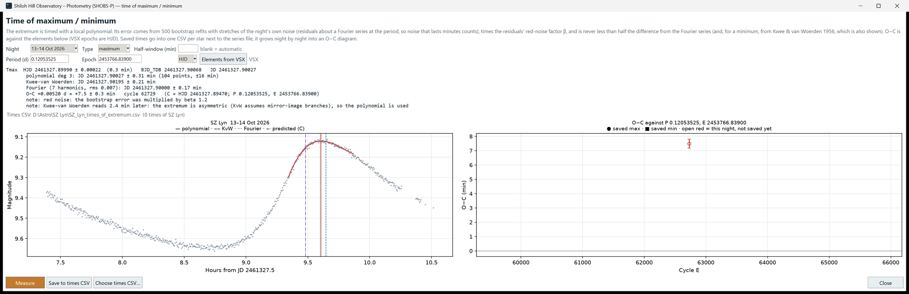

# 14. Time a maximum or minimum

For eclipsing binaries and short-period pulsators, the most valuable single number from a night is often the *time* of a minimum or maximum. Compared with the time predicted by the star's elements (period and epoch), it gives **O − C**: observed minus calculated. Collected over months and years, O − C values show whether the period is changing.

SHOBS-P times an extremum from one night of your series and keeps the results in a CSV file per star, which grows night by night into an O − C diagram.

## Before you start

- The night must cover the maximum or minimum, with points well before and after it. SHOBS-P needs at least 12 usable points.
- For the O − C, you need the star's elements. SHOBS-P can fetch them from VSX.
- For heliocentric or barycentric times (HJD, BJD_TDB), the target's RA/Dec must be on the Input page. They are filled in when the Star ID is looked up. Without them, times stay in JD, and the O−C is taken in JD (up to 8 minutes off).

## Measure a time

1. On the Output page, press **Time of max/min…**. The **Time of maximum / minimum** window opens.
2. In **Night**, choose the night. It starts on the highlighted night, or the last one.
3. In **Type**, choose **maximum** or **minimum**. SHOBS-P sets this from the VSX variable type: minimum for eclipsing binaries, maximum for pulsators and the rest.
4. Leave **Half-window (min)** blank. SHOBS-P then picks how much of the light curve on each side of the extremum to fit. Type a number of minutes only if the automatic window catches something it should not, such as a nearby shoulder of the light curve.
5. Check **Period (d)** and **Epoch**. If they are empty, press **Elements from VSX**. The label beside it shows **VSX** when the elements are VSX's, or **typed** when you typed your own. VSX epochs are HJD, so leave the system box on **HJD** for VSX elements. Choose **BJD** if your elements are in BJD.
6. Press **Measure**.

## Read the result

The result text gives, for each extremum found that night:

- **Tmin** or **Tmax**: the adopted time in HJD with its error in days and minutes, plus the same moment in **BJD_TDB** and **JD**.
- **polynomial deg N**: the time from a local polynomial fit, with how many points and what window it used. This is the adopted method.
- **Kwee-van Woerden**: the classic method for eclipse timings, shown for comparison (it assumes mirror-image branches, so on a lopsided maximum it can read a minute off).
- **Fourier**: the time from a Fourier series fitted at the period, also for comparison.
- **O−C**: in days and minutes, with the cycle number E and the calculated time C it was compared against. For a minimum, E can be a half cycle (a secondary eclipse).
- Any notes and ⚠ warnings.

On the left plot, the red curve is the polynomial fit and the red line the adopted time. The blue dashed line is Kwee-van Woerden, the green dotted line Fourier, and the purple dash-dot line the predicted time C.

Where does the error come from? SHOBS-P refits the polynomial 500 times with stretches of the night's own noise added, and allows for noise that lasts minutes (red noise). The error is never smaller than half the difference from the Fourier time (and, for a minimum, from Kwee-van Woerden). So if the methods disagree, the error says so. Without elements there is no Fourier check and the error can be low by a factor of 2–3; the result says so. (The details are for the methods document, planned.)

If no elements are given, the result says **No elements: type the period and epoch (or Elements from VSX) for the O−C.** You still get the time.

## Save the time

1. Press **Save to times CSV**.
2. The first time, if the series has no file and no Output folder is set, SHOBS-P asks where to save.

The file is called `<Star>_times_of_extremum.csv` (for example `SZ_Lyn_times_of_extremum.csv`). It goes next to the series file, or in the Output folder. The line under the result shows which file is in use and how many times of this star it holds.

Measuring the same extremum again and saving replaces that row (same star, same type, within 0.01 d), so you can refine a timing without making duplicates.

To keep times in another file, for example one shared between several series of the same star, press **Choose times CSV…** and pick or name a file.

## The O − C diagram

The right-hand plot reads the times CSV. Saved maxima are filled circles, saved minima filled squares. Tonight's result, not yet saved, is an open red marker. The horizontal line at zero is "exactly on time".

- Points scattered around zero: the elements are good.
- Points along a sloping straight line: the period is slightly off.
- Points along a curve: the period is changing.

Until there is something to plot, the panel says **The O−C diagram appears here once times are saved to the CSV**.

---

Previous: [13. Look for a period](13-look-for-a-period.md) · Next: [15. Submit to AAVSO](15-submit-to-aavso.md)
