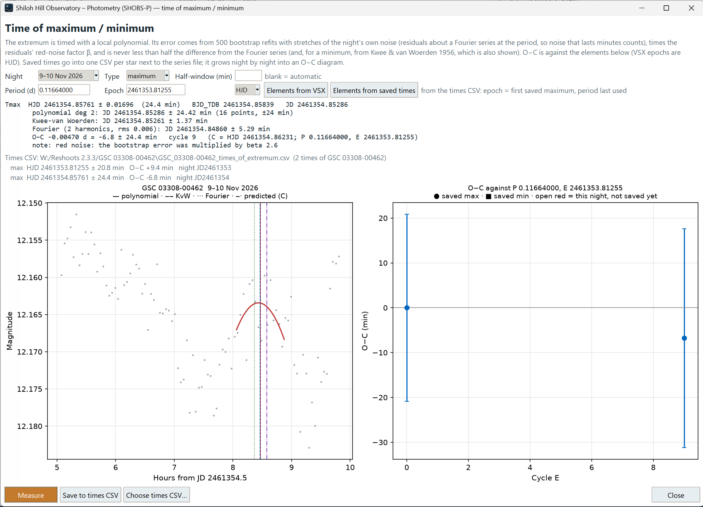

# 14. Time a maximum or minimum

For eclipsing binaries and short-period pulsators, the most valuable single number from a night is often the *time* of a minimum or maximum. Compared with the time predicted by the star's elements (period and epoch), it gives **O − C**: observed minus calculated. Collected over months and years, O − C values show whether the period is changing.

SHOBS-P times an extremum from one night of your series and keeps the results in a CSV file per star, which grows night by night into an O − C diagram.

## Before you start

- The night must cover the maximum or minimum, with points well before and after it. SHOBS-P needs at least 12 usable points.
- Only untrimmed points are used (from 2.4.0): a stretch left out with **Trim** on the Output page (chapter 12) is left out of the time of maximum or minimum too, whether **Leave flagged points out** is ticked or not. Never trim around the maximum itself to tidy it.
- For the O − C, you need the star's elements (period and epoch). SHOBS-P can fetch them from VSX. They are optional: without them you still get the time and an honest error.
- For the error, SHOBS-P needs to know the star's period, roughly. It finds one itself (see [The two jobs of a period](#the-two-jobs-of-a-period)); the best source is your own series, so run the period search on the Output page first ([13. Look for a period](13-look-for-a-period.md)).
- For heliocentric or barycentric times (HJD, BJD_TDB), the target's RA/Dec must be on the Input page. They are filled in when the Star ID is looked up. Without them, times stay in JD, and the O−C is taken in JD (up to 8 minutes off).

## The two jobs of a period

A period does two different jobs in this window. Until 2.4.0 one **Period** box did both, and leaving it empty quietly
made the error 2–3 times too small. From 2.4.0 the two jobs are apart.

| Job | What it needs | Where it comes from |
|---|---|---|
| **The error bar.** The error counts noise that lasts minutes (thin cloud, seeing, guiding). To see that noise, SHOBS-P takes the star's own variation out of the whole night with a Fourier series at the star's period. | A period only; roughly right is enough on a night of two cycles or more (see below). No epoch. | SHOBS-P finds it itself, every time. You do not type it. |
| **The predicted time and the O − C.** The elements say when the extremum should fall, so SHOBS-P looks there, and the difference from the measured time is the O − C. | A period **and** an epoch, both precise. | The **Period (d)** and **Epoch** boxes, under the heading **Elements for the predicted time and O−C (optional)**. |

**The period for the error** is the best one SHOBS-P has, in this order:

1. **The series' own period**: the Output page's period search (or **Refit period**), when the Output page calls it
   a reliable period (its fold is titled *Folded P = …*, not *Best peak (not significant)*). A best peak that is not
   reliable (one short night, a peak carried by one night, a peak that follows airmass) is not used.
2. **The times CSV**: the period of the latest saved time of this star that has one.
3. **VSX**: the period from the Star ID lookup, even when VSX gives no epoch.
4. **The Period box**: a period you typed there, when there is nothing better. No epoch is needed for this.

The result names the one it used, for example *error: noise model at P 0.14906 d (series period)*. The other names
are *(times CSV)*, *(VSX)* and *(Period box)*.

**One exception: a period twice the series period wins.** A period search finds an eclipsing star at half its
period, because its two minima look alike. So when the times CSV, VSX or the Period box gives a period that is twice
the series period (within 3%), SHOBS-P uses that longer period, and the result says so: *error: noise model at
P 0.36700 d (VSX; the series period 0.18350 d is half of it)*.

**How exact must the period be?** That depends on how much of the star the night holds.

- **The night covers two cycles or more.** SHOBS-P fits the period to that night (within 20% of the one it was
  given) before it measures the noise. A series period and a VSX period that differ by a percent or two then end at
  the same fitted period and give the same error. When the fit moved the period by more than 1%, the line adds it:
  *(VSX; fitted to this night at 0.14870 d)*.
- **The night covers less than two cycles.** The period is used as it is; such a night is too short to fit a period
  safely (a free period would follow the night's slow noise as well, and the error would come out too small). Here
  the period matters more. On a night of one to two cycles a period that is a few percent off leaves some of the
  star's own variation in the noise, and the error comes out too large (about twice for 2% off in our tests). So on
  such a night two sources that differ by a percent or two can give different errors. Check which period the result
  line names. If it is a rough one, run the period search on more nights, or type a better period (see below).
  On a night shorter than one cycle a period that is a little off does little harm.

**The Period and Epoch boxes do not choose the error's period while SHOBS-P has a better one.** With a series
period, a times-CSV period or a VSX period, you can fill the boxes in, clear them, or change them: the time and its
error stay the same (the time can move slightly, well inside its error, because the elements choose where the fit
window is centered). Only the predicted time and the O − C follow the boxes. There are two cases where the Period
box does reach the error, and the result line always shows them: when there is no other period at all (source 4
above, *(Period box)*), and when the period typed there is twice the series period (the exception above).

**When there is no period anywhere** (a new star, one short night, nothing in VSX, an empty Period box), the result
says so plainly, next to the time:

> ⚠ error: SHOBS-P has no period for this star, so noise lasting minutes is not counted and this ± may be 2-3 times
> too small. Run the period search on the Output page first (more nights help), or type the star's period in the
> Period box, then press Measure again.

Do not report that error as it stands. Add nights and run the period search, or type a period from the literature
in the **Period** box (no epoch needed), and press **Measure** again.

## Measure a time

1. On the Output page, press **Time of max/min…**. The **Time of maximum / minimum** window opens.
2. In **Night**, choose the night. It starts on the highlighted night, or the last one.
3. In **Type**, choose **maximum** or **minimum**. SHOBS-P sets this from the VSX variable type: minimum for eclipsing binaries, maximum for pulsators and the rest.
4. Leave **Half-window (min)** blank. SHOBS-P then picks how much of the light curve on each side of the extremum to fit. Type a number of minutes only if the automatic window catches something it should not, such as a nearby shoulder of the light curve.
5. Check **Period (d)** and **Epoch**, under **Elements for the predicted time and O−C (optional)**. They are for
   the predicted time and the O − C only; the error does not use them. For a star with times already saved in its times CSV (below), the window
   opens with them filled from those times (from 2.4.0; 2.3.3 had only the button): **Period** is the one used last
   and **Epoch** the first saved maximum (or minimum, by the **Type** box), and the label says **from the times CSV:
   epoch = first saved maximum, period last used**. That is often better than VSX's elements, whose epoch can be
   decades old. Switching **Type** takes the epoch from that type's first saved time, unless you typed the elements
   yourself (then they stay). With no saved time of the chosen type, the boxes hold VSX's elements from the Star ID
   lookup and the label says, for example, **no saved maxima yet; VSX elements**; if they are empty, press **Elements
   from VSX** (greyed, from 2.4.0, until **Star ID** on the Input page holds the star's name). When VSX has a period but no epoch (AA LMi, for example), the label says **VSX gives a period but no
   epoch**: the error is fine (it uses that period), and for an O − C you type an epoch yourself. A good first epoch
   is this night's own Tmax; it makes this night cycle 0 with O − C 0. **Elements from VSX** and **Elements from saved times** switch between the two at any time. A time
   saved against the saved times' elements is marked **saved** in the CSV's elements column. The label beside it shows **VSX** when the elements are VSX's, or **typed** when you typed your own. VSX epochs are HJD, so leave the system box on **HJD** for VSX elements. Choose **BJD** if your elements are in BJD.
6. Press **Measure** (greyed while a step runs in the main window). From 2.4.0 the measurement runs in the background: **Measure** greys out and the result box
   says *Measuring the time of maximum…* until the result appears (a few seconds on a long night; the main window's
   busy bar says the same). The window and SHOBS-P keep responding meanwhile.

With Period and Epoch both filled in, SHOBS-P looks for the extremum near each time those elements predict in the
night. With either one empty, it takes the night's most marked maximum (or minimum) and gives no O − C.
Old elements can miss by part of a cycle: VSX epochs are often decades old, and a period error far too small to notice
grows to an hour or more over tens of thousands of cycles. The predicted window then lands on the other branch of the
light curve (for a maximum, on the night's minimum). From 2.3.5, when no predicted window holds the extremum, SHOBS-P
measures the night's own extremum instead and adds a note: *"found away from the time the elements predict …: the
elements may be off by part of a cycle"*. Its O − C is then large, which is the sign to use your own elements: your
own period (Output page, Period box) and one of your own well-measured times as the Epoch. Before 2.3.5 it said only
*"polynomial: no extremum inside the window"*; clearing the **Epoch** box and pressing **Measure** again measures the
night's own extremum.

*The saved-times list under the result works out each time's O − C against the elements in the boxes, as the O − C
diagram does, so the two always agree (the list's first line names the elements). When a time was saved against other
elements (VSX's, or an earlier period), its line adds the O − C stored then, for example* `O−C +0.0 min (saved +9.4
against VSX HJD)`*. With no elements in the boxes the list shows each row's O − C as stored.*

## Read the result

The result text gives, for each extremum found that night:

- **Tmin** or **Tmax**: the adopted time in HJD with its error in days and minutes, plus the same moment in **BJD_TDB** and **JD**.
- **polynomial deg N**: the time from a local polynomial fit, with how many points and what window it used. This is the adopted method.
- **Kwee-van Woerden**: the classic method for eclipse timings, shown for comparison (it assumes mirror-image branches, so on a lopsided maximum it can read a minute off).
- **Fourier**: the time from a Fourier series fitted at the error's period (below), also for comparison. From 2.4.0 it is there whenever SHOBS-P has a period, with or without elements.
- **error: noise model at P … d (…)**: the period the error used and where it came from: *series period*, *times CSV*, *VSX* or *Period box*. See [The two jobs of a period](#the-two-jobs-of-a-period).
- **O−C**: in days and minutes, with the cycle number E and the calculated time C it was compared against. For a minimum, E can be a half cycle (a secondary eclipse).
- Any notes and ⚠ warnings.

On the left plot, the red curve is the polynomial fit and the red line the adopted time. The blue dashed line is Kwee-van Woerden, the green dotted line Fourier, and the purple dash-dot line the predicted time C.

Where does the error come from? SHOBS-P refits the polynomial 500 times with stretches of the night's own noise added, and allows for noise that lasts minutes (red noise). The error is never smaller than half the difference from the Fourier time (and, for a minimum, from Kwee-van Woerden). So if the methods disagree, the error says so. The night's own noise is what is left after a Fourier series at the star's period is taken out of the whole night; that is why the error needs a period, and why SHOBS-P finds one itself. Only when it has none at all is the error measured from the fit window alone, where it can be low by a factor of 2–3; the result then says so with a ⚠ (above). (The details are for the methods document, planned.)

**Errors from before 2.4.0.** A time measured in 2.3 with **Period** or **Epoch** empty had no period for its error, and its ± is probably 2–3 times too small (GSC 03308-00462, 13–14 Nov 2026: ± 1.4 min without a period, ± 3 to 4 min with one). The saved-times list marks such a row: *(timed without a period: ± may be 2-3× too small; measure again)*. Measure that night again and save; the new row replaces the old one. Errors measured in 2.4.0 can also differ a little from 2.3's for the same night, because the period is now fitted to the night.

If no elements are given, the result says **No elements: type the period and epoch (or Elements from VSX) for the O−C (optional); the error does not need them.** With a period but no epoch it says **Period without an epoch: no predicted time or O−C. Type an epoch for them (optional); the error does not need one.** You still get the time and its error.

## Save the time

1. Press **Save to times CSV**.
2. The first time, if the series has no file and no Output folder is set, SHOBS-P asks where to save.

The file is called `<Star>_times_of_extremum.csv` (for example `SZ_Lyn_times_of_extremum.csv`). It goes next to the series file, or in the Output folder. The line under the result shows which file is in use and how many times of this star it holds, and, from 2.3.3, lists the saved times themselves (type, HJD and error, O − C, night; the last eight), so you need not open the CSV to find an epoch.

From 2.4.0 each saved row also records the period its error used: `noise_period_d` and `noise_period_source`
(`series`, `times CSV`, `VSX`, `Period box`, or `none` for a time measured without a period), and
`noise_period_used_d`, the period after it was fitted to the night (the same number when it was not fitted). These are apart from
`period_d` and `epoch`, which are the elements of the O − C and stay blank when the boxes were empty. The columns are
listed in [22. Files SHOBS-P writes](22-files-shobs-p-writes.md).

**Older times saved against VSX's elements.** The CSV keeps each row as it was saved: its own `period_d`, `epoch`,
`elements` (`VSX HJD`, `saved HJD`, `typed HJD`) and the O − C and cycle worked out then. SHOBS-P never rewrites them,
so the file stays a record of what was used. So a CSV started in 2.3 with VSX's elements and continued in 2.4.0 with
the saved times' elements holds O − C columns against two sets of elements. The window does not mix them: the list and
the diagram work every row out again against the elements in the boxes. If you analyse the CSV elsewhere, use the time
columns (`hjd`, `bjd_tdb`) with one set of elements, not the stored `o_c_min` column.

Measuring the same extremum again and saving replaces that row (same star, same type, within 0.01 d), so you can refine a timing without making duplicates.

To keep times in another file, for example one shared between several series of the same star, press **Choose times CSV…** and pick or name a file.

## The O − C diagram

The right-hand plot reads the times CSV and works every saved time out against the elements in the boxes (it follows
them as you type). Saved maxima are filled circles, saved minima filled squares. Tonight's result, not yet saved, is an open red marker. The horizontal line at zero is "exactly on time".

- Points scattered around zero: the elements are good.
- Points along a sloping straight line: the period is slightly off.
- Points along a curve: the period is changing.

Until there is something to plot, the panel says **The O−C diagram appears here once times are saved to the CSV**.

---

Previous: [13. Look for a period](13-look-for-a-period.md) · Next: [15. Submit to AAVSO](15-submit-to-aavso.md)
