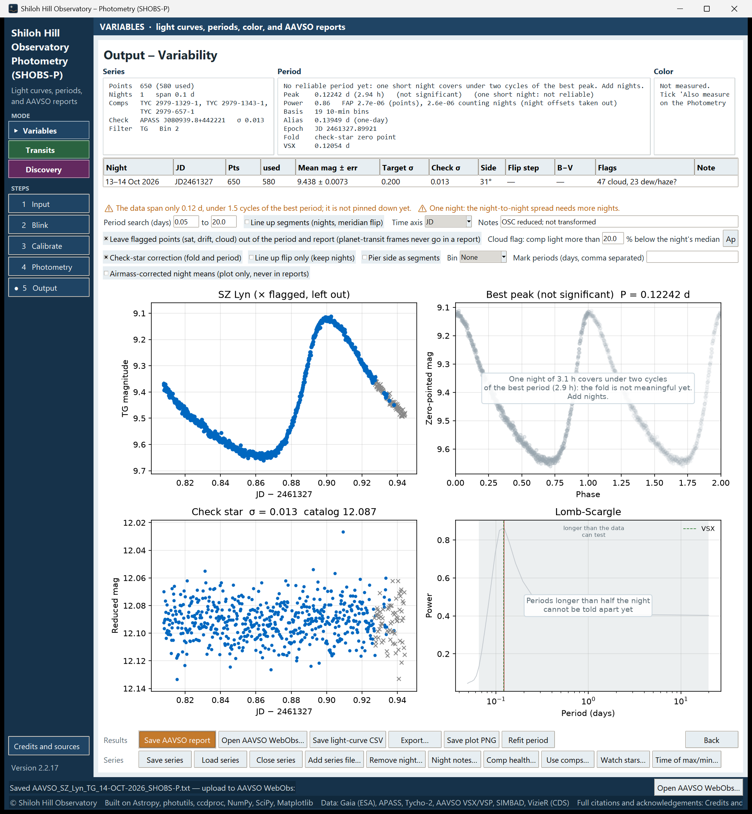

# 15. Submit to AAVSO

SHOBS-P writes reports in the **AAVSO Extended File Format**, ready to upload with the file tool of AAVSO WebObs. This chapter covers what to set up, how to save a report for one night or a whole series, what each field holds, and how to avoid sending the same observations twice.

## Set up once

On the Input page, in the **AAVSO report** box:

- **Observer code**: your AAVSO observer code. Without it the report says `na`, and WebObs will not accept it under your name.
- **Chart ID**: the AAVSO chart your comparison magnitudes come from. When any comp or the check star is an AAVSO sequence star, SHOBS-P fills in the chart ID from the solve. If you typed one yourself, it is left alone. Use `na` for comps not from an AAVSO chart.

In the Output page's **Notes** box, the default note is **OSC reduced; not transformed** for a color camera, or **Monochrome camera; not transformed** for a mono camera. It goes into every line of the report. Add anything AAVSO's reviewers should know, but keep it short.

## Save the report

1. On the Output page, press **Save AAVSO report**.
2. Answer any questions (below).
3. Choose where to save, unless an **Output** folder is set on the Input page; then the file goes there directly.

The file is named like `AAVSO_SZ_Lyn_TG_14-OCT-2026_SHOBS-P.txt`: the star, the filter code, and the UTC date (or a date range such as `16-SEP-2026_to_06-OCT-2026` for several nights). An existing file is never overwritten; a new copy gets `_2`, `_3` and so on.

### Questions before saving

**The Star ID is “hd219134”. AAVSO spells it “HD 219134” … Use “HD 219134” in the report?**
Answer **Yes**. WebObs may not match another spelling to the star.

**Before you upload:** followed by a list. Each item is something AAVSO may reject or misfile:

- **AAVSO observer code is empty**, **Chart ID is empty**, **Star ID is empty**: fill them in on the Input page.
- **the series mixes filters**: report each filter separately (chapter 10).
- **ensemble report (more than one comp) without a check star; AAVSO requires one**: mark a check star and run again.
- **a comp has no star name**: the comp would be called something like `comp1`. Give it its catalog name.

Answer **No** to stop and fix things, or **Yes** to save anyway.

**The check star has no name in this series …**
The check star was never given a real name, so the report would say `KNAME = check`. Type its AUID (for example `000-BJR-417`) or catalog name (for example `TYC 4006-956-1`). SHOBS-P remembers it with the series. If you leave it empty, the report is not saved.

## One night or the whole series

If a night is highlighted in the night table (and the series has more than one night), SHOBS-P asks:

> SZ Lyn · night of 5–6 Oct 2026 is highlighted.
>
> Yes: save the AAVSO report for just that night.
> No: save the AAVSO report for the whole series (8 nights).
> Cancel: don't save.

With no night highlighted, the whole series is saved.

**Report each night once.** The simplest habit for a campaign: after you add a night, click it in the night table, save the report for just that night, and upload it.

### The duplicate warning

SHOBS-P records in the series file every night that has gone into a report. If you save a report that includes a night already saved the *other* way (in its own report when you now save the whole series, or the other way round), it warns:

> These nights are already in another AAVSO report:
>   • … : already saved in its own report, AAVSO_… (2026-10-06 21:40)
>
> If that report was uploaded, uploading this one too puts the same observations into the AAVSO database twice. Upload only one of them for each night.

> **Caution:** There is no warning when you save a *whole-series* report again after adding nights. That new report repeats every earlier night. If you uploaded the earlier whole-series report, upload only the new nights (one night at a time, as above).

## Which points go in

- Only **used** points: flagged points are left out while **Leave flagged points (sat, drift, cloud) out of the period and report …** is ticked (chapter 12).
- Frames flagged during a planet transit are **always** left out. The log says how many.
- The magnitudes are as measured against your comps. The line-up checkboxes, the check-star correction and the airmass-corrected night means do not change the report.

If nothing is left, you see **No usable points to report for that choice.**

## What is in the file

The file begins with `#` header lines: `#TYPE=Extended`, `#OBSCODE=`, `#SOFTWARE=SHOBS-P 2.2.17`, `#DELIM=,`, `#DATE=JD`, `#OBSTYPE=CCD`, and a line saying when SHOBS-P created it. Then one line per point:

| Field | What SHOBS-P writes |
|---|---|
| NAME | The Star ID |
| DATE | Julian Date (UTC) at mid-exposure |
| MAG, MERR | The magnitude and its error (photon noise, scintillation, and any extra for dew/haze) |
| FILT | The filter code, e.g. TG, V, CV, SI |
| TRANS | `NO` (not transformed) |
| MTYPE | `STD` |
| CNAME, CMAG | One comp: its name and instrumental magnitude. Two or more: `ENSEMBLE` and `na` |
| KNAME, KMAG | The check star's name and instrumental magnitude |
| AMASS | The airmass, or `na` without a site and pointing |
| GROUP | `na` |
| CHART | The Chart ID |
| NOTES | Your note, then for an ensemble `ens` and the comps' names, then the night key (e.g. `night JD2461319`) |

Stars from the AAVSO sequence appear under their **AUID**. Other stars appear under their catalog name. The comps named are the ones actually in use, including a choice made with **Use comps…** (chapter 11). For a Sloan filter, the notes also say which catalogs the comp and check magnitudes came from.

## Upload with WebObs

After saving, the status bar names the file and shows a button **Open AAVSO WebObs…**. The same button is in the **Results** row of the Output page.

1. Press **Open AAVSO WebObs…**. AAVSO's photometry submission page opens in your browser.
2. Log in with your AAVSO account.
3. Use the file upload, and choose the report file.
4. Read WebObs's check of the file before you confirm.

Before uploading, check three things in the file: your observer code, the chart ID, and the comparison magnitudes.

<!-- SCREENSHOT 15-webobs-offer: Variables mode, Output – Variability page just after Save AAVSO report with an Output folder set: status bar "Saved AAVSO_… — upload to AAVSO WebObs:" with the Open AAVSO WebObs… button at its right end. Crop: bottom of the window (Results/Series rows and status bar). -->

---

Previous: [14. Time a maximum or minimum](14-time-a-maximum-or-minimum.md) · Next: [16. Plan a transit night](16-plan-a-transit-night.md)
