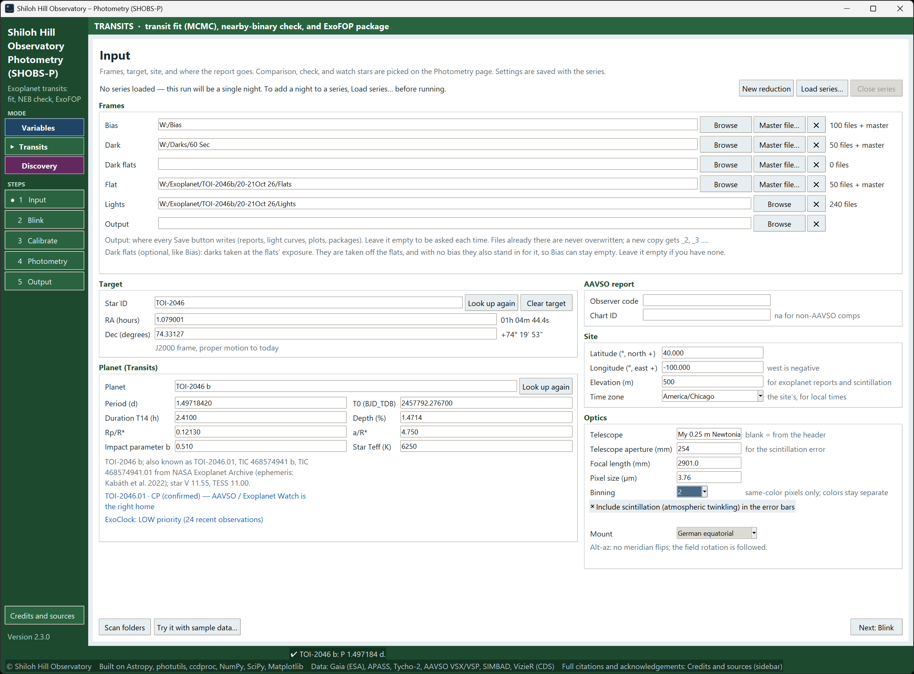

# 16. Prepare for a transit night

A transit night is decided before you open the dome. You need a planet whose whole transit, plus a stretch of
steady baseline on both sides, happens in the dark with the star well above the horizon. This chapter is about
getting SHOBS-P ready for that night, and about the choices that make the transit fit work later.

This chapter covers:

- entering a planet under any of its names (or by its host star),
- the TESS TOI status and ExoClock priority lines,
- choosing the night and how much baseline to take,
- what to do about a meridian flip (or, on an alt-az mount, the zenith keyhole).

SHOBS-P 2.3.0 no longer has the **Tonight's transits…** and **Transit planner…** windows. SHOBS-P does not predict
the coming transits for you: choose the night with the planning resource you normally use, and then use this chapter
to set SHOBS-P up for it.

## Before you start

1. Click **Transits** in the sidebar (under **MODE**). The window turns green and the Input page shows the
   **Planet (Transits)** box.
2. On the Input page, fill in the **Site** box: **Latitude (°, north +)**, **Longitude (°, east +)** (west is
   negative) and **Elevation (m)**. You type these once; SHOBS-P remembers them. The transit fit needs them for BJD
   times, and the airmass and scintillation in the error bars come from them too.
3. Check **Time zone** in the same box: the site's time zone (it starts as this computer's own). The times SHOBS-P
   shows for your night (for example the **Trim** boxes in chapter 17) are the site's local times in that zone. Make
   sure the computer's clock is right.
4. In the **Optics** box, set **Mount** to **German equatorial** or **Alt-az**. SHOBS-P uses it to handle a meridian
   flip (below) and the field rotation of an alt-az mount.

See [4. Before your first night](04-before-your-first-night.md) for the Site and Optics boxes.

## Enter a planet

You can type a planet under any of its catalog names. SHOBS-P asks the NASA Exoplanet Archive, which knows
KOI, Kepler, TOI, TIC, EPIC, Gaia and 2MASS spellings. TOIs that are not in the Archive yet are looked up at ExoFOP.

To enter a planet:

1. In the **Planet (Transits)** box, type the name in **Planet**, for example `TrES-3 b`, `KOI-217 b`,
   `TOI-2046 b` or `EPIC 220504338 b`.
2. Press **Enter** (or Tab out of the box). The lookup starts by itself. While it runs, the busy bar at the left
   end of the bottom status strip says *"Looking up planet TOI-2046 b at the NASA Exoplanet Archive…"*. The boxes
   stay as they are until the answer comes: an empty box stays blank, and a value already in a box stays until the
   lookup replaces it. When it is done, the line under the box says where the values came from.
   If the archive does not answer within 60 seconds, that line says so in red, for example *"✖ TOI-2046 b: the NASA
   Exoplanet Archive did not answer within 60 s — type the values or Look up again."* Type the values, or press
   **Look up again** later.
3. Check the filled boxes: **Period (d)**, **T0 (BJD_TDB)**, **Duration T14 (h)**, **Depth (%)**, **Rp/R\***,
   **a/R\***, **Impact parameter b** and **Star Teff (K)** (used for limb darkening).

The lookup also fills the Star ID and RA/Dec of the host star when they are empty.

### Start from the host star instead

You can also start from the star. Type the host star in **Star ID** (in the Target box), for example `TrES-3`, and
press **Enter**. The busy bar then stays on the whole time, in three steps:

1. *"Looking up TrES-3 at SIMBAD and VSX…"* (the star's position),
2. *"Looking up TrES-3's planets at the NASA Exoplanet Archive…"*,
3. *"Looking up planet TrES-3 b at the NASA Exoplanet Archive…"*.

The bar goes when the planet boxes are filled. A star with several planets opens a chooser instead (see below).

If the Archive lists no planet for the star, or did not answer, the line under the Planet box says in red: *"✖ No
planets found for TrES-3 at the NASA Exoplanet Archive (none listed under that name, or the Archive did not answer).
Type the planet's name, or press Look up again on the Star ID."* If the planet list gets no answer within 60 seconds,
it says *"✖ TrES-3: the NASA Exoplanet Archive did not answer within 60 s — type the planet's name, or Look up again
on the Star ID."*

### Things worth knowing about the lookup

- **The ephemeris.** SHOBS-P compares every published ephemeris for the planet and keeps the one with the smallest
  predicted uncertainty for tonight. The source line names it, for example *"most precise of 4 published
  ephemerides, ±3 min now"*. This is the ephemeris your O − C is measured against later.
- **A star with several planets.** If you type a star (or the Star ID is a star) with more than one known planet,
  a window asks *"… has N known planets. Which one did you observe?"*. Click the planet. Planets that do not
  transit are marked **(does not transit)**. **Cancel** stops the lookup.
- **A planet of another star.** If the planet orbits a different star than the one now on the Input page, SHOBS-P
  starts a new reduction (chapter 5): it clears the old target, comparison stars, check star, watch stars and **Use
  comps…** choice, closes an open series (asking first, with a save offered), and fills in the new host. This keeps a
  previous field's stars from leaking into the new one. If a series is open and you answer **No**, the old star and
  its series stay; check the planet's name.
- **Typing values by hand.** Every box can be edited. If the lookup fails (for example, no internet), type the
  period, T0 and duration yourself; the rest help the fit but are optional. If you type a depth that disagrees with
  Rp/R\* by more than 20%, SHOBS-P notes it and compares against (Rp/R\*)².
- **Look up again** repeats the lookup, for example after a failed one.

### TESS TOI status and ExoClock priority

Right after the planet's values are filled in, SHOBS-P checks two more things in the background, so the lookup is
not slowed. While it checks, the line under the box says *"Checking TESS TOI status and ExoClock…"*. Then two lines
appear under the source line:

- **TESS TOI status**, from the NASA Exoplanet Archive's TOI table (the TFOP Working Group's disposition). SHOBS-P
  finds the TOI by the star's TIC number, else by a TOI number in the planet's names, else by the star's position
  (within 10″). Many WASP, HAT-P and KELT planets are TOIs too.
  - A candidate: *"TOI-1234.01 · PC (planet candidate) — consider uploading to ExoFOP-TESS (coordinate with TFOP
    SG1)"*. **APC** (ambiguous planet candidate) reads the same way. Your transit of a candidate is real follow-up
    science; coordinate with TFOP Sub Group 1 before you upload.
  - A confirmed or known planet: *"TOI-2046.01 · CP (confirmed) — AAVSO / Exoplanet Watch is the right home"* (or
    **KP**, known planet).
  - A false positive (**FP**), a false alarm (**FA**) or a planet that is not a TOI: no line.
  - If the Archive does not answer: *"TOI status unknown (Archive did not answer)"*. It never says "not a TOI" when
    it could not ask.

  The TOI line is blue: click it to open the target's ExoFOP-TESS page.
- **ExoClock priority**, from ExoClock's planet list (downloaded once a day), for example *"ExoClock: HIGH priority
  (2 recent observations)"*. The priority is ALERT, HIGH, MEDIUM or LOW; ALERT and HIGH planets need timings most.
  If your telescope (**Telescope aperture (mm)** in the Optics box) is smaller than ExoClock asks for, the line adds
  *"(needs ≥ 5″ telescope)"*. A planet ExoClock does not follow says *"Not on ExoClock's list"*. Click the line to
  open the planet's ExoClock page.

When a service does not answer, SHOBS-P uses its last answer and says so, for example *"(from cache, fetched 12 Oct
2026)"*. The same two lines are shown on the Transit fit page (chapter 17).

If the lookup fails, the line under the box says *"Could not look up … Check the spelling and press Look up
again, or type the values."*

## Choose the night

A good transit night has:

- the whole transit (ingress to egress, **Duration T14 (h)**) in astronomical darkness,
- the star well above the horizon the whole time, baseline included (30° or more is a good rule),
- a baseline before ingress and after egress (next section),
- the Moon not too close to the star, for a faint target.

The predicted mid-transit times follow from the boxes the lookup filled: a transit happens at **T0 (BJD_TDB)** plus
a whole number of **Period (d)**. BJD_TDB differs from a plain Julian date in UTC by at most about 9½ minutes (the
light's travel time across the Earth's orbit, plus about a minute), so for planning, T0 + n × P read as a UTC Julian
date is close enough; take a few minutes' more baseline on each side to cover it. Add the ephemeris's
uncertainty (the *"±… min now"* in the source line) to both ends of your run.

When you run photometry later, SHOBS-P checks whether your frames cover a predicted transit of the planet. If they do
not, it says so before it runs, and offers Variables mode if the run looks like variability work instead (chapter 8).

## How much baseline

The baseline is the light curve before ingress and after egress. The fit uses it to learn the star's level and any
airmass trend, so a transit with no baseline on one side can be faked or distorted by a slow trend.

- Aim for at least an hour on each side. Half an hour on each side is a workable minimum.
- Equal amounts on both sides are better than a long stretch on one side only.
- If the ephemeris is uncertain, add that uncertainty to both ends.
- Start a few minutes early: the first frames often go to focus and settling.

When the fit later finds less than about 20 minutes of baseline on a side, it warns you and may judge the depth
unreliable (see [18. When the fit says "inconclusive" or "none"](18-inconclusive-or-none.md)).

**Faint comps?** If the field's comparison stars are much fainter than the target, their noise can swamp the
transit in single frames. SHOBS-P can stack frames after the run to fix that (see "Stacking when comps are weak" in
[8. Photometry page basics](08-photometry-basics.md)), but a stack hides anything faster than itself. Short
exposures are fine; just take enough of them.

## Meridian flips

On a German equatorial mount the telescope flips when the star crosses the meridian. The flip leaves a gap in the
data, and the star lands on a different part of the sensor, which can leave a small step in the light curve.

What SHOBS-P does:

- With **Mount** set to **German equatorial**, SHOBS-P finds the flip from the frames' headers (ROTATOR or PIERSIDE)
  or from the image itself, and splits the night there.
- During photometry, frames on both sides of the flip are aligned and measured as usual; the alignment of each
  flipped frame is checked on up to 15 stars' own centers, so the comp and check apertures land on their stars. The
  Calibrate log notes where the flip happened (*"Meridian flip before frame …"*). If you reject the frames before the
  flip in Blink, the first kept frame becomes the reference (chapter 6).
- The transit fit tests a **flip step**: a jump in the star's level at the flip. It fits the night with and without
  the step, and keeps the step only when it improves the fit clearly (ΔBIC 10 or more, the same bar as a detection).
  A kept step is fitted together with the transit, so its uncertainty is part of the depth's. See "A meridian flip in
  the night" in [17. Fit a transit and submit it](17-fit-a-transit-and-submit-it.md).
- If **Mount** is left on **Alt-az** but the field turns by about 180° between two frames, the photometry run warns
  you: *"⚠ The field turned by 180° between frames … — that looks like a meridian flip. Is the Mount set right
  (German equatorial)? …"*. Set **Mount** to **German equatorial** and run photometry again, so the frames after the
  flip are treated as after it.

How to plan for it:

1. Prefer a transit with no flip, if you have the choice.
2. If a flip cannot be avoided, put it in the baseline, well away from ingress and egress, and keep a good stretch
   of baseline (30 minutes or more) on each side of it. This matters more now that the fit can fit a step at the
   flip: with too little baseline on one side, the step and the transit cannot be told apart, and the verdict is
   "inconclusive".
3. Keep the flip short, so the gap is short.

**You do not need a second set of flats for a meridian flip.** After a flip the camera sits in the same place on the
telescope; only the whole tube has turned. The dust shadows and vignetting the flat corrects turn with it. SHOBS-P
knows this: rotator readings 180° apart count as the same camera position, so flats from either side of the pier
match lights from both sides. A *real* rotator move (the camera turned on the telescope) is different, and the
Calibrate page warns about it. See [7. Calibrate](07-calibrate.md).

### Alt-az mounts: the zenith keyhole

An alt-az mount never flips, so the flip step does not apply to it. Its trouble spot is the zenith: above about 85°
the mount's azimuth speed and the field rotation get extreme, and frames there can trail or smear. When you choose
the night, avoid transits during which the star climbs above 85°, or keep that stretch in the baseline.

When you scan the folders of such a night, with **Mount** set to **Alt-az** in the Optics box (Input page), the log
says, for example, *"Zenith keyhole: the field reached altitude 87.2° (above 85°), … Check them on the Blink page."*

## Checklist for the night

- Planet entered on the Input page, with period, T0 and duration filled in.
- **Mount** in the Optics box set to your mount.
- Start and end times that cover the transit, at least 30–60 minutes of baseline on each side, plus any ephemeris
  uncertainty.
- Flats for the camera angle you will use (one set covers both sides of a flip).
- Bias (or dark flats) and darks that match the lights' exposure (chapter 4).
- Comparison stars of similar brightness and color in the field (the Photometry page suggests them; see
  [8. Photometry page basics](08-photometry-basics.md)).

---

Previous: [15. Submit to AAVSO](15-submit-to-aavso.md) · Next: [17. Fit a transit and submit it](17-fit-a-transit-and-submit-it.md)
