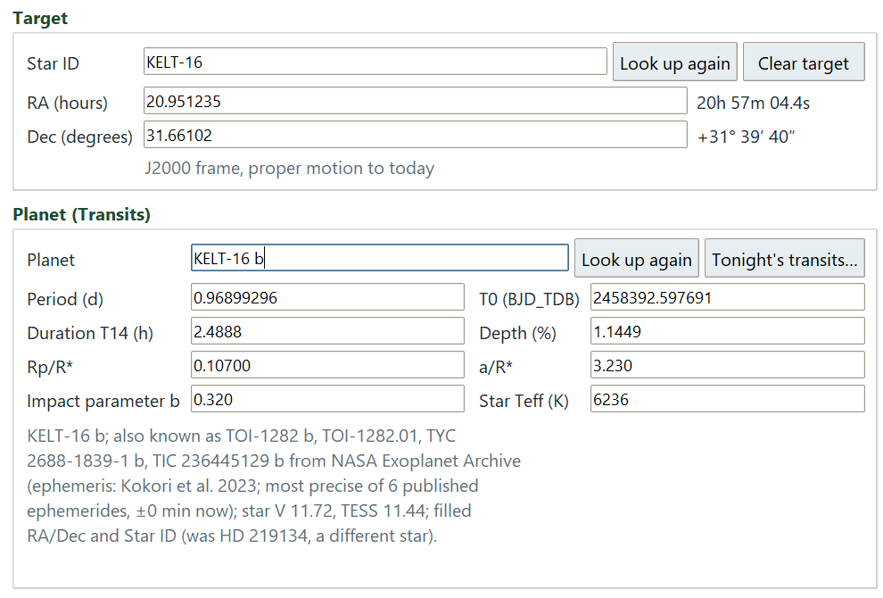
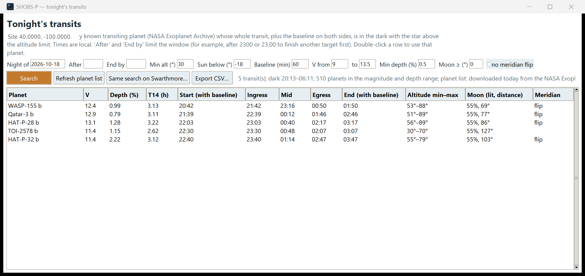
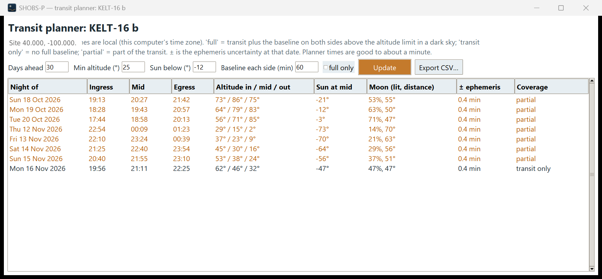

# 16. Plan a transit night

A transit night is decided before you open the dome. You need a planet whose whole transit, plus a stretch of
steady baseline on both sides, happens in the dark with the star well above the horizon. SHOBS-P has two tools
for this: **Tonight's transits…** finds every suitable planet for one night, and **Transit planner…** lists the
coming transits of one planet you have already chosen.

This chapter covers:

- entering a planet under any of its names,
- finding tonight's transits,
- planning the coming transits of one planet,
- how much baseline to take,
- what to do about a meridian flip.

## Before you start

1. Click **Transits** in the sidebar (under **MODE**). The window turns green and the Input page shows the
   **Planet (Transits)** box.
2. On the Input page, fill in the **Site** box: **Latitude (°, north +)**, **Longitude (°, east +)** (west is
   negative) and **Elevation (m)**. You type these once; SHOBS-P remembers them. Both planning tools refuse to run
   without a latitude and longitude, and the transit fit needs them later for BJD times.
3. Make sure the computer's clock and time zone are right. Every time in the planning windows is local time, in
   the computer's time zone.

See [4. Before your first night](04-before-your-first-night.md) for the Site and Optics boxes.

## Enter a planet

You can type a planet under any of its catalog names. SHOBS-P asks the NASA Exoplanet Archive, which knows
KOI, Kepler, TOI, TIC, EPIC, Gaia and 2MASS spellings. TOIs that are not in the Archive yet are looked up at ExoFOP.

To enter a planet:

1. In the **Planet (Transits)** box, type the name in **Planet**, for example `TrES-3 b`, `KOI-217 b`,
   `TOI-2046 b` or `EPIC 220504338 b`.
2. Press **Enter** (or Tab out of the box). The lookup starts by itself; the line under the box says
   *Looking up …* and then where the values came from.
3. Check the filled boxes: **Period (d)**, **T0 (BJD_TDB)**, **Duration T14 (h)**, **Depth (%)**, **Rp/R\***,
   **a/R\***, **Impact parameter b** and **Star Teff (K)** (used for limb darkening).

The lookup also fills the Star ID and RA/Dec of the host star when they are empty.

Things worth knowing about the lookup:

- **The ephemeris.** SHOBS-P compares every published ephemeris for the planet and keeps the one with the smallest
  predicted uncertainty for tonight. The source line names it, for example *"most precise of 4 published
  ephemerides, ±3 min now"*. This is the ephemeris your O − C is measured against later.
- **A star with several planets.** If you type a star (or the Star ID is a star) with more than one known planet,
  a window asks *"… has N known planets. Which one did you observe?"*. Click the planet. Planets that do not
  transit are marked **(does not transit)**. **Cancel** stops the lookup.
- **A planet of another star.** If the planet orbits a different star than the one now on the Input page, SHOBS-P
  clears the old target, comparison stars, check star and watch stars, and fills in the new host. This keeps a
  previous field's stars from leaking into the new one.
- **Typing values by hand.** Every box can be edited. If the lookup fails (for example, no internet), type the
  period, T0 and duration yourself; the rest help the fit but are optional. If you type a depth that disagrees with
  Rp/R\* by more than 20%, SHOBS-P notes it and compares against (Rp/R\*)².
- **Look up again** repeats the lookup, for example after a failed one.

If the lookup fails, the line under the box says *"Could not look up … Check the spelling and press Look up
again, or type the values."*

## Find tonight's transits

**Tonight's transits…** searches every known transiting planet for transits you can observe whole on one night.

To find tonight's transits:

1. Click **Tonight's transits…**. It is beside **Look up again** in the Planet box, and also on the Transit fit
   page (Output step).
2. Check the search fields across the top of the window:
   - **Night of**: the date the night starts (today by default), as `YYYY-MM-DD`.
   - **After** and **End by**: optional clock times that limit the window, for example `2300` or `23:00` if you
     want to finish another target first. Hours before 12 count as the next morning.
   - **Min alt (°)**: the lowest altitude the star may reach during the run, baseline included (default 30).
   - **Sun below (°)**: how dark it must be (default −18, astronomical darkness).
   - **Baseline (min)**: the out-of-transit time you want before ingress and after egress (default 60).
   - **V from** … **to**: the brightness range your telescope handles (default 9 to 13.5).
   - **Min depth (%)**: the shallowest transit worth trying (default 0.5).
   - **Moon ≥ (°)**: the smallest distance from the Moon you accept (default 0, no limit).
   - **no meridian flip**: tick it to list only transits during which the star does not cross the meridian.
3. Click **Search**.

The limits (not **After** and **End by**) are remembered for next time.

Each row is one transit. The columns are **Planet**, **V**, **Depth (%)**, **T14 (h)**, **Start (with baseline)**,
**Ingress**, **Mid**, **Egress**, **End (with baseline)**, **Altitude min–max**, **Moon (lit, distance)** and
**Meridian** (it says **flip** when the star crosses the meridian during the run).

The summary line next to the buttons says how many transits matched, when it is dark, how many planets were in
your magnitude and depth range, and how old the planet list is. The planet list is downloaded from the NASA
Exoplanet Archive and refreshed once a week; **Refresh planet list** downloads it again now.

To use a planet from the list:

1. Double-click its row.
2. If the Input page already has a target, SHOBS-P asks whether to clear it (and its RA/Dec) so the lookup can fill
   them. Answer **Yes** for a new field.

SHOBS-P switches to Transits mode if needed, looks the planet up, opens the Input page, and the status bar says
when the transit runs and when to start, for example *"Transit 22:10–00:35, start by 21:10."*

Other buttons in this window:

- **Same search on Swarthmore…** opens the Swarthmore Transit Finder in your browser with the same site and limits,
  so you can compare.
- **Export CSV…** saves the list as `transits_<date>.csv`.

If nothing matches, the table says *"No transits match. Loosen a limit (altitude, Sun, magnitude, depth, or the
time window)."*

## Plan the coming transits of one planet

**Transit planner…** lists the next transits of the planet on the Input page, as seen from your site.

To plan the coming transits:

1. Enter the planet on the Input page (see above). The planner needs its period, T0 and RA/Dec.
2. Go to the Output step (the Transit fit page) and click **Transit planner…**.
3. Set **Days ahead** (default 30), **Min altitude (°)** (25), **Sun below (°)** (−12) and **Baseline each side
   (min)** (60). Tick **full only** to hide nights that cannot give a full baseline.
4. Click **Update**.

> **Tip:** The planner's default altitude and Sun limits are looser than those of Tonight's transits (25° and −12°
> against 30° and −18°). Set them to the same values if you want the two windows to agree.

The table shows **Night of**, **Ingress**, **Mid**, **Egress**, **Altitude in / mid / out**, **Sun at mid**,
**Moon (lit, distance)**, **± ephemeris** and **Coverage**:

- **full** (green): the transit and the baseline on both sides fit in a dark sky above the altitude limit.
- **transit only**: the transit fits, but not the whole baseline.
- **partial** (orange): only part of the transit is observable.

**± ephemeris** is how uncertain the predicted time is on that date. If it is large (tens of minutes), take more
baseline on both sides so the transit cannot slip out of your window. **Export CSV…** saves the list as
`<planet>_transits.csv` (the planet's name without spaces, e.g. `TrES-3b_transits.csv`). With no observable transit in the range the table says *"No observable transits in this range."*

## How much baseline

The baseline is the light curve before ingress and after egress. The fit uses it to learn the star's level and any
airmass trend, so a transit with no baseline on one side can be faked or distorted by a slow trend.

- Aim for at least an hour on each side (the default). Half an hour on each side is a workable minimum.
- Equal amounts on both sides are better than a long stretch on one side only.
- If the ephemeris is uncertain, add that uncertainty to both ends.
- Start a few minutes early: the first frames often go to focus and settling.

When the fit later finds less than about 20 minutes of baseline on a side, it warns you and may judge the depth
unreliable (see [18. When the fit says "inconclusive" or "none"](18-inconclusive-or-none.md)).

## Meridian flips

On a German equatorial mount the telescope flips when the star crosses the meridian. The flip leaves a gap in the
data, and the star lands on a different part of the sensor, which can leave a small step in the light curve.

What SHOBS-P does:

- **Tonight's transits** marks such nights with **flip** in the **Meridian** column, and **no meridian flip** hides
  them.
- During photometry, frames on both sides of the flip are aligned and measured as usual. The Calibrate log notes
  where the flip happened (*"Meridian flip before frame …"*).
- The transit fit tests whether a plain jump at the largest gap in the data explains the dip as well as a transit
  does. If it does, the verdict becomes "inconclusive" rather than "detected".

How to plan for it:

1. Prefer a transit with no flip, if you have the choice.
2. If a flip cannot be avoided, put it in the baseline, well away from ingress and egress, and keep a good stretch
   of baseline (30 minutes or more) on each side of it.
3. Keep the flip short, so the gap is short.

**You do not need a second set of flats for a meridian flip.** After a flip the camera sits in the same place on the
telescope; only the whole tube has turned. The dust shadows and vignetting the flat corrects turn with it. SHOBS-P
knows this: rotator readings 180° apart count as the same camera position, so flats from either side of the pier
match lights from both sides. A *real* rotator move (the camera turned on the telescope) is different, and the
Calibrate page warns about it. See [7. Calibrate](07-calibrate.md).

## Checklist for the night

- Planet entered on the Input page, with period, T0 and duration filled in.
- Start time = **Start (with baseline)**, end time = **End (with baseline)**, plus any ephemeris uncertainty.
- Flats for the camera angle you will use (one set covers both sides of a flip).
- Bias and darks that match the lights' exposure.
- Comparison stars of similar brightness and color in the field (the Photometry page suggests them; see
  [8. Photometry page basics](08-photometry-basics.md)).

If you later run photometry on frames that do not cover a predicted transit, SHOBS-P says so before it runs, and
offers Variables mode if the run looks like variability work instead.

---

Previous: [15. Submit to AAVSO](15-submit-to-aavso.md) · Next: [17. Fit a transit and submit it](17-fit-a-transit-and-submit-it.md)
