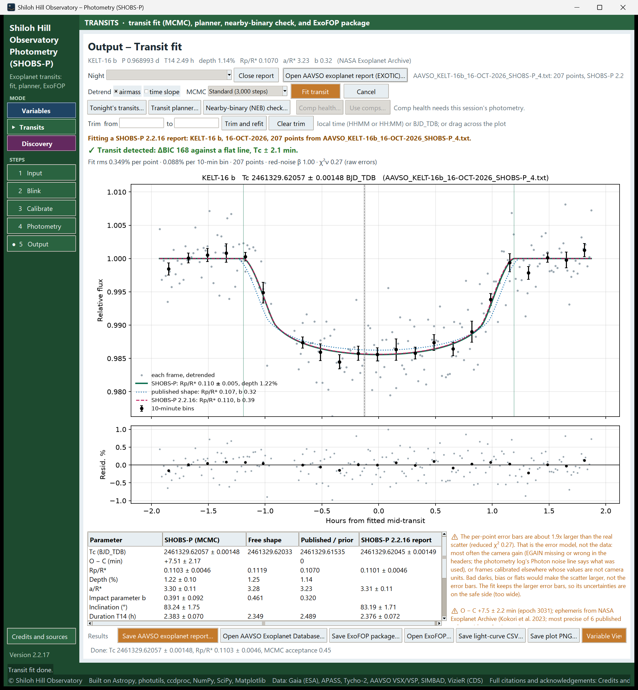
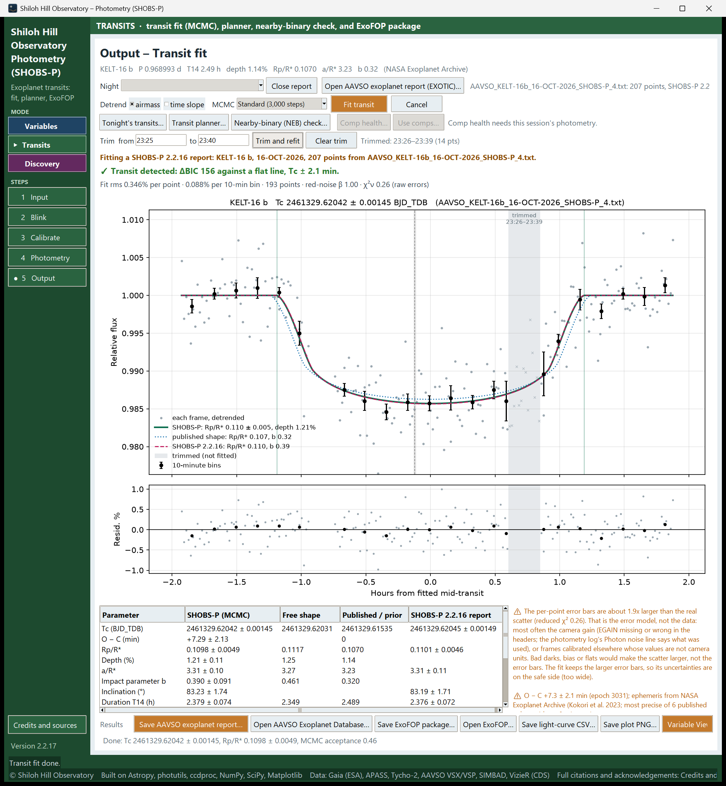

# 17. Fit a transit and submit it

After photometry in Transits mode, the Output step is the **Output – Transit fit** page. It fits a transit model
to your light curve, tells you in plain words whether a transit was measured, and writes the reports.

This chapter covers:

- getting to the fit,
- reading the verdict, the numbers and the plot,
- the comparison-star checks on this page (leave-one-comp-out, **Comp health…**, **Use comps…**),
- leaving out a bad stretch with **Trim**,
- the corner plot of the fit's uncertainties,
- saving and submitting the result,
- fitting several nights of one planet together (**Multi-night…**).

## Get to the fit

1. In Transits mode, enter the planet on the Input page (see [16. Plan a transit night](16-plan-a-transit-night.md)).
2. Work through Input, Blink and Calibrate, then mark the target and comparison stars and press **Run photometry**
   (see [8. Photometry page basics](08-photometry-basics.md)). A check star is optional for a transit.
3. When photometry ends, SHOBS-P opens the Output step. The fit starts by itself when there are at least 20 usable
   points and a planet is known. Press **Cancel** if you want to change a setting first.

The fit has three stages, shown in the progress line under the plot: a least-squares fit, then an MCMC run
(*"MCMC step 1,200 of 3,000"*), then a comparison-star check (*"Checking comps (1 of 3)…"*). How long it takes
depends on the number of frames and comps.

> **Caution:** The fit needs your site's latitude and longitude for BJD times. Without them it stops with
> *"Enter your site's latitude and longitude on the Input page first (they are needed for BJD times)."*

In 2.2.19 the legend sits under the residual panel, and the tools row has **Multi-night…** and **Corner plot…**.

## The page, top to bottom

- **Planet line**: the planet's period, duration, depth and shape, and where they came from.
- **Night**: which night of your photometry is fitted (for example *"KELT-16 b · night of 5–6 Oct 2026"*). The newest
  night is chosen. Picking another one refits it. The hint beside it counts the points: usable, in this fit,
  flagged, trimmed.
- **Open AAVSO exoplanet report (EXOTIC)…**: fit someone else's report instead (see [19. Reports](19-transit-reports.md)).
- **Detrend**: **airmass** (on by default) and **time slope** (off). These are baseline trends fitted together with
  the transit. Add **time slope** only when the baseline clearly drifts and airmass does not explain it. With both
  ticked ("Both"), the two trends can together absorb a transit. When that happens, SHOBS-P refits with each trend
  alone, and the verdict says so, for example *"No detection with Both: … Airmass alone detects it (ΔBIC 32). Untick
  time slope and fit again only if that trend is not real …"*.
- **MCMC**: **Quick (1,500 steps)**, **Standard (3,000 steps)** (default) or **Thorough (8,000 steps)**. Thorough
  gives steadier error bars for a final result; Quick is fine while you try things.
- **Fit transit** runs the fit again with the current settings. **Cancel** stops it.
- **Tonight's transits…**, **Transit planner…** (see chapter 16), **Nearby-binary (NEB) check…** and
  **Multi-night…** (below).
- **Comp health…** and **Use comps…** (below).
- **Corner plot…** and the **credible bands** box (below).
- **Trim** row (below).
- The **verdict**, the **quality line**, the **plot**, the **parameter table** and the **notes**.
- The **Results** row: **Save AAVSO exoplanet report…**, **Open AAVSO Exoplanet Database…**, **Save ExoFOP
  package…**, **Open ExoFOP…**, **Save light-curve CSV…**, **Save plot PNG…** and **Save field image…**, with
  **Variable View  ▶** at the right.

## Read the verdict

The bold line above the plot is the verdict. There are three:

- **✓ Transit detected** (green), for example *"Transit detected: ΔBIC 48 against a flat line, Tc ± 1.9 min."* The
  transit model beats a flat line clearly, the mid-transit time is pinned down, and the depth is believable.
- **⚠ Inconclusive** (orange): the dip beats a flat line, but something else explains it as well. *"Tc may be
  usable; the depth is not."*
- **✗ No transit measured** (red): *"The numbers below are for reference only."*

A detected transit can still carry *"Timing usable; depth unreliable: …"* (orange) when the depth is far from the
published value and the night gives a reason, such as a one-sided baseline. Chapter 18 explains every reason and
what to do about it.

## Read the quality line

Under the verdict a single line sums up the noise, for example:

*Fit rms 0.480% per point · 0.210% per 10-min bin · 68 points · red-noise β 1.12 · χ²ν 1.05 (raw errors)*

- **Fit rms per point**: the scatter of single frames around the model.
- **per 10-min bin**: the scatter after averaging 10 minutes of frames. Compare it with the depth: a 1% transit
  measured with 0.2% bins is clear; a 0.5% transit with 0.4% bins is not.
- **red-noise β**: above 1 means the noise is correlated in time (seeing, guiding, thin cloud). The fit widens its
  uncertainties by β, and the notes say so when β is above 1.5.
- **χ²ν (raw errors)**: how the scatter compares with the error bars from the photometry. About 1 is right. Well
  below 1 or well above 2 gets a note explaining the likely cause (often the camera gain, EGAIN, in the headers).

## Read the table

The table under the plot has one row per quantity: **Tc (BJD_TDB)**, **O − C (min)**, **Rp/R\***, **Depth (%)**,
**a/R\***, **Impact parameter b**, **Inclination (°)**, **Duration T14 (h)**, the limb-darkening coefficients, the
**Airmass slope**, and the noise figures. Its columns are:

- **SHOBS-P (MCMC)**: the result, value ± uncertainty. This is what goes in the report.
- **Free shape**: a quick fit with a/R\* and b left free. It is a cross-check: if Rp/R\* moves a lot here, your data
  alone do not pin the shape down, and the result leans on the published shape. When the free fit runs away (for
  example to an impossible depth), the column says **not constrained** instead of numbers, and a note explains that
  the reported values use the published a/R\* and b.
- **Published / prior**: the lookup's values. The published depth shown is (Rp/R\*)², so it compares like with like.
  On the **Tc** row this column holds the predicted Tc for your epoch, with its uncertainty.
- A fourth column with a report's own values appears when you fit an EXOTIC report.

Rows a caution talks about are shown in orange.

### O − C

**O − C (min)** is your mid-transit time minus the time the ephemeris predicts, in minutes, and in σ, for example
`+5.38 ± 11.15 (+0.5σ)`. Its ± combines your timing error and the ephemeris's (in quadrature). The ephemeris's own
uncertainty is propagated to your epoch, and shown in the Published column as `0 ± 11.10 (ephemeris)`. It is also right
for an epoch before the ephemeris's T0. A note gives the whole story, for example *"O − C +5.38 ± 11.15 min (+0.48σ; fit
and ephemeris σ in quadrature) vs predicted Tc 2461328.625780 ± 0.007706 BJD_TDB (±11.10 min) at epoch 2362;
ephemeris from …"*. The same line goes into the report's notes and the fit CSV. The note turns orange when O − C is
more than 3σ from zero.

The fit looks for Tc anywhere within your data (plus 0.2 day either side), never only in a window around the
prediction, so a late or early transit is found where it really is. If the
prediction itself is uncertain by more than about 10 minutes, a note says the O − C *"mostly tests the
ephemeris"*, which is still useful: that is what timing observations are for.

## Read the plot

- Gray dots: each frame, detrended.
- Black points with error bars: 10-minute bins.
- Green line: the SHOBS-P model, labeled with its Rp/R\* and depth.
- Blue dotted line: the published transit shape, for comparison.
- Gray dashed line and band: the predicted mid-transit and its uncertainty.
- Thin green lines: the fitted start and end of the transit.
- Green shading around the model: the 68 % and 95 % **credible bands**, the range of models the MCMC allows. The
  lower panel shades the baseline's own spread the same way. Untick **credible bands** to hide them.
- Lower panel (**Resid. %**): the residuals. They should look like noise, with no dip or step.

The horizontal axis is **Hours from fitted mid-transit**. The legend sits under the residual panel, never on the
data.

## Notes about the reduction

The notes under the table also say:

- what this night was measured with, for example *"Measured with r 8, sky 14–22 px (Bin 1)."*, in orange when the
  Photometry page's boxes have changed since (run photometry again to apply them);
- the camera gain the error bars used and where it came from, for example *"Gain 0.25 e-/ADU (header EGAIN)."* When
  the headers have no gain, it is estimated from the sky's own noise, or 1 e-/ADU is assumed, in orange.

The full set of reduction settings (aperture, binning, comps, check, frames left out, trimmed frames, detrending,
calibration, gain) is written to the log after each fit, one line per fit, and saved with the report (see below), so
a result can be reproduced later.

## The corner plot

**Corner plot…** opens a window with the MCMC samples of every fitted parameter: a histogram per parameter on the
diagonal (with its median and 16/84 % lines, and the value and error in the title), and each pair below it, with 1σ and
2σ contours. Tc is in minutes from its median. By default the window shows the shape parameters (Tc, Rp/R\*, a/R\*, b,
and the flip step if fitted); tick **Show all parameters (baseline, limb darkening)** for the rest. **Save PNG…** saves
the plot.

How to read it: a round hump is a measurement. A histogram that piles up against the edge of its allowed range is
set by that range, not by your data, so its error bar is not a measurement. SHOBS-P flags such a parameter with ⚠ in
the window, in the page's notes and in the report's notes, for example *"a/R\* is limited by its prior range: its MCMC
samples pile up against …, so the error bar is not a measurement."* An impact parameter b against 0 is the exception:
that is a central transit, and the note says to read b as an upper limit.

## Check the comparison stars

A bad comparison star can make or hide a transit. The page checks this in three ways.

**Leave-one-comp-out.** With two or more comps, after every fit SHOBS-P refits once with each comp left out. The
progress line then reads, for example, *"Comps checked: depth spread 0.12 %, Tc spread 45 s"*. If leaving one comp
out moves the depth or Tc by more than its statistical error, the notes name that comp in orange, with a link to
Comp health. Wait for this check to finish (a few seconds) before saving: saves made while it runs are refused, so
that the files carry its result.

**Comp health….** Opens the same comparison-star health window as in Variables mode: each star against the others,
through the night. A comp marked **SUSPECT** should go. See [11. Check your comparison stars](11-check-your-comparison-stars.md).

**Use comps….** Tick the stars to use and click **Apply**. Every point is recalculated from the stored
measurements (nothing is reduced again), and the transit is refitted at once with the same settings. The notes say
*"Comps changed (now C1, C3): refitting with the same settings…"*.

These two buttons work only on this session's photometry. While an EXOTIC report is shown they are grayed out, and
the hint beside them says why.

## Leave out a bad stretch (Trim)

Use Trim when part of the night is clearly bad (a passing cloud, a dewed-up corrector, a tracking jump) and the
flags did not catch it.

To trim a stretch:

1. Drag across the plot from the start to the end of the bad stretch. The **from** and **to** boxes fill with the
   local times, and the status bar says how many points are inside.
   Or type the times yourself: local clock time (`0042` or `00:42`), or a BJD_TDB. Leave **from** empty to trim
   from the start, or **to** empty to trim to the end.
2. Click **Trim and refit** (or press Enter in either box).

The trimmed points show as faint × in a gray band labeled *trimmed (not fitted)*. They are left out of the fit, the
verdict, the rms, the comp check and every saved file, and the report's NOTES record the trimmed span. Each **Trim
and refit** adds another span; **Clear trim** puts every point back and refits.

A trim needs at least 20 points left. It belongs to the night it was made on: choosing another night, opening a
report or running photometry again clears it.

> **Caution:** Trim to remove bad data, not to make a result look better. Never trim the ingress, egress or the
> bottom of the transit because they disagree with the model.

## Check nearby stars (NEB check)

For a TESS candidate, a faint eclipsing binary next to the target can fake the transit in TESS's large pixels.
**Nearby-binary (NEB) check…** lists every labeled star within **Radius (arcmin)** (2.5 by default), the depth it
would need to cause the whole signal (**Needed depth**), and a **Verdict**:

- **cannot cause it (would need over 100%)**: too faint to matter.
- **needs checking: watch it and measure a transit night**.
- **cleared**: its measured drop at transit time is well below what it would need.
- **POSSIBLE SOURCE: dims by about the needed depth**.
- **not cleared yet (too noisy); measure again**.

To clear the neighbors:

1. Click **Watch the neighbors that need checking**. They become watch stars.
2. Run photometry on a transit night and fit the transit.
3. Open the NEB check again. Each watched neighbor now has a **Measured drop** and a verdict.

The check needs a solved image and the transit depth.

## Look at the light curve in detail

**Variable View  ▶** (bottom right) shows the Variables-style Output page for the same photometry: the light curve
in magnitudes, the check star, the night table and the comp tools. **◀  Transit View** in the same corner brings you
back. See [9. Reduce a variable-star night](09-reduce-a-variable-night.md) for that page.

## Save and submit

When the verdict is "detected" and you are happy with the fit:

1. Set an **Output** folder on the Input page if you have not, so every save goes there without asking.
2. Click **Save AAVSO exoplanet report…**. The status bar names the file and offers **Open AAVSO Exoplanet
   Database…**.
3. Click **Open AAVSO Exoplanet Database…** and upload the report there, following the AAVSO's current
   instructions.
4. For a TESS target, click **Save ExoFOP package…** and then **Open ExoFOP…**.
5. Click **Save plot PNG…** for your own records. The corner plot is saved beside it, as `…_corner.png`.
6. Click **Save light-curve CSV…** if you want the numbers. With a fit shown, it saves two files: the light-curve CSV
   (the same as on the Variables Output page) and a fit CSV beside it, named like
   `TrES-3b_TG_05-OCT-2026_SHOBS-P_transit_fit.csv`. The fit CSV has the columns `BJD_TDB`, `rel_flux`, `rel_flux_err`,
   `model`, `residual` and `flag`, one row per point in time order. Trimmed points are rows too, flagged `trimmed`,
   with no error, model or residual. With an **Output** folder set, both files get the same number as the report and
   plot of this fit. For a fit of an opened EXOTIC report, only the fit CSV is saved. Under its first line, the fit
   CSV has comment lines starting with `#`: the planet, filter, fitted Tc and verdict, and the O − C line.

Saving the report also writes a `…_settings.txt` with the reduction settings, and a field image (`…_field.png`, plus
the AAVSO chart of the field when it answers) beside it. Chapter 19 describes them.

**Uploading twice.** **Open AAVSO Exoplanet Database…** and **Open ExoFOP…** work like **Open AAVSO WebObs…** in
chapter 15: when the page opens, the night of the report (or package) you saved last is marked sent, and the night
table's **Sent** column shows it (for example `✓ AAVSO exo 2026-10-06` or `✓ ExoFOP 2026-10-06`). If that night was
already sent in another report, SHOBS-P asks before opening the page. Double-click the night in the night table to
unmark it.

If the verdict is "inconclusive" or "none", SHOBS-P asks before saving a report and writes the verdict into its
notes. Chapter 19 describes every file and both upload sites.

## Fit several nights together (Multi-night…)

One night gives one transit time. Several nights of the same planet, fitted together, give a better shape, a time for
every night, and a check of the ephemeris. **Multi-night…** opens the **multi-night transit analysis** window.

1. Press **Add reports or fit CSVs…** and pick the nights: AAVSO exoplanet reports (from SHOBS-P or EXOTIC, `.txt`)
   or SHOBS-P fit CSVs (`…_transit_fit.csv`). The night fitted on the Transit fit page joins them when **Include the
   Transit fit page's night** is ticked.
2. Check the list. The **Status** column says **✔ ready** for each usable night. A night of another planet, the same
   night twice, fewer than 20 points, or no transit predicted during the data is left out (**✖** and the reason). A
   night in another filter than most gets a ⚠; consider **Depth and limb darkening per filter**. **Leave out / put
   back** (or a double-click) and **Remove** change the list.
3. Check the **Input ephemeris** (filled from the planet; **Look up (NASA Exoplanet Archive)** fetches it). Optionally
   type an **Alternative ephemeris** (T0, P, their ±, and a source, for example Exoplanet Watch's or ExoClock's
   current one) and press **Apply**.
4. Choose **Detrend** and **MCMC** as on the page, and press **Fit nights**. At least two usable nights are needed.

The joint fit uses one transit shape (Rp/R\*, a/R\*, b and limb darkening) for all nights, with each night's own
mid-transit time, baseline and detrending. Then the timing table lists each epoch: **Tc (BJD_TDB) ± min**, and the
O − C against three ephemerides: **O − C input** (min and σ), **O − C alternative**, and **O − C own fit**, the nights'
own updated linear ephemeris. Outlier nights are flagged.

Under the table, a few lines read the timing in plain words. For example, when all nights are late or early by about
the same amount, and that offset is within what the input ephemeris can predict at these epochs, it says the offset
is *"most likely the ephemeris, not the data"*. (A constant offset can also come from a clock or time-system error.)
A current ephemeris, typed as the alternative, settles it.

The **Plots** tab shows the O − C diagrams and the nights stacked with the joint model; the **Summary and
ephemerides** tab gives the joint shape, each ephemeris (the updated one with its uncertainties and their
covariance) and notes per night. It also lists a combined ephemeris of these nights with the input T0 and P. That
one is *for comparison only*: it is not valid if the input ephemeris already includes these nights.

**Save timing CSV…** writes one row per epoch (mid-time in BJD_TDB with its error, the three O − C, the flag) with
the ephemerides in its header lines, ready for ExoClock. **Save plot PNG…** saves the plots.

---

Previous: [16. Plan a transit night](16-plan-a-transit-night.md) · Next: [18. When the fit says "inconclusive" or "none"](18-inconclusive-or-none.md)
