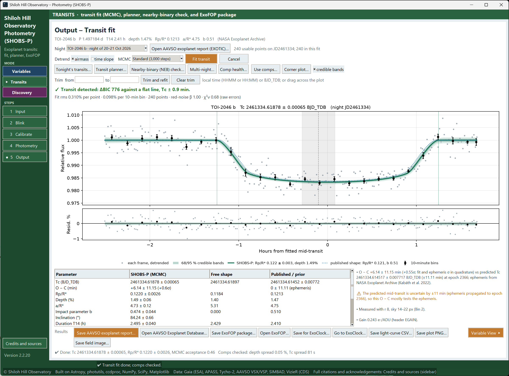
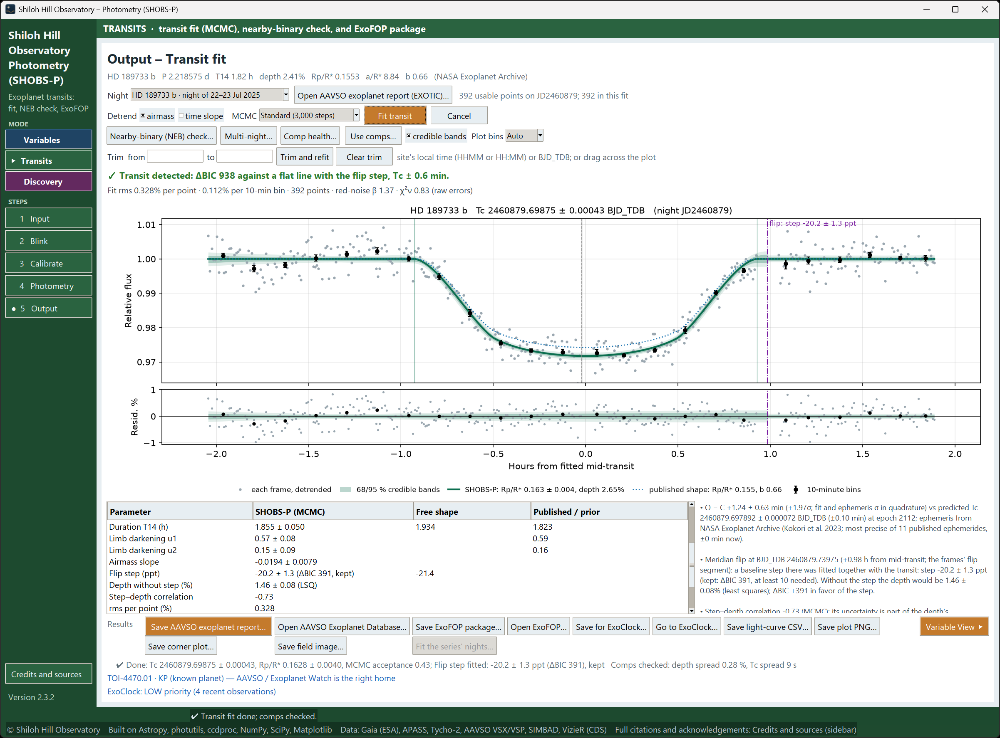
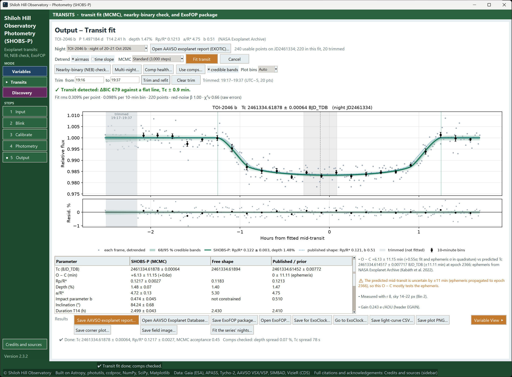
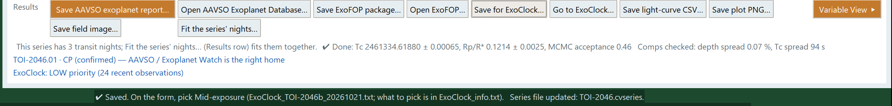
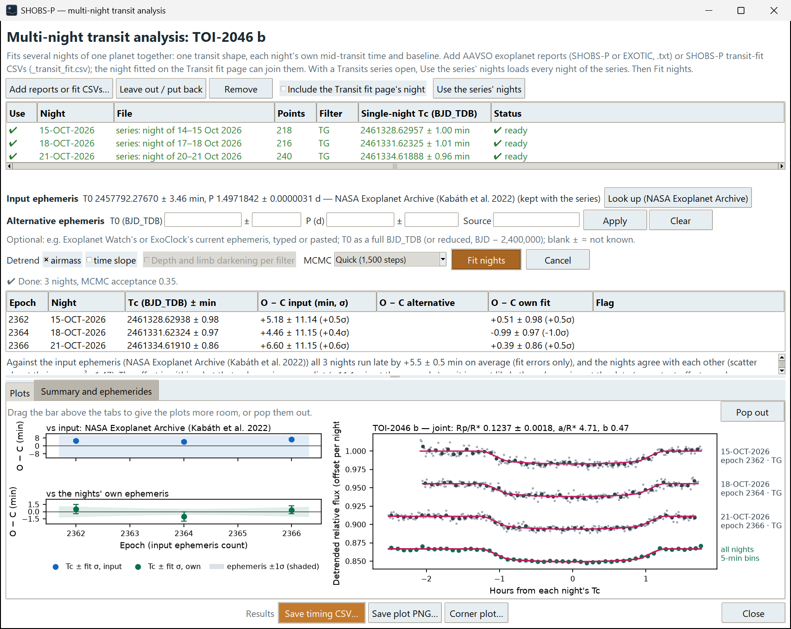
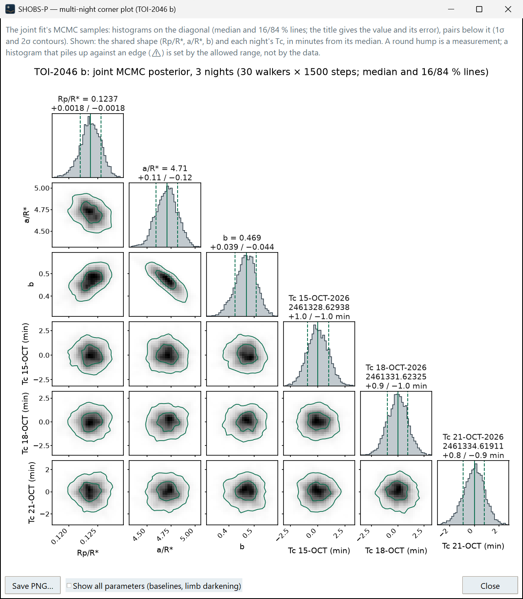

# 17. Fit a transit and submit it

After photometry in Transits mode, the Output step is the **Output – Transit fit** page. It fits a transit model
to your light curve, tells you in plain words whether a transit was measured, and writes the reports.

This chapter covers:

- getting to the fit,
- reading the verdict, the numbers and the plot,
- the comparison-star checks on this page (leave-one-comp-out, **Comp health…**, **Use comps…**),
- leaving out a bad stretch with **Trim**,
- a meridian flip in the night (the flip step),
- the corner plot of the fit's uncertainties,
- per-frame or stacked points,
- saving and submitting the result (AAVSO, ExoFOP and ExoClock),
- fitting several nights of one planet together (**Multi-night…**).

## Get to the fit

1. In Transits mode, enter the planet on the Input page (see [16. Prepare for a transit night](16-plan-a-transit-night.md)).
2. Work through Input, Blink and Calibrate, then mark the target and comparison stars and press **Run photometry**
   (see [8. Photometry page basics](08-photometry-basics.md)). A check star is optional for a transit.
3. When photometry ends, SHOBS-P opens the Output step. The fit never starts by itself: the page says *"… usable
   points. Set the detrend and press Fit transit."* Set the detrend (and anything else) first, then press **Fit
   transit**. It needs at least 20 usable points and a planet. The same holds after **Use comps…**, after you pick
   another night, and after you open a report.

The fit has three stages. The busy bar at the left end of the bottom status strip names each one as it goes: a
least-squares fit (*"Fitting the transit: least-squares fit…"*), then an MCMC run (*"Fitting the transit: MCMC
burn-in… 600 of 1,000"*, then *"Fitting the transit: MCMC step… 1,200 of 3,000"*), then a comparison-star check
(*"Checking the comps… 2 of 5"*). The bar moves back and forth; it never fills, so read the counts in its words. When
it is all done, the bar goes and the status line says *"✔ Transit fit done; comps checked."* How long it takes
depends on the number of frames and comps.

> **Caution:** The fit needs your site's latitude and longitude for BJD times. Without them it stops with
> *"Enter your site's latitude and longitude on the Input page first (they are needed for BJD times)."*

In 2.3.0 the tools row starts with **Nearby-binary (NEB) check…** (Tonight's transits and the Transit planner are
gone), and the corner plot moved to the Results row as **Save corner plot…**. A running fit shows on the busy bar in
the status strip; the page has no progress bar of its own.

## The page, top to bottom

- **Planet line**: the planet's period, duration, depth and shape, and where they came from.
- **Night**: which night of your photometry is fitted (for example *"KELT-16 b · night of 5–6 Oct 2026"*). The newest
  night is chosen. Picking another one clears the fit; press **Fit transit** to fit it. The hint beside it counts the points: usable, in this fit,
  flagged, trimmed.
- **Open AAVSO exoplanet report (EXOTIC)…**: fit someone else's report instead (see [19. Reports](19-transit-reports.md)).
- **Detrend**: **airmass** (on by default) and **time slope** (off). These are baseline trends fitted together with
  the transit. Add **time slope** only when the baseline clearly drifts and airmass does not explain it. With both
  ticked ("Both"), the two trends can together absorb a transit. When that happens, SHOBS-P refits with each trend
  alone, and the verdict says so, for example *"No detection with Both: … Airmass alone detects it (ΔBIC 32). Untick
  time slope and fit again only if that trend is not real …"*.
- **MCMC**: **Quick (1,500 steps)**, **Standard (3,000 steps)** (default) or **Thorough (8,000 steps)**. Thorough
  gives steadier error bars for a final result; Quick is fine while you try things.
- **Fit transit** runs the fit again with the current settings. **Cancel** stops it.
- The tools row: **Nearby-binary (NEB) check…**, **Multi-night…**, **Comp health…**, **Use comps…** (all below),
  the **credible bands** box and the **Plot bins** box (see "Read the plot").
- **Trim** row (below).
- The **verdict**, the **quality line**, the **plot**, the **parameter table** and the **notes**.
- A **result line** above the Results row, once there is something to say: *"✔ Done: Tc …"* with the main numbers,
  *"✖ Fit failed."* or *"Canceled."*, and then the comp-check result (below). On a night with a meridian flip it also
  says what the flip step test decided, for example *"; Flip step fitted: −14.4 ± 0.5 ppt (ΔBIC 629), kept"* (see
  "A meridian flip in the night").
- The **Results** row: **Save AAVSO exoplanet report…**, **Open AAVSO Exoplanet Database…**, **Save ExoFOP
  package…**, **Open ExoFOP…**, **Save for ExoClock…**, **Go to ExoClock…**, **Save light-curve CSV…**, **Save plot
  PNG…**, **Save corner plot…**, **Save field image…** and **Fit the series' nights…**, with **Variable View  ▶** at
  the right. **Multi-night
  fit…** is grayed unless a Transits series with two or more nights is open (see *Fit several nights together*
  below).
- Under the Results row, once the planet is looked up: the planet's **TESS TOI status** and **ExoClock priority**
  (chapter 16), for example *"TOI-2046.01 · CP (confirmed) — AAVSO / Exoplanet Watch is the right home"* and
  *"ExoClock: LOW priority (24 recent observations)"*. Click the TOI line to open the target's ExoFOP-TESS page, and
  the ExoClock line to open the planet's ExoClock page. They help you choose where to send the result (below).

## Read the verdict

The bold line above the plot is the verdict. There are three:

- **✓ Transit detected** (green), for example *"Transit detected: ΔBIC 48 against a flat line, Tc ± 1.9 min."* The
  transit model beats a flat line clearly, the mid-transit time is pinned down, and the depth is believable.
- **⚠ Inconclusive** (orange): the dip beats a flat line, but something else explains it as well. *"Tc may be
  usable; the depth is not."*
- **✗ No transit measured** (red): *"The numbers below are for reference only."*

A detected transit can still carry *"Timing usable; depth unreliable: …"* (orange) when the depth is far from the
published value and the night gives a reason, such as a one-sided baseline. Chapter 18 explains every reason and
what to do about it.

## Read the quality line

Under the verdict a single line sums up the noise, for example:

*Fit rms 0.480% per point · 0.210% per 10-min bin · 68 points · red-noise β 1.12 · χ²ν 1.05 (raw errors)*

- **Fit rms per point**: the scatter of single frames around the model.
- **per 10-min bin**: the scatter after averaging 10 minutes of frames. Compare it with the depth: a 1% transit
  measured with 0.2% bins is clear; a 0.5% transit with 0.4% bins is not.
- **red-noise β**: above 1 means the noise is correlated in time (seeing, guiding, thin cloud). The fit widens its
  uncertainties by β, and the notes say so when β is above 1.5.
- **χ²ν (raw errors)**: how the scatter compares with the error bars from the photometry. About 1 is right. Well
  below 1 or well above 2 gets a note explaining the likely cause (often the camera gain, EGAIN, in the headers).

## Read the table

The table under the plot has one row per quantity: **Tc (BJD_TDB)**, **O − C (min)**, **Rp/R\***, **Depth (%)**,
**a/R\***, **Impact parameter b**, **Inclination (°)**, **Duration T14 (h)**, the limb-darkening coefficients, the
**Airmass slope**, the flip step on a night with a meridian flip (see "A meridian flip in the night"), and the noise
figures. Its columns are:

- **SHOBS-P (MCMC)**: the result, value ± uncertainty. This is what goes in the report.
- **Free shape**: a quick fit with a/R\* and b left free. It is a cross-check: if Rp/R\* moves a lot here, your data
  alone do not pin the shape down, and the result leans on the published shape. When the free fit runs away (for
  example to an impossible depth), the column says **not constrained** instead of numbers, and a note explains that
  the reported values use the published a/R\* and b. From 2.3.2 one parameter can also run away on its own while the
  depth looks fine: then only that row says **not constrained**. That is a/R\* or T14 more than 25 % above or below
  the published value (else the MCMC's), b more than 0.3 from it, or an error on a/R\* larger than half of it. A wide
  error on b alone is normal (b and a/R\* trade off on one night's light curve) and is not flagged.
- **Published / prior**: the lookup's values. The published depth shown is (Rp/R\*)², so it compares like with like.
  On the **Tc** row this column holds the predicted Tc for your epoch, with its uncertainty.
- A fourth column with a report's own values appears when you fit an EXOTIC report.

Rows a caution talks about are shown in orange.

### O − C

**O − C (min)** is your mid-transit time minus the time the ephemeris predicts, in minutes, and in σ, for example
`+5.38 ± 11.15 (+0.5σ)`. Its ± combines your timing error and the ephemeris's (in quadrature). The ephemeris's own
uncertainty is propagated to your epoch, and shown in the Published column as `0 ± 11.10 (ephemeris)`. It is also right
for an epoch before the ephemeris's T0. A note gives the whole story, for example *"O − C +5.38 ± 11.15 min (+0.48σ; fit
and ephemeris σ in quadrature) vs predicted Tc 2461328.625780 ± 0.007706 BJD_TDB (±11.10 min) at epoch 2362;
ephemeris from …"*. The same line goes into the report's notes and the fit CSV. The note turns orange when O − C is
more than 3σ from zero.

The fit looks for Tc anywhere within your data (plus 0.2 day either side), never only in a window around the
prediction, so a late or early transit is found where it really is. If the
prediction itself is uncertain by more than about 10 minutes, a note says the O − C *"mostly tests the
ephemeris"*, which is still useful: that is what timing observations are for.

## Read the plot

- Gray dots: each frame, detrended.
- Black points with error bars: bins of several frames, also shown on the residual panel. The **Plot bins** box
  sets their width: **Auto** (10 minutes, or 3 frames' spacing when the frames are farther apart than 3⅓ minutes),
  **5 min**, **10 min**, **15 min** or **30 min**. A bin needs at least 3 frames, and the legend names the real width
  (for example *"13-minute bins"* on MicroObservatory frames). The bins are only for the eye: changing them redraws
  the plot without refitting, and the fit, the red-noise beta and the **rms per 10-min bin** line use every frame
  as before.
- Green line: the SHOBS-P model, labeled with its Rp/R\* and depth.
- Blue dotted line: the published transit shape, for comparison.
- Gray dashed line and band: the predicted mid-transit and its uncertainty.
- Thin green lines: the fitted start and end of the transit.
- Purple line at a meridian flip: dash-dot when the flip step was kept, labeled for example *"flip: step −14.4 ± 0.5
  ppt"*; dotted when it was not needed, labeled *"flip: no step needed"*.
- Green shading around the model: the 68 % and 95 % **credible bands**, the range of models the MCMC allows. The
  lower panel shades the baseline's own spread the same way. Untick **credible bands** to hide them.
- Lower panel (**Resid. %**): the residuals. They should look like noise, with no dip or step.

The horizontal axis is **Hours from fitted mid-transit**. The legend sits under the residual panel, never on the
data.

## Notes about the reduction

The notes under the table also say:

- what this night was measured with, for example *"Measured with r 8, sky 14–22 px (Bin 1)."*, in orange when the
  Photometry page's boxes have changed since (run photometry again to apply them);
- the camera gain the error bars used and where it came from, for example *"Gain 0.25 e-/ADU (header EGAIN)."* When
  the headers have no gain, it is estimated from the sky's own noise, or 1 e-/ADU is assumed, in orange. On frames
  the camera binned (XBINNING above 1), SHOBS-P also works out from the sky's noise whether the camera summed or
  averaged the binned pixels, for example *"Gain 0.768 e-/ADU (header EGAIN); camera bin 3x3 averaged, so 6.91 e- per
  stored ADU used (from the sky's noise)"*. See "Camera binning and the gain" in [7. Calibrate](07-calibrate.md);
- on stacked points, *"Stacking: stacks of 40 frames (effective exposure 30 s) (sigma-clipped mean, whole-pixel
  shifts, never across a flip)"* (see "Per-frame or stacked points" below).

The full set of reduction settings (aperture, binning, comps, check, frames skipped at photometry, frames left out,
trimmed frames, detrending, calibration, gain, stacking) is written to the log after each fit, one line per fit, and saved with the report (see below), so
a result can be reproduced later.

## A meridian flip in the night

On a German equatorial mount the star lands on another part of the sensor after the flip, and its measured level can
jump a little: a **flip step**. Left in, such a step drags the baseline on one side and can make the depth wrong (on
one real night the target was 16 mmag fainter after the flip, and without a step the depth came out 14 ppt instead of
the published 24 ppt).

When SHOBS-P knows the night has a flip (**Mount** set to **German equatorial**; the flip comes from the frames'
headers or the image, chapter 16), the fit tests a step there:

1. It fits the night twice by least squares, with and without a step. The step multiplies the baseline after the flip
   by (1 + step), so it is in relative flux, given in ppt. A target that gets fainter after the flip has a negative
   step.
2. It keeps the step only when it lowers the BIC by **10 or more** (ΔBIC ≥ 10, the same bar as a detection).
3. A kept step is fitted together with the transit in the MCMC, so its uncertainty is part of the depth's. A step
   that is not needed is left out: the fit then has no step term at all.

The flip time itself is never fitted: it is halfway between the last frame before the flip and the first after it.
An alt-az night has no flip and never gets the term.

Where you see the decision:

- **The log while fitting**: *"meridian flip: step −14.5 ± 0.6 ppt, ΔBIC 628.8 (kept at 10 or more): kept, fitted
  with the transit"* or *"… not needed, fitted without a step"*.
- **The result line**: *"; Flip step fitted: −14.4 ± 0.5 ppt (ΔBIC 629), kept"* or *"; Flip step not needed: +0.2 ±
  0.6 ppt (ΔBIC −6; kept only at 10 or more)"*.
- **The table**. With the step kept: a row **Flip step (ppt)**, for example *"−14.4 ± 0.5 (ΔBIC 629, kept)"*, then
  **Depth without step (%)** (what the depth would be with no step, from a least-squares fit) and **Step–depth
  correlation** (how much the step and the depth trade off in the MCMC; near ±1 they are hard to tell apart). With
  the step not needed: one row **Flip step**, for example *"not needed (ΔBIC −6; test step +0.2 ± 0.6 ppt)"*.
- **The plot**: the purple line at the flip (see "Read the plot").
- **The notes**: for example *"Meridian flip at BJD_TDB … (+2.57 h from mid-transit; the frames' flip segment): a
  baseline step there was fitted together with the transit: step −14.4 ± 0.5 ppt (kept: ΔBIC 629, at least 10
  needed)."*, then the depth without the step, the step–depth correlation and the baseline on each side. When it is
  not needed: *"… Flip step not needed: … The step is kept only at ΔBIC 10 or more, so this fit has no step term."*

*A night with a meridian flip: the purple dash-dot line marks the flip, and the table has the Flip step (ppt), Depth
without step and Step–depth correlation rows.*

The leave-one-comp-out check uses the main fit's decision (step or no step) for every refit. The reports carry the
flip time either way (chapter 19), so a later refit of a report uses the same time.

For an opened report, which carries no flip segment, tick **meridian flip at the largest gap** to tell the fit that
the report's largest gap is the flip; the same ΔBIC ≥ 10 rule then decides.

## The corner plot

**Save corner plot…** (in the Results row) opens a window with the MCMC samples of every fitted parameter: a
histogram per parameter on the diagonal (with its median and 16/84 % lines, and the value and error in the title), and each pair below it, with 1σ and
2σ contours. Tc is in minutes from its median. By default the window shows the shape parameters (Tc, Rp/R\*, a/R\*, b,
and the flip step if fitted); tick **Show all parameters (baseline, limb darkening)** for the rest. **Save PNG…** saves
the plot, and **Close** closes the window. From 2.3.2 the file carries the number of the fit's saved set
(`…_transit_2_corner.png` beside `…_transit_2.png`), whichever you save first, and one fit keeps one corner plot:
saving it again for the same fit (from this window or with **Save plot PNG…**) replaces it, in the view saved last,
instead of adding a `_2` copy. Without a fit, the button says *"Fit a transit first: the corner plot shows
that fit's MCMC samples."*

How to read it: a round hump is a measurement. A histogram that piles up against the edge of its allowed range is
set by that range, not by your data, so its error bar is not a measurement. SHOBS-P flags such a parameter with ⚠ in
the window, in the page's notes and in the report's notes, for example *"a/R\* is limited by its prior range: its MCMC
samples pile up against …, so the error bar is not a measurement."* An impact parameter b against 0 is the exception:
that is a central transit, and the note says to read b as an upper limit.

## Check the comparison stars

A bad comparison star can make or hide a transit. The page checks this in three ways.

**Leave-one-comp-out.** With two or more comps, after every fit SHOBS-P refits once with each comp left out. The
result line then adds, for example, *"Comps checked: depth spread 0.12 %, Tc spread 45 s"*. If leaving one comp
out moves the depth or Tc by more than its statistical error, the notes name that comp in orange, with a link to
Comp health. Wait for this check to finish (a few seconds) before saving: saves made while it runs are refused, so
that the files carry its result.

**Comp health….** Opens the same comparison-star health window as in Variables mode: each star against the others,
through the night. A comp marked **SUSPECT** should go. See [11. Check your comparison stars](11-check-your-comparison-stars.md).

**Use comps….** Tick the stars to use and click **Apply**. Every point is recalculated from the stored
measurements (nothing is reduced again), and the old fit is cleared. The page says *"Comps in use: C1, C3. Set the
detrend and press Fit transit."*; nothing is fitted until you press it.

These two buttons work only on this session's photometry. While an EXOTIC report is shown they are grayed out, and
the hint beside them says why.

## Leave out a bad stretch (Trim)

Use Trim when part of the night is clearly bad (a passing cloud, a dewed-up corrector, a tracking jump) and the
flags did not catch it.

To trim a stretch:

1. Drag across the plot from the start to the end of the bad stretch. The **from** and **to** boxes fill with the
   site's local times, and the status bar says how many points are inside.
   Or type the times yourself: the site's local clock time (`0042` or `00:42`, in the **Time zone** of the Site box
   on the Input page), or a BJD_TDB. Leave **from** empty to trim
   from the start, or **to** empty to trim to the end.
2. Click **Trim and refit** (or press Enter in either box).

The trimmed points show as faint × in a gray band labeled *trimmed (not fitted)*. They are left out of the fit, the
verdict, the rms, the comp check and every saved file, and the report's NOTES record the trimmed span (in BJD_TDB, with the site's local times and their UTC offset). Each **Trim
and refit** adds another span; **Clear trim** puts every point back and refits.

A trim needs at least 20 points left. It belongs to the night it was made on: choosing another night, opening a
report or running photometry again clears it.

> **Caution:** Trim to remove bad data, not to make a result look better. Never trim the ingress, egress or the
> bottom of the transit because they disagree with the model.

## Check nearby stars (NEB check)

For a TESS candidate, a faint eclipsing binary next to the target can fake the transit in TESS's large pixels.
**Nearby-binary (NEB) check…** lists every labeled star within **Radius (arcmin)** (2.5 by default), the depth it
would need to cause the whole signal (**Needed depth**), and a **Verdict**:

- **cannot cause it (would need over 100%)**: too faint to matter.
- **needs checking: watch it and measure a transit night**.
- **cleared**: its measured drop at transit time is well below what it would need.
- **POSSIBLE SOURCE: dims by about the needed depth**.
- **not cleared yet (too noisy); measure again**.

To clear the neighbors:

1. Click **Watch the neighbors that need checking**. They become watch stars.
2. Run photometry on a transit night and fit the transit.
3. Open the NEB check again. Each watched neighbor now has a **Measured drop** and a verdict.

The check needs a solved image and the transit depth.

## Per-frame or stacked points

When the comparison stars are much fainter than the target, the Photometry page can stack frames and measure the
stacks (see "Stacking when comps are weak" in [8. Photometry page basics](08-photometry-basics.md)). The night then has
two sets of points, and the **Points** box on the Photometry page (**Per frame** / **Stacked**) chooses which one the
fit uses. The **Results use** line on the Photometry page, and on the Output page in Variable View, says which.

- The fit of each set is kept. Switching back to a set fitted before shows its fit at once, and the result line says,
  for example, *"✔ Fit of the stacked points (kept from before)."* A set not fitted yet is fitted as soon as this page
  is on screen.
- The fit needs 20 points or more. **Stack** asks first when the stacks would be fewer.
- With stacked points the fit uses the stacks' effective exposure (the sum of their frames' exposures), and the
  settings record and the report's `SHOBS-P settings:` notes say *"points are stacks of 40 frames (effective exposure
  30 s)"*.
- A stack hides anything faster than itself, so SHOBS-P suggests stacks no longer than a fifth of the ingress (or
  egress), from the planet on the Input page.

## Look at the light curve in detail

**Variable View  ▶** (bottom right) shows the Variables-style Output page for the same photometry: the light curve
in magnitudes, the check star, the night table and the comp tools. **◀  Transit View** in the same corner brings you
back. See [9. Reduce a variable-star night](09-reduce-a-variable-night.md) for that page.

## Save and submit

When the verdict is "detected" and you are happy with the fit:

1. Set an **Output** folder on the Input page if you have not, so every save goes there without asking.
2. Click **Save AAVSO exoplanet report…**. The status bar names the file.
3. Click **Open AAVSO Exoplanet Database…** (beside it on the Results row) and upload the report there, following the AAVSO's current
   instructions.
4. For a TESS target, click **Save ExoFOP package…** and then **Open ExoFOP…**. The TOI line under the Results row
   tells you whether ExoFOP-TESS wants it: a **PC** or **APC** (planet candidate) is follow-up science there
   (coordinate with TFOP Sub Group 1 first); for a **CP** or **KP** (confirmed or known planet), AAVSO and Exoplanet
   Watch are the right home.
5. Click **Save plot PNG…** for your own records. The corner plot is saved beside it, as `…_corner.png`.
   (**Save corner plot…** opens the corner plot on its own, with its own **Save PNG…**.)
6. Click **Save light-curve CSV…** if you want the numbers. With a fit shown, it saves two files: the light-curve CSV
   (the same as on the Variables Output page) and a fit CSV beside it, named like
   `TrES-3b_TG_05-OCT-2026_SHOBS-P_transit_fit.csv`. The fit CSV has the columns `BJD_TDB`, `rel_flux`, `rel_flux_err`,
   `model`, `residual`, `flag`, `airmass`, `segment` and (from 2.3.4) `rel_flux_err_raw`, one row per point in time order. `rel_flux` is the raw
   relative flux (divided by its median, not detrended); the baseline is in `model`. `segment` says `before flip` or
   `after flip` on a night with a meridian flip, and is blank otherwise. Trimmed points are rows too, flagged
   `trimmed`, with no error, model, residual or airmass. With an **Output** folder set, both files get the same number
   as the report and plot of this fit. For a fit of an opened EXOTIC report, only the fit CSV is saved. Under its
   first line, the fit CSV has comment lines starting with `#`: the planet, filter, fitted Tc and verdict, the O − C
   line, what the columns hold, and the time of the meridian flip when there was one.

**Notes that name another star.** Before it saves the AAVSO exoplanet report or the ExoFOP package of your own
photometry, SHOBS-P reads the **Notes** box (in Variable View). If the notes name a star that is not in this
reduction (often a leftover from the last star), it asks, for example *"⚠ The notes name HD 219134, which is not in this reduction. … Save anyway?"*. **No** (the default)
saves nothing and the status line says *"✖ Not saved: fix the Notes (Output page), then save again."* The target,
planet, comps and check star never set it off. A new reduction puts the notes back to *"OSC reduced; not
transformed"* (or *"Monochrome camera; not transformed"*).

Saving the report also writes a `…_settings.txt` with the reduction settings, and a field image (`…_field.png`, plus
the AAVSO chart of the field when it answers) beside it. Chapter 19 describes them.

### Send it to ExoClock

ExoClock collects transit times of known planets to keep their ephemerides up to date, so the Ariel space mission
knows when to look. Any timed transit is welcome there, TESS target or not. Uploading needs an ExoClock account.
The ExoClock line under the Results row says how much ExoClock needs this planet (ALERT and HIGH most), how many
recent observations it has, and whether it asks for a bigger telescope than yours.

1. Click **Save for ExoClock…**. SHOBS-P writes two files:
   - `ExoClock_<planet>_<YYYYMMDD>.txt`, for example `ExoClock_TOI-2046b_20261027.txt` (the planet without spaces,
     and the UTC date of the first frame). This is the file you upload. It has three columns: the time in JD_UTC at
     mid-exposure, the relative flux (not detrended), and its error. Only the frames the fit used are in it.
   - `ExoClock_info.txt`: what to pick on ExoClock's upload form for that file.

   The status line says *"✔ Saved. On the form, pick Mid-exposure (ExoClock_TOI-2046b_20261027.txt; what to pick is
   in ExoClock_info.txt)."*
2. Click **Go to ExoClock…**. The upload page opens in your browser. Log in.
3. Fill in the form from `ExoClock_info.txt`:
   - **Planet**: the name with no space, for example `TOI-2046b`.
   - **Time format**: **JD_UTC**.
   - **Time stamp**: **Mid-exposure**. The form starts on **Exposure start**, so change it. This is the one most
     easily missed: left on Exposure start, every time is off by half an exposure.
   - **Flux format**: **Flux**.
   - **Filter**: as the info file says. A color camera's green channel (`TG`) is listed as **Johnson V**.
   - **Exposure time**: in seconds, as the info file says.
4. Upload the `ExoClock_…txt` file.

*The Results row on the Transit fit page, with **Save for ExoClock…** and **Go to ExoClock…** after **Open ExoFOP…**.*

The times need the target's RA/Dec and your site's latitude and longitude, as for every BJD time. Without them,
SHOBS-P says *"ExoClock file not saved: …"*.

**Uploading twice.** **Open AAVSO Exoplanet Database…**, **Open ExoFOP…** and **Go to ExoClock…** work like **Open
AAVSO WebObs…** in chapter 15: when the page opens, the night of the report (or package, or file) you saved last is
marked sent, and the night table's **Sent** column shows it (for example `✓ AAVSO exo 2026-10-06`, `✓ ExoFOP
2026-10-06` or `✓ ExoClock 2026-10-27`). If that night was already sent in another report, SHOBS-P asks before
opening the page. Double-click the night in the night table to
unmark it.

If the verdict is "inconclusive" or "none", SHOBS-P asks before saving a report and writes the verdict into its
notes. Chapter 19 describes every file and the upload sites.

## Fit several nights together (Multi-night…)

One night gives one transit time. Several nights of the same planet, fitted together, give a better shape, a time for
every night, and a check of the ephemeris. There are two ways in:

- **Fit the series' nights…** (Results row) when a **Transits series** is open with two or more nights. The window opens
  with every night of the series already in the table, one row per night (*"series: night of 15–16 Oct 2026"*).
- **Multi-night…** (tools row, under the fit options) for reports and fit CSVs, yours or other observers'.

Both open the same **multi-night transit analysis** window.

### From a Transits series

A Transits series holds every night of one planet with one reduction: the same comps and apertures, each night with
its own flats. **Fit the series' nights…** (or **Use the series' nights** in the window) takes each night from the series'
own points: times put on BJD_TDB from the Input page's RA/Dec and your site, airmass, and the meridian-flip segment.
You do not need to save a fit CSV for each night first.

When a night has a fit CSV or an AAVSO exoplanet report saved for it (**Save light-curve CSV…** or **Save AAVSO
exoplanet report…** on this page), the series remembers the file, and its Tc fills the **Single-night Tc** column.
For a night with neither, SHOBS-P fits that night alone in the background, as for an older fit CSV. If a remembered
file is no longer on disk (moved or deleted), a line in orange under the buttons names it, for example *"⚠ Night of
18–19 Oct 2026: TOI-2046b_CV_18-OCT-2026_SHOBS-P_transit_fit.csv is not found (moved or deleted); the night is loaded
from the series' own points."* The other nights load as usual. A night that cannot be made from the points (no
RA/Dec or site, or too few points) is loaded from its file instead, or listed with **✖** and the reason.

After you save a report, fit CSV or ExoClock file for a night of a series with two or more nights, the line under the
plot says, for example, *"This series has 3 transit nights; Fit the series' nights… (Results row) fits them together."*

A Variables-mode series never offers **Fit the series' nights…**.

### The steps

1. Load the nights: **Fit the series' nights…** for a Transits series (above), or **Add reports or fit CSVs…** for AAVSO
   exoplanet reports (from SHOBS-P or EXOTIC, `.txt`) or SHOBS-P fit CSVs (`…_transit_fit.csv`). The night fitted on
   the Transit fit page joins them when **Include the Transit fit page's night** is ticked. (It is unticked when
   the series' nights are loaded, since that night is one of them.)
2. Check the list. The **Status** column says **✔ ready** for each usable night. A night of another planet, the same
   night twice, fewer than 20 points, or no transit predicted during the data is left out (**✖** and the reason). A
   night in another filter than most gets a ⚠; consider **Depth and limb darkening per filter**. **Leave out / put
   back** (or a double-click) and **Remove** change the list. If the table is wider than the window, use the
   sideways scroll bar under it. The **Single-night Tc (BJD_TDB)** column gives each night's own Tc. For a fit CSV
   that does not carry one, SHOBS-P fits that night alone in the background: the column says *fitting…* until it is
   done, or *not fitted* if the quick fit fails.
3. Check the **Input ephemeris**. It shows T0 and P with their ± and where they came from, for example *"T0
   2460000.50000 ± 0.72 min, P 1.4971842 ± 0.0000010 d — NASA Exoplanet Archive (Ivshina & Winn 2022)"*. It is
   filled from the planet (a series keeps its planet's lookup; the line then ends *"(kept with the series)"*);
   **Look up (NASA Exoplanet Archive)** fetches it again. Optionally type an **Alternative ephemeris** (T0, P, their
   ±, and a source, for example Exoplanet Watch's or ExoClock's current one) and press **Apply**. With the series'
   nights loaded, the alternative ephemeris is kept in the series file, so the next **Fit the series' nights…** fills it in
   again and the O − C compares with the same one.
4. Choose **Detrend** and **MCMC** as on the page, and press **Fit nights**. At least two usable nights are needed.
   The window's own busy bar, at the lower left, says what the fit is doing, for example *"Fitting 4 nights… MCMC
   burn-in 300 of 500"*. When it is done, the line under the fit options says *"✔ Done: 4 nights, MCMC acceptance
   0.31."*

### Nights with no airmass

Fit CSVs saved by SHOBS-P 2.2.20 or later carry each point's airmass. Older fit CSVs do not. With **airmass**
ticked, a night with no airmass among nights that have it is fitted against time only, unlike the others, and its
Tc may shift. SHOBS-P marks such a night with *"⚠ No airmass in this file: its baseline is fitted against time only,
unlike the other nights. Tc may shift."* in its **Status**, in a line under the table (with the nights' dates) and in
the Summary. The line under the fit options says, for example, *"⚠ 4 nights in use; 1 with no airmass (see
above)."*

You have two ways out:

- Open those nights again in SHOBS-P 2.2.20 or later and save their fit CSVs again (**Save light-curve CSV…**). They
  then carry airmass.
- Press **Fit every night against time only** (beside the line under the table). It unticks **airmass** and ticks
  **time slope**, so every night is fitted the same way.

### The window's layout

The window opens at least 900 × 700 and has two parts with a divider between them. Above it: the nights table, the
ephemerides, the fit options, the result line, the timing table and the reading in plain words. Below it: the
**Plots** and **Summary and ephemerides** tabs, which take any extra height when you make the window bigger. The
divider opens below the timing table, so the nights table and **Fit nights** show at once (on a short screen it
opens at a little over half the height). Drag the divider up to give the plots more room. The **Results** row along the bottom holds **Save timing CSV…**, **Save
plot PNG…**, **Corner plot…** and **Close**.

*The Multi-night window after a joint fit of three nights: nights table above the divider, plots below.*

The joint fit uses one transit shape (Rp/R\*, a/R\*, b and limb darkening) for all nights, with each night's own
mid-transit time, baseline and detrending. A night with a meridian flip gets its own flip step only when that
night's own test kept it (the same ΔBIC ≥ 10 rule as above); the **Nights** part of the Summary says, per night,
*"flip step fitted: … ppt (ΔBIC …), kept"* or *"flip step not needed (ΔBIC …; kept only at 10 or more)"*, and the
corner plot shows a kept step as *step:N*. Then the timing table lists each epoch: **Tc (BJD_TDB) ± min**, and the
O − C against three ephemerides: **O − C input** (min and σ), **O − C alternative**, and **O − C own fit**, the nights'
own updated linear ephemeris. Outlier nights are flagged.

Under the table, a few lines read the timing in plain words. For example, when all nights are late or early by about
the same amount, and that offset is within what the input ephemeris can predict at these epochs, it says the offset
is *"most likely the ephemeris, not the data"*. (A constant offset can also come from a clock or time-system error.)
A current ephemeris, typed as the alternative, settles it.

The **Plots** tab shows the O − C diagrams and the nights stacked with the joint model. One legend sits below the
O − C panels: *Tc ± fit σ* (input, alternative, own), *ephemeris ±1σ (shaded)* and *outlier (> 3σ)*. Each night is
labeled in the right margin with its date, epoch and filter, and the bottom curve is *all nights, 5-min bins*.
**Pop out** (top right of the tab) opens the plots in a window of their own, **SHOBS-P — multi-night plots
(planet)**, which you can make any size or move to another screen. It has its own **Save plot PNG…** and **Close**.

The **Summary and ephemerides** tab gives the joint shape, each ephemeris (the updated one with its uncertainties
and their covariance) and notes per night. It also lists a combined ephemeris of these nights with the input T0 and P. That
one is *for comparison only*: it is not valid if the input ephemeris already includes these nights.

The Summary also has one line, *"Ephemeris used: T0 … ± … BJD_TDB, P … ± … d — "* and the source, that names the
input ephemeris the O − C was measured against.

**Save timing CSV…** writes one row per epoch (mid-time in BJD_TDB with its error, the three O − C, the flag) with
the ephemerides and their sources in its header lines, ready for ExoClock. Nights from a series add a line *"# Nights
from the series TOI-2046b.cvseries"*. **Save plot PNG…** saves the plots, with the *"Ephemeris used: …"* line in small
print at the lower left.

**Corner plot…** (grayed until the nights are fitted) opens **SHOBS-P — multi-night corner plot (planet)**: the
corner plot of the joint fit, read the same way as the single-night one above. Its title reads, for example, *"TOI-2046
b: joint MCMC posterior, 4 nights"*. It shows Rp/R\*, a/R\*, b and one **Tc** panel per night (headed with the
night's date). Tick **Show all parameters (baselines, limb darkening)** for the rest. A parameter that piles up
against its prior range gets the same ⚠ as on a single night. **Save PNG…** saves it as
`<planet>_<first night>_to_<last night>_SHOBS-P_multinight_corner.png`.

*The joint corner plot of three nights: the shared shape, and one Tc panel per night.*

---

Previous: [16. Prepare for a transit night](16-plan-a-transit-night.md) · Next: [18. When the fit says "inconclusive" or "none"](18-inconclusive-or-none.md)
