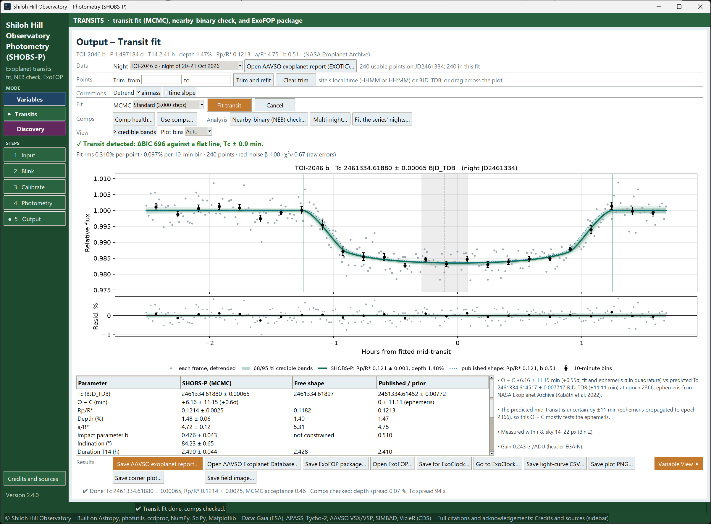
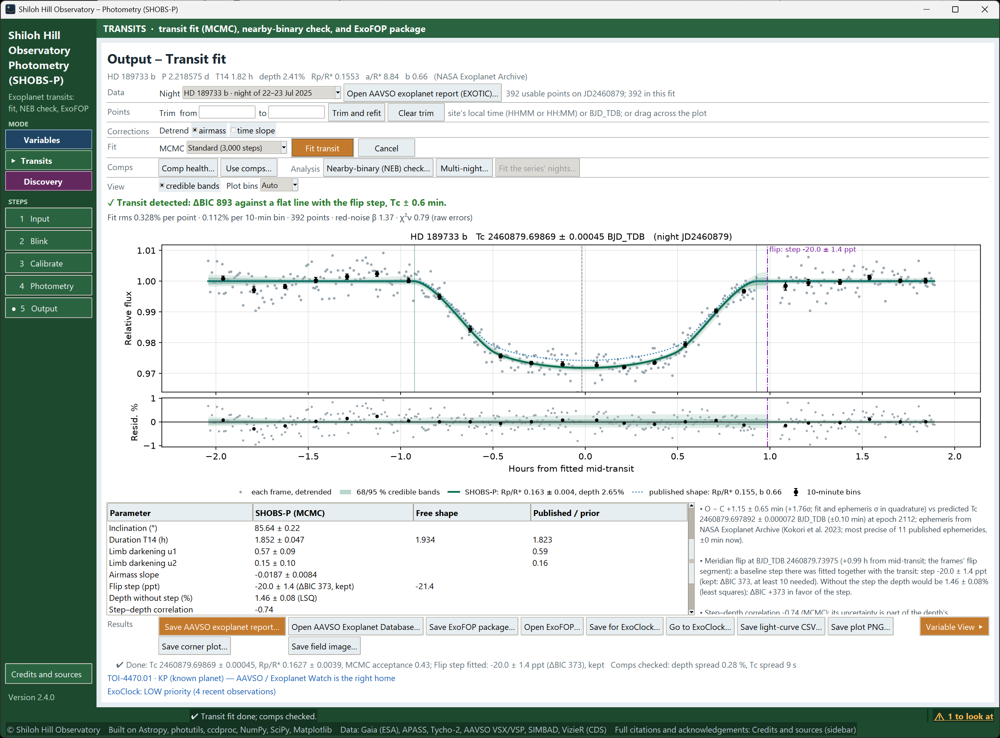
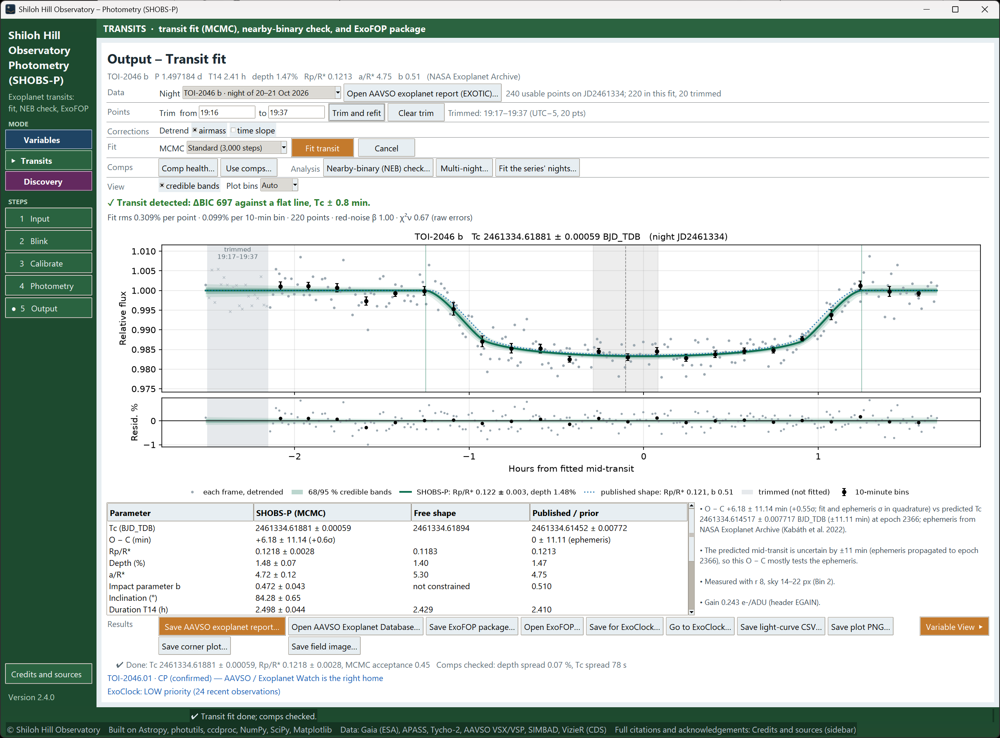
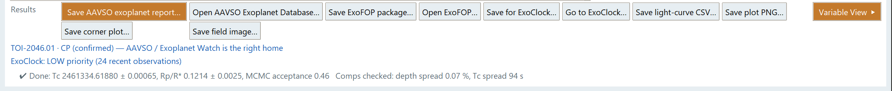
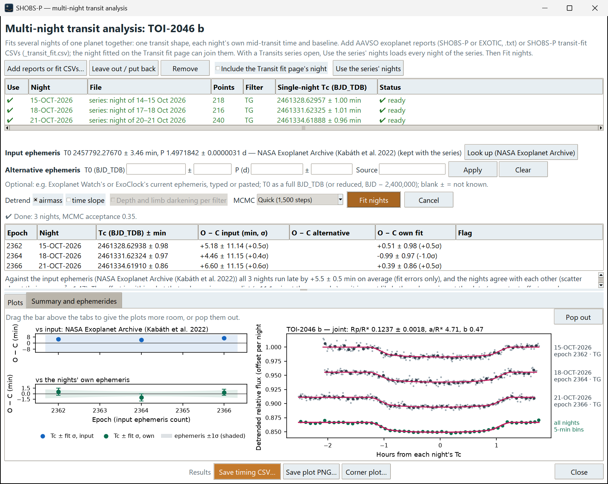
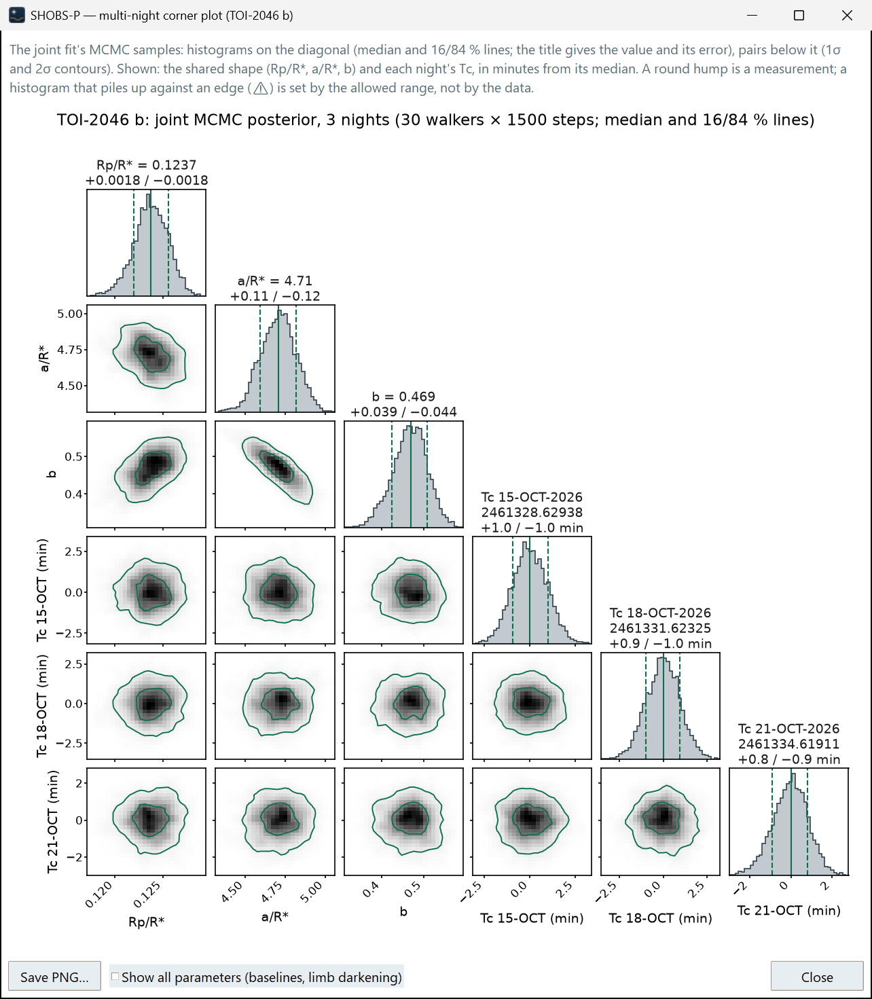

# 17. Fit a transit and submit it

After photometry in Transits mode, the Output step is the **Output – Transit fit** page. It fits a transit model
to your light curve, tells you in plain words whether a transit was measured, and writes the reports.

This chapter covers:

- getting to the fit,
- reading the verdict, the numbers and the plot,
- the comparison-star checks on this page (leave-one-comp-out, **Comp health…**, **Use comps…**),
- leaving out a bad stretch with **Trim**,
- a meridian flip in the night (the flip step),
- the corner plot of the fit's uncertainties,
- per-frame or stacked points,
- saving and submitting the result (AAVSO, ExoFOP and ExoClock),
- fitting several nights of one planet together (**Multi-night…**).

## Get to the fit

1. In Transits mode, enter the planet on the Input page (see [16. Prepare for a transit night](16-plan-a-transit-night.md)).
2. Work through Input, Blink and Calibrate, then mark the target and comparison stars and press **Run photometry**
   (see [8. Photometry page basics](08-photometry-basics.md)). A check star is optional for a transit.
3. When photometry ends, SHOBS-P opens the Output step. The fit never starts by itself: the page says *"… usable
   points. Set the detrend and press Fit transit."* Set the detrend (and anything else) first, then press **Fit
   transit**. It needs at least 20 usable points and a planet. The same holds after **Use comps…**, after you pick
   another night, and after you open a report. When one of your comps was left out of part of the night (it went off
   the frame edge, say), the line below says so first: *"⚠ C4 is missing in 24 frames (off the frame edge; frames
   61–84). The comp ensemble changes partway through the night, which can move the depth and Tc. Leave that comp
   out with Use comps… if the fit looks off."* The same line goes into the fit's notes and its reports. A comp lost
   in only a frame or two (under 5 % of the night) is not named.

The fit has three stages. The busy bar at the left end of the bottom status strip names each one as it goes: a
least-squares fit (*"Fitting the transit: least-squares fit…"*; with **Detrend** on **Auto (BIC)** first a
reference fit and then each choice by name: *"Fitting the transit: choosing the detrend… trying airmass (2 of 6)"*,
and on a night with a meridian flip which of the choice's two fits runs, *"… (2 of 6, with the flip step)"*, from
2.4.0), then an MCMC run (*"Fitting the transit: MCMC
burn-in… 600 of 1,000"*, then *"Fitting the transit: MCMC step… 1,200 of 3,000"*), then a comparison-star check
(*"Checking the comps… 2 of 5"*). The bar moves back and forth; it never fills, so read the counts in its words. When
it is all done, the bar goes and the status line says *"✔ Transit fit done; comps checked."* How long it takes
depends on the number of frames and comps.

**The transit model (2.4.0).** The curve SHOBS-P fits is the exact formula for a round planet crossing a round star
whose disk is darker toward its edge (quadratic limb darkening), from Mandel & Agol (2002). It covers every case:
planet off the star, crossing the edge, fully on the disk, and a grazing transit. Before 2.4.0 SHOBS-P got the same
curve by adding up 200 thin rings of the star; the formula gives the same answer (the two differ by less than a
millionth of the star's light for a planet up to 0.15 of the star's size, and the formula is the more exact one)
and is several times faster to work out, so a fit, the MCMC, **Auto (BIC)**, the Robustness check and the corner plot
all finish sooner (a 300-frame Auto fit: about a third of the time). Fitted values can move from an older version's,
but only by a small fraction of their error bars: the MCMC draws its random steps a little differently.
**Multi-night…** uses the same exact formula for every night (before 2.4.0 it read the curve off a table of 126
points, about a millionth of the star's light away from the exact curve).

The fit needs your site's latitude and longitude, for its BJD times. From 2.4.0 SHOBS-P asks about this before the
photometry, not after it: when you press **Run photometry** in Transits mode with an empty Site box, it says *"No
site is set, so the transit fit can't run."* **Set the site now** shows the Input page with the cursor in the
**Latitude** box; type the site and press **Run photometry** again. **Run photometry only** measures the night
anyway; set the site afterwards and the fit runs on the same points. (Pressing **Fit transit** with no site still
stops with *"Enter your site's latitude and longitude on the Input page first (they are needed for BJD times)."*)

From 2.4.0 the controls above the plot are grouped by what they do, in seven labelled groups (**Data**, **Points**,
**Corrections**, **Fit**, **Comps**, **Analysis**, **View**; **Comps** and **Analysis** share a row), the same rows in the same order as on the Variables
Output page (chapter 9). Under the plot is the save area only. A running fit shows on the busy bar in the status
strip; the page has no progress bar of its own.

## The page, top to bottom

- **Planet line**: the planet's period, duration, depth and shape, and where they came from.
- **Data** row. **Night**: which night of your photometry is fitted (for example *"KELT-16 b · night of 5–6 Oct 2026"*). The newest
  night is chosen. Picking another one clears the fit; press **Fit transit** to fit it. The hint beside it counts the points: usable, in this fit,
  flagged, trimmed.
- **Open AAVSO exoplanet report (EXOTIC)…** (same row): fit someone else's report instead (see [19. Reports](19-transit-reports.md)).
  **Close report** appears beside the Night box while a report is open.
- **Points** row: **Trim** (below), and **Refit with flagged frames** when the night has cloud-flagged frames the fit
  left out. After such a refit a plain note says *"This fit includes 12 frames flagged cloud, error bars ×2.
  Without them: depth 1.52 %, Tc 2461000.51234."*, so the two fits can be compared without fitting again (the
  "Without them" part is there when the fit without them was the one on the page just before). From 2.4.0, when some fitted frames are past airmass 3, a **Trim airmass > 3** button appears after the
  fit, with a note saying how many frames that is and how much out-of-transit baseline a trim would leave before and
  after the transit. Pressing it trims them (the same as a Trim span) and refits; **Clear trim** puts them back. The
  limit can be changed with `transit_trim_airmass` in the settings file.
- **Corrections** row. **Detrend** (a drop-down, from 2.4.0): the baseline trend fitted together with the transit.
  The choices are **Auto (BIC)** (the default), **none**, **airmass**, **time slope**, **time curve (quadratic)**,
  **airmass + time slope** and **airmass + time curve (quadratic)**. A *time curve* is a slope plus a gentle bend
  (quadratic in time); nothing higher than that is offered, because higher powers start to fit the transit itself (ExoClock's advice).
  **Auto** fits every choice and keeps the one with the lowest BIC. Choices within 2 of the lowest count as just as
  good, and then the one with fewer terms is kept, so Auto never adds a term for nothing. On a night with a meridian
  flip, the flip-step test runs *inside* each choice, because a time curve and a flip step can stand in for each
  other. The Log lists every choice with its ΔBIC against the chosen one (for example *"Detrend Auto (BIC): airmass +
  time slope; the others: none ΔBIC +16.4, airmass ΔBIC +12.1, …"*). The same list goes into the settings file
  (*Fit input detrend*), and the report's NOTES name the choice and the runner-up. Pick a choice yourself to force
  it, for example to compare with an earlier fit.
  With airmass and a time trend together, the two can absorb a transit. When that happens, SHOBS-P refits with each
  trend alone, and the verdict says so, for example *"No detection with airmass and time trend together: … Airmass
  alone detects it (ΔBIC 32). Choose airmass in Detrend and fit again only if the other trend is not real …"*.
  When Auto picks a **time curve**, a plain note gives the depth with the curve and the depth the best choice
  without a curve gives (for example *"Auto chose airmass + time curve: depth 4.84 % with the time curve; the best
  choice without it, airmass (ΔBIC +13.5), gives 3.56 % (least squares) …"*). A curve can trade against the depth,
  most of all with little baseline on one side; compare the two before you rely on the depth. The note also goes
  into the report's NOTES and the settings file.
  When the data have no airmass, the airmass choices leave the list (a chosen one becomes the same choice without
  airmass, and Auto leaves them out itself), and the row says why: *no airmass: site not set* (enter the site's
  latitude and longitude on the Input page), *no airmass in these data (run photometry again with the site set)* (the
  site is set now, but the photometry ran before it was) or *no airmass in these data* (a report without an airmass
  column). With airmass again, the full list and your earlier choice come back. The Multi-night window starts with
  your own choice.
  For an opened report the row also has **meridian flip at the largest gap**.
- **Fit** row. **MCMC**: **Quick (1,500 steps)**, **Standard (3,000 steps)** (default) or **Thorough (8,000 steps)**. Thorough
  gives steadier error bars for a final result; Quick is fine while you try things. The MCMC starts from the same
  random seed every time, so the same night with the same comps gives the same numbers, whichever Comp boxes the comps
  are in (from 2.4.0; before, a different order could move the result by a few hundredths of its error). A refit of a
  night measured by an earlier version can differ from that version's numbers by about as much, for the same reason.
- **Fit transit** (the one colored button above the plot) runs the fit with the current settings. **Cancel** stops
  it. The fit always waits for this button. If you change a **Points** or **Corrections** setting while a fit is
  shown, the button reads **Refit (settings changed)** and the shown fit's numbers (the verdict, the quality line,
  the table and the result line) turn gray: they are still the earlier fit's, until you press the button. Setting the
  box back makes them black again.
- **Comps** row: **Comp health…**, **Use comps…** (below).
- **Analysis** row: **Nearby-binary (NEB) check…**, **Multi-night…**, **Fit the series' nights…** and
  **Robustness check** (all below). **Fit the series' nights…** is grayed unless a Transits series with two or more
  nights is open; **Robustness check** is grayed until there is a fit on the page.
- From 2.4.0 a button that cannot work yet is greyed, and hovering over it says why. While a fit, the comp check or
  another step runs (the busy bar), **Fit transit**, **Trim and refit**, **Clear trim**, **Comp health…**, **Use
  comps…**, **Multi-night…**, **Fit the series' nights…**, **Robustness check** and the report buttons are greyed until
  it ends. **Fit transit** pressed on an opened report while its ephemeris is still being looked up is not lost: the
  status bar says *"Fit transit: waiting for the ephemeris…"* and the fit starts as soon as the ephemeris is in.
  Changed your mind? **Cancel** calls it off (*"Fit transit called off (it was waiting for the ephemeris; …)"*), and
  so do **Close report**, opening another report and a change of planet: a waiting fit only ever runs on the report
  and planet it was pressed for.
- **View** row: the **credible bands** box and the **Plot bins** box (see "Read the plot"). Display only.
- The **verdict**, the **quality line**, the **plot**, the **parameter table** and the **notes**.
- A **result line** above the Results row, once there is something to say: *"✔ Done: Tc …"* with the main numbers,
  *"✖ Fit failed."* or *"Canceled."*, and then the comp-check result (below). On a night with a meridian flip it also
  says what the flip step test decided, for example *"; Flip step fitted: −14.4 ± 0.5 ppt (ΔBIC 629), kept"* (see
  "A meridian flip in the night").
- The **Results** row: **Save AAVSO exoplanet report…**, **Open AAVSO Exoplanet Database…**, **Save ExoFOP
  package…**, **Open ExoFOP…**, **Save for ExoClock…**, **Go to ExoClock…**, **Save light-curve CSV…**, **Save plot
  PNG…**, **Save corner plot…** and **Save field image…**, with **Variable View  ▶** at the right. After **Save AAVSO
  exoplanet report…** has saved the field image with the report, **Save field image…** reads **Field image saved ✓**
  and is greyed out (or **Fetch AAVSO chart** when only the chart is missing; chapter 19). The saves are greyed until
  there is a fit to save (**Save light-curve CSV…** also works with this session's photometry and no fit), and the
  AAVSO report, ExoFOP package, ExoClock file and plot PNG are greyed for the few seconds the comp check runs, so their
  files carry its result (from 2.4.0).
- Under the Results row, once the planet is looked up: the planet's **TESS TOI status** and **ExoClock priority**
  (chapter 16), for example *"TOI-2046.01 · CP (confirmed) — AAVSO / Exoplanet Watch is the right home"* and
  *"ExoClock: LOW priority (24 recent observations)"*. Click the TOI line to open the target's ExoFOP-TESS page, and
  the ExoClock line to open the planet's ExoClock page. They help you choose where to send the result (below).
  From 2.4.0 each line takes room only while it has something to say: with no planet looked up there are no empty
  lines there, and the plot is that much taller.

## Read the verdict

The bold line above the plot is the verdict. There are three:

- **✓ Transit detected** (green), for example *"Transit detected: ΔBIC 48 against a flat line, Tc ± 1.9 min."* The
  transit model beats a flat line clearly, the mid-transit time is pinned down, and the depth is believable.
- **⚠ Inconclusive** (orange): the dip beats a flat line, but something else explains it as well. *"Tc may be
  usable; the depth is not."*
- **✗ No transit measured** (red): *"The numbers below are for reference only."*

A detected transit can still carry *"Timing usable; depth unreliable: …"* (orange) when the depth is far from the
published value and the night gives a reason, such as a one-sided baseline. Chapter 18 explains every reason and
what to do about it.

## Read the quality line

Under the verdict a single line sums up the noise, for example:

*Fit rms 0.480% per point · 0.210% per 10-min bin · 68 points · red-noise β 1.12 · χ²ν 1.05 (raw errors)*

- **Fit rms per point**: the scatter of single frames around the model.
- **per 10-min bin**: the scatter after averaging 10 minutes of frames. Compare it with the depth: a 1% transit
  measured with 0.2% bins is clear; a 0.5% transit with 0.4% bins is not.
- **red-noise β**: above 1 means the noise is correlated in time (seeing, guiding, thin cloud). The fit widens its
  uncertainties by β, and the notes say so when β is above 1.5. From 2.4.0 β is worked out on bins of 10 to 30 minutes
  only (before, 2-point bins counted too and kept β near 1 on sparse nights).
- **Prayer-bead check (2.4.0).** After the MCMC, SHOBS-P shifts the fit's residuals around the light curve (up to 40
  shifts), adds them back to the model and refits each one. Slow wiggles in the residuals move those refits; plain
  white noise hardly does. Where the spread of the refits is larger than the MCMC's error (Tc, Rp/R\*, depth, a flip
  step or a time curve), that larger error is the one shown, and a note says which (*"Prayer-bead check (40 shifted
  refits): its error is larger than the MCMC's for Tc, depth …"*). The settings file always has both
  (*Fit errors: prayer bead …*).
- **χ²ν (raw errors)**: how the scatter compares with the error bars from the photometry. About 1 is right. Well
  below 1 or well above 2 gets a note explaining the likely cause (often the camera gain, EGAIN, in the headers).

## Read the table

The table under the plot has one row per quantity: **Tc (BJD_TDB)**, **O − C (min)**, **Rp/R\***, **Depth (%)**,
**a/R\***, **Impact parameter b**, **Inclination (°)**, **Duration T14 (h)**, the limb-darkening coefficients, the
**Airmass slope**, the flip step on a night with a meridian flip (see "A meridian flip in the night"), and the noise
figures. Its columns are:

- **SHOBS-P (MCMC)**: the result, value ± uncertainty. This is what goes in the report.
- **Free shape**: a quick fit with a/R\* and b left free. It is a cross-check: if Rp/R\* moves a lot here, your data
  alone do not pin the shape down, and the result leans on the published shape. When the free fit runs away (for
  example to an impossible depth), the column says **not constrained** instead of numbers, and a note explains that
  the reported values use the published a/R\* and b. From 2.3.2 one parameter can also run away on its own while the
  depth looks fine: then only that row says **not constrained**. That is a/R\* or T14 more than 25 % above or below
  the published value (else the MCMC's), b more than 0.3 from it, or an error on a/R\* larger than half of it. A wide
  error on b alone is normal (b and a/R\* trade off on one night's light curve) and is not flagged.
- **Published / prior**: the lookup's values. The published depth shown is (Rp/R\*)², so it compares like with like.
  From 2.4.0 the **Depth** row shows the **range** of every published (Rp/R\*)² in the NASA Exoplanet Archive (for
  example *2.71–2.91 (8 values)*), because one paper's number is not a fair yardstick when the papers disagree. A
  **Listed depths** row under it shows the Archive's listed transit depths (including ExoFOP's TESS-band dip) for
  information only: they are a different quantity (the limb-darkened dip, other bands, other analyses), so they are
  never used to judge your fit. For an opened report, or a planet typed by hand, SHOBS-P fetches the list when you
  press Fit transit (the busy bar says *looking up the published sizes*; the last good answer is kept for when the
  Archive is down).
  The priors on a/R\* and b use the lookup's published uncertainties (at least 3 % of a/R\* and 0.04 in b). The
  Input page boxes show a/R\* and b to 3 decimals and Rp/R\* to 5; that rounding does not count as a change, so the
  lookup's uncertainties are kept (from 2.4.0; before, an a/R\* of 8.7312 shown as 8.731 lost its uncertainty and the
  prior fell to the minimum width). A value you type yourself has no published uncertainty, so its prior uses the
  minimum width.
  On the **Tc** row this column holds the predicted Tc for your epoch, with its uncertainty.
- A fourth column with a report's own values appears when you fit an EXOTIC report.

Rows a caution talks about are shown in orange.

### O − C

**O − C (min)** is your mid-transit time minus the time the ephemeris predicts, in minutes, and in σ, for example
`+5.38 ± 11.15 (+0.5σ)`. Its ± combines your timing error and the ephemeris's (in quadrature). The ephemeris's own
uncertainty is propagated to your epoch, and shown in the Published column as `0 ± 11.10 (ephemeris)`. It is also right
for an epoch before the ephemeris's T0. A note gives the whole story, for example *"O − C +5.38 ± 11.15 min (+0.48σ; fit
and ephemeris σ in quadrature) vs predicted Tc 2461328.625780 ± 0.007706 BJD_TDB (±11.10 min) at epoch 2362;
ephemeris from …"*. The same line goes into the report's notes and the fit CSV. The note turns orange when O − C is
more than 3σ from zero.

The fit looks for Tc anywhere within your data (plus 0.2 day either side), never only in a window around the
prediction, so a late or early transit is found where it really is. If the
prediction itself is uncertain by more than about 10 minutes, a note says the O − C *"mostly tests the
ephemeris"*, which is still useful: that is what timing observations are for.

## Read the plot

- Gray dots: each frame. The legend says what was taken out of them: *each frame, detrended* when a detrend term
  (airmass, time slope or curve) was fitted, *each frame, flip step taken out* when only a flip step was, and just
  *each frame* when nothing was.
- Black points with error bars: bins of several frames, also shown on the residual panel. The **Plot bins** box
  sets their width: **Auto** (10 minutes, or 3 frames' spacing when the frames are farther apart than 3⅓ minutes),
  **5 min**, **10 min**, **15 min** or **30 min**. A bin needs at least 3 frames, and the legend names the real width
  (for example *"13-minute bins"* on MicroObservatory frames). A width whose bins would mostly hold fewer than 3
  frames gives way to the next one that works, and the legend says so, for example *"10-minute bins (5-min bins hold
  under 3 frames on this night (one every 3 min): showing 10-min bins)"*. The bins are only for the eye: changing them redraws
  the plot without refitting, and the fit, the red-noise beta and the **rms per 10-min bin** line use every frame
  as before.
- Green line: the SHOBS-P model, labeled with its Rp/R\* and depth.
- Blue dotted line: the published transit shape, for comparison.
- Gray dashed line and band: the predicted mid-transit and its uncertainty.
- Thin green lines: the fitted start and end of the transit.
- Purple line at a meridian flip: dash-dot when the flip step was kept, labeled for example *"flip: step −14.4 ± 0.5
  ppt"*; dotted when it was not needed, labeled *"flip: no step needed"*.
- Green shading around the model: the 68 % and 95 % **credible bands**, the range of models the MCMC allows. The
  lower panel shades the baseline's own spread the same way. Untick **credible bands** to hide them.
- Lower panel (**Resid. %**): the residuals. They should look like noise, with no dip or step.

The horizontal axis is **Hours from fitted mid-transit**. The legend sits under the residual panel, never on the
data.

## Notes about the reduction

The notes under the table also say:

- what this night was measured with, for example *"Measured with r 8, sky 14–22 px (Bin 1)."*, in orange when the
  Photometry page's boxes have changed since (run photometry again to apply them);
- the camera gain the error bars used and where it came from, for example *"Gain 0.25 e-/ADU (header EGAIN)."* When
  the headers have no gain, it is measured from the night's sky, for example *"Gain measured from the night's sky,
  39.3 e- per image unit (from 24 frame pairs, 38.9-39.4; read + dark noise 1.16 units from the darks; photon-transfer
  check 37.1 +/- 2.7; method: background model and source mask, idea by Mike Fitzgerald)."* (see "The gain behind the
  error bars" in [8. Photometry basics](08-photometry-basics.md)). When it cannot be measured, the one-frame estimate
  is used and the note says so: *"Gain from the sky's own noise, a lower limit of 28.7 e- per image unit (no EGAIN in
  the headers; error bars are on the safe side)."* With no estimate at all, 1 e-/ADU is assumed, in orange. On frames
  the camera binned (XBINNING above 1), SHOBS-P also works out from the sky's noise whether the camera summed or
  averaged the binned pixels, for example *"Gain 0.768 e-/ADU (header EGAIN); camera bin 3x3 averaged, so 6.91 e- per
  stored ADU used (from the sky's noise)"*. See "Camera binning and the gain" in [7. Calibrate](07-calibrate.md);
- on stacked points, *"Stacking: stacks of 40 frames (effective exposure 30 s) (sigma-clipped mean, whole-pixel
  shifts, never across a flip)"* (see "Per-frame or stacked points" below).

The full set of reduction settings (aperture, binning, comps, check, frames skipped at photometry, frames left out,
trimmed frames, detrending, calibration, gain, stacking) is written to the log after each fit, one line per fit, and saved with the report (see below), so
a result can be reproduced later.

## A meridian flip in the night

On a German equatorial mount the star lands on another part of the sensor after the flip, and its measured level can
jump a little: a **flip step**. Left in, such a step drags the baseline on one side and can make the depth wrong (on
one real night the target was 16 mmag fainter after the flip, and without a step the depth came out 14 ppt instead of
the published 24 ppt).

When SHOBS-P knows the night has a flip (**Mount** set to **German equatorial**; the flip comes from the frames'
headers or the image, chapter 16), the fit tests a step there:

1. It fits the night twice by least squares, with and without a step. The step multiplies the baseline after the flip
   by (1 + step), so it is in relative flux, given in ppt. A target that gets fainter after the flip has a negative
   step.
2. It keeps the step only when it lowers the BIC by **10 or more** (ΔBIC ≥ 10, the same bar as a detection).
3. A kept step is fitted together with the transit in the MCMC, so its uncertainty is part of the depth's. A step
   that is not needed is left out: the fit then has no step term at all.

The flip time itself is never fitted: it is halfway between the last frame before the flip and the first after it.
An alt-az night has no flip and never gets the term.

Where you see the decision:

- **The log while fitting**: *"meridian flip: step −14.5 ± 0.6 ppt, ΔBIC 628.8 (kept at 10 or more): kept, fitted
  with the transit"* or *"… not needed, fitted without a step"*.
- **The result line**: *"; Flip step fitted: −14.4 ± 0.5 ppt (ΔBIC 629), kept"* or *"; Flip step not needed: +0.2 ±
  0.6 ppt (ΔBIC −6; kept only at 10 or more)"*.
- **The table**. With the step kept: a row **Flip step (ppt)**, for example *"−14.4 ± 0.5 (ΔBIC 629, kept)"*, then
  **Depth without step (%)** (what the depth would be with no step, from a least-squares fit) and **Step–depth
  correlation** (how much the step and the depth trade off in the MCMC; near ±1 they are hard to tell apart). With
  the step not needed: one row **Flip step**, for example *"not needed (ΔBIC −6; test step +0.2 ± 0.6 ppt)"*.
- **The plot**: the purple line at the flip (see "Read the plot").
- **The notes**: for example *"Meridian flip at BJD_TDB … (+2.57 h from mid-transit; the frames' flip segment): a
  baseline step there was fitted together with the transit: step −14.4 ± 0.5 ppt (kept: ΔBIC 629, at least 10
  needed)."*, then the depth without the step and the step–depth correlation. When the step and the depth cannot
  be told apart, or a side of the flip has too little baseline, the verdict line above the plot says so (from 2.4.0
  the notes do not repeat it). When the step is not needed there is no note (from 2.4.0): the result line and the
  table's **Flip step** row say it.

*A night with a meridian flip: the purple dash-dot line marks the flip, and the table has the Flip step (ppt), Depth
without step and Step–depth correlation rows.*

The leave-one-comp-out check and the Robustness check (below) decide the step for each of their refits the same
way the fit does (kept only at ΔBIC 10 or more), so a refit whose data need a step gets one even when the fit on the
page has none, and the other way round (2.4.0). The comp check's note names the comps whose refit decided otherwise:
*"… Without TYC 5936-2126-1 the night needs a flip step of its own: that comp jumps at the meridian flip, so check
it before reporting."* (A step forced on for a test keeps that setting in every refit.) Before 2.4.0 every refit took the main fit's decision, which hid the
size of the step a single comp brings. The reports carry the flip time either way (chapter 19), so a later refit of a
report uses the same time.

For an opened report, which carries no flip segment, tick **meridian flip at the largest gap** to tell the fit that
the report's largest gap is the flip; the same ΔBIC ≥ 10 rule then decides.

## The corner plot

**Save corner plot…** (in the Results row) opens a window with the MCMC samples of every fitted parameter: a
histogram per parameter on the diagonal (with its median and 16/84 % lines, and the value and error in the title), and each pair below it, with 1σ and
2σ contours. Tc is in minutes from its median. By default the window shows the shape parameters (Tc, Rp/R\*, a/R\*, b,
and the flip step if fitted); tick **Show all parameters (baseline, limb darkening)** for the rest. **Save PNG…** saves
the plot, and **Close** closes the window. From 2.3.2 the file carries the number of the fit's saved set
(`…_transit_2_corner.png` beside `…_transit_2.png`), whichever you save first, and one fit keeps one corner plot:
saving it again for the same fit (from this window or with **Save plot PNG…**) replaces it, in the view saved last,
instead of adding a `_2` copy. Without a fit, the button says *"Fit a transit first: the corner plot shows
that fit's MCMC samples."*

How to read it: a round hump is a measurement. A histogram that piles up against the edge of its allowed range is
set by that range, not by your data, so its error bar is not a measurement. SHOBS-P flags such a parameter with ⚠ in
the window, in the page's notes and in the report's notes, for example *"a/R\* is limited by its prior range: its MCMC
samples pile up against …, so the error bar is not a measurement."* An impact parameter b against 0 is the exception:
that is a central transit, and the note says to read b as an upper limit.

## Check the comparison stars

A bad comparison star can make or hide a transit. The page checks this in three ways.

**Leave-one-comp-out.** With two or more comps, after every fit SHOBS-P refits once with each comp left out. The
result line then adds, for example, *"Comps checked: depth spread 0.12 %, Tc spread 45 s"*, and the notes give the
range beside the depth with all comps and the points used: *"Comp choice check (each of the 4 comps left out in turn,
least squares): depth 1.58–1.72 % beside 1.65 % with all comps (218 points; …)"*. Each refit uses the same frames as
the main fit: a frame where one comp is missing is measured from the others, on the night's scale, as the photometry
does (from 2.3.5; before, such frames were dropped from every refit, which gave a wrong range). If a refit had to
use fewer points (no other comp in some frames), the note says so. If leaving one comp out moves the depth or Tc by
more than its statistical error, the notes name that comp in orange, with a link to Comp health. The spread is a
diagnostic (how much the comp choice moves the result), not an error bar; the files call it the *Comp-choice check
(diagnostic)*. Wait for this check to finish (a few seconds) before saving: saves made while it runs are refused, so
that the files carry its result.

**Comp health….** Opens the same comparison-star health window as in Variables mode: each star against the others,
through the night. A comp marked **SUSPECT** should go. See [11. Check your comparison stars](11-check-your-comparison-stars.md).

**Use comps….** Tick the stars to use and click **Apply**. Every point is recalculated from the stored
measurements (nothing is reduced again), and the old fit is cleared. The page says *"Comps in use: C1, C3. Set the
detrend and press Fit transit."*; nothing is fitted until you press it.

These two buttons work only on this session's photometry. While an EXOTIC report is shown they are grayed out, and
the hint beside them says why.

## How robust is the result? (Robustness check, 2.4.0)

The depth and Tc can move with choices that are all reasonable: the detrend, how much baseline is kept, the flagged
frames, the comps, the aperture and the sky ring. **Robustness check** (Analysis row) makes that visible. It is
optional: press it after a fit. It refits the night once per variation, by least squares (no MCMC), with the same
planet priors and the same meridian-flip decision as the fit on the page, in the background (the busy bar counts
*Robustness check: refit 7 of 12*; **Cancel** stops it; with a detrend you picked by hand it first works out Auto's
BICs, *Robustness check: choosing the detrend… trying airmass (2 of 6)*). The variations are:

- **every other detrend choice** that is a reasonable one. A choice whose BIC is more than 10 above the lowest is
  not reasonable and is not tried (the note lists it: *Not tried (not reasonable choices here): detrend none (ΔBIC
  +25)*). The BICs are Auto's; when you picked the detrend by hand, the check works them out the same way first.
  The airmass choices are not tried when some frames have no airmass and your fit kept those frames;
- the **first 10 %** of the points trimmed, and the **last 10 %** (two refits);
- the **flagged frames** the other way: put back when the fit left them out, left out when you refitted with them;
- **each comp left out** (as the comp check below);
- for this session's photometry, the **aperture ×0.8 and ×1.2**, and the **sky ring moved out** by half its
  width. For these, SHOBS-P measures the target and the comps in use again on every frame of the fit, at the spots
  the run measured them, so expect a minute or more on a long night of large frames (*Robustness check:
  re-measuring frame 31 of 232*). When the bigger aperture would reach the sky ring, the ring moves out with it.
  These are left out, with the reason in the note, for an opened report (no frames), when the night's frames are
  not calibrated in this session, or when the Binning box no longer matches the night. A star whose aperture or sky
  ring would run off the frame in a variation is not measured in that frame.

The result goes into the notes, the Log, the report's NOTES and the settings file, for example *"Robustness check
(12 least-squares refits: detrend choice, trim first/last 10 %, each comp left out, aperture ±20 %, sky ring
shifted): depth 1.37-1.73 %, ± 0.180 % across choices (formal ± 0.293 %); Tc ± 4.48 min across choices (formal
± 6.32 min); rms 15.53-21.00 ppt. Moves the depth most: last 10 % of the points trimmed; Tc most: aperture r 3.2
px."* The result line adds *"Robustness: depth ± 0.180 % (formal ± 0.293 %), Tc ± 4.48 min (formal ± 6.32 min)"*.
The **spread** is half the full range of the refits (with the fit itself), so it reads like a ± and can be held
against the fit's formal error. The settings file also lists every refit's depth, Tc, rms and points.

A plain note means every spread is within its formal error. When the depth or Tc moves **more** than its formal
error, the notes get a ⚠ that names the choice that moves it most, for example *"Robustness: the Tc moves more
across reasonable reduction choices than its formal error (± 3.10 min against ± 1.20 min); the most is aperture r
6.4 px, which moves it by 4.2 min. Report the larger spread with the result, or find out which choice is right before reporting."*
Press it again after a new fit: the check belongs to the fit it was run on.

On a night with a meridian flip, each refit decides the flip step for itself, as the fit does (above). When some
refits decide otherwise than the fit on the page, the note says which: *"… Flip step: 2 of 10 refits need a flip step
of their own, though the night as fitted has none (TYC 5936-2126-1 left out; Gaia DR3 2991287972537580288 left
out)."* The refit that moves the depth or Tc most adds *(its flip step differs)* when it decided the step otherwise. A comp whose
leave-out needs a step of its own is one that jumps at the flip; the comp survey (chapter 8) now keeps such stars
out of the suggestions.

## Leave out a bad stretch (Trim)

Use Trim when part of the night is clearly bad (a passing cloud, a dewed-up corrector, a tracking jump) and the
flags did not catch it.

To trim a stretch:

1. Drag across the plot from the start to the end of the bad stretch. The **from** and **to** boxes fill with the
   site's local times, and the status bar says how many points are inside.
   Or type the times yourself: the site's local clock time (`0042` or `00:42`, in the **Time zone** of the Site box
   on the Input page), or a BJD_TDB. Leave **from** empty to trim
   from the start, or **to** empty to trim to the end.
2. Click **Trim and refit** (or press Enter in either box). From 2.4.0 the button stays greyed, and the words beside
   the boxes say why, while the span cannot be trimmed: nothing typed, a box it cannot read, no points in the span,
   or fewer than 20 points left. A **to** time before the **from** time is the same span the other way round: it is
   trimmed as meant, and the boxes are put in order.

The trimmed points show as faint × in a gray band labeled *trimmed (not fitted)*. They are left out of the fit, the
verdict, the rms, the comp check and every saved file, and the report's NOTES record the trimmed span (in BJD_TDB, with the site's local times and their UTC offset). Each **Trim
and refit** adds another span; **Clear trim** puts every point back and refits.

A trim needs at least 20 points left (the button says how many would be left). It belongs to the night it was made on: choosing another night, opening a
report or running photometry again clears it.

### One point far from the fit (from 2.4.0)

A cosmic ray, a satellite or a plane across the target or a comp can lift or drop a single frame by several percent.
One such frame can make up much of a night's scatter, and so of the error bars the fit scales up to match it.

After every fit SHOBS-P looks at how far each point is from the fit. The yardstick is the night's typical scatter
about the fit, worked out from the median (1.4826 × the median absolute deviation), so that the one bad point cannot
widen its own yardstick. A single point more than 5 of these (5σ) from the fit gets:

- a plain note that names the frame (its frame number and file name, or for an opened report its place in the report),
  its local time and BJD_TDB, how far it is from the fit, and what the scatter would be without it;
- a red ring on the plot (a red arrow at the panel's edge when the point is above or below it). The bin it falls in
  is drawn **without** it, so the bin does not show the bad frame as if it were real data; the legend says so;
- the button **Leave it out and refit** in the Points row.

**Nothing is left out unless you press the button.** The point is still in the fit, the numbers and the saved files
until you do. Look at the frame in Blink first if you can: leave out a frame that is bad, not one that is only
inconvenient.

**Leave it out and refit** refits without the point. It then shows as a red × labeled *left out as a single-point
outlier (not fitted)*, the notes say which frame is left out, and **Put it back** appears; pressing it refits with
every left-out point back in. Both buttons are greyed while a fit or check runs.

Two or more such points next to each other are not single points. They are something real in the night (a flare,
cloud, a fit that does not follow the data), so none of them is named: use **Trim** for a bad stretch. Frames put back
with **Refit with flagged frames** are never named either. No point is named when leaving it out would leave fewer
than 20.

A left-out point belongs to its night or report, just like a trim. It stays out of every refit of the same data
(**Trim and refit**, **Clear trim**, another detrend, **Use comps…**, **Refit with flagged frames**) and so out of the
comp check, the **Robustness check** and every saved file, until **Put it back**. Choosing another night, opening or
closing a report, or loading another series puts it back, with a line in the log. A left-out point is recorded in the
report's NOTES (`SHOBS-P: left out of the fit as single-point outlier (the user's choice): …`), in the settings file
(**Single points left out of the fit as outliers**) and in the fit CSV, as a row flagged `trimmed outlier`. The
Multi-night window leaves that row out when it loads the fit CSV; nights it takes straight from the series are not
changed by anything done on this page (as with a trim).

> **Caution:** Trim to remove bad data, not to make a result look better. Never trim the ingress, egress or the
> bottom of the transit because they disagree with the model.

## Check nearby stars (NEB check)

For a TESS candidate, a faint eclipsing binary next to the target can fake the transit in TESS's large pixels.
**Nearby-binary (NEB) check…** lists every labeled star within **Radius (arcmin)** (2.5 by default), the depth it
would need to cause the whole signal (**Needed depth**), and a **Verdict**:

- **cannot cause it (would need over 100%)**: too faint to matter.
- **needs checking: watch it and measure a transit night**.
- **cleared**: its measured drop at transit time is well below what it would need.
- **POSSIBLE SOURCE: dims by about the needed depth**.
- **not cleared yet (too noisy); measure again**.

To clear the neighbors:

1. Click **Watch the neighbors that need checking**. They become watch stars.
2. Run photometry on a transit night and fit the transit.
3. Open the NEB check again. Each watched neighbor now has a **Measured drop** and a verdict.

The check needs a solved image and the transit depth. The depth, the target's position and the neighbors always come
from one star. With your photometry shown they are the Input page's. With an opened report (chapter 19) shown, the
check runs only when the report is of the Input page's star, and then uses the report's depth. For a report of
another star, it says so and does not run (from 2.4.0; before, it mixed that report's depth with the Input page's
star and field). Press **Close report** to check the Input page's star. A report of the Input page's star with no
RA and Dec on the Input page yet gets *"The NEB check needs the target's RA/Dec: …"*: press **Lookup** (or type them)
first.

## Per-frame or stacked points

When the comparison stars are much fainter than the target, the Photometry page can stack frames and measure the
stacks (see "Stacking when comps are weak" in [8. Photometry page basics](08-photometry-basics.md)). The night then has
two sets of points, and the **Points** box on the Photometry page (**Per frame** / **Stacked**) chooses which one the
fit uses. The **Results use** line on the Photometry page, and on the Output page in Variable View, says which.

- The fit of each set is kept. Switching back to a set fitted before shows its fit at once, and the result line says,
  for example, *"✔ Fit of the stacked points (kept from before)."* A set not fitted yet is fitted as soon as this page
  is on screen.
- The fit needs 20 points or more. **Stack** asks first when the stacks would be fewer.
- With stacked points the fit uses the stacks' effective exposure (the sum of their frames' exposures), and the
  settings record and the report's `SHOBS-P settings:` notes say *"points are stacks of 40 frames (effective exposure
  30 s)"*.
- A stack hides anything faster than itself, so SHOBS-P suggests stacks no longer than a fifth of the ingress (or
  egress), from the planet on the Input page.

## Look at the light curve in detail

**Variable View  ▶** (bottom right) shows the Variables-style Output page for the same photometry: the light curve
in magnitudes, the check star, the night table and the comp tools. **◀  Transit View** in the same corner brings you
back. See [9. Reduce a variable-star night](09-reduce-a-variable-night.md) for that page.

## Save and submit

When the verdict is "detected" and you are happy with the fit:

1. Set an **Output** folder on the Input page if you have not, so every save goes there without asking.
2. Click **Save AAVSO exoplanet report…**. The status bar names the file.
3. Click **Open AAVSO Exoplanet Database…** (beside it on the Results row) and upload the report there, following the AAVSO's current
   instructions.
4. For a TESS target, click **Save ExoFOP package…** and then **Open ExoFOP…**. The TOI line under the Results row
   tells you whether ExoFOP-TESS wants it: a **PC** or **APC** (planet candidate) is follow-up science there
   (coordinate with TFOP Sub Group 1 first); for a **CP** or **KP** (confirmed or known planet), AAVSO and Exoplanet
   Watch are the right home.
5. Click **Save plot PNG…** for your own records. The corner plot is saved beside it, as `…_corner.png`.
   (**Save corner plot…** opens the corner plot on its own, with its own **Save PNG…**.)
6. Click **Save light-curve CSV…** if you want the numbers. With a fit shown, it saves two files: the light-curve CSV
   (the same as on the Variables Output page) and a fit CSV beside it, named like
   `TrES-3b_TG_05-OCT-2026_SHOBS-P_transit_fit.csv`. The fit CSV has the columns `BJD_TDB`, `rel_flux`, `rel_flux_err`,
   `model`, `residual`, `flag`, `airmass`, `segment` and (from 2.3.4) `rel_flux_err_raw`, one row per point in time order. `rel_flux` is the raw
   relative flux (divided by its median, not detrended); the baseline is in `model`. `segment` says `before flip` or
   `after flip` on a night with a meridian flip, and is blank otherwise. Trimmed points are rows too, flagged
   `trimmed`, with no error, model, residual or airmass; so is a point left out as a single-point outlier, flagged
   `trimmed outlier` (from 2.4.0). With an **Output** folder set, both files get the same number
   as the report and plot of this fit. For a fit of an opened EXOTIC report, only the fit CSV is saved. Under its
   first line, the fit CSV has comment lines starting with `#`: the planet, filter, fitted Tc and verdict, the O − C
   line, what the columns hold, and the time of the meridian flip when there was one.

**Notes that name another star.** Before it saves the AAVSO exoplanet report or the ExoFOP package of your own
photometry, SHOBS-P reads the **Notes** box (in Variable View). If the notes name a star that is not in this
reduction (often a leftover from the last star), it asks, for example *"⚠ The notes name HD 219134, which is not in this reduction. … Save anyway?"*. **No** (the default)
saves nothing and the status line says *"Not saved: fix the Notes (Output page), then save again."* The target,
planet, comps and check star never set it off. A new reduction puts the notes back to *"OSC reduced; not
transformed"* (or *"Monochrome camera; not transformed"*).

Saving the report also writes a `…_settings.txt` with the reduction settings and the fit's exact inputs (period, t0,
a/R\*, b and the rest at full precision, with the catalog and the lookup date, so a rerun can be checked for the same
inputs), and a field image (`…_field.png`, plus
the AAVSO chart of the field when it answers) beside it: the field image comes with the report. Chapter 19 describes them.

### Send it to ExoClock

ExoClock collects transit times of known planets to keep their ephemerides up to date, so the Ariel space mission
knows when to look. Any timed transit is welcome there, TESS target or not. Uploading needs an ExoClock account.
The ExoClock line under the Results row says how much ExoClock needs this planet (ALERT and HIGH most), how many
recent observations it has, and whether it asks for a bigger telescope than yours.

1. Click **Save for ExoClock…**. SHOBS-P writes a folder of its own in the Output folder (from 2.4.0), named like
   the ExoFOP package's: `ExoClock_<planet>_<YYYYMMDD>_<observer code>_SHOBS-P`, for example
   `ExoClock_TOI-2046b_20261027_JABA_SHOBS-P`. In it are two files:
   - `ExoClock_<planet>_<YYYYMMDD>.txt`, for example `ExoClock_TOI-2046b_20261027.txt` (the planet without spaces,
     and the UTC date of the first frame). This is the file you upload. It has three columns: the time in JD_UTC at
     mid-exposure, the relative flux (not detrended), and its error. Only the frames the fit used are in it.
   - `ExoClock_info.txt`: what to pick on ExoClock's upload form for that file.

   A second save of the same night makes a new folder ending in `_2`; nothing is overwritten. (Before 2.4.0 the two
   files lay loose in the Output folder, where the ExoFOP package's `…_fit.txt` was easy to pick by mistake.)

   ExoClock wants JD_UTC times, and turning BJD_TDB back into JD_UTC needs the star's RA/Dec. For your own
   photometry that is the Input page's. For a fit of an **opened report** it is the report's own star: the planet
   lookup's RA/Dec, or, when that has none (an ExoFOP TOI), the star looked up by name (SIMBAD, then VSX; the busy bar
   shows it and the Log says *ExoClock file: TOI-2046's RA/Dec from SIMBAD …*). It is never the Input page's,
   which may hold another target. The site is the report's OBSLAT/OBSLON, else the Input page's. If the lookup does not
   answer, nothing is saved and the message says why; try again later.

   The status line says *"✔ Saved ExoClock_TOI-2046b_20261027_JABA_SHOBS-P: upload the .txt inside (what to pick on
   the form is in ExoClock_info.txt)."*
2. Click **Go to ExoClock…**. The upload page opens in your browser. Log in.
3. Fill in the form from `ExoClock_info.txt`:
   - **Planet**: the name with no space, for example `TOI-2046b`.
   - **Time format**: **JD_UTC**.
   - **Time stamp**: **Mid-exposure**. The form starts on **Exposure start**, so change it. This is the one most
     easily missed: left on Exposure start, every time is off by half an exposure.
   - **Flux format**: **Flux**.
   - **Filter**: as the info file says. A color camera's green channel (`TG`) is listed as **Johnson V**.
   - **Exposure time**: in seconds, as the info file says.
4. Upload the `ExoClock_<planet>_<YYYYMMDD>.txt` file from the ExoClock folder (not `ExoClock_info.txt`, and not a
   file from the ExoFOP package: ExoClock answers those with *index list out of range*).

*The Results row on the Transit fit page, with **Save for ExoClock…** and **Go to ExoClock…** after **Open ExoFOP…**.*

The times need the target's RA/Dec and your site's latitude and longitude, as for every BJD time. Without them,
SHOBS-P says *"ExoClock file not saved: …"*.

**Uploading twice.** **Open AAVSO Exoplanet Database…**, **Open ExoFOP…** and **Go to ExoClock…** work like **Open
AAVSO WebObs…** in chapter 15: when the page opens, the night of the report (or package, or file) you saved last is
marked sent, and the night table's **Sent** column shows it (for example `✓ AAVSO exo 2026-10-06`, `✓ ExoFOP
2026-10-06` or `✓ ExoClock 2026-10-27`). If that night was already sent in another report, SHOBS-P asks before
opening the page. Double-click the night in the night table to
unmark it.

If the verdict is "inconclusive" or "none", SHOBS-P asks before saving a report and writes the verdict into its
notes. Chapter 19 describes every file and the upload sites.

## Fit several nights together (Multi-night…)

One night gives one transit time. Several nights of the same planet, fitted together, give a better shape, a time for
every night, and a check of the ephemeris. There are two ways in:

- **Fit the series' nights…** (**Analysis** row) when a **Transits series** is open with two or more nights. The window opens
  with every night of the series already in the table, one row per night (*"series: night of 15–16 Oct 2026"*).
- **Multi-night…** (beside it in the **Analysis** row) for reports and fit CSVs, yours or other observers'.

Both open the same **multi-night transit analysis** window.

### From a Transits series

A Transits series holds every night of one planet with one reduction: the same comps and apertures, each night with
its own flats. **Fit the series' nights…** (or **Use the series' nights** in the window) takes each night from the series'
own points: times put on BJD_TDB from the Input page's RA/Dec and your site, airmass, and the meridian-flip segment.
You do not need to save a fit CSV for each night first.

When a night has a fit CSV or an AAVSO exoplanet report saved for it (**Save light-curve CSV…** or **Save AAVSO
exoplanet report…** on this page), the series remembers the file, and its Tc fills the **Single-night Tc** column.
For a night with neither, SHOBS-P fits that night alone in the background, as for an older fit CSV. If a remembered
file is no longer on disk (moved or deleted), a line in orange under the buttons names it, for example *"Night of
18–19 Oct 2026: TOI-2046b_CV_18-OCT-2026_SHOBS-P_transit_fit.csv is not found (moved or deleted); the night is loaded
from the series' own points."* The other nights load as usual. A night that cannot be made from the points (no
RA/Dec or site, or too few points) is loaded from its file instead, or listed with **✖** and the reason.

After you save a report, fit CSV or ExoClock file for a night of a series with two or more nights, the line under the
plot says, for example, *"This series has 3 transit nights; Fit the series' nights… (Analysis row) fits them together."*

A Variables-mode series never offers **Fit the series' nights…**.

### The steps

1. Load the nights: **Fit the series' nights…** for a Transits series (above), or **Add reports or fit CSVs…** for AAVSO
   exoplanet reports (from SHOBS-P or EXOTIC, `.txt`) or SHOBS-P fit CSVs (`…_transit_fit.csv`). The night fitted on
   the Transit fit page joins them when **Include the Transit fit page's night** is ticked. (It is unticked when
   the series' nights are loaded, since that night is one of them.)
2. Check the list. The **Status** column says **✔ ready** for each usable night. A night of another planet or the same
   night twice is left out with the reason in plain words (nothing is wrong; it just does not belong in this fit). A
   night with fewer than 20 points, or no transit predicted during the data, is left out with **✖** and the reason. A
   night in another filter than most, or one whose file has no airmass, is still **✔ ready**, with the fact in
   brackets (see *Nights in more than one filter* and *Nights with no airmass* below). **Leave out / put
   back** (or a double-click) and **Remove** change the list. If the table is wider than the window, use the
   sideways scroll bar under it. The **Single-night Tc (BJD_TDB)** column gives each night's own Tc. For a fit CSV
   that does not carry one, SHOBS-P fits that night alone in the background: the column says *fitting…* until it is
   done, or *not fitted* if the quick fit fails.
3. Check the **Input ephemeris**. It shows T0 and P with their ± and where they came from, for example *"T0
   2460000.50000 ± 0.72 min, P 1.4971842 ± 0.0000010 d — NASA Exoplanet Archive (Ivshina & Winn 2022)"*. It is
   filled from the planet (a series keeps its planet's lookup; the line then ends *"(kept with the series)"*);
   **Look up (NASA Exoplanet Archive)** fetches it again. Optionally type an **Alternative ephemeris** (T0, P, their
   ±, and a source, for example Exoplanet Watch's or ExoClock's current one) and press **Apply**. With the series'
   nights loaded, the alternative ephemeris is kept in the series file, so the next **Fit the series' nights…** fills it in
   again and the O − C compares with the same one.
4. Choose **Detrend** and **MCMC** as on the page, and press **Fit nights**. At least two usable nights are needed.
   **Detrend** has the page's choices (from 2.4.0): **Auto (BIC)** (the default), **none**, **airmass**, **time
   slope**, **time curve (quadratic)**, **airmass + time slope** and **airmass + time curve (quadratic)**. With
   **Auto**, each night gets the baseline its own fit picks by the lowest BIC, exactly as the Transit fit page
   picks it for that night alone, so one night can have airmass and the next a time curve. The time curve
   (quadratic) is the most a night can get. Any other choice is used for every night. The Log and the Summary
   name each night's baseline, for example *"12-OCT-2026: baseline airmass (Auto: next airmass + time slope ΔBIC
   +4.3)"*. Before 2.4.0 the window had two boxes (airmass, time slope) that applied to all nights and no time
   curve, so a joint fit made with 2.4.0 can give slightly different numbers.
   If the window is still looking up the planet, the line under the fit options says *"Fit nights: waiting for the
   ephemeris…"* and the fit starts when the lookup is in (from 2.4.0; the window's **Cancel**, or a change of
   planet, calls it off and says so); only after a failed lookup does it ask you to
   press **Look up**. **Fit nights** is greyed while it, or any other step, runs. When the archive knows the planet but
   gives no T0, the Summary says so plainly (*"No published ephemeris: epochs counted from the first night."*); the
   ⚠ form, ending *"Look up."*, means no lookup answered.
   The window's own busy bar, at the lower left, says what the fit is doing, for example *"Fitting 4 nights… MCMC
   burn-in 300 of 500"*. When it is done, the line under the fit options says *"✔ Done: 4 nights, MCMC acceptance
   0.31."*

### Nights with no airmass

Fit CSVs saved by SHOBS-P 2.2.20 or later carry each point's airmass. Older fit CSVs do not. Such a night cannot be
fitted against airmass, so it is fitted against time instead: with **Auto**, SHOBS-P picks none, a time slope or a
time curve for it by BIC, as the Transit fit page does for a night without airmass; with a choice that includes
airmass, the night gets a time slope in place of the airmass term. There is nothing for you to do. The night's
**Status** reads *"✔ ready (no airmass in the file: baseline fitted against time)"*, and one plain line under the
table and in the Summary names all such nights: *"No airmass in the file for 5–6 Oct, 9–10 Oct: their baseline is
fitted against time instead (Auto picks none, a time slope or a time curve for each, as the Transit fit page
does)."* (Before 2.4.0 this was a ⚠ on every such night, with a **Fit every night against time only** button.)

If you would rather have airmass for such a night, open it again in SHOBS-P 2.2.20 or later and save its fit CSV
again (**Save light-curve CSV…**); it then carries airmass.

### Nights in more than one filter

The depth and the limb darkening differ with the filter. When the nights in use are in more than one filter,
**Depth and limb darkening per filter** is ticked by itself (from 2.4.0): each filter gets its own depth (Rp/R\*)
and limb darkening, while a/R\*, b and the timing are shared by all nights. The line under the table says so,
for example *"Nights in 2 filters (CV, SR): each filter gets its own depth and limb darkening; a/R\*, b and the
timing are shared. Untick “Depth and limb darkening per filter” for one depth for all."* Untick the box if you want
one depth for all nights; it then stays unticked, and the line reads *"… are fitted with one depth and one limb
darkening, as chosen."* A night whose filter is not known (an older fit CSV) is fitted with the filter most nights
have. With one filter the box is greyed.

### The window's layout

The window opens at least 900 × 700 and has two parts with a divider between them. Above it: the nights table, the
ephemerides, the fit options, the result line, the timing table and the reading in plain words. Below it: the
**Plots** and **Summary and ephemerides** tabs, which take any extra height when you make the window bigger. The
divider opens below the timing table, so the nights table and **Fit nights** show at once (on a short screen it
opens at a little over half the height). Drag the divider up to give the plots more room. The **Results** row along the bottom holds **Save timing CSV…**, **Save
plot PNG…**, **Corner plot…** and **Close**.

*The Multi-night window after a joint fit of three nights: nights table above the divider, plots below.*

The joint fit uses one transit shape (Rp/R\*, a/R\*, b and limb darkening) for all nights, with each night's own
mid-transit time, baseline and detrending. A night with a meridian flip gets its own flip step only when that
night's own test kept it (the same ΔBIC ≥ 10 rule as above); the **Nights** part of the Summary says, per night,
*"flip step fitted: … ppt (ΔBIC …), kept"* or *"flip step not needed (ΔBIC …; kept only at 10 or more)"*, and the
corner plot shows a kept step as *step:N*. Then the timing table lists each epoch: **Tc (BJD_TDB) ± min**, and the
O − C against three ephemerides: **O − C input** (min and σ), **O − C alternative**, and **O − C own fit**, the nights'
own updated linear ephemeris. Outlier nights are named: in the ⚠ line when the nights scatter more than their
error bars allow (*"… (χ²ν 4.2); outlier nights: 5–6 Oct, 9–10 Oct. Its errors are scaled by √χ²ν = 2.05."*), or in a
plain note when the scatter test passes (*"Night 5–6 Oct is more than 3σ from the nights' own ephemeris."*).

Under the table, a few lines read the timing in plain words. For example, when all nights are late or early by about
the same amount, and that offset is within what the input ephemeris can predict at these epochs, it says the offset
is *"most likely the ephemeris, not the data"*. (A constant offset can also come from a clock or time-system error.)
A current ephemeris, typed as the alternative, settles it.

The **Plots** tab shows the O − C diagrams and the nights stacked with the joint model. One legend sits below the
O − C panels: *Tc ± fit σ* (input, alternative, own), *ephemeris ±1σ (shaded)* and *outlier (> 3σ)*. Each night is
labeled in the right margin with its date, epoch and filter, and the bottom curve is *all nights, 5-min bins*.
**Pop out** (top right of the tab) opens the plots in a window of their own, **SHOBS-P — multi-night plots
(planet)**, which you can make any size or move to another screen. It has its own **Save plot PNG…** and **Close**.

The **Summary and ephemerides** tab gives the joint shape, each ephemeris (the updated one with its uncertainties
and their covariance) and notes per night. It also lists a combined ephemeris of these nights with the input T0 and P. That
one is *for comparison only*: it is not valid if the input ephemeris already includes these nights.

The Summary also has one line, *"Ephemeris used: T0 … ± … BJD_TDB, P … ± … d — "* and the source, that names the
input ephemeris the O − C was measured against.

**Save timing CSV…** writes one row per epoch (mid-time in BJD_TDB with its error, the three O − C, the flag) with
the ephemerides and their sources in its header lines, ready for ExoClock. Nights from a series add a line *"# Nights
from the series TOI-2046b.cvseries"*. **Save plot PNG…** saves the plots, with the *"Ephemeris used: …"* line in small
print at the lower left.

**Corner plot…** (grayed until the nights are fitted) opens **SHOBS-P — multi-night corner plot (planet)**: the
corner plot of the joint fit, read the same way as the single-night one above. Its title reads, for example, *"TOI-2046
b: joint MCMC posterior, 4 nights"*. It shows Rp/R\*, a/R\*, b and one **Tc** panel per night (headed with the
night's date). Tick **Show all parameters (baselines, limb darkening)** for the rest. A parameter that piles up
against its prior range gets the same ⚠ as on a single night. **Save PNG…** saves it as
`<planet>_<first night>_to_<last night>_SHOBS-P_multinight_corner.png`.

*The joint corner plot of three nights: the shared shape, and one Tc panel per night.*

---

Previous: [16. Prepare for a transit night](16-plan-a-transit-night.md) · Next: [18. When the fit says "inconclusive" or "none"](18-inconclusive-or-none.md)
