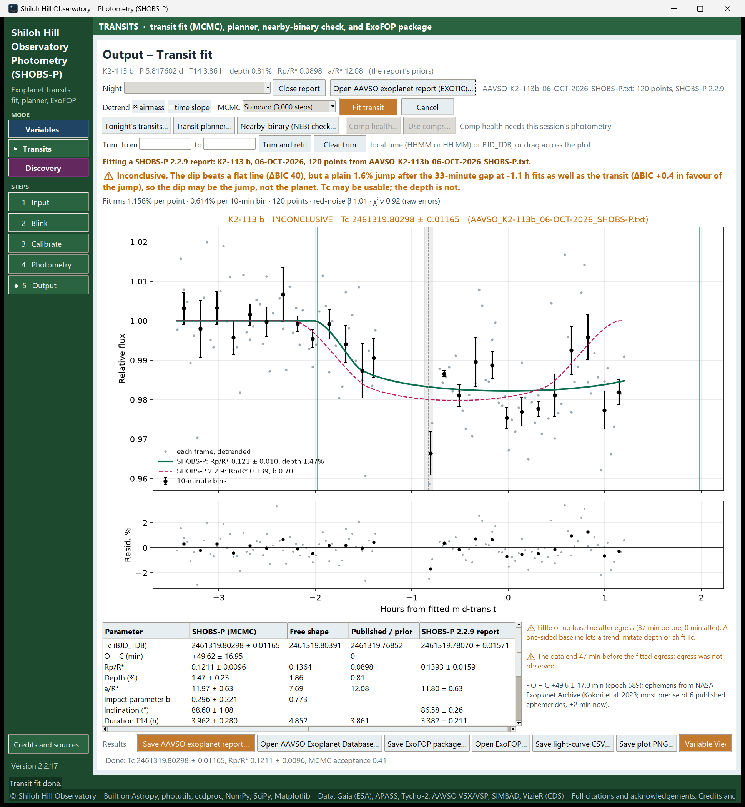

# 18. When the fit says "inconclusive" or "none"

SHOBS-P does not take every dip for a transit. Before it says **✓ Transit detected** it checks that:

1. the transit model fits clearly better than a flat line (a ΔBIC of 10 or more),
2. the mid-transit time Tc is pinned down (its uncertainty at most a quarter of the transit's duration),
3. the depth is believable against the published one,
4. a plain jump at a gap in the data does not explain the dip just as well.

When a test fails, the verdict line says which, in words. This chapter lists those words, what they mean, and what
you can do. Often the honest answer is "this night cannot tell", and that is a useful result too.

## The three verdicts

| Verdict | What it means | What you can report |
|---|---|---|
| **✓ Transit detected** | All four tests pass. | Tc, depth and shape. |
| **✓ … Timing usable; depth unreliable: …** | Detected, but the depth is far from published and the night gives a reason. | Tc. Treat the depth with care. |
| **⚠ Inconclusive** | The dip beats a flat line, but a jump at a gap explains it as well. | Possibly Tc, with that caveat. Not the depth. |
| **✗ No transit measured** | The dip is not significant, Tc is not pinned, or the depth is impossible. | Nothing for submission. |

With "No transit measured" the table rows turn gray and the plot title says *NO TRANSIT MEASURED (model shown for
reference)*.

## The reasons, and what to do

### "a flat line fits about as well as a transit (ΔBIC …; a detection needs 10 or more)"

The dip is not significant against the noise. Typical causes: the transit is too shallow for your telescope, the
night was noisy, or much of the transit is missing.

- Compare **per 10-min bin** on the quality line with the expected depth. A transit needs bins well below its depth.
- Check that the transit is actually inside your data (the gray band on the plot is the predicted time).
- Look at **Comp health…**: a noisy comp raises the scatter for every point.
- Try fewer, better comps with **Use comps…** (the fit reruns at once).

### "Tc is not pinned down (± … h for a …-hour transit)"

The fit cannot tell when the transit happened. This usually means ingress or egress (or both) were not observed,
or the noise is as large as the dip. More baseline and full coverage on the next night is the fix.

### "the depth, …%, is …x the published …; a real transit of this planet cannot be that deep (shallow)"

The fitted depth is more than three times (or less than a third of) the published depth, and far outside the error.
Something in the light curve made the dip: a jump, a trend, a bad comp, or a calibration problem.

- A much **deeper** dip almost always comes from the light curve itself. Check the comps (**Comp health…**), the
  flats, and the residuals panel for steps.
- A much **shallower** dip can come from a neighbor star's light inside the aperture. Look at the image, and
  consider a smaller aperture (see [8. Photometry page basics](08-photometry-basics.md)).

### "a plain …% jump after the …-minute gap at … h fits as well as the transit … so the dip may be the jump, not the planet"

This is the most common reason for **⚠ Inconclusive**. Your data have a gap of 20 minutes or more (a meridian flip,
a re-centering, a cloud), and a simple step in brightness at that gap explains the data as well as a transit does.
A flip, a camera rotation or a guiding re-acquisition can all shift the star on the sensor and leave such a step.

- If the gap is a meridian flip, the next time put the flip in the baseline, or choose a night with no flip (see
  [16. Plan a transit night](16-plan-a-transit-night.md)).
- Check **Comp health…** in the one-night view: a comp that jumps at the flip is a common cause. Replace it with
  **Use comps…**.
- Tc may still be usable; the depth is not.

When the step test is run but the transit wins, the notes say so as information: *"Step check: a …% jump at the
…-minute gap fits worse than the transit …"*.

### "Timing usable; depth unreliable: depth …% vs published …, and …"

The transit was detected, but its depth is more than 3σ from the published one, and the night shows why it might be
off:

- *"a …% jump at the …-minute gap fits nearly as well"*, or
- *"the baseline is one-sided (… min before, … min after)"*: less than 20 minutes of data on one side of the transit.

Report the timing; flag the depth. The report's NOTES carry this sentence automatically.

## Notes that point at the cause

The notes beside the table add detail. The ones you will see most with a weak result:

- **"Little or no baseline before ingress (after egress) (… min before, … min after). A one-sided baseline lets a
  trend imitate depth or shift Tc."** Take more baseline next time.
- **"A …-minute gap in the data inside the transit. Ingress, egress, or the bottom may be missing…"**
- **"The data start … min after the fitted ingress: ingress was not observed."** (or *"The data end … before the
  fitted egress"*)
- **"Almost no points inside the predicted transit window: the transit was missed (clouds, a gap, or the
  ephemeris)."**
- **"… = … is …σ from the published …. The light curve pulls hard against the known shape: look for a trend, a bad
  comp, or clouds."**
- **"With the shape left free, Rp/R\* goes to …. The data alone do not pin the shape…"**
- **"Leaving out C2 makes the transit … deeper (…σ)…"**: one comparison star moves the result. Check it in
  **Comp health…** (the link in the note opens it).
- **"The comp choice moves … by more than its statistical error (…). Treat the comp spread below as a systematic
  error, or try other comps."**

### Error-bar notes (χ²ν)

- **"The per-point error bars are about …x larger than the real scatter (reduced χ² …)."** The error model is off,
  most often because the camera gain (EGAIN) is missing or wrong in the headers, or the frames were calibrated in
  other software. The fit keeps the larger error bars, so its uncertainties are on the safe side. The photometry
  log's *Photon noise* line says which gain was used.
- **"The scatter is about …x the per-point error bars (reduced χ² …)…"** There is noise the error model leaves out:
  thin cloud, dew, seeing or tracking changes, a noisy comp. The fit scales its error bars up to match.

## Cloud-flagged frames: "No usable baseline after egress: the 31 frames there were flagged cloud"

Photometry flags frames where the comparison stars lose light (see [12. Flags and bad data](12-flags-and-bad-data.md)).
The fit leaves those frames out. If they were the whole baseline on one side, the baseline note says so, naming the
frames and their times.

When a night has cloud-flagged frames, a button appears next to **Cancel**: **Refit with flagged frames (errors ×2)**.
It puts those frames back with their error bars doubled and refits.

To try it:

1. Click **Refit with flagged frames (errors ×2)**.
2. Read the verdict. It starts with *[Includes N cloud-flagged frames (error bars ×2).]*, and the plot shows those
   frames as hollow orange circles.
3. Compare it with the normal fit (click **Fit transit** to get it back).

> **Caution:** Thin cloud dims the target and the comps by slightly different amounts. Report a fit that includes
> flagged frames only when it agrees with the fit without them, and say so. The report's NOTES record it.

You can also remove a short bad stretch by hand with **Trim** (see [17. Fit a transit and submit it](17-fit-a-transit-and-submit-it.md)).

## "No transit of … is predicted during these data"

If no predicted transit falls inside your data, a fit cannot measure anything. When you press **Fit transit**,
SHOBS-P says where the nearest transit is (for example *"… 3.2 h after the last point"*) and asks **Fit anyway?**.
**No** shows the raw light curve with an arrow pointing to the predicted transit. Check the planet on the Input page,
the date of the lights, and the computer's clock. If this was really a variability run, use Variables mode.

## Saving a weak result

You can still save the files.

- For **No transit measured**, SHOBS-P asks *"This fit did not measure a transit: … Save it anyway (for your records,
  not for submission)?"*.
- For **Inconclusive**, it asks *"This fit is inconclusive: … The report will say so in its notes. Tc may be worth
  reporting with that caveat; the depth is not. Save it?"*.

The verdict and its reason go into the report's NOTES, so anyone reading it later sees them.

> **Tip:** A night of "no transit measured" on a predicted transit can be a real finding (for example, a planet
> whose transit time has drifted far from its ephemeris). Before you conclude that, rule out the ordinary causes
> above, and observe it again.

---

Previous: [17. Fit a transit and submit it](17-fit-a-transit-and-submit-it.md) · Next: [19. Reports](19-transit-reports.md)
