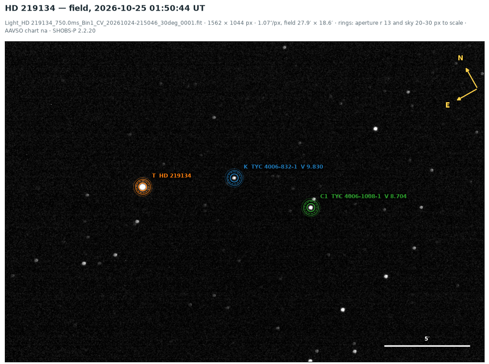
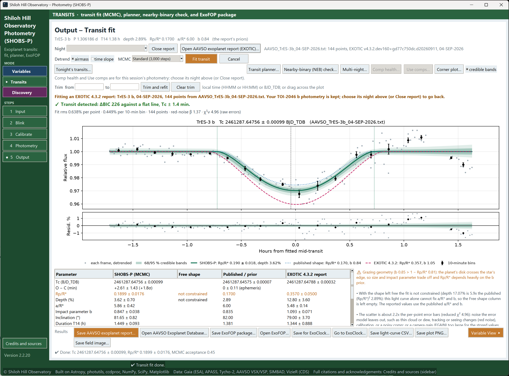

# 19. Reports

This chapter covers the files the Transit fit page writes and where they go:

- the AAVSO exoplanet report, for the AAVSO Exoplanet Database,
- the ExoFOP package, for TESS targets,
- the ExoClock upload file, for ExoClock,
- the plot PNG, the corner plot and the light-curve CSV,
- the settings file and the field image saved with a report,
- opening an EXOTIC report to compare its fit with SHOBS-P's.

All the save buttons are in the **Results** row at the bottom of the Transit fit page. They need a finished fit
(otherwise: *"Fit a transit first."*). If the comparison-star check is still running, wait a few seconds: SHOBS-P
asks you to save when it is done, so the files carry its result.

## Where files go

If the Input page has an **Output** folder, every save goes there without a dialog, and the status bar says what
was saved. A file already there is never overwritten: a new copy gets `_2`, `_3` and so on. The AAVSO report,
light-curve CSV, fit CSV, plot PNG, and the corner plot, settings file and field image saved beside them share one
number, so they sort together. Without an Output folder, each save
asks where to put the file.

See [22. Files SHOBS-P writes](22-files-shobs-p-writes.md) for the full list of names.

## The AAVSO exoplanet report

To save and upload it:

1. Fill in **Observer code** on the Input page (**AAVSO report** box). It goes in the report's `#OBSCODE` line.
2. Optionally type a note in **Notes** (in Variable View); it goes in the report's NOTES. If the notes name a star
   that is not in this reduction, SHOBS-P asks before saving (chapter 17, "Notes that name another star").
3. Click **Save AAVSO exoplanet report…**.
   The file is called `AAVSO_<planet>_<DD-MON-YYYY>_SHOBS-P.txt`, for example `AAVSO_KELT-16b_05-OCT-2026_SHOBS-P.txt`.
4. The status bar says *"Saved … — upload to the AAVSO Exoplanet Database (check its current instructions):"* with
   a button **Open AAVSO Exoplanet Database…** at its right end. Click it (or the button of the same name in the
   Results row) to open the submit page in your browser.
5. Upload the file there.

When the page opens, SHOBS-P marks the report's night as sent (the night table's **Sent** column). If that night was
already sent in another report, it asks first whether to open the page anyway, because the AAVSO would hold
duplicates. See "The duplicate warning" in [15. Submit to AAVSO](15-submit-to-aavso.md).

The report uses the same format as EXOTIC's (`#TYPE=EXOPLANET`): a header with your site, filter, exposure,
binning, the priors and the fitted results, then one line per frame with the BJD_TDB time, the relative flux, its
error and the airmass. Times are always BJD_TDB.

`#BINNING` is how the **camera** binned the frames, read from the frames' headers (`XBINNING`/`YBINNING`), for example
`2x2` for MicroObservatory frames; `1x1` when the headers name no binning. SHOBS-P's own **Binning** box is not the
camera's binning, so it goes into the NOTES instead, for example `SHOBS-P processing bin 1 (OSC superpixel base: 2x2
camera pixels per measured pixel)`.

> **Note:** the header carries your site latitude and longitude (`#OBSLAT`, `#OBSLON`), as the format requires,
> so they are uploaded with your data. Round them in the Site box before saving if you
> prefer not to publish your exact location; a few kilometers makes no difference to the BJD times.

SHOBS-P adds to the NOTES line, automatically, anything a reader should know:

- the verdict, when it is not "detected" (for example `SHOBS-P verdict INCONCLUSIVE: …`),
- "timing usable, depth unreliable", with the reason,
- any trimmed span,
- cloud-flagged frames put back into the fit,
- times left in JD_UTC from a source report (see below),
- SHOBS-P's processing bin (see above),
- the O − C against the predicted Tc, for example `SHOBS-P O - C +5.38 +/- 11.15 min (+0.48 sigma; …) vs predicted Tc
  … at epoch 2362; ephemeris from …` (not for "no transit", or for times left in JD_UTC); when the Archive was down
  and SHOBS-P used its saved answer, the source ends `, from cache (fetched 12 Oct 2026)`,
- on a night with a meridian flip, the flip time and the flip-step decision, written whether or not the step was
  kept, for example `SHOBS-P: meridian flip at BJD_TDB 2463218.67686; baseline step -1.45+/-0.05% (kept, dBIC 629) …`
  or `SHOBS-P: meridian flip at BJD_TDB …; Flip step not needed: …, no step in this fit`. A later refit of the report
  (by SHOBS-P or another program) then uses the same flip time. `#DETREND_PARAMETERS` is unchanged: it lists data
  columns, and the step is in the NOTES,
- one line of reduction settings, starting `SHOBS-P settings:` (aperture, comps, check, frames left out, trimmed
  frames, detrending, gain, calibration, and, for stacked points, `points are stacks of 40 frames (effective exposure
  30 s)`),
- a parameter limited by its prior range (chapter 17, "The corner plot").

### The settings file and the field image

Beside the report, SHOBS-P writes:

- `…_settings.txt`: the full settings of the reduction, one per line: **Source**, **Aperture** (what the night was
  measured with), **Binning** (camera and processing), **Comps**, **Check**, **Frames skipped at photometry**,
  **Frames left out** (by flag and frame number), **Frames trimmed**, **Detrend**, **Calibration** (the masters, and
  the dark's exposure) and the **Gain** with where it came from, and **Stacking** for stacked points. With it, you (or
  anyone you send it to) can reduce the night again the same way. Some rows in more detail:
  - **Comps** lists only what this night really measured, for example `Comps: C1, C2 (Use comps choice; measured: C1,
    C2, C3 (missing in 14 frames: off the frame edge), SP (as spare))`. A comp no frame of the night measured is not
    listed. Without a Use comps choice, the `(measured: …)` part is added only when it says something new.
  - **Frames skipped at photometry (reason: frame numbers)**: frames the photometry run could not measure, for example
    `every comp lost (off the frame edge): 158-213`, or `none`. **Frames left out (flag: frame numbers)** is a
    different list: frames the fit left out because of their flags.
  - **Calibration** names the dark flat master when there is one, and with no bias adds `dark flat used as the bias
    (no bias frames)`.
  - **Gain** on camera-binned frames says how the camera binned, for example `Gain 0.768 e-/ADU (header EGAIN); camera
    bin 3x3 averaged, so 6.91 e- per stored ADU used (from the sky's noise)` (chapter 7).
  - **Stacking**: `stacks of 40 frames (effective exposure 30 s) (sigma-clipped mean, whole-pixel shifts, never across
    a flip)` (chapter 8).
  - On an alt-az night where the field turned by about 180° between two frames, a row `Warning: field turned 180 deg
    between frames … on an alt-az night (a meridian flip? check Mount)` (chapter 8).
- `…_field.png`: the reference frame exactly as shot (never turned or mirrored), filling the picture on a smooth
  dark-gray background. The target, comps and check star are marked with their apertures to scale, with a scale
  bar at the bottom right. Yellow **N** and **E** arrows in the top-right corner show where north and east lie on
  the frame, from the plate solution. On a frame that is not solved, the corner says *"Orientation unknown (the
  image is not solved)"* instead. The line under the title (frame name, size, plate scale, apertures, chart ID)
  wraps onto a second line when it is long. When the target is itself an AAVSO sequence star (HD 219134 is one),
  only its own marker is drawn, with no extra sequence ring beside it. The log says *"Field image saved (as shot,
  N/E arrows): …"*. When the AAVSO's chart server answers, the AAVSO chart of the same field and size is saved next
  to it as `…_aavso_chart.png`. That chart is north up and east left, so use the arrows to match the two. If the
  chart server does not answer, the log says so and **Save field image…** fetches it again later. No field image is
  made for an opened EXOTIC report's fit, nor from another star's frame after **Load series…** (the log says
  *"Reduce a night of … first; the field image comes from a reduction …"*; chapter 10).

> **Caution:** The AAVSO's exoplanet section sets its own rules for what it accepts. Check its current
> instructions before your first upload.

## The ExoFOP package (TESS targets)

ExoFOP-TESS collects follow-up observations of TESS targets (TOIs and TIC stars). Uploading needs an ExoFOP
account.

To save the package:

1. Click **Save ExoFOP package…**. Without an Output folder, SHOBS-P asks for a folder ("Folder for the ExoFOP
   package").
2. SHOBS-P writes a folder named `ExoFOP_<planet>_<YYYYMMDD>_<observer code>_SHOBS-P` (the date is the UTC date of
   the first frame). Inside it:
   - `…_lightcurve.csv`: columns BJD_TDB, rel_flux, rel_flux_err, airmass, detrended_flux, model, residual.
   - `…_fit.txt`: the fitted values and the notes ExoFOP asks for (telescope and camera, pixel scale, binning (the
     camera's, and SHOBS-P's processing bin), aperture, transit coverage, and the comparison-star spread as a
     systematic error). When the planet's TOI status and ExoClock priority were looked up (chapter 16), the summary
     at the top has a **TESS TOI** line (with the target's ExoFOP-TESS address) and an **ExoClock** line. On a
     night with a meridian flip it has the *Meridian flip* lines and the *Flip step …* line, and **Detrending** says
     `airmass, meridian flip step` when the step was kept (chapter 17).
   - `…_plot.png`: the transit plot.

The package is a plain folder, not a zip, and it does not contain the AAVSO report; save that separately if you want
to upload it too. Saving the same fit again into the same place makes nothing new (*"ExoFOP package unchanged: …"*).

To upload it:

1. Click **Open ExoFOP…**. SHOBS-P opens the target's ExoFOP-TESS page, found by its TOI number, else its TIC
   number. If neither is known, ExoFOP-TESS's home page opens and you search for the star there.
2. The first time, a message explains the upload: log in, use **Add new** in the Time Series section for the light
   curve and fit notes, and **Add new** under Files for the plot, with the same data tag.
3. The data tag has the form `YYYYMMDD_username_description_n`, for example `20261015_jsmith_SHOBS-P-transit_1`.
   The description may use only letters, numbers and hyphens.

As with the AAVSO pages, opening ExoFOP marks the night of the package you saved last as sent, and warns first if
it was already sent in another package.

## The ExoClock file

ExoClock (exoclock.space) collects transit times to keep planets' ephemerides up to date for the Ariel mission.
**Save for ExoClock…** writes two files:

- `ExoClock_<planet>_<YYYYMMDD>.txt`, for example `ExoClock_TOI-2046b_20261027.txt`: the planet's name with no
  spaces (as ExoClock spells it) and the UTC date of the first frame. A few header lines start with `#` (planet,
  time format, filter, exposure, observer code, number of frames). Then one line per frame with three columns: the
  time in **JD_UTC** at **mid-exposure**, the relative flux (divided by its median, not detrended; ExoClock fits its
  own baseline) and its measurement error (ExoClock scales the errors itself). Only the frames the fit used are in
  it, as in the AAVSO report; flagged frames you put back with **Fit with flagged** are left out too.
- `ExoClock_info.txt`: what to pick on ExoClock's upload form for that file: **Planet** (for example `TOI-2046b`),
  **Time format** `JD_UTC`, **Time stamp** `Mid-exposure`, **Flux format** `Flux`, **Filter** (a color camera's `TG`
  is listed as Johnson V), **Exposure time** in seconds, and the upload page's address.

> **Caution:** ExoClock's form starts on **Exposure start**. Change it to **Mid-exposure**, or every time is off by
> half an exposure. The status line reminds you: *"✔ Saved. On the form, pick Mid-exposure (…; what to pick is in
> ExoClock_info.txt)."*

**Go to ExoClock…** opens the upload page (https://www.exoclock.space/upload/) in your browser; log in and upload the
`ExoClock_…txt` file. As with the other upload pages, the night of the file you saved last is marked sent (**Sent**
shows `ExoClock` and the date), and SHOBS-P warns first if that night was already sent. Chapter 17 walks through the
form.

## The plot PNG and the light-curve CSV

- **Save plot PNG…** writes `<planet>_<filter>_<date>_SHOBS-P_transit.png`: the plot with a header above it holding
  the planet line, the verdict (in its color), the quality line, the parameter table and the notes. It works for
  report fits too. It is the best single picture of a result to share or keep. The legend sits under the residual
  panel.
- The **corner plot** of the fit is saved beside it, as `<planet>_<filter>_<date>_SHOBS-P_transit_corner.png`
  (chapter 17). **Save corner plot…** (Results row) opens the corner plot window, whose **Save PNG…** saves it on its
  own.
- **Save light-curve CSV…** writes the general light-curve CSV, the same as in Variables mode: one row per frame with
  magnitudes, errors, airmass, flags and much more (see [9. Reduce a variable-star night](09-reduce-a-variable-night.md)).
  It is in magnitudes, not the transit fit's relative flux.
- With a fit shown, the same button also writes the **fit CSV** beside it:
  `<planet>_<filter>_<date>_SHOBS-P_transit_fit.csv`, with the columns `BJD_TDB`, `rel_flux`, `rel_flux_err`, `model`,
  `residual`, `flag`, `airmass` and `segment`. `rel_flux` is the raw relative flux (not detrended); `segment` says
  `before flip` or `after flip` on a night with a meridian flip. Trimmed points are included and flagged `trimmed`. Without an Output folder it is named after
  the light-curve CSV you chose (for example `mine.csv` and `mine_transit_fit.csv`). For a report fit only the fit CSV
  is written; if the report's times stayed in JD_UTC, the first column is `JD_UTC`. For the detrended flux, use the
  CSV in the ExoFOP package. Under the `# Created` line, comment lines starting with `#` give the planet, filter,
  fitted Tc and verdict, the O − C, what the columns hold, and the time of the meridian flip if there was one.
  **Multi-night…** reads the night back from them (chapter 17).
- **Save field image…** saves the field image on its own (see above).

*The field image of HD 219134: the frame as shot, with N and E arrows at the top right and the stars marked.*

## Compare with an EXOTIC report

You can open an AAVSO exoplanet report written by EXOTIC (or by SHOBS-P, or any program using that format), and
SHOBS-P refits its light curve and shows both results side by side. This is useful to check a reduction, or to
look again at an older observation.

To open a report:

1. On the Transit fit page, click **Open AAVSO exoplanet report (EXOTIC)…** and choose the `.txt` file.
2. The old plot clears and SHOBS-P starts fitting. A brown banner above the plot says what is being fitted, for
   example *"Fitting EXOTIC report: WASP-12 b, 05-OCT-2026, 210 points from AAVSO_WASP-12b.txt. Your … photometry
   is kept; choose its night above (or Close report) to go back."*
3. When the fit is done, the table has a fourth column with the report's own values (headed with its software, for
   example **EXOTIC 4.3.2 report**), and the plot shows the report's model as a pink dashed line.

Things to know:

- **The planet.** SHOBS-P uses the report's planet, unless the Input page names the same planet.
- **The ephemeris.** If the report has no predicted mid-transit, SHOBS-P looks one up (NASA Exoplanet Archive, then
  an EXOTIC `inits` file next to the report). Without any, no O − C is given.
- **Time systems.** BJD_TDB is used as it is. HJD is moved to BJD_TDB (+69.184 s). JD_UTC is converted when the star's
  position is known from the Input page or the lookup. If it is not, the times are kept as JD_UTC and a warning says
  Tc may be off by up to 8 minutes, with no usable O − C; enter the star on the Input page and open the report again.
- **What is not available.** **Comp health…**, **Use comps…**, **Refit with flagged frames** and the comp check
  need your own photometry, so they are off for a report.
- **Going back.** Click **Close report**, or pick one of your nights in **Night**. Your own photometry was kept.

You can save the AAVSO report, ExoFOP package, fit CSV and plot of a report fit like any other.

---

Previous: [18. When the fit says "inconclusive" or "none"](18-inconclusive-or-none.md) · Next: [20. Scan a field](20-scan-a-field.md)
