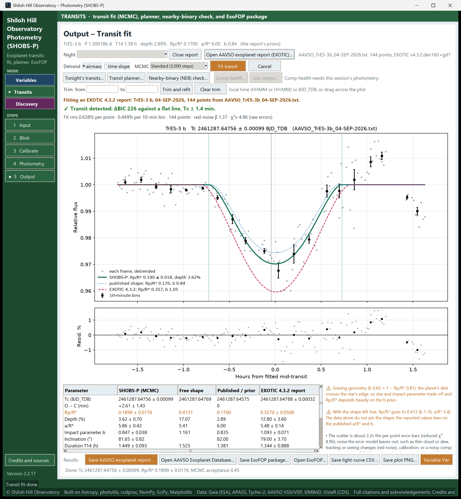

# 19. Reports

This chapter covers the files the Transit fit page writes and where they go:

- the AAVSO exoplanet report, for the AAVSO Exoplanet Database,
- the ExoFOP package, for TESS targets,
- the plot PNG and the light-curve CSV,
- opening an EXOTIC report to compare its fit with SHOBS-P's.

All the save buttons are in the **Results** row at the bottom of the Transit fit page. They need a finished fit
(otherwise: *"Fit a transit first."*). If the comparison-star check is still running, wait a few seconds: SHOBS-P
asks you to save when it is done, so the files carry its result.

## Where files go

If the Input page has an **Output** folder, every save goes there without a dialog, and the status bar says what
was saved. A file already there is never overwritten: a new copy gets `_2`, `_3` and so on. The AAVSO report,
light-curve CSV and plot PNG of one fit share one number, so they sort together. Without an Output folder, each save
asks where to put the file.

See [22. Files SHOBS-P writes](22-files-shobs-p-writes.md) for the full list of names.

## The AAVSO exoplanet report

To save and upload it:

1. Fill in **Observer code** on the Input page (**AAVSO report** box). It goes in the report's `#OBSCODE` line.
2. Optionally type a note in **Notes** (in Variable View); it goes in the report's NOTES.
3. Click **Save AAVSO exoplanet report…**.
   The file is called `AAVSO_<planet>_<DD-MON-YYYY>_SHOBS-P.txt`, for example `AAVSO_KELT-16b_05-OCT-2026_SHOBS-P.txt`.
4. The status bar says *"Saved … — upload to the AAVSO Exoplanet Database (check its current instructions):"* with
   a button **Open AAVSO Exoplanet Database…** at its right end. Click it (or the button of the same name in the
   Results row) to open the submit page in your browser.
5. Upload the file there.

The report uses the same format as EXOTIC's (`#TYPE=EXOPLANET`): a header with your site, filter, exposure,
binning, the priors and the fitted results, then one line per frame with the BJD_TDB time, the relative flux, its
error and the airmass. Times are always BJD_TDB.

SHOBS-P adds to the NOTES line, automatically, anything a reader should know:

- the verdict, when it is not "detected" (for example `SHOBS-P verdict INCONCLUSIVE: …`),
- "timing usable, depth unreliable", with the reason,
- any trimmed span,
- cloud-flagged frames put back into the fit,
- times left in JD_UTC from a source report (see below).

> **Caution:** The AAVSO's exoplanet section sets its own rules for what it accepts. Check its current
> instructions before your first upload.

## The ExoFOP package (TESS targets)

ExoFOP-TESS collects follow-up observations of TESS targets (TOIs and TIC stars). Uploading needs an ExoFOP
account.

To save the package:

1. Click **Save ExoFOP package…**. Without an Output folder, SHOBS-P asks for a folder ("Folder for the ExoFOP
   package").
2. SHOBS-P writes a folder named `ExoFOP_<planet>_<YYYYMMDD>_<observer code>_SHOBS-P` (the date is the UTC date of
   the first frame). Inside it:
   - `…_lightcurve.csv`: columns BJD_TDB, rel_flux, rel_flux_err, airmass, detrended_flux, model, residual.
   - `…_fit.txt`: the fitted values and the notes ExoFOP asks for (telescope and camera, pixel scale, aperture,
     transit coverage, and the comparison-star spread as a systematic error).
   - `…_plot.png`: the transit plot.

The package is a plain folder, not a zip, and it does not contain the AAVSO report; save that separately if you want
to upload it too. Saving the same fit again into the same place makes nothing new (*"ExoFOP package unchanged: …"*).

To upload it:

1. Click **Open ExoFOP…**. SHOBS-P opens the target's ExoFOP-TESS page, found by its TOI number, else its TIC
   number. If neither is known, ExoFOP-TESS's home page opens and you search for the star there.
2. The first time, a message explains the upload: log in, use **Add new** in the Time Series section for the light
   curve and fit notes, and **Add new** under Files for the plot, with the same data tag.
3. The data tag has the form `YYYYMMDD_username_description_n`, for example `20261015_jsmith_SHOBS-P-transit_1`.
   The description may use only letters, numbers and hyphens.

<!-- SCREENSHOT 19-exofop-hint: Transits mode, Transit fit page, the info box shown on the first click of "Open ExoFOP…" for a TOI target (the version without the "No TOI or TIC number" first paragraph); crop to the dialog. -->

## The plot PNG and the light-curve CSV

- **Save plot PNG…** writes `<planet>_<filter>_<date>_SHOBS-P_transit.png`: the plot with a header above it holding
  the planet line, the verdict (in its color), the quality line, the parameter table and the notes. It works for
  report fits too. It is the best single picture of a result to share or keep.
- **Save light-curve CSV…** writes the general light-curve CSV, the same as in Variables mode: one row per frame with
  magnitudes, errors, airmass, flags and much more (see [9. Reduce a variable-star night](09-reduce-a-variable-night.md)).
  It is in magnitudes, not the transit fit's relative flux. For the detrended flux and the model, use the CSV in
  the ExoFOP package.

## Compare with an EXOTIC report

You can open an AAVSO exoplanet report written by EXOTIC (or by SHOBS-P, or any program using that format), and
SHOBS-P refits its light curve and shows both results side by side. This is useful to check a reduction, or to
look again at an older observation.

To open a report:

1. On the Transit fit page, click **Open AAVSO exoplanet report (EXOTIC)…** and choose the `.txt` file.
2. The old plot clears and SHOBS-P starts fitting. A brown banner above the plot says what is being fitted, for
   example *"Fitting EXOTIC report: WASP-12 b, 05-OCT-2026, 210 points from AAVSO_WASP-12b.txt. Your … photometry
   is kept; choose its night above (or Close report) to go back."*
3. When the fit is done, the table has a fourth column with the report's own values (headed with its software, for
   example **EXOTIC 4.3.2 report**), and the plot shows the report's model as a pink dashed line.

<!-- SCREENSHOT 19-exotic-side-by-side: Transits mode, Transit fit page after opening an EXOTIC AAVSO exoplanet report (e.g. TrES-3 b); brown banner, verdict, plot with green SHOBS-P model, blue dotted published shape and pink dashed report model, and the table with the "EXOTIC … report" column; whole window. -->

Things to know:

- **The planet.** SHOBS-P uses the report's planet, unless the Input page names the same planet.
- **The ephemeris.** If the report has no predicted mid-transit, SHOBS-P looks one up (NASA Exoplanet Archive, then
  an EXOTIC `inits` file next to the report). Without any, no O − C is given.
- **Time systems.** BJD_TDB is used as it is. HJD is moved to BJD_TDB (+69.184 s). JD_UTC is converted when the star's
  position is known from the Input page or the lookup. If it is not, the times are kept as JD_UTC and a warning says
  Tc may be off by up to 8 minutes, with no usable O − C; enter the star on the Input page and open the report again.
- **What is not available.** **Comp health…**, **Use comps…**, **Refit with flagged frames** and the comp check
  need your own photometry, so they are off for a report.
- **Going back.** Click **Close report**, or pick one of your nights in **Night**. Your own photometry was kept.

You can save the AAVSO report, ExoFOP package and plot of a report fit like any other.

---

Previous: [18. When the fit says "inconclusive" or "none"](18-inconclusive-or-none.md) · Next: [20. Scan a field](20-scan-a-field.md)
