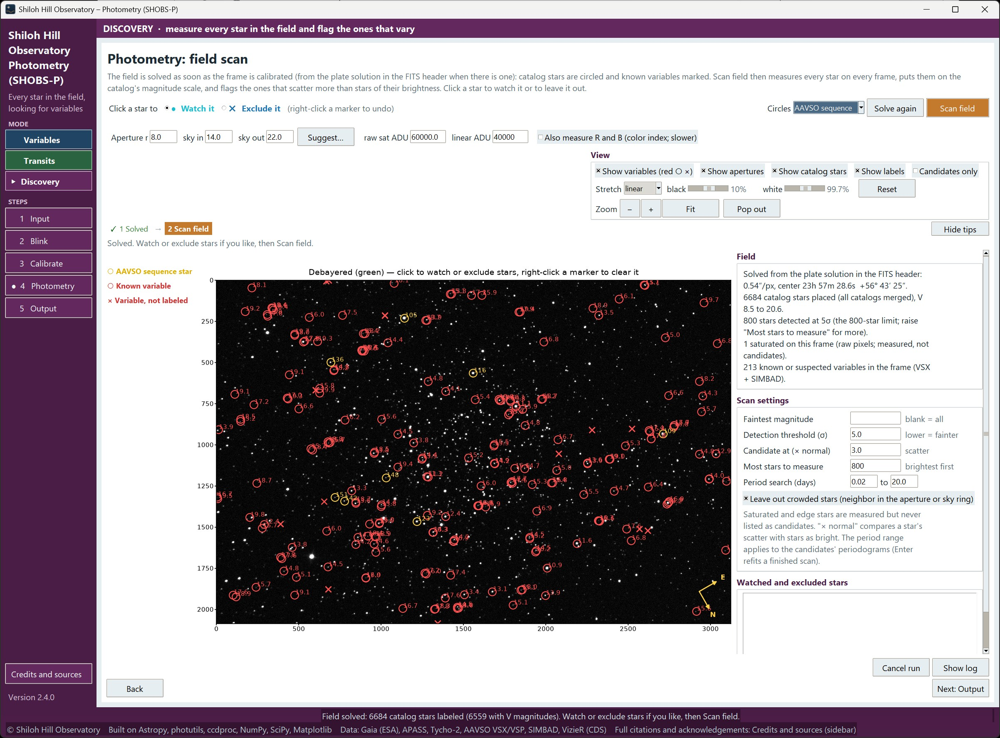
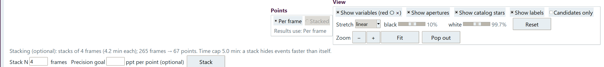
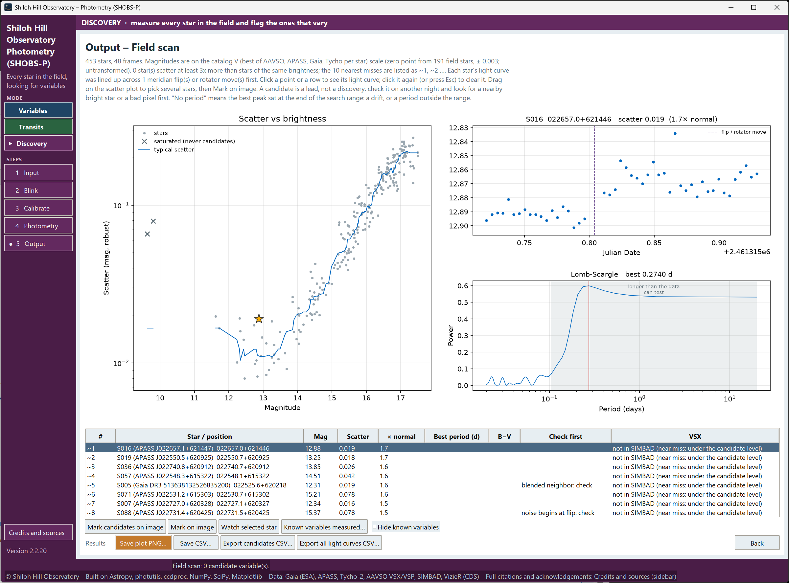

# 20. Scan a field

Discovery mode measures every star in the field on every frame, and points out the ones that vary more than stars
of the same brightness. You need no target: any series of frames of one patch of sky, with calibration frames, will do.

A star the scan points out is a **Suspect**: a lead, not a discovery. A Suspect belongs to its one night: it lives
on that night's results only. Confirming it is up to you (chapter 21).

This chapter covers:

- setting up a field scan,
- the scan settings (faintest magnitude, detection threshold, the two Suspect levels),
- reading the scan table and plots,
- the kinds of suspect and the "check first" warnings,
- the night's suspects file and **Suspect again**.

[21. Check a suspect](21-follow-a-candidate.md) covers what to do with a suspect next.

> **Tip:** A suspect is a lead, not a discovery. Most are explained by something ordinary: a bright neighbor, a
> bad pixel, saturation, a meridian flip. The scan tells you which to check first.

## Set up the scan

1. Click **Discovery** in the sidebar. The window turns plum.
2. On the Input page, choose the Bias, Dark, Flat and Lights folders and press **Scan folders**, as in any mode (see
   [5. Input](05-input.md)). There is no Target box in Discovery mode.
3. If the lights carry neither a plate solution nor the telescope's pointing in their headers, a box **Field center
   (only needed when the headers do not say)** appears. Type roughly where the frames point, in **RA (hours)** and
   **Dec (degrees)**. A few arcminutes off is fine. Your planetarium program or mount can tell you.
4. Make sure the **Optics** box (focal length, pixel size, binning) is right: the solve depends on the plate scale.
5. **Blink** the lights and reject the bad ones (see [6. Blink](06-blink.md)).
6. On the **Calibrate** page, press **Build masters and calibrate** (see [7. Calibrate](07-calibrate.md)).

When calibration ends, SHOBS-P opens the Photometry page and solves the field straight away.

## The Photometry page in Discovery mode

The page title is **Photometry: field scan**. The step strip shows **1 Solve → 2 Scan field**.

Once solved, catalog stars are circled and known variables (from VSX and SIMBAD) are marked with red circles or ×.
The **Circles** box defaults to **APASS DR9** in this mode, because an AAVSO sequence covers only charted
variables.

The **Field** box on the right sums up the solve: the plate scale and center, how many catalog stars were placed,
how many stars were detected, how many are saturated, and how many known or suspected variables lie in the frame.
Saturation is judged on the frame's raw pixels, where binning and calibration cannot hide a clipped core; the line
reads, for example, "3 saturated on this frame (raw pixels; measured, not suspects)." (It shows "…" for a moment
while the raw frame is read.)

If the solve fails, the step strip says **1 Not solved**. Check the field center on the Input page and the Optics
box, then press **Solve again** (top right). You can scan an unsolved field, but then:

- magnitudes are instrumental, not on a catalog scale,
- there is no check against VSX and SIMBAD, so every suspect is "unchecked",
- a suspect has no Gaia DR3 ID, so **Suspect again** cannot match it on another night,
- a typed **Faintest magnitude** is ignored.

### Apertures

The scan uses the **Aperture r**, **sky in** and **sky out** boxes, like photometry. Press **Suggest…** and then
**Use these aperture sizes** to set them from the field's seeing (see [8. Photometry page basics](08-photometry-basics.md)).
**Suggest…** works in Discovery too: its aperture test uses bright, isolated, unsaturated field stars, since there
are no comps. Also check **raw sat ADU**: saturated stars are measured but never listed as suspects.

### Watch or leave out stars

Above the image, **Click a star to** offers two choices:

- **● Watch it**: the star is always measured and listed in the scan (as a "W" row), with its own light curve and
  period search.
- **✕ Exclude it**: the star is left out of the scan, for example a star you know is a ghost or sits on a bad column.

Right-click a marker to undo. Both lists appear in the **Watched and excluded stars** box, where **Remove selected**
also undoes one. **Known variables in the field…** lists the known variables SHOBS-P found in the frame.

## The scan settings

The **Scan settings** box on the right holds:

| Setting | Default | What it does |
|---|---|---|
| **Faintest magnitude** | blank | The faintest catalog magnitude that can be a suspect. Blank: SHOBS-P stops where the field's typical scatter reaches 0.25 mag, and says where in the log. |
| **Detection threshold (σ)** | 5.0 | How far above the sky noise a star must be to be measured. Lower finds fainter stars, and more noise. |
| **Suspect at (× normal)** | 3.0 | How many times more than normal a star must scatter to be a suspect. |
| **or at (χ²ν × normal)** | 2.5 | The second test: how many times more than normal a star's scatter against its own error bars (χ²ν) must be. 0 or blank switches this test off. |
| **Most stars to measure** | 800 | The brightest stars first, up to this number. When the limit is reached, the scan's result says so (*Limits: brightest 800 measured …* on the status line, in the log's *Field scan done* line and at the start of the text above the table, from 2.4.0); raise it to go fainter. |
| **Period search (days)** | 0.02 to 20 | The period range of the suspects' periodograms. Remembered between sessions. (A range left at the old default, 0.05, moves to 0.02 once.) |
| **Leave out crowded stars (neighbor in the aperture or sky ring)** | on | Skip stars where a neighbor's light reaching the aperture is 1 % or more of the star's own. |

"Normal" means the typical scatter of stars of the same brightness in this field. A star at **× normal** 3 scatters
three times as much as its neighbors in magnitude. Saturated stars and stars at the edge of the frame are measured
but never listed as suspects.

### The two Suspect tests

A star is a suspect when it passes **either** test:

1. **× normal**: its scatter is at least 3 times the typical scatter of stars as bright. This is the scan's first test,
   and needs no error model.
2. **χ²ν × normal**: SHOBS-P predicts each star's error bar on each frame (photon noise from the camera gain, the sky
   noise in the aperture, and that frame's zero-point error) and works out the star's χ²ν: how much it scatters
   against its own error bars (1 = exactly as much as the error bars say). The star is then compared with stars as
   bright that night. At 2.5 or more, it is a suspect.

The second test catches low-amplitude variables the first one misses. Its motivating case is S033 (APASS
J024812.2+505255), a δ Scuti star found by eye on 13–14 Nov 2026 at only 2.06 × normal. Against its own error bars it
scatters about 2.7 times as much as stars as bright, so the second test makes it a suspect. Because each star is judged
against stars as bright on the same night, a night whose error bars read a little low (a camera gain that is somewhat
off, haze) lifts every star alike and does not flood the list. One wild point (a cosmic ray, a satellite) counts at
most as a 5 σ point, so it cannot make a star a suspect by itself. From 2.4.0 the 5 σ is measured against the noise
stars as bright really show that night: each star's error bars are first widened by the χ²ν of its brightness
(never narrowed), then each point is capped.

On a short run the level rises by itself, because χ²ν scatters more from noise alone when there are few points: a
star needs at least 1 + 5 × √(2 / (n − 1)) on n points, which is 3.36 on 10 points and 2.89 on 15 (a scan of stacks
often has 10 to 30); from 24 points up the level stays 2.5. The header under the page title says *(more on short
runs)*.

The error bars have no flat-field floor in them, so on the brightest stars they read low. Before 2.4.0 that let a
bright star of low amplitude read under the level (each point was capped at 5 σ of the too-small error bar); the
widening above fixes it. On the 13–14 Nov GSC 03308-00462 night it lists a few more bright stars than before (15
instead of 9 in the tuning run), which you review like any other suspect.

**Saturated** means the star's raw core reached **raw sat ADU** on 2 or more frames (or it was near saturation on the
reference frame). A star clipped on one frame only (a cosmic ray or a hot pixel can do that) is still a suspect,
with a caution. The log counts both.

**Crowded** is worked out from how much of each neighbor's light falls inside the star's aperture, using every
detected star and the catalog stars on the frame. At 1 % or more of the star's own light, the star is left out (when
the box is ticked). At 0.2 % or more, a star that is kept (box unticked, or a watch star) gets a **blended neighbor:
check** caution.

The **Period search (days)** range is Discovery's own; it does not change the Variables Output page's range. After a
scan, change a box and press **Enter** (or click into another box): the suspects' periods are searched again over
the new range, without scanning again. The busy bar says **Searching the suspects' periods over 0.02–20 d…**
meanwhile, and the status bar then says **✔ Period search 0.02–20 d done.** Before a scan, the range is kept for the
next one.

## Run the scan

1. Press **Scan field** (top right). It is greyed (2.4.0) until the frames are calibrated, while the aperture boxes are
   not in order (chapter 8) and while a job runs; hover over it to see why. A settings box that is not a number stops
   the scan with a message that names the box, for example *Check the scan settings: Detection threshold (σ) is not
   a number. Type a number in that box.*
2. Wait. The busy bar at the bottom of the window (chapter 3) says **Scanning 412 stars in 38 frames…**, then
   counts the frames, for example **Field scan… 12 of 38, about 1:20 left**. Each frame is calibrated, aligned and
   every star measured, so a scan takes about as long as a photometry run with many stars. **Cancel run** stops it.
3. When the scan ends, SHOBS-P opens the Output step, now the **Output – Field scan** page, and the status bar says
   *"Field scan: N suspect(s)."* The log says how many of them are suspects by their own error bars only.

Before measuring each star's scatter, SHOBS-P lines its light curve up across any meridian flip or rotator move,
so a flip cannot pass for a variable star. From 2.4.0 it does the same across a re-center: the field moved by at
least 20″ and 10 pixels between two frames with no flip, and stayed there for at least 5 frames (chapter 12; the
same test as a photometry run). The Log says how many and how far. Without a plate scale (no solve, empty Optics
boxes) re-centers are not looked for, and the text above the scan's table says so. On an alt-az mount there are no flips: the frames are aligned following
the field rotation.

### Scan stacks of frames (optional)

After a scan, the Photometry page shows the same **Stack row** as the other modes (chapter 8, "Stacking when comps
are weak"). Discovery has no comps, so its line is never orange; it only offers stacking, for example *"Stacking
(optional): stacks of 6 frames (18 s each); 60 frames → 10 points. Time cap 5.0 min: a stack hides events faster than
itself."* Stacking lets fainter stars into the scan, but a stack of 5 minutes cannot show an eclipse or flare shorter
than that.

To scan the stacks, set **Stack N** and press **Stack**. SHOBS-P makes the stacks, then runs the field scan on them
instead of the single frames. A scan needs at least 10 stacks; with fewer, **Stack** says *"That makes only K stacks;
a field scan needs at least 10. Use a smaller N: N = 4 is the largest that gives 10 or more."* The per-frame scan is kept: the **Points** box (**Per frame** /
**Stacked**) on the Stack row switches between the two scans.

## Read the Field scan page

The hint under the title sums up the scan: the number of stars and frames, how the magnitudes were calibrated (for
example *"on the catalog V … scale (zero point from n field stars, ± 0.012; untransformed)"*), and how many stars
are suspects, by either test. If none are, the ten nearest misses are listed as **~1**, **~2** and so on.

Under the table the buttons sit in labelled groups, as on the other Output pages:

| Group | Buttons |
|---|---|
| **Marks** | **Mark suspects on image**, **Mark on image**, **Hide known variables** |
| **Suspects** | **Watch selected star**, **Add as suspect**, **Remove added suspect**, **Known variables measured…** |
| **Checks** | **Check neighbors…**, **Outside data…** (from 2.4.0) |
| **Results** | the save and export buttons, and **Back** |

**Suspects** and **Checks** share one row; on a narrow window a group wraps onto a second line.

### The plots

- **Scatter vs brightness** (left): every star, scatter against magnitude, on a log scale. The blue line is the
  typical scatter. Suspects are red circles with their rank number; known variables are orange squares; saturated
  stars are gray ×. Click a point to see that star; click it again to clear the selection. You can also pick several
  stars on the plot (chapter 21).
- **The selected star's light curve** (top right): red for a suspect, blue otherwise. Dashed purple lines mark a
  flip, rotator move, re-center or gap.
- **Lomb-Scargle periodogram** (bottom right): the red line is the best period. Periods longer than about half the
  data span are grayed (*"longer than the data can test"*).

### The table

| Column | Meaning |
|---|---|
| **#** | Rank by how far the star stands over the nearer of the two Suspect levels. **~1, ~2** are near misses; **W** are watch stars. Stars you add by hand come last. |
| **Star / position** | SHOBS-P's label (`S012`), the catalog name if any, and RA/Dec when solved. |
| **Mag** | Magnitude on the catalog scale (or instrumental if unsolved). |
| **Scatter** | The star's scatter in magnitudes, robust against outliers. |
| **× normal** | Scatter divided by the typical scatter at that magnitude. |
| **χ²ν × normal** | The star's χ²ν against its own error bars, divided by the typical χ²ν at that magnitude that night. |
| **Suspect by** | Which test made it a suspect: **scatter**, **own errors**, **both**, or **by hand** (Add as suspect). |
| **Nights** | **Suspect again (N nights)** when the same star was a suspect on other nights of this field (N counts tonight). Empty the first time. |
| **Best period (d)** | The best Lomb-Scargle period. **no period (drift)** means the best peak sat at the long end of the search: a slow drift, not a period. **at the short end: search shorter** means it sat at the short end. |
| **B−V** | Color, when measured. |
| **Check first** | Reasons to doubt the suspect (below). |
| **VSX** | **KNOWN (VSX): name type**, or **not in VSX or SIMBAD — possible new variable**. When VSX could not be reached it reads **VSX not reached — possible new variable** (only SIMBAD was checked; solve and scan again later). |

Click a row to draw that star. You can select several rows. Click the selected row again, or press **Esc**, to clear
the selection.

> **Tip:** The period search range comes from the **Period search (days)** boxes in **Scan settings** (0.02 to 20
> days by default). See "The scan settings" above. From 2.4.0 the search follows the known period: when a known
> variable in the list has a VSX period outside that range (or right at its edge), SHOBS-P searches that one star
> again over a range that holds its VSX period, and a plain line under the table says so, for example **Searched over
> a wider range to cover the VSX period: V1 0.9 d (0.02–1.1 d).** Only that star's **Best period** and periodogram
> change; the scan's range and the other stars stay as they are. A VSX period longer than half the scan (under two
> cycles) cannot be tested by any range; the line then reads **VSX period too long for this scan to test (under two
> cycles): …**. There is no ⚠ and no button any more.

### Check first

The **Check first** column lists warnings that often explain a suspect away:

- **near saturation: check linearity**: the star's peak came close to saturation in some frames.
- **clipped on 1 frame: check linearity**: the star's raw core reached saturation on one frame (or a few, for a star
  not counted as saturated).
- **blended neighbor: check**: a neighbor's light reaches the aperture (see "The scan settings").
- **Searched over a wider range to cover the VSX period: …** / **VSX period too long for this scan to test …**
  (a plain line under the table, from 2.4.0): see the Tip above.
- **change begins at flip: check** / **change begins at re-center: check** / **change begins after a gap: check**:
  the light curve changes level at a flip, rotator move, re-center or gap, which points at the instrument rather
  than the star.
- **noise begins at flip: check** / **noise begins at re-center: check** / **noise begins after a gap: check**: the
  same for a jump in noise.

### Add a suspect by hand

You may judge a star suspect by eye that neither test flagged (S033 itself was found that way). Click it on the
scatter plot (or pick several), then press **Add as suspect**. It joins tonight's suspects at the end of the list,
**Suspect by** reads **by hand**, its period is searched like the others', and it is kept in the night's suspects file
(below). A star that is already a suspect says *"Already a suspect."* To take a star you added by mistake off the
list, select its row and press **Remove added suspect**; the scan's own suspects cannot be removed (a new scan would
find them again).

### The Checks group: neighbors and outside data

The **Checks** group holds two tools for the selected star (from 2.4.0). Both report; neither changes a number.

Select a star and press **Check neighbors…** to see its light curve beside its close companions (inside
the aperture plus sky ring) and its look-alikes (stars within ±0.5 mag, nearest first), all from this night's scan,
with each one's power and amplitude at the suspect's period (the scan's own period when it found one). **Save to
suspects file** keeps the result in the night's suspects file (a suspect only). A suspect whose neighbors share its
signal is most likely instrumental. See [21. Check a suspect](21-follow-a-candidate.md#check-the-neighbors).

Press **Outside data…** to ask ZTF, TESS and ATLAS what they hold at the star's sky position. The answer says what
each survey found and whether it agrees with the star's period (the same period within 1 %). The star needs a
sky position (a solved field). Both buttons are grey until a star is selected. See
[21. Check a suspect](21-follow-a-candidate.md#outside-data-ztf-tess-atlas).

### The suspect kinds

**Mark suspects on image** switches to the Photometry page and draws numbered squares on the suspects. With rows
selected in the table, it marks only those (**Mark N selected on image**). The style of each square says its kind;
hover over it for the reason:

- **Possible new variable** (bright magenta): not in VSX or SIMBAD, and nothing to check first.
- **Known variable (VSX/SIMBAD)** (pale purple).
- **Suspect to check first** (tan): it has a **Check first** warning.
- **Unchecked (no sky positions)** (gray): the field was not solved.

Tick **Suspects only** in the **View** box to hide everything else on the image. Press the button again (now
**Clear suspect marks**) to remove the marks.

### Known variables

- **Known variables measured…** lists every VSX and SIMBAD variable in the frame and what the scan saw for each, in
  the column **In this scan**: **VARIED: a scan suspect**, **steady tonight, within the noise**, **somewhat more
  scatter than normal**, **measured on too few frames**, **saturated: clipped, so not usable tonight**, or **not
  measured (faint, saturated, blended, or not detected)**. It is a quick way to see whether your setup catches the
  variables you know are there.
- **Hide known variables** removes known variables from the table, the plot and the marks on the image, so the new
  ones stand out. Their rank numbers are kept, so the table may jump from #1 to #3, matching the marks on the image.
  It also works when the field's variable-star check finishes after the scan.

## The night's suspects file and Suspect again

When the scan ends, SHOBS-P keeps the night's suspects beside its results, in the Input page's **Output** folder:
`<field>_<filter>_<date>_SHOBS-P_suspects.json`. It holds each suspect's label, its **Gaia DR3 ID** (its lasting
name, when the field was solved with Gaia), position, magnitude, scatter, both test values, why it is a suspect and its
best period, and whether the scan was on the frames or on stacks. **Add as suspect** writes the file again, and so
does a new period search (Enter in the period boxes). A new scan of the same night replaces it, but the stars you
added by hand to the night's file come back as **by hand** suspects (the log names them, and any not found in the new
scan). The file always goes to the Output folder the scan started with. From 2.4.0 its name starts with the **field
folder's** name (the folder that holds the night folders, for example *GSC 03308-00462*), else the Star ID. The log says, for
example, *"10 suspect(s) kept in GSC_03308-00462_TG_14-NOV-2026_SHOBS-P_suspects.json; 1 were suspects on other
nights of this field too."*

For **Suspect again**, SHOBS-P reads the suspects files of the field's other nights: the night's Output folder sits in
its night folder, which sits in the field's folder (for example `W:\Variables\GSC 03308-00462\13Nov26\Output`), so the
other night folders of `GSC 03308-00462` are searched. The same star is matched by its Gaia DR3 ID, or within 3″ when
one of the nights has no Gaia ID. A file of the same night (another filter's Output folder, or a copy) is never
counted as another night. Discovery still judges each night on its own: a repeat is a flag, never a test.

With no Output folder on the Input page, no file is written; the log says that **Suspect again** cannot be checked on
another night.

## Save the results

The **Results** row holds the buttons below. Before the first scan the page shows them greyed (2.4.0; hover over one:
*Scan the field first (Scan field on the Photometry page).*); they come live when a scan lands.

- **Save plot PNG…**: the three plots with a one-line summary, `<field>_<filter>_<date>_SHOBS-P_scan.png`
  (from 2.4.0 `<field>` is the field folder's name, the same as in the night's suspects file: the folder that holds
  the night's folder, as in `W:\Variables\<field>\<night>\Output`; otherwise `field`. A Star ID left over from
  another mode no longer names Discovery's files).
- **Save CSV…**: one row per measured star (position, magnitude, scatter, expected scatter, excess, excess χ²ν,
  suspect rank and kind, period, VSX name).
- **Export suspects CSV…**: one row per suspect, with both test values, why it is a suspect, its Gaia DR3 ID, how many
  nights it was a suspect, color and VSX period, `field_scan_suspects.csv`.
- **Export all light curves CSV…**: every star's light curve, one row per star per frame,
  `field_scan_lightcurves.csv`.
- **Back** returns to the Photometry page. (From 2.4.0 it is the only **Back** on this page; a second one under the
  Results row is gone.)

See [21. Check a suspect](21-follow-a-candidate.md) for what to do with them.

---

Previous: [19. Reports](19-transit-reports.md) · Next: [21. Check a suspect](21-follow-a-candidate.md)
