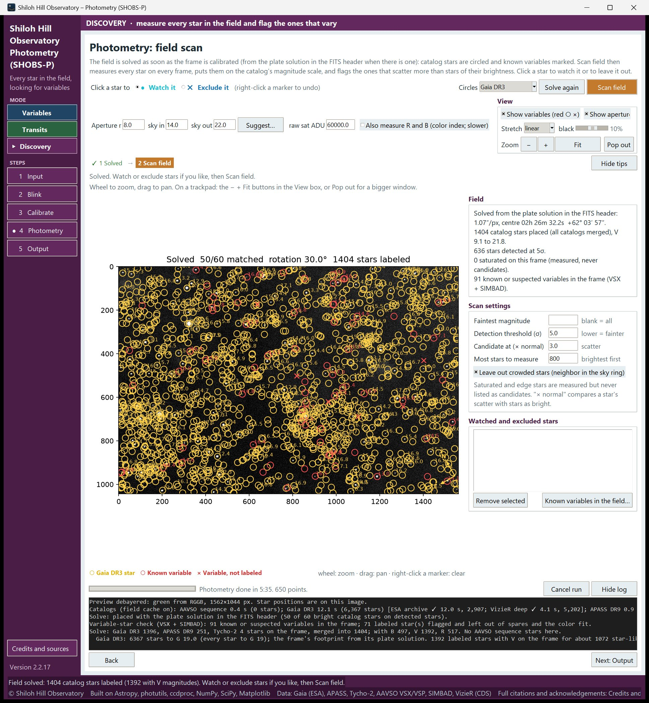
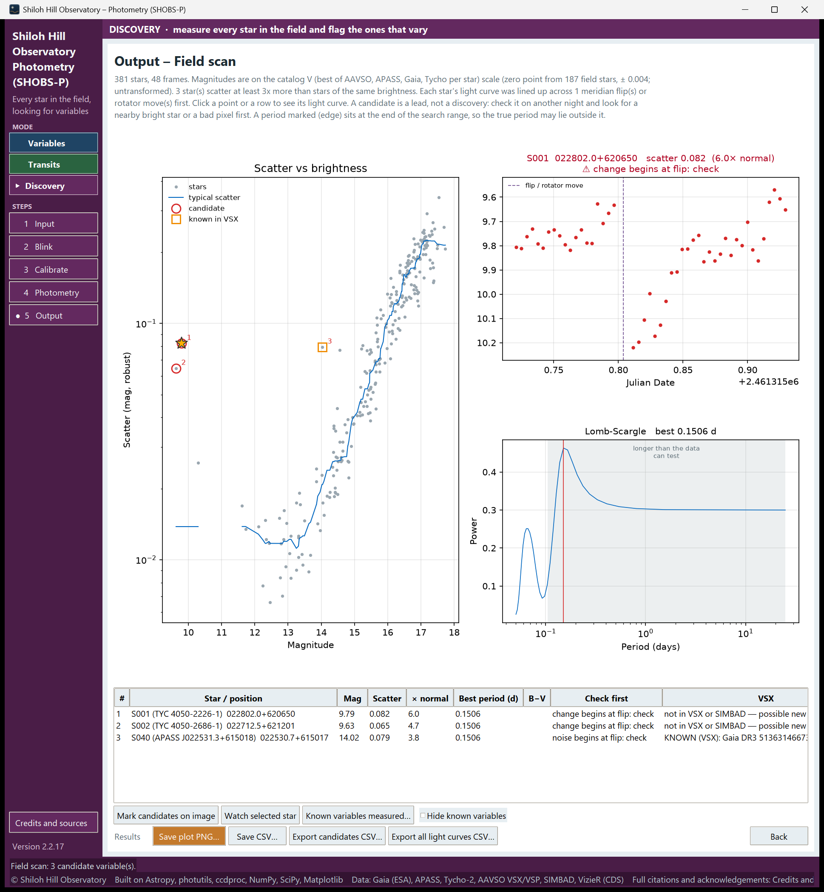

# 20. Scan a field

Discovery mode measures every star in the field on every frame, and points out the ones that vary more than stars
of the same brightness. You need no target: any series of frames of one patch of sky, with calibration frames, will do.

This chapter covers:

- setting up a field scan,
- the scan settings (faintest magnitude, detection threshold, candidate level),
- reading the scan table and plots,
- the kinds of candidate and the "check first" warnings.

[21. Follow a candidate](21-follow-a-candidate.md) covers what to do with a candidate next.

> **Tip:** A candidate is a lead, not a discovery. Most are explained by something ordinary: a bright neighbor, a
> bad pixel, saturation, a meridian flip. The scan tells you which to check first.

## Set up the scan

1. Click **Discovery** in the sidebar. The window turns plum.
2. On the Input page, choose the Bias, Dark, Flat and Lights folders and press **Scan folders**, as in any mode (see
   [5. Input](05-input.md)). There is no Target box in Discovery mode.
3. If the lights carry neither a plate solution nor the telescope's pointing in their headers, a box **Field center
   (only needed when the headers do not say)** appears. Type roughly where the frames point, in **RA (hours)** and
   **Dec (degrees)**. A few arcminutes off is fine. Your planetarium program or mount can tell you.
4. Make sure the **Optics** box (focal length, pixel size, binning) is right: the solve depends on the plate scale.
5. **Blink** the lights and reject the bad ones (see [6. Blink](06-blink.md)).
6. On the **Calibrate** page, press **Build masters and calibrate** (see [7. Calibrate](07-calibrate.md)).

When calibration ends, SHOBS-P opens the Photometry page and solves the field straight away.

## The Photometry page in Discovery mode

The page title is **Photometry: field scan**. The step strip shows **1 Solve → 2 Scan field**.

Once solved, catalog stars are circled and known variables (from VSX and SIMBAD) are marked with red circles or ×.
The **Circles** box defaults to **APASS DR9** in this mode, because an AAVSO sequence covers only charted
variables.

The **Field** box on the right sums up the solve: the plate scale and center, how many catalog stars were placed,
how many stars were detected, how many are saturated, and how many known or suspected variables lie in the frame.
Saturation is judged on the frame's raw pixels, where binning and calibration cannot hide a clipped core; the line
reads, for example, "3 saturated on this frame (raw pixels; measured, not candidates)." (It shows "…" for a moment
while the raw frame is read.)

If the solve fails, the step strip says **1 Not solved**. Check the field center on the Input page and the Optics
box, then press **Solve again** (top right). You can scan an unsolved field, but then:

- magnitudes are instrumental, not on a catalog scale,
- there is no check against VSX and SIMBAD, so every candidate is "unchecked",
- a typed **Faintest magnitude** is ignored.

### Apertures

The scan uses the **Aperture r**, **sky in** and **sky out** boxes, like photometry. Press **Suggest…** and then
**Use these aperture sizes** to set them from the field's seeing (see [8. Photometry page basics](08-photometry-basics.md)).
**Suggest…** works in Discovery too: its aperture test uses bright, isolated, unsaturated field stars, since there
are no comps. Also check **raw sat ADU**: saturated stars are measured but never listed as candidates.

### Watch or leave out stars

Above the image, **Click a star to** offers two choices:

- **● Watch it**: the star is always measured and listed in the scan (as a "W" row), with its own light curve and
  period search.
- **✕ Exclude it**: the star is left out of the scan, for example a star you know is a ghost or sits on a bad column.

Right-click a marker to undo. Both lists appear in the **Watched and excluded stars** box, where **Remove selected**
also undoes one. **Known variables in the field…** lists the known variables SHOBS-P found in the frame.

## The scan settings

The **Scan settings** box on the right holds:

| Setting | Default | What it does |
|---|---|---|
| **Faintest magnitude** | blank | The faintest catalog magnitude that can be a candidate. Blank: SHOBS-P stops where the field's typical scatter reaches 0.25 mag, and says where in the log. |
| **Detection threshold (σ)** | 5.0 | How far above the sky noise a star must be to be measured. Lower finds fainter stars, and more noise. |
| **Candidate at (× normal)** | 3.0 | How many times more than normal a star must scatter to be a candidate. |
| **Most stars to measure** | 800 | The brightest stars first, up to this number. The log says when the limit is reached; raise it to go fainter. |
| **Period search (days)** | 0.02 to 20 | The period range of the candidates' periodograms. Remembered between sessions. (A range left at the old default, 0.05, moves to 0.02 once.) |
| **Leave out crowded stars (neighbor in the aperture or sky ring)** | on | Skip stars where a neighbor's light reaching the aperture is 1 % or more of the star's own. |

"Normal" means the typical scatter of stars of the same brightness in this field. A star at **× normal** 3 scatters
three times as much as its neighbors in magnitude. Saturated stars and stars at the edge of the frame are measured
but never listed as candidates.

**Saturated** means the star's raw core reached **raw sat ADU** on 2 or more frames (or it was near saturation on the
reference frame). A star clipped on one frame only (a cosmic ray or a hot pixel can do that) is still a candidate,
with a caution. The log counts both.

**Crowded** is worked out from how much of each neighbor's light falls inside the star's aperture, using every
detected star and the catalog stars on the frame. At 1 % or more of the star's own light, the star is left out (when
the box is ticked). At 0.2 % or more, a star that is kept (box unticked, or a watch star) gets a **blended neighbor:
check** caution.

The **Period search (days)** range is Discovery's own; it does not change the Variables Output page's range. After a
scan, change a box and press **Enter** (or click into another box): the candidates' periods are searched again over
the new range, without scanning again. Before a scan, the range is kept for the next one.

## Run the scan

1. Press **Scan field** (top right).
2. Wait. The progress line counts the frames. Each frame is calibrated, aligned and every star measured, so a scan
   takes about as long as a photometry run with many stars. **Cancel run** stops it.
3. When the scan ends, SHOBS-P opens the Output step, now the **Output – Field scan** page, and the status bar says
   *"Field scan: N candidate variable(s)."*

Before measuring each star's scatter, SHOBS-P lines its light curve up across any meridian flip or rotator move,
so a flip cannot pass for a variable star. On an alt-az mount there are no flips: the frames are aligned following
the field rotation.

## Read the Field scan page

The hint under the title sums up the scan: the number of stars and frames, how the magnitudes were calibrated (for
example *"on the catalog V … scale (zero point from n field stars, ± 0.012; untransformed)"*), and how many stars
reached the candidate level. If none did, the ten nearest misses are listed as **~1**, **~2** and so on.

### The plots

- **Scatter vs brightness** (left): every star, scatter against magnitude, on a log scale. The blue line is the
  typical scatter. Candidates are red circles with their rank number; known variables are orange squares; saturated
  stars are gray ×. Click a point to see that star; click it again to clear the selection. You can also pick several
  stars on the plot (chapter 21).
- **The selected star's light curve** (top right): red for a candidate, blue otherwise. Dashed purple lines mark a
  flip, rotator move or gap.
- **Lomb-Scargle periodogram** (bottom right): the red line is the best period. Periods longer than about half the
  data span are grayed (*"longer than the data can test"*).

### The table

| Column | Meaning |
|---|---|
| **#** | Rank by how much the star exceeds normal. **~1, ~2** are near misses; **W** are watch stars. |
| **Star / position** | SHOBS-P's label (`S012`), the catalog name if any, and RA/Dec when solved. |
| **Mag** | Magnitude on the catalog scale (or instrumental if unsolved). |
| **Scatter** | The star's scatter in magnitudes, robust against outliers. |
| **× normal** | Scatter divided by the typical scatter at that magnitude. |
| **Best period (d)** | The best Lomb-Scargle period. **no period (drift)** means the best peak sat at the long end of the search: a slow drift, not a period. **at the short end: search shorter** means it sat at the short end. |
| **B−V** | Color, when measured. |
| **Check first** | Reasons to doubt the candidate (below). |
| **VSX** | **KNOWN (VSX): name type**, or **not in VSX or SIMBAD — possible new variable**. |

Click a row to draw that star. You can select several rows. Click the selected row again, or press **Esc**, to clear
the selection.

> **Tip:** The period search range comes from the **Period search (days)** boxes in **Scan settings** (0.02 to 20
> days by default). See "The scan settings" above. When a known variable in the list has a VSX period outside that
> range, an orange line under the table says so (**⚠ VSX period outside the search (…): …**), with a button such as
> **Search 0.02–40 d instead** to widen it in one click.

### Check first

The **Check first** column lists warnings that often explain a candidate away:

- **near saturation: check linearity**: the star's peak came close to saturation in some frames.
- **clipped on 1 frame: check linearity**: the star's raw core reached saturation on one frame (or a few, for a star
  not counted as saturated).
- **blended neighbor: check**: a neighbor's light reaches the aperture (see "The scan settings").
- **VSX period … d outside the search**: a known variable whose period the search could not find.
- **change begins at flip: check** / **change begins after a gap: check**: the light curve changes level at a flip,
  rotator move or gap, which points at the instrument rather than the star.
- **noise begins at flip: check** / **noise begins after a gap: check**: the same for a jump in noise.

### The candidate kinds

**Mark candidates on image** switches to the Photometry page and draws numbered squares on the candidates. With rows
selected in the table, it marks only those (**Mark N selected on image**). The style of each square says its kind;
hover over it for the reason:

- **Possible new variable** (bright magenta): not in VSX or SIMBAD, and nothing to check first.
- **Known variable (VSX/SIMBAD)** (pale purple).
- **Candidate to check first** (tan): it has a **Check first** warning.
- **Unchecked (no sky positions)** (gray): the field was not solved.

Tick **Candidates only** in the **View** box to hide everything else on the image. Press the button again (now
**Clear candidate marks**) to remove the marks.

### Known variables

- **Known variables measured…** lists every VSX and SIMBAD variable in the frame and what the scan saw for each, in
  the column **In this scan**: **VARIED: a scan candidate**, **steady tonight, within the noise**, **somewhat more
  scatter than normal**, **measured on too few frames**, **saturated: clipped, so not usable tonight**, or **not
  measured (faint, saturated, blended, or not detected)**. It is a quick way to see whether your setup catches the
  variables you know are there.
- **Hide known variables** removes known variables from the table, the plot and the marks on the image, so the new
  ones stand out. Their rank numbers are kept, so the table may jump from #1 to #3, matching the marks on the image.
  It also works when the field's variable-star check finishes after the scan.

## Save the results

The **Results** row holds:

- **Save plot PNG…**: the three plots with a one-line summary, `<field>_<filter>_<date>_SHOBS-P_scan.png`
  (`<field>` is the Input page's Star ID if one is left from another mode, otherwise `field`).
- **Save CSV…**: one row per measured star (position, magnitude, scatter, expected scatter, excess, candidate rank
  and kind, period, VSX name).
- **Export candidates CSV…**: one row per candidate, with color and VSX period, `field_scan_candidates.csv`.
- **Export all light curves CSV…**: every star's light curve, one row per star per frame,
  `field_scan_lightcurves.csv`.
- **Back** returns to the Photometry page.

See [21. Follow a candidate](21-follow-a-candidate.md) for what to do with them.

---

Previous: [19. Reports](19-transit-reports.md) · Next: [21. Follow a candidate](21-follow-a-candidate.md)
