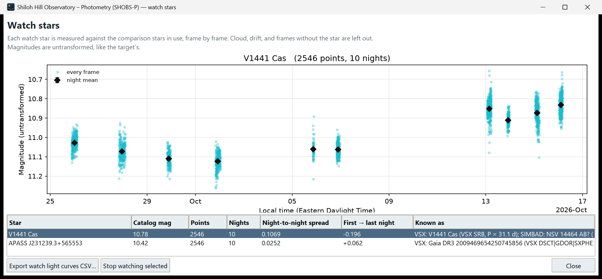

# 21. Follow a candidate

A field scan gives you leads. One night is never enough to call a star variable: you want to see it change again, on
another night, with the same behavior. This chapter covers:

- deciding which candidates are worth following,
- putting them on the watch list,
- measuring them on more nights,
- exporting their light curves, for your own analysis or a VSX submission.

## Decide which candidates are worth following

Work down the scan table (see [20. Scan a field](20-scan-a-field.md)) and, for each candidate:

1. Read **Check first**. A candidate whose change begins at a flip or a gap, or that is near saturation, is most
   likely instrumental. Follow it only if its light curve also changes well away from the flip or gap.
2. Read **VSX**. **KNOWN (VSX): …** is already cataloged. It may still be worth following if the catalog lacks a
   period or type, but it is not a new variable.
3. Look at its light curve (click the row). A real variable usually changes smoothly, or repeats; a single-frame
   spike is usually a cosmic ray, a satellite or a hot pixel.
4. Click **Mark candidates on image** and look at the star in the image. A bright neighbor, a diffraction spike,
   a column defect or the frame edge can each make a star "vary".
5. Look at **× normal** together with **Scatter**. A faint star at 3× normal may scatter 0.1 mag from noise alone; a
   bright star at 3× normal with 0.02 mag scatter is a cleaner lead.

## Put a candidate on the watch list

Watch stars are measured on every later run, with their own light curves. There are three ways to add one:

- On the **Output – Field scan** page, click the candidate's row and press **Watch selected star**. The status bar
  says *"Watching …"*.
- In **Known variables measured…**, select a known variable and press **Watch selected**. This works even for one the
  scan could not measure (it is watched by its sky position).
- On the Photometry page, with **● Watch it** chosen, click the star in the image.

A watch star is remembered by its catalog name and sky position when the field is solved. A star that is not a
labeled catalog star on an unsolved image is remembered only by its pixel position; the status bar warns *"It is
not a labeled catalog star, so click it again on later nights."*

## Measure another night

### In the same session (Discovery mode)

1. On the Input page, change the **Lights** folder (and the calibration folders, if they differ) to the next night's
   frames and press **Scan folders**.
2. Blink and calibrate as before. The field is solved again, and the watch stars are found by name and sky position.
   The log says how many were found, for example *"Watch stars: 2 of 3 found on this frame"*.
3. Press **Scan field**. Watch stars appear in the table as **W** rows (with their periodogram), whether or not they
   reach the candidate level that night.

Compare the two nights. A star that is a candidate again, with similar behavior, is a much stronger lead.

> **Caution:** In Discovery mode the watch list lives only in this session. It is not saved when you close
> SHOBS-P. To keep a candidate's history across sessions, follow it in Variables mode with a series, as below.

### Over many nights (Variables mode)

A series in Variables mode keeps the watch list and every night's measurements in one file. There are two ways to
use it.

**The candidate as the target** (best when one candidate matters most):

1. Switch to **Variables** mode. Marked stars and calibrated frames are kept.
2. On the Input page, type the candidate's catalog name in **Star ID** (the name in brackets in the scan table), or
   type its **RA (hours)** and **Dec (degrees)**.
3. On the Photometry page mark it as the **Target**, choose comparison stars and a check star, and press **Run
   photometry**.
4. **Save series** on the Output page. On each new night, **Load series…** first, then reduce the night and answer
   **Yes** to add it.

You get the full Variables-mode tools: the period search with its significance tests, the comparison-star health
check, Time of max/min and an AAVSO report. See [9. Reduce a variable-star night](09-reduce-a-variable-night.md),
[10. Build a multi-night series](10-build-a-multi-night-series.md) and [13. Look for a period](13-look-for-a-period.md).

**The candidate as a watch star** (best for several candidates in one field):

1. In Variables mode, pick any good star in the field as the target, with comps and a check star.
2. Make sure the candidates are on the watch list (they stay on it when you switch modes in the same session).
3. Run photometry and save the series. The watch list is saved with it.
4. On later nights, **Load series…** before reducing; the watch stars are found again after the solve and measured
   on every run.
5. On the Output page, click **Watch stars…** to see each watch star's light curve across all nights, measured
   against the comparison stars in use.

## Export the light curves

| What you want | Where | File |
|---|---|---|
| One row per measured star, with scatter, excess and period | **Save CSV…** on the Field scan page | `<field>_<filter>_<date>_SHOBS-P_scan.csv` |
| One row per candidate, ready to start a VSX new-variable submission | **Export candidates CSV…** | `field_scan_candidates.csv` |
| Every star's light curve from one scan (label, JD, magnitude) | **Export all light curves CSV…** | `field_scan_lightcurves.csv` |
| Watch stars' light curves across a series | **Export watch light curves CSV…** in the Watch stars window | `watch_stars.csv` |
| The target's full light curve | **Save light-curve CSV** or **Export…** on the Variables Output page | see chapter 22 |

Scan magnitudes are on the catalog's scale (untransformed) when the field was solved, and instrumental otherwise.
Every CSV starts with a `# Created …` line.

## Before you report a new variable

- See it vary on at least two nights, ideally with the same period or the same kind of change.
- Rule out a neighbor: look at the image at full zoom, and try a smaller aperture.
- Check the comparison stars: a variable comp makes every other star look variable in the opposite sense.
- Check that the star is not already cataloged under another name (SIMBAD, VSX search by position).
- Follow the VSX submission guidelines. The candidates CSV gives position, magnitude, scatter, period and color as a
  starting point.

---

Previous: [20. Scan a field](20-scan-a-field.md) · Next: [22. Files SHOBS-P writes](22-files-shobs-p-writes.md)
