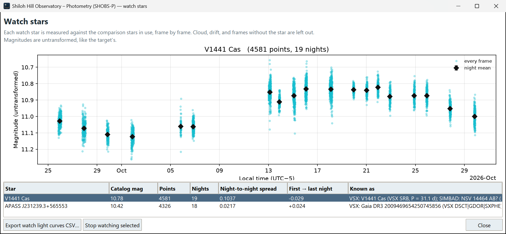

# 21. Check a suspect

A field scan gives you leads. One night is never enough to call a star variable: you want to see it change again, on
another night, with the same behavior. This chapter covers:

- what a suspect is, and what SHOBS-P does and does not decide,
- deciding which suspects are worth following,
- two checks on a suspect: its neighbors, and outside survey data,
- putting suspects on the watch list and measuring them on more nights,
- exporting their light curves, for your own analysis or a VSX submission.

## What a suspect is

A **Suspect** is a star that stood out on one night's field scan
(see [20. Scan a field](20-scan-a-field.md)). There are two tests, and either one is enough:

- **Scatter**: the star scatters at least 3× more than stars of the same brightness.
- **Own errors**: its scatter against its own error bars (χ²ν) is at least 2.5× that of stars as bright. This
  catches a bright, low-amplitude variable that the first test misses.

You can also add a star by hand with **Add as suspect**.

A suspect belongs to its one night. It is kept in that night's suspects file, beside the night's results. When
another night of the same field made the star a suspect too, the **Nights** column says **Suspect again (N nights)**.
That is the strongest sign SHOBS-P gives you.

SHOBS-P stops there. It finds suspects and gives you tools to check them. It does not confirm a variable, and it
keeps no list of confirmed stars. Deciding that a star is real, and reporting it to VSX, is your job as the
observer. See "Before you report a new variable" at the end of this chapter.

## Decide which suspects are worth following

Work down the scan table (see [20. Scan a field](20-scan-a-field.md)) and, for each suspect:

1. Read **Check first**. A suspect whose change begins at a flip or a gap, that is near saturation or clipped, or
   that has a blended neighbor, is most likely instrumental. Follow it only if its light curve also changes well away from the flip or gap.
2. Read **VSX**. **KNOWN (VSX): …** is already cataloged. It may still be worth following if the catalog lacks a
   period or type, but it is not a new variable. Tick **Hide known variables** to take them out of the table, the
   plot and the image while you work through the new ones.
3. Look at its light curve (click the row). A real variable usually changes smoothly, or repeats; a single-frame
   spike is usually a cosmic ray, a satellite or a hot pixel. A **Best period** of **no period (drift)** means the
   periodogram's best peak sat at the long end of the search: the star drifts slowly, which may be the star or may be
   the instrument. Click the row again (or press **Esc**) to clear the selection.
4. Click **Mark suspects on image** and look at the star in the image. A bright neighbor, a diffraction spike,
   a column defect or the frame edge can each make a star "vary".
5. Look at **× normal** together with **Scatter**. A faint star at 3× normal may scatter 0.1 mag from noise alone; a
   bright star at 3× normal with 0.02 mag scatter is a cleaner lead.
6. Look at **Suspect by** and **χ²ν × normal**. A star that is a suspect by its **own errors** only scatters
   modestly but far more than its error bars allow: a low-amplitude variable (S033 was one), or something its error
   bars do not cover, such as a neighbor in the sky ring. **Nights** says **Suspect again (N nights)** when it was a
   suspect on other nights of this field too: a much stronger lead.

### Pick stars on the scatter plot

Not every interesting star reaches a suspect level. On the **Scatter vs brightness** plot you can pick any
measured star:

- **Click** a point to pick that star (and draw its light curve); click it again to clear.
- **Ctrl+click** adds a star to the picked set, or takes it out.
- **Drag** a box to pick every star inside it.

Picked stars are ringed on the plot. Press **Mark on image** to mark them on the Photometry image: suspects keep
their rank number, other stars are labeled with SHOBS-P's label (for example `S066`) and drawn as **Picked on the scan
plot**. From there you can look at each one, and watch it (below). Press **Add as suspect** to make the picked stars
suspects by hand (chapter 20): they are kept in the night's suspects file with the others.

## Check the neighbors

A star that varies may be borrowing its signal: from a neighbor whose light falls in its aperture, from a variable
comparison star, or from something every star of that brightness shows (the sky, the detector). **Check neighbors…**
(from 2.4.0) puts the star's light curve beside its neighbors' on one shared scale.

On the **Output – Field scan** page, select a star (a row in the table or a point on the plot) and press **Check
neighbors…** in the **Checks** group. It works on any measured star, suspect or not. It uses that one night, with
every star the scan measured; nothing is measured again.

The rows, in groups:

- **Target**: the star itself, with its amplitude at its period P. P is the scan's **Best period** for the star;
  when the scan found none, the window searches for one.
- **Close companions**: any star inside the aperture plus the sky ring. Its light is in the star's measurement.
- **Look-alikes (±0.5 mag)**: stars of about the same brightness, nearest first, up to six. A star that shares the
  star's brightness shares its noise and its systematics. Each row gives the catalog name (when the scan has one),
  the separation and ΔV.
- **Comps and check**: only when the scan was run with marked comparison stars (a field scan in Variables mode).

Each row ends with **Power at P** (the star's periodogram power at P as a share of the target's own) and **Amp at
P**, then **✓ Quiet** or **⚠ Signal at P**. A row is quiet when its power is under half the target's and its
amplitude under a third of the target's (or 2σ). The bottom line sums it up: *Neighbors quiet at P: 6 of 6
measured*. A neighbor with a signal at P is a warning: the change may not belong to your star.

**View**: **Folded at P** (40 phase bins) or **Time** (6-minute bins). Type another look-alike range in
**Look-alikes ±** and press Enter to list them again.

The small map on the left shows where each star sits on the frame: the star in blue, look-alikes green, close
companions orange, comps and check grey.

**Save to suspects file** keeps the result with the star in the night's suspects file. It works for a suspect only:
for another star, press **Add as suspect** first.

The window judges one night. To see whether the neighbors stay quiet on other nights, scan those nights and check
again.

## Outside data (ZTF, TESS, ATLAS)

From one site a short-period star's best peak and its ±1 cycle/day alias can be nearly equal, and one night cannot
settle that. A survey with other sampling can. **Outside data…** (from 2.4.0), beside **Check neighbors…** in the
**Checks** group, asks three surveys about the selected star's sky position and compares what they find with the
star's scan period:

- **ZTF** (IRSA light curves, within 2″): each filter searched over the scan's period range;
- **TESS** (the TIC star within 5″, the sectors that covered it, the Quick-Look Pipeline light curves): one search
  over all sectors. TESS pixels are 21″, so TESS confirms the period, not which star has it (Check neighbors does);
- **ATLAS** (the ATLAS variable-star catalog): its periods and class.

It runs in the background; the busy bar shows it. The answer comes in a message box and in the log: a summary, then
one line per survey.

- A survey **agrees** when it finds the same period within 1 % with a significant peak (ZTF, TESS: FAP under 1e-3).
  The summary then reads *Outside data agrees: ZTF and TESS.*
- An ATLAS entry the catalog classes *dubious* never counts as agreement.
- A survey that finds your ±1 c/d alias instead is named: that is a reason to doubt your period.
- *did not answer* means the service was down; try again later. ✖ means it answered with something SHOBS-P cannot
  read.

Outside data is a report. It changes nothing in SHOBS-P and nothing is stored: run it again whenever you like.

The star needs a sky position (the field must be solved). The period is the scan's **Best period**; when the scan
lists none for the star, SHOBS-P uses the best period of its light curve that night, as Check neighbors does, and
says so in the log. Both **Checks** buttons are grey until a star is selected, and **Outside data…** is grey on a
scan with no sky positions at all.

## Put a suspect on the watch list

Watch stars are measured on every later run, with their own light curves. There are three ways to add one:

- On the **Output – Field scan** page, click the suspect's row (or its point on the scatter plot) and press **Watch
  selected star**. The status bar says *"Watching …"*.
- In **Known variables measured…**, select a known variable and press **Watch selected**. This works even for one the
  scan could not measure (it is watched by its sky position).
- On the Photometry page, with **● Watch it** chosen, click the star in the image.

A watch star is remembered by its catalog name and sky position when the field is solved. A star that is not a
labeled catalog star on an unsolved image is remembered only by its pixel position; the status bar warns *"It is
not a labeled catalog star, so click it again on later nights."*

## Measure another night

### Night after night in Discovery mode

1. On the Input page, change the **Lights** folder (and the calibration folders, if they differ) to the next night's
   frames and press **Scan folders**.
2. Blink and calibrate as before. The field is solved again, and the watch stars are found by name and sky position.
   The log says how many were found, for example *"Watch stars: 2 of 3 found on this frame"*.
3. Press **Scan field**. Watch stars appear in the table as **W** rows (with their periodogram), whether or not they
   reach a suspect level that night.

Compare the two nights. A star that is a suspect again, with similar behavior, is a much stronger lead: the
**Nights** column says **Suspect again (N nights)** when the field's other nights have a suspects file (chapter 20).

Discovery watch stars are remembered between sessions, with their sky positions. After the next solve, the ones
that fall on the new frame are watched again, and the log says, for example, *"Watch stars remembered for this field
(2): …"*. A star clicked on an unsolved frame has no sky position, so it cannot be found again and is not remembered.
Right-click a watch star (or **Remove selected**) to stop watching it.

> **Tip:** Discovery keeps the watch list, but not each night's measurements. To keep a suspect's history across
> nights, follow it in Variables mode with a series, as below.

### Over many nights (Variables mode)

A series in Variables mode keeps the watch list and every night's measurements in one file. There are two ways to
use it.

**The suspect as the target** (best when one suspect matters most):

1. Switch to **Variables** mode. Marked stars and calibrated frames are kept.
2. On the Input page, type the suspect's catalog name in **Star ID** (the name in brackets in the scan table), or
   type its **RA (hours)** and **Dec (degrees)**.
3. On the Photometry page mark it as the **Target**, choose comparison stars and a check star, and press **Run
   photometry**.
4. **Save series** on the Output page. On each new night, **Load series…** first, then reduce the night and answer
   **Yes** to add it.

You get the full Variables-mode tools: the period search with its significance tests, the comparison-star health
check, Time of max/min and an AAVSO report. See [9. Reduce a variable-star night](09-reduce-a-variable-night.md),
[10. Build a multi-night series](10-build-a-multi-night-series.md) and [13. Look for a period](13-look-for-a-period.md).

**The suspect as a watch star** (best for several suspects in one field):

1. In Variables mode, pick any good star in the field as the target, with comps and a check star.
2. Make sure the suspects are on the watch list (they stay on it when you switch modes in the same session).
3. Run photometry and save the series. The watch list is saved with it.
4. On later nights, **Load series…** before reducing; the watch stars are found again after the solve and measured
   on every run.
5. On the Output page, click **Watch stars…** to see each watch star's light curve across all nights, measured
   against the comparison stars in use.

## Worked example: S033

S033 (APASS J024812.2+505255, Gaia DR3 440531844915790208) was found this way in November 2026.

1. **Suspect** (13–14 Nov, GSC 03308-00462 field scan): 2.2× normal scatter, under the 3× level, but χ²ν 2.7 times
   that of stars of its brightness: a suspect by its own errors.
2. **Check neighbors** on that night's scan: *Neighbors quiet at P: 6 of 6 measured*. No star inside the aperture
   plus sky ring.
3. **Outside data**: ZTF finds 0.102970 d (g and r) and TESS 0.102970 d (sectors 18, 58, 85). The summary reads
   *Outside data agrees: ZTF and TESS.* ATLAS lists the star as *dubious* at 0.249 d (not counted).
4. **More nights**: followed in Variables mode as a series (6 nights from 8 Nov, 583 usable points of 624). The
   period search gives P 0.10279 d with an amplitude of 10.4 mmag.
5. **The observer's call**: submitted to VSX on 15 Nov 2026 as a δ Scuti star, P 0.1029705 d.

## Export the light curves

| What you want | Where | File |
|---|---|---|
| One row per measured star, with scatter, excess and period | **Save CSV…** on the Field scan page | `<field>_<filter>_<date>_SHOBS-P_scan.csv` |
| One row per suspect, ready to start a VSX new-variable submission | **Export suspects CSV…** | `field_scan_suspects.csv` |
| The night's suspects, kept for **Suspect again** on later nights | written by the scan (and by **Add as suspect**) | `<field>_<filter>_<date>_SHOBS-P_suspects.json` |
| Every star's light curve from one scan (label, JD, magnitude) | **Export all light curves CSV…** | `field_scan_lightcurves.csv` |
| Watch stars' light curves across a series | **Export watch light curves CSV…** in the Watch stars window | `watch_stars.csv` |
| The target's full light curve | **Save light-curve CSV** or **Export…** on the Variables Output page | see chapter 22 |

Scan magnitudes are on the catalog's scale (untransformed) when the field was solved, and instrumental otherwise.
Every CSV starts with a `# Created …` line.

## Before you report a new variable

Confirming a variable and submitting it to VSX is the observer's job. SHOBS-P gives you the evidence; you make the
call.

- See it vary on at least two nights, ideally with the same period or the same kind of change.
- Rule out a neighbor: **Check neighbors…**, and look at the image at full zoom.
- Ask the surveys: **Outside data…**. A survey that finds the same period is strong support; one that finds the
  ±1 c/d alias is a warning.
- Check the comparison stars: a variable comp makes every other star look variable in the opposite sense.
- Check that the star is not already cataloged under another name (SIMBAD, VSX search by position).
- Follow the VSX submission guidelines. The suspects CSV gives position, magnitude, scatter, period and color as a
  starting point.

---

Previous: [20. Scan a field](20-scan-a-field.md) · Next: [22. Files SHOBS-P writes](22-files-shobs-p-writes.md)
