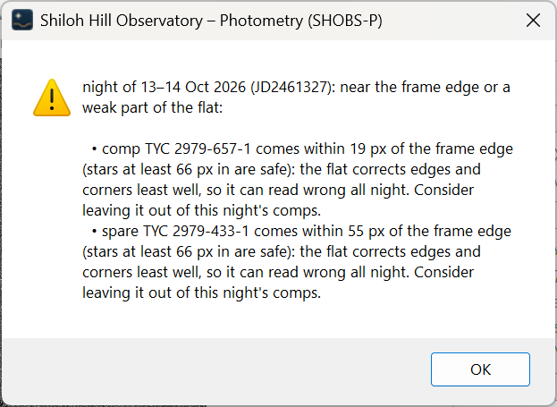

# 23. Messages explained

SHOBS-P talks to you in four places:

- **The status bar** at the bottom of the window: the latest news, one line. While SHOBS-P works, the busy bar at its
  left end says what it is doing (chapter 3); when the job ends, the line says how it went, starting with ✔ (done),
  ✖ (failed) or ⚠ (done, but look). After a report save it also holds a button for the upload page.
- **The log**: on the Calibrate page, and under the image on the Photometry page (**Show log** / **Hide log**). Every
  status line goes here too, often with more detail. When something looks wrong, read the log first.
- **Message boxes**: a question (Yes / No, sometimes Cancel) when SHOBS-P needs a decision, a warning when it found a
  problem, an error when it cannot go on.
- **Notes and cautions on the Output pages**: lines starting with **⚠** are cautions about the result.

Most questions have a default that is the safe choice; just read the whole message before you answer. The messages
below are the ones new users meet most often, grouped by step. "…" stands for the names and numbers filled in.

## Starting on Linux or a Mac

These appear in the Terminal window the first time SHOBS-P starts (chapter 2).

| Message | What it means | What to do |
|---|---|---|
| *Looking for a Python that can run SHOBS-P...* then *Trying …* and *usable: Python 3.13.x* or *not usable: …* | SHOBS-P checks each Python it finds, 3.13, 3.12 and 3.11 first. | Nothing; it picks the first one that works. |
| *⚠ Some packages SHOBS-P needs have no ready-made copy for Python 3.15.x yet (they would have to be compiled, and SHOBS-P never compiles).* *Trying the next Python.* | A brand-new Python has no ready-made packages yet. | Nothing, if another Python follows. Otherwise install Python 3.13. |
| *✔ SHOBS-P is set up with Python 3.13.x.* | The setup worked. | Nothing; SHOBS-P opens. |
| *✖ SHOBS-P could not find a Python it can use (each one tried is listed above, with the reason).* | No Python 3.11 or newer with Tkinter was found. | Mac: install Python 3.13 from python.org. Linux: install Python and its Tkinter package (the message names it). |
| *✖ SHOBS-P could not set up its packages with any Python on this computer (each one is listed above).* | None of the Pythons could install the packages, often because the only one is too new. | Do what the next lines say (Mac: install Python 3.13 from python.org; your other Pythons can stay). pip's own words are in `pip_log.txt` (chapter 24). |
| *✖ The packages could not be downloaded. Check the internet connection and try again.* | No internet, or the download was blocked. | Check the connection, then start again. |

## Anywhere

| Message | What it means | What to do |
|---|---|---|
| *Another step is still running. Wait for it to finish.* | Only one job runs at a time. | Wait, or press **Cancel** / **Cancel run**. |
| *Wait for the current run to finish (or cancel it) before switching modes.* | Same, for the mode buttons. | Wait or cancel. |
| *Something went wrong: … Details were written to ….shobs_p.log.* | An unexpected error. | Note what you were doing and see [24. Troubleshooting](24-troubleshooting.md). |
| *Could not open a browser: go to …* | The upload or ExoFOP page could not open. | Copy the address into your browser. |
| *The output folder could not be used (…); choose where to save.* | The Output folder is missing or read-only. | Pick another folder on the Input page. |

## Input

| Message | What it means | What to do |
|---|---|---|
| *✖ Could not look up … (…). Type RA/Dec, or let the plate solution fill them, or press Look up again.* | SIMBAD and VSX did not find the name, or there is no internet. | Check the spelling (the Input page may suggest the AAVSO spelling: **Use it**), or type RA/Dec. |
| *The … folder holds N file(s) SHOBS-P cannot read … It reads FITS and XISF* | Camera RAW, TIFF or JPEG files. | Save the frames as FITS or XISF in your capture program. |
| *This Lights folder holds frames pointing at more than one place: … Use only the N frames near the Input target …?* | Two fields in one folder. | **Yes** sets the other field aside (Blink can bring frames back). |
| *These frames are DY Peg, not BL Cam. … Start a new reduction? …* | The lights' pointing (or their OBJECT keyword) says they are another star than the Input page's. | **Yes** starts a new reduction: the open series is closed (save offered), the old star's target, planet, comps, check and watch stars are cleared, and the frames' star is looked up. **No** keeps yours. See [5. Input](05-input.md). |
| *Start a new reduction? … target, planet, comps, check and watch stars, Use comps choice, VSX period and rejected frames are cleared …* | You pressed **New reduction**. | **Yes** to start over for another star; folders, site and optics stay. The Output page notes go back to their default (the log lists *the Output page notes* among what was cleared when you had typed your own). |
| **no such folder** (count beside a Frames row) | The path typed in the box is not an existing folder (yet). | Finish typing the path, or use **Browse**. The count updates a moment after you stop typing, or when you press Enter. |
| *SIMBAD from cache (fetched 12 Oct 2026); the live service did not answer (503).* (end of the status line, and in the log; also *VSX from cache …*, *NASA Exoplanet Archive from cache …* under the planet boxes) | The service did not answer, so the last good answer for this name was used. | Nothing; a live answer replaces it next time. See "When a service is down" in [24. Troubleshooting](24-troubleshooting.md). |
| *✖ …: SIMBAD and VSX did not answer (…) — type RA/Dec, or Look up again.* | The lookup services did not answer (no connection, or the service is down). | Type RA/Dec, or press **Look up again** later. The planet lookup says the same about the NASA Exoplanet Archive. |
| *✖ TOI-2046: SIMBAD and VSX did not answer within 60 s — type RA/Dec, or Look up again.* (under RA/Dec and on the status bar) | The lookup has waited 60 seconds with no answer; the busy bar stops. | Type RA/Dec, or press **Look up again** later. If the answer still comes in, it is used. For a planet the line is under the planet boxes and says *… the NASA Exoplanet Archive did not answer within 60 s — type the values or Look up again.* |
| *⚠ Darks 60 s, lights 120 s: the master dark is scaled ×2 …* (under the Frames box) | The darks' exposure differs from the lights'. ✖ in red when it would be scaled more than 3 times. | Point **Dark** at darks of the lights' exposure if you have them. |
| *⚠ No bias and no dark flats: darks can't be scaled correctly without bias or dark flats (110 s darks to 55 s lights scales the camera's offset too). …* (under the Frames box) | The darks must be scaled, and nothing tells SHOBS-P the camera's offset. | Add bias frames or dark flats (**Dark flats** row), or use darks at the lights' exposure. See [7. Calibrate](07-calibrate.md). |
| *⚠ Dark flats 2 s, flats 0.5 s: dark flats should match the flats' exposure. Take dark flats at 0.5 s.* | The dark flats do not match the flats. | Take dark flats at the flats' exposure. They are still used meanwhile. |
| *Dark flats folder cleared. Calibration will skip it.* (status bar) | You pressed **✕** on the Dark flats row. | Nothing. |
| *✖ No planets found for … at the NASA Exoplanet Archive (none listed under that name, or the Archive did not answer). Type the planet's name, or press Look up again on the Star ID.* (Transits, under the Planet box) | A Star ID lookup found no planet of that star. | Type the planet's name in **Planet**, or look up again later. See [16. Prepare for a transit night](16-plan-a-transit-night.md). |
| *✖ …: the NASA Exoplanet Archive did not answer within 60 s — type the planet's name, or Look up again on the Star ID.* | The star's planet list did not come within 60 seconds. | Type the planet's name, or press **Look up again** later. |
| *These lights come from …. Last time you measured frames from that telescope the Telescope aperture was … mm; the box says … mm. Use … mm for these frames?* | The header gives no aperture, and you measured this telescope before with another one. | **Yes**, unless you know the box is right. |
| *These lights come from …, another telescope than the last frames you measured (…). The Telescope aperture box still says … mm from those frames. Is … mm right for this telescope?* | New telescope, no aperture in the header. | **Yes** keeps the value; **No** puts the cursor in the **Telescope aperture (mm)** box: type the aperture. |
| *These lights were taken at latitude …, longitude …, N km from your site.* | The frames come from another observatory (shared or downloaded data). | **Yes** uses their site and optics for these frames only; your own come back with your own frames. |
| *… is not a master SHOBS-P built.* | A master from other software was chosen. | Choose the folder of raw frames instead; SHOBS-P builds and reuses its own master. |
| **Color images**: *These N lights are color images that other software has already debayered (three channels: red, green and blue). … Which channel should be measured?* | The lights are finished color images, not raw frames. | Usually **Green (TG)**. They are measured without a debayer or calibration; change the channel later in the **Filter** box (Calibrate page). |
| **Color or monochrome camera?** | No Bayer keyword, and neither the flats nor the lights' sky can tell. | Answer **Color camera** or **Monochrome camera**. For a color camera, check the pattern on the Calibrate page. |
| Log: *Mount: Alt-az from the headers (…); the Mount box says German equatorial …* | The headers clearly show another mount than the **Mount** box. | If these are your own lights, set **Mount** in the Optics box. |

## Calibrate

| Message | What it means | What to do |
|---|---|---|
| *2 dark frames (60 s) are in the Lights folder, and the Dark box is empty. Use them as darks?* | Calibration frames were saved with the lights. | **Yes** uses them for this run (the files stay where they are). See [7. Calibrate](07-calibrate.md). |
| *Dark folder '…': The darks are 30 s and the lights 120 s, so the master dark is scaled x4 …* | The darks are far from the lights' exposure. | **Yes** calibrates without the dark (fine for most cooled cameras); **Cancel** lets you pick better darks. |
| *The flats were taken at rotator angle X° and the lights at Y°.* | The camera was turned between flats and lights; the flat corrects the wrong pattern. | Use flats taken at the lights' angle if you have them. On a German equatorial mount a meridian flip (180°) does not cause this. On an alt-az mount without a derotator (the message adds *alt-az mount, so no meridian flip explains it*) it is a real turn. |
| Log: *Caution: flats taken with the derotator at sky angle …* | An alt-az mount with a derotator. | Nothing: the message explains that this is fine. |
| Log: *These lights are color images (already debayered and calibrated): the bias, dark and flat entries are not used for them.* | Information. | Nothing. |
| *The Flat folder mixes camera angles: …* | Flats from more than one camera angle. | Keep only the flats taken at the lights' angle. |
| *These lights look already calibrated: … Skip bias, dark, and flat for this run? (Recommended)* | The files show signs of earlier calibration. | **Yes**, or they are calibrated twice. |
| *Calibration failed: The masters do not fit these lights: …* | Size or binning differs between masters and lights. | Pick matching frames, or tick **Rebuild masters (ignore saved ones)**. |
| *Calibration failed: … is not a master SHOBS-P built …* (or *… is a master dark, not a master flat.*) | A Bias, Dark or Flat row points at a file that is not the right SHOBS-P master. The same line is in the log. | Pick the right master with **Master file…**, or the folder of raw frames. |
| *No light frames found.* | The Lights folder is empty or every frame is rejected. | Check the folder and the Blink page. |
| *Monochrome camera found (no color mask in the flat): Bayer pattern MONO.* (or *… in the lights' sky background …*) | Information (status bar and log). | If your camera is in fact a color camera, choose its pattern on the Calibrate page. |
| Log: *Meridian flip before frame … (…° to …°)* | Information: where the flip happened. | Nothing; one set of flats covers both sides. |
| Log: *Calibration: lights = …; flats = ….* | How the lights and flats are calibrated, from the rows you filled in. | Nothing, unless a ⚠ follows it. |
| Log: *⚠ Darks can't be scaled correctly without bias or dark flats. …* | No bias and no dark flats, and the darks are scaled to the lights. | Add bias frames or dark flats, or use darks at the lights' exposure. |
| Log: *⚠ The flats (0.5 s) get the master dark (55 s) scaled ×0.00909, and with no bias that scales the camera's offset too … Put dark flats … in the Dark flats box, or add bias frames.* | The flats would lose the wrong amount of offset, so the master flat would be wrong. | Put the dark flats in the **Dark flats** row (or add bias frames) and calibrate again. |
| Log: *The Bias box holds dark flats (their IMAGETYP says so). They are used as the bias, as before 2.3.0; the Dark flats box is now the place for them …* | Information: the old way still works. | Next time, put them in the **Dark flats** row. |
| Log: *N dark flats found in the Flat folder (IMAGETYP or name): used as the dark flats, and left out of the master flat.* | Dark flats saved beside the flats. | Nothing. |
| Log: *Photon noise: … The camera binned 3x3 and averaged the binned pixels (the sky's noise says so), so each stored ADU holds 9 x EGAIN electrons …* (or *… summed the binned pixels …*, or *… cannot tell whether it summed … or averaged …*) | How the error bars count electrons on camera-binned frames. | Nothing. When SHOBS-P cannot tell and the Transit fit's χ²ν is well under 1, the camera averaged. See [7. Calibrate](07-calibrate.md). |

## Photometry

| Message | What it means | What to do |
|---|---|---|
| *Calibrate first (Calibrate page). Star positions are measured on the calibrated, debayered image.* | You clicked the image before calibrating. | Calibrate. |
| Step strip **1 Not solved**, or *Not solved: no lock (h of n catalog stars matched).* | The plate solve failed. | Press **Solve again** for the full diagnosis. Check the Optics box (focal length, pixel size, binning) and the RA/Dec. You can still click stars and type magnitudes. |
| *Solve needs to know roughly where the frame is: …* | No pointing in the headers and no RA/Dec typed. | Type the target (or field center) on the Input page. |
| *… is a known or suspected variable: … Use it anyway?* | A comp or check you clicked is in VSX or SIMBAD. | Usually **No**, and pick another star. |
| *The aperture (r = 12 px) is much larger than the stars on this frame (FWHM 3.2 px).* | The aperture does not suit the seeing. | **No**, then **Suggest…** to set sizes from the stars. |
| *Defocused stars: the aperture (r = … px) clips the ring — use r ≥ … px. … Run with the current aperture anyway?* | The stars are donuts and the aperture is too small for them. | **No**, then **Suggest…** (it sizes the aperture to 95 % of the light). |
| *There is no star under the Target marker at (x, y).* | The marker is on blank sky. | **No**, and click the star again. |
| *These have a name in the Stars panel but no marker on this image …* | A name left from an earlier night or series. | **Yes** clears the names; **Cancel** lets you mark them. |
| *With 3 comps the AAVSO report is an ensemble, and AAVSO requires a check star …* | No check star in Variables mode. | Mark a check star (or continue if you will not report this run). |
| *No transit of … is predicted during these lights …* | Transits mode, but the frames miss the transit. | Check the planet and date; use Variables mode for a variability run. |
| *… hosts …, and a transit of … is predicted during these lights …* | Variables mode on a planet host during a transit. | **Yes** switches to Transits mode. |
| Log: *⚠ Check marker at (x, y) is N px from the center of the star there …* | Before the run: that marker would be measured beside its star, so the star would read faint. | Clear the marker, zoom in and click the star again, unless you meant it. |
| *Binning is 2 but the masters were built at 1.* | Binning changed after calibration. | Calibrate again, or set binning back. |
| Log: *skipped …: could not align this frame (N stars found; clouds? trailing?)* | One frame was unusable. | Nothing, unless many are skipped; then check those frames in Blink. |
| *No frames produced a magnitude. The Calibrate page log says why each frame was skipped.* | Every frame failed. | Read the log. |
| Log: *AAVSO sequence did not answer (503 from apps.aavso.org); asking again in the background …* | The AAVSO chart server is slow or down. The solve goes on without it. | Wait: the log says if it answers, and then **Solve again** uses it. |
| Log: *AAVSO sequence blocked: 403 (Cloudflare check page) from apps.aavso.org: AAVSO's site refused the request …* | AAVSO's site turned the request away. | **Solve again** later. |
| Log and status line: *AAVSO sequence from cache (fetched 12 Oct 2026); the live service did not answer (503). Chart X28123AB (goes in the AAVSO report).* | AAVSO's chart server did not answer, so the last sequence for this field was used, with its chart ID. | Nothing; the report is as usual. |
| *Variable-star check (SIMBAD; VSX not reached): …* (Field box and log) | VSX could not be reached (VizieR and AAVSO's VSX both down, nothing saved for this field). Only SIMBAD was checked. | **Solve again** later to check against VSX. |
| Log: *Variable-star check: VSX from AAVSO's VSX API (VizieR did not answer).* or *VSX from cache (fetched …) …* | VizieR's copy of VSX did not answer; AAVSO's own VSX, or the last saved list for this field, was used. | Nothing. |
| *⚠ raw peak … ADU is over the linear limit (…): the camera's response bends there, so this star reads too faint …* (Stars panel) | The star is too bright for your camera's linear range (**linear ADU**). | Pick a fainter comp; for the target, shorter exposures or more defocus. |
| *⚠ only … px from the frame edge: its sky ring … needs the star at least … px in …* (Stars panel) | The comp or check star is too near the edge. | Pick a star further in (for the check, the line may name a green ring S1, S2 … farther in). |
| *Star catalogs did not answer, so the frame could not be solved …: Gaia DR3 (…) … did not answer: a catalog service outage …* | Gaia, APASS or Tycho-2 did not answer (or Gaia sent no stars). Not your settings. | **Solve again** in a few minutes. |
| Log: *Target: … is on frame … (found by …), not on frames …. Frame … is the reference now …* | The first frames missed the target; SHOBS-P moved the reference to the first frame that holds it. | Nothing; the frames without the target are skipped and listed. |
| Log: *… not on the frame in N of M images (frames …); those frames were skipped.* | Frames on which the target was off the frame. | With ⚠ (a large share): check the pointing, or reject those frames in Blink. |
| Log: *⚠ After the meridian flip the … apertures were off their stars by about (…) px together, while the target's was not …* | An aperture-placement error at the flip, not the stars. | See [12. Flags and bad data](12-flags-and-bad-data.md). Look at the positions in the light-curve CSV. |
| Log: *⚠ Linear limit … ADU: raw peak at or above it in … frames …* | Some frames of these stars were over your camera's linear limit. | Check **Comp health…**'s **Over linear limit** column; prefer stars that stay under it. |
| *⚠ Small image? Pop out opens it in its own window …* (under the image) | The image is drawn small (a small frame, or display scaling). | Press **Pop out**, or **Hide log**. |
| *C3 left out of 14 frames (off the frame edge; frames 27–40); those frames use the other comps.* (orange, under "Measured with", and in a box after the run) | A comp drifted off the frame edge in those frames. The frames are kept and measured with the other comps. | Nothing; pick a comp further in next time. See "Comps near the frame edge" in [8. Photometry page basics](08-photometry-basics.md). |
| *… out of the whole night (missing in most frames)* | The comp was measured in fewer than half of the night's frames (or fewer than 5). | Nothing; the night uses the other comps. |
| *check star left out of 18 frames (off the frame edge; …); no check value there.* | The check star drifted off the edge. | Nothing; those frames have no check value. |
| *check … comes within … px of the frame edge … The check star was off the frame in N frames (…). A better check star stays farther in: … Pick it as the check next time.* (in the same box after the run) | The check drifted off the edge; SHOBS-P names a spare as bright as it that stayed in all night. | Pick that star as the check next time. |
| Log: *…: spare … comes within … px of the frame edge … (a spare: only measured, not used; nothing to do).* | A spare sat near the edge. | Nothing. |
| *⚠ 16 frames skipped: every comp lost (off the frame edge) (frames 25–40).* | No comp was left in those frames. | Choose comps further from the edge, or keep the field better centered. |
| *⚠ N frames were skipped because of …, which is no longer a comp — Run photometry again to measure them.* | Every comp was lost in those frames, and **Use comps…** has since dropped those comps; Use comps does not measure frames. | Press **Measure skipped frames** at the right of the line. |
| *The N skipped frames of … are not in the Lights folder on the Input page now (or no image is loaded), so they cannot be measured on their own. …* | **Measure skipped frames** needs that night's frames. | Open that night's frames, or press **Run photometry** to measure the whole night again. |
| *⚠ The field turned by 180° between frames … — that looks like a meridian flip. Is the Mount set right (German equatorial)? …* | **Mount** is **Alt-az**, but the field turned half a turn between two frames. | If it was a flip, set **Mount** to **German equatorial** (Input page, Optics box) and run photometry again. |
| *⚠ Comps are weak (comp noise 4.7× the target's per frame). Stack 20 frames …?* (Stack row) | The comps' noise, not the target's, limits each point. | Press **Stack**, or choose brighter comps. See "Stacking when comps are weak" in [8. Photometry page basics](08-photometry-basics.md). |
| *⚠ Comps are weak (…), but the time resolution allows no stacking (…). Brighter comps, or longer exposures, would help.* | A stack would hide the signal. | Use brighter comps or longer exposures next time. |
| *Comps are fine per frame (…): stacking is not needed. Type N to stack anyway.* | Information. | Nothing. |
| *Stacks of N frames last about …, longer than the time resolution allows (…): they may blur the signal. Stack anyway?* | The N you typed is longer than the time cap. | **No**, and use a smaller N, unless you know the signal is slow. |
| *That makes only K stacked points; the transit fit needs 20 or more. Stack anyway?* | Transits: too few stacks for the fit. | **No**, and use a smaller N. |
| *That makes only K stacks; a field scan needs at least 10. Use a smaller N.* | Discovery: too few stacks for a scan. | Use a smaller N. |
| *Run photometry first (Scan field in Discovery): the Stack step uses that run's frames, alignment and noise.* | **Stack** before any run. | Run photometry first. |
| Log: *⚠ Aperture check on the stacks: …* | The stacked stars are more than 15 % wider than in one frame. | Run **Suggest…** with **Points: Stacked**, set the new aperture and press **Stack** again (the stacks are reused). |

## Output, Variables mode

| Message | What it means | What to do |
|---|---|---|
| *Add these N points as the night of … to the M points already in the series?* | A series is open. | **Yes** adds the night. Read any **Careful:** lines first (other comps, filter or equipment). |
| *… frames of … lost light …, but every measured star … faded by the same amount …: transmission loss (dew/haze?), not cloud. Use these points in the light curve …, or leave them out?* | Dew or haze, not cloud. | **Leave them out** (the default) leaves them flagged; **Use these points** keeps them. See [12. Flags and bad data](12-flags-and-bad-data.md). |
| *…: N frames fall in planet b's transit … Leave those frames out …?* | A known planet transits the variable during your frames. | **Yes** (the default) follows the campaign rule. |
| *Before you upload: • AAVSO observer code is empty …* | The report is missing something AAVSO needs. | Fix the listed items and save again. |
| *⚠ No AUID: WebObs will reject this report. Request one in VSX (open the star's VSX page, Request AUID).* (orange, under the **Results** row; also on the status line after a save, and in the log) | VSX knows the star but has not given it an AUID yet, and WebObs files reports by AUID. | Open the star's page in VSX and press **Request AUID**. When it has one, look the star up again on the Input page and save the report again. See [15. Submit to AAVSO](15-submit-to-aavso.md). |
| *⚠ The notes name …, which is not in this reduction. Notes: "…" Save anyway?* | The **Notes** box names a star that is not the target, planet, comps or check: usually a leftover from the last star. Catalog names (HD, HIP, TYC, TIC, AUIDs, WASP-…) and GCVS names such as *SZ Lyn*, *V1441 Cas* or *XX Cyg* are recognized; the target's own names are not flagged. Also asked before an AAVSO exoplanet report or ExoFOP package. | **No** (the default) and fix the Notes box. **Yes** only if you meant to name that star. |
| *Saved … — upload to AAVSO WebObs:   Series file updated: ….cvseries.* (status line) | The report was saved, and the open series file was rewritten to note it (for the **Sent** column). | Nothing. See [10. Build a multi-night series](10-build-a-multi-night-series.md). |
| *This series was observed from …; the Input page has …. Keep the series' site?* | A report save is about to rewrite the series file, and the Input page's site or observer code differ from the series' own. | **Yes** keeps the series' site and observer code in the file (usually right). **No** writes the Input page's into the series. |
| *Reduce a night of … first; the field image comes from a reduction (the Photometry page's frame).* | **Save field image** (or a report save) after **Load series…**: the frame on the Photometry page is another star's, or there is none. | Calibrate a night of the series' star, then save the field image again. With a report, the line is in the log and the report itself is saved. |
| Log: *AAVSO chart not saved (…): the field image is saved alone. Save field image again later to fetch the chart.* | The AAVSO chart server did not answer (time-out, no internet). After a report save this goes to the log only; the status line keeps the saved line and the upload button. | Press **Save field image** later. |
| *✖ Not saved: fix the Notes (Output page), then save again.* | You answered **No** to the notes question. | Correct the **Notes** box on the Output page and save again. |
| *Night … was already sent on … (in …); AAVSO will hold duplicates. Open anyway?* | Asked by **Open AAVSO WebObs…** (and the exoplanet and ExoFOP upload buttons): the report you saved last holds a night already sent. | Upload only the nights not sent yet. If that night was never really sent, double-click it in the night table to unmark it. See [15. Submit to AAVSO](15-submit-to-aavso.md). |
| ⚠ *No reliable period …* / *No significant period …* | The best peak does not pass the significance tests. | See [13. Look for a period](13-look-for-a-period.md). |
| *Too short for a period search: one night of … h covers under two cycles of even the shortest period searched …* | One night is too short to test any period. | Add nights, or observe longer. |
| *This night's meridian-flip step is … mag ⚠ … Save … with this night now?* | The flip step looks like an aperture problem, not the star. | **No** keeps the file on disk unchanged; **Save series** keeps the night later. See [9. Reduce a variable-star night](09-reduce-a-variable-night.md). |
| Log: *Not saved: … has a flip step ⚠ — Save series to keep it.* | An automatic save skipped the night you held back. | Press **Save series** when you want it in the file. |
| Log: *✖ Use comps choice (…) not applied to …: … not measured on any of its frames (another field's comps?) …* | The series' **Use comps…** stars are not in this night's field. | For another star, use **New reduction** on the Input page. |
| **Range ⚠** … *outside the search* (Period box) | The VSX or marked period lies outside the period search range. | Press **Search … d instead**. |

## Output, Transits mode

| Message | What it means | What to do |
|---|---|---|
| *Enter your site's latitude and longitude on the Input page first …* | Needed for BJD times. | Type your site once. |
| *…: N usable points. Run photometry in Transits mode first (or open an exoplanet report).* | Fewer than 20 points. | Run photometry, or check the flags. |
| *The photometry, the comps, or the planet changed since the last fit, so that fit was cleared.* | The fit no longer matches the data. | Press **Fit transit**. |
| *The comps are still being checked (a few seconds). Save the … when that is done …* | The leave-one-comp-out check is running. | Wait a moment and save again. |
| **⚠ Inconclusive …**, **✗ No transit measured …** | See [18. When the fit says "inconclusive" or "none"](18-inconclusive-or-none.md). | |
| *The per-point error bars are about …x larger than the real scatter …* | Usually the camera gain (EGAIN) in the headers. | Check the photometry log's *Photon noise* line. |
| *This fit did not measure a transit: … Save it anyway …?* | Saving a "none" result. | Save for your records only. |
| *… is limited by its prior range: its MCMC samples pile up against …, so the error bar is not a measurement.* | The data did not constrain that parameter. | Open it with **Save corner plot…**; don't quote that error bar as a measurement. See [17. Fit a transit and submit it](17-fit-a-transit-and-submit-it.md). |
| *No detection with Both: … alone detects it (ΔBIC …). …* | Airmass and time slope together absorbed the transit. | Untick one trend only if it is not real. See [18. When the fit says "inconclusive" or "none"](18-inconclusive-or-none.md). |
| *With the shape left free the fit is not constrained (…) …* | The free-shape cross-check ran away. | Nothing; the result uses the published shape. |
| *Gain 1 e-/ADU assumed (no EGAIN in the headers, no usable sky estimate) …* (orange) | The error bars' photon noise used a guessed gain. | Add EGAIN to the headers if you know the camera's gain. |
| *; Flip step fitted: −14.4 ± 0.5 ppt (ΔBIC 629), kept* (result line) | The night has a meridian flip, and a step there improved the fit clearly; it is fitted with the transit. | Nothing. See "A meridian flip in the night" in [17. Fit a transit and submit it](17-fit-a-transit-and-submit-it.md). |
| *; Flip step not needed: +0.2 ± 0.6 ppt (ΔBIC −6; kept only at 10 or more)* (result line) | The step test did not improve the fit enough; the fit has no step term. | Nothing. |
| Log: *meridian flip: step … ppt, ΔBIC … (kept at 10 or more): kept, fitted with the transit* (or *… not needed, fitted without a step*) | The same decision, while fitting. | Nothing. |
| Table: **Flip step (ppt)** *… (ΔBIC …, kept)*, or **Flip step** *not needed (ΔBIC …; test step … ppt)* | The flip step's value, or why there is none. | With a kept step, also read **Depth without step (%)** and **Step–depth correlation**. |
| *Fit a transit first: the corner plot shows that fit's MCMC samples.* | **Save corner plot…** with no fit. | Press **Fit transit** first. |
| *✔ Fit of the stacked points (kept from before).* (or *per-frame*) | You switched **Points** to a set fitted before; its fit is shown again. | Nothing. |
| *A joint fit needs at least two usable nights of the same planet (see the Status column).* | **Multi-night…**: fewer than two nights are ready. | Read each night's **Status** and add nights. |

## Discovery mode

| Message | What it means | What to do |
|---|---|---|
| *Field not solved: these lights do not say where they point.* | No pointing in the headers. | Type the field center on the Input page and **Solve again**. |
| *Fewer than 8 stars found in the frame; a field scan needs more.* | Too few stars detected. | Check focus and exposure, or lower **Detection threshold (σ)**. |
| *Field scan failed: only N frames could be measured; a scan needs at least 10* | Too many frames could not be aligned. | Blink out bad frames; check that the frames are of one field. |
| Log: *Field scan: the 800-star limit was reached …* | Only the brightest stars were measured. | Raise **Most stars to measure**. |
| *VSX and SIMBAD could not be reached during the scan. Scan again when online.* | No check against known variables. | Scan again when online. |
| **VSX not reached** (the table's VSX column), and *… already known (SIMBAD; VSX not reached)* in the log | SIMBAD answered but VSX did not, so a star there may still be a known VSX variable. | **Solve again** and scan again later. |
| Check first: *clipped on N frames: check linearity* | The star's raw core reached saturation on a frame or two. | Look at its light curve at those frames. |
| Check first: *blended neighbor: check* | A neighbor's light reaches the aperture (0.2 % or more). | Look at the image; a neighbor can fake variability. |
| *⚠ VSX period outside the search (…): …* (under the table) | A known variable's period is outside the scan's period range. | Press **Search … d instead**. |

---

Previous: [22. Files SHOBS-P writes](22-files-shobs-p-writes.md) · Next: [24. Troubleshooting](24-troubleshooting.md)
