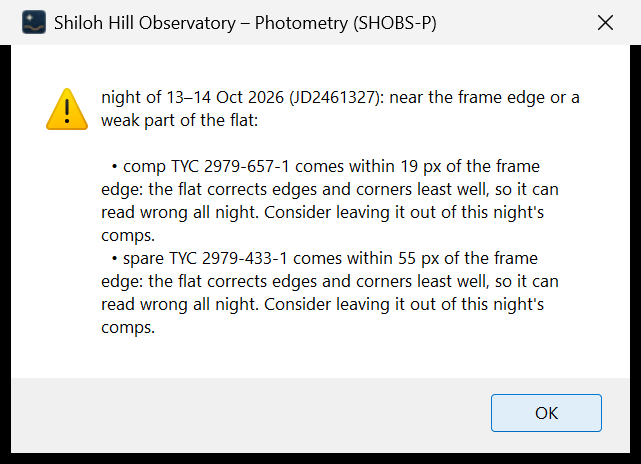

# 23. Messages explained

SHOBS-P talks to you in four places:

- **The status bar** at the bottom of the window: the latest news, one line. After a report save it also holds a
  button for the upload page.
- **The log**: on the Calibrate page, and under the image on the Photometry page (**Show log** / **Hide log**). Every
  status line goes here too, often with more detail. When something looks wrong, read the log first.
- **Message boxes**: a question (Yes / No, sometimes Cancel) when SHOBS-P needs a decision, a warning when it found a
  problem, an error when it cannot go on.
- **Notes and cautions on the Output pages**: lines starting with **⚠** are cautions about the result.

Most questions have a default that is the safe choice; just read the whole message before you answer. The messages
below are the ones new users meet most often, grouped by step. "…" stands for the names and numbers filled in.

## Anywhere

| Message | What it means | What to do |
|---|---|---|
| *Another step is still running. Wait for it to finish.* | Only one job runs at a time. | Wait, or press **Cancel** / **Cancel run**. |
| *Wait for the current run to finish (or cancel it) before switching modes.* | Same, for the mode buttons. | Wait or cancel. |
| *Something went wrong: … Details were written to ….shobs_p.log.* | An unexpected error. | Note what you were doing and see [24. Troubleshooting](24-troubleshooting.md). |
| *Could not open a browser: go to …* | The upload or ExoFOP page could not open. | Copy the address into your browser. |
| *The output folder could not be used (…); choose where to save.* | The Output folder is missing or read-only. | Pick another folder on the Input page. |

## Input

| Message | What it means | What to do |
|---|---|---|
| *Could not look up … (…). Type RA/Dec, or let the plate solution fill them, or press Look up again.* | SIMBAD and VSX did not find the name, or there is no internet. | Check the spelling (the Input page may suggest the AAVSO spelling: **Use it**), or type RA/Dec. |
| *The … folder holds N file(s) SHOBS-P cannot read … It reads FITS and XISF* | Camera RAW, TIFF or JPEG files. | Save the frames as FITS or XISF in your capture program. |
| *This Lights folder holds frames pointing at more than one place: … Use only the N frames near the Input target …?* | Two fields in one folder. | **Yes** sets the other field aside (Blink can bring frames back). |
| *These frames are DY Peg, not BL Cam. … Start a new reduction? …* | The lights' pointing (or their OBJECT keyword) says they are another star than the Input page's. | **Yes** starts a new reduction: the open series is closed (save offered), the old star's target, planet, comps, check and watch stars are cleared, and the frames' star is looked up. **No** keeps yours. See [5. Input](05-input.md). |
| *Start a new reduction? … target, planet, comps, check and watch stars, Use comps choice, VSX period and rejected frames are cleared …* | You pressed **New reduction**. | **Yes** to start over for another star; folders, site and optics stay. |
| *✖ …: SIMBAD and VSX did not answer (…) — type RA/Dec, or Look up again.* | The lookup services did not answer (no connection, or the service is down). | Type RA/Dec, or press **Look up again** later. The planet lookup says the same about the NASA Exoplanet Archive. |
| *⚠ Darks 60 s, lights 120 s: the master dark is scaled ×2 …* (under the Frames box) | The darks' exposure differs from the lights'. ✖ in red when it would be scaled more than 3 times. | Point **Dark** at darks of the lights' exposure if you have them. |
| *These lights were taken at latitude …, longitude …, N km from your site.* | The frames come from another observatory (shared or downloaded data). | **Yes** uses their site and optics for these frames only; your own come back with your own frames. |
| *… is not a master SHOBS-P built.* | A master from other software was chosen. | Choose the folder of raw frames instead; SHOBS-P builds and reuses its own master. |
| **Color images**: *These N lights are color images that other software has already debayered (three channels: red, green and blue). … Which channel should be measured?* | The lights are finished color images, not raw frames. | Usually **Green (TG)**. They are measured without a debayer or calibration; change the channel later in the **Filter** box (Calibrate page). |
| **Color or monochrome camera?** | No Bayer keyword, and neither the flats nor the lights' sky can tell. | Answer **Color camera** or **Monochrome camera**. For a color camera, check the pattern on the Calibrate page. |
| Log: *Mount: Alt-az from the headers (…); the Mount box says German equatorial …* | The headers clearly show another mount than the **Mount** box. | If these are your own lights, set **Mount** in the Optics box. |

## Calibrate

| Message | What it means | What to do |
|---|---|---|
| *2 dark frames (60 s) are in the Lights folder, and the Dark box is empty. Use them as darks?* | Calibration frames were saved with the lights. | **Yes** uses them for this run (the files stay where they are). See [7. Calibrate](07-calibrate.md). |
| *Dark folder '…': The darks are 30 s and the lights 120 s, so the master dark is scaled x4 …* | The darks are far from the lights' exposure. | **Yes** calibrates without the dark (fine for most cooled cameras); **Cancel** lets you pick better darks. |
| *The flats were taken at rotator angle X° and the lights at Y°.* | The camera was turned between flats and lights; the flat corrects the wrong pattern. | Use flats taken at the lights' angle if you have them. On a German equatorial mount a meridian flip (180°) does not cause this. On an alt-az mount without a derotator (the message adds *alt-az mount, so no meridian flip explains it*) it is a real turn. |
| Log: *Caution: flats taken with the derotator at sky angle …* | An alt-az mount with a derotator. | Nothing: the message explains that this is fine. |
| Log: *These lights are color images (already debayered and calibrated): the bias, dark and flat entries are not used for them.* | Information. | Nothing. |
| *The Flat folder mixes camera angles: …* | Flats from more than one camera angle. | Keep only the flats taken at the lights' angle. |
| *These lights look already calibrated: … Skip bias, dark, and flat for this run? (Recommended)* | The files show signs of earlier calibration. | **Yes**, or they are calibrated twice. |
| *Calibration failed: The masters do not fit these lights: …* | Size or binning differs between masters and lights. | Pick matching frames, or tick **Rebuild masters (ignore saved ones)**. |
| *Calibration failed: … is not a master SHOBS-P built …* (or *… is a master dark, not a master flat.*) | A Bias, Dark or Flat row points at a file that is not the right SHOBS-P master. The same line is in the log. | Pick the right master with **Master file…**, or the folder of raw frames. |
| *No light frames found.* | The Lights folder is empty or every frame is rejected. | Check the folder and the Blink page. |
| *Monochrome camera found (no color mask in the flat): Bayer pattern MONO.* (or *… in the lights' sky background …*) | Information (status bar and log). | If your camera is in fact a color camera, choose its pattern on the Calibrate page. |
| Log: *Meridian flip before frame … (…° to …°)* | Information: where the flip happened. | Nothing; one set of flats covers both sides. |

## Photometry

| Message | What it means | What to do |
|---|---|---|
| *Calibrate first (Calibrate page). Star positions are measured on the calibrated, debayered image.* | You clicked the image before calibrating. | Calibrate. |
| Step strip **1 Not solved**, or *Not solved: no lock (h of n catalog stars matched).* | The plate solve failed. | Press **Solve again** for the full diagnosis. Check the Optics box (focal length, pixel size, binning) and the RA/Dec. You can still click stars and type magnitudes. |
| *Solve needs to know roughly where the frame is: …* | No pointing in the headers and no RA/Dec typed. | Type the target (or field center) on the Input page. |
| *… is a known or suspected variable: … Use it anyway?* | A comp or check you clicked is in VSX or SIMBAD. | Usually **No**, and pick another star. |
| *The aperture (r = 12 px) is much larger than the stars on this frame (FWHM 3.2 px).* | The aperture does not suit the seeing. | **No**, then **Suggest…** to set sizes from the stars. |
| *Defocused stars: the aperture (r = … px) clips the ring — use r ≥ … px. … Run with the current aperture anyway?* | The stars are donuts and the aperture is too small for them. | **No**, then **Suggest…** (it sizes the aperture to 95 % of the light). |
| *There is no star under the Target marker at (x, y).* | The marker is on blank sky. | **No**, and click the star again. |
| *These have a name in the Stars panel but no marker on this image …* | A name left from an earlier night or series. | **Yes** clears the names; **Cancel** lets you mark them. |
| *With 3 comps the AAVSO report is an ensemble, and AAVSO requires a check star …* | No check star in Variables mode. | Mark a check star (or continue if you will not report this run). |
| *No transit of … is predicted during these lights …* | Transits mode, but the frames miss the transit. | Check the planet and date; use Variables mode for a variability run. |
| *… hosts …, and a transit of … is predicted during these lights …* | Variables mode on a planet host during a transit. | **Yes** switches to Transits mode. |
| Log: *⚠ Check marker at (x, y) is N px from the center of the star there …* | Before the run: that marker would be measured beside its star, so the star would read faint. | Clear the marker, zoom in and click the star again, unless you meant it. |
| *Binning is 2 but the masters were built at 1.* | Binning changed after calibration. | Calibrate again, or set binning back. |
| Log: *skipped …: could not align this frame (N stars found; clouds? trailing?)* | One frame was unusable. | Nothing, unless many are skipped; then check those frames in Blink. |
| *No frames produced a magnitude. The Calibrate page log says why each frame was skipped.* | Every frame failed. | Read the log. |
| Log: *AAVSO sequence did not answer (503 from apps.aavso.org); asking again in the background …* | The AAVSO chart server is slow or down. The solve goes on without it. | Wait: the log says if it answers, and then **Solve again** uses it. |
| Log: *AAVSO sequence blocked: 403 (Cloudflare check page) from apps.aavso.org: AAVSO's site refused the request …* | AAVSO's site turned the request away. | **Solve again** later. |
| *⚠ raw peak … ADU is over the linear limit (…): the camera's response bends there, so this star reads too faint …* (Stars panel) | The star is too bright for your camera's linear range (**linear ADU**). | Pick a fainter comp; for the target, shorter exposures or more defocus. |
| *⚠ only … px from the frame edge: its sky ring … needs the star at least … px in …* (Stars panel) | The comp or check star is too near the edge. | Pick a star further in. |
| Log: *Target: … is on frame … (found by …), not on frames …. Frame … is the reference now …* | The first frames missed the target; SHOBS-P moved the reference to the first frame that holds it. | Nothing; the frames without the target are skipped and listed. |
| Log: *… not on the frame in N of M images (frames …); those frames were skipped.* | Frames on which the target was off the frame. | With ⚠ (a large share): check the pointing, or reject those frames in Blink. |
| Log: *⚠ After the meridian flip the … apertures were off their stars by about (…) px together, while the target's was not …* | An aperture-placement error at the flip, not the stars. | See [12. Flags and bad data](12-flags-and-bad-data.md). Look at the positions in the light-curve CSV. |
| Log: *⚠ Linear limit … ADU: raw peak at or above it in … frames …* | Some frames of these stars were over your camera's linear limit. | Check **Comp health…**'s **Over linear limit** column; prefer stars that stay under it. |
| *⚠ Small image? Pop out opens it in its own window …* (under the image) | The image is drawn small (a small frame, or display scaling). | Press **Pop out**, or **Hide log**. |

## Output, Variables mode

| Message | What it means | What to do |
|---|---|---|
| *Add these N points as the night of … to the M points already in the series?* | A series is open. | **Yes** adds the night. Read any **Careful:** lines first (other comps, filter or equipment). |
| *… frames of … lost light …, but every measured star … faded by the same amount …: transmission loss (dew/haze?), not cloud. Use these points in the light curve …, or leave them out?* | Dew or haze, not cloud. | **Leave them out** (the default) leaves them flagged; **Use these points** keeps them. See [12. Flags and bad data](12-flags-and-bad-data.md). |
| *…: N frames fall in planet b's transit … Leave those frames out …?* | A known planet transits the variable during your frames. | **Yes** (the default) follows the campaign rule. |
| *Before you upload: • AAVSO observer code is empty …* | The report is missing something AAVSO needs. | Fix the listed items and save again. |
| *Night … was already sent on … (in …); AAVSO will hold duplicates. Open anyway?* | Asked by **Open AAVSO WebObs…** (and the exoplanet and ExoFOP upload buttons): the report you saved last holds a night already sent. | Upload only the nights not sent yet. If that night was never really sent, double-click it in the night table to unmark it. See [15. Submit to AAVSO](15-submit-to-aavso.md). |
| ⚠ *No reliable period …* / *No significant period …* | The best peak does not pass the significance tests. | See [13. Look for a period](13-look-for-a-period.md). |
| *This night's meridian-flip step is … mag ⚠ … Save … with this night now?* | The flip step looks like an aperture problem, not the star. | **No** keeps the file on disk unchanged; **Save series** keeps the night later. See [9. Reduce a variable-star night](09-reduce-a-variable-night.md). |
| Log: *Not saved: … has a flip step ⚠ — Save series to keep it.* | An automatic save skipped the night you held back. | Press **Save series** when you want it in the file. |
| Log: *✖ Use comps choice (…) not applied to …: … not measured on any of its frames (another field's comps?) …* | The series' **Use comps…** stars are not in this night's field. | For another star, use **New reduction** on the Input page. |
| **Range ⚠** … *outside the search* (Period box) | The VSX or marked period lies outside the period search range. | Press **Search … d instead**. |

## Output, Transits mode

| Message | What it means | What to do |
|---|---|---|
| *Enter your site's latitude and longitude on the Input page first …* | Needed for BJD times and planning. | Type your site once. |
| *…: N usable points. Run photometry in Transits mode first (or open an exoplanet report).* | Fewer than 20 points. | Run photometry, or check the flags. |
| *The photometry, the comps, or the planet changed since the last fit, so that fit was cleared.* | The fit no longer matches the data. | Press **Fit transit**. |
| *The comps are still being checked (a few seconds). Save the … when that is done …* | The leave-one-comp-out check is running. | Wait a moment and save again. |
| **⚠ Inconclusive …**, **✗ No transit measured …** | See [18. When the fit says "inconclusive" or "none"](18-inconclusive-or-none.md). | |
| *The per-point error bars are about …x larger than the real scatter …* | Usually the camera gain (EGAIN) in the headers. | Check the photometry log's *Photon noise* line. |
| *This fit did not measure a transit: … Save it anyway …?* | Saving a "none" result. | Save for your records only. |
| *… is limited by its prior range: its MCMC samples pile up against …, so the error bar is not a measurement.* | The data did not constrain that parameter. | Look at **Corner plot…**; don't quote that error bar as a measurement. See [17. Fit a transit and submit it](17-fit-a-transit-and-submit-it.md). |
| *No detection with Both: … alone detects it (ΔBIC …). …* | Airmass and time slope together absorbed the transit. | Untick one trend only if it is not real. See [18. When the fit says "inconclusive" or "none"](18-inconclusive-or-none.md). |
| *With the shape left free the fit is not constrained (…) …* | The free-shape cross-check ran away. | Nothing; the result uses the published shape. |
| *Gain 1 e-/ADU assumed (no EGAIN in the headers, no usable sky estimate) …* (orange) | The error bars' photon noise used a guessed gain. | Add EGAIN to the headers if you know the camera's gain. |
| *A joint fit needs at least two usable nights of the same planet (see the Status column).* | **Multi-night…**: fewer than two nights are ready. | Read each night's **Status** and add nights. |

## Discovery mode

| Message | What it means | What to do |
|---|---|---|
| *Field not solved: these lights do not say where they point.* | No pointing in the headers. | Type the field center on the Input page and **Solve again**. |
| *Fewer than 8 stars found in the frame; a field scan needs more.* | Too few stars detected. | Check focus and exposure, or lower **Detection threshold (σ)**. |
| *Field scan failed: only N frames could be measured; a scan needs at least 10* | Too many frames could not be aligned. | Blink out bad frames; check that the frames are of one field. |
| Log: *Field scan: the 800-star limit was reached …* | Only the brightest stars were measured. | Raise **Most stars to measure**. |
| *VSX and SIMBAD could not be reached during the scan. Scan again when online.* | No check against known variables. | Scan again when online. |
| Check first: *clipped on N frames: check linearity* | The star's raw core reached saturation on a frame or two. | Look at its light curve at those frames. |
| Check first: *blended neighbor: check* | A neighbor's light reaches the aperture (0.2 % or more). | Look at the image; a neighbor can fake variability. |
| *⚠ VSX period outside the search (…): …* (under the table) | A known variable's period is outside the scan's period range. | Press **Search … d instead**. |

---

Previous: [22. Files SHOBS-P writes](22-files-shobs-p-writes.md) · Next: [24. Troubleshooting](24-troubleshooting.md)
