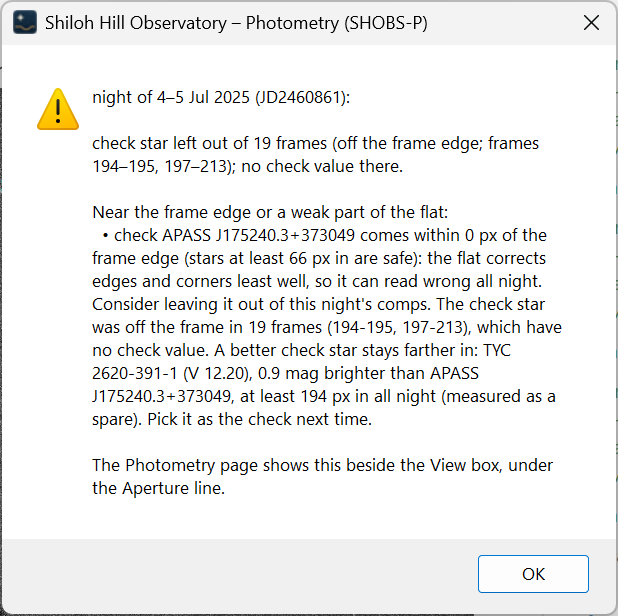

# 23. Messages explained

SHOBS-P talks to you in five places:

- **The status bar** at the bottom of the window: the latest news, one line. While SHOBS-P works, the busy bar at its
  left end says what it is doing (chapter 3). While a job runs, a ⚠ or ✖ stays on the status line until the job
  ends, so a later routine line never hides it. When the job ends, the line says how it went: the one ⚠ or ✖ itself,
  or *⚠ N things need a look (click to see them)* when there were several (or *✖ … (and N more: click to see them)*).
  After a report save it also holds a button for the upload page.
- **The Findings list** (from 2.4.0): every ⚠ and ✖ written to the log, kept until you tick it off or run that step again, with what
  to do in the words of this chapter. The **⚠ N to look at** link at the right end of the status line opens it
  (chapter 3).
- **The log**: on the Calibrate page, and under the image on the Photometry page (**Show log** / **Hide log**; hidden until you press **Show log**, from 2.4.0). Every
  status line goes here too, often with more detail, and so do the routine notes that never reach the status line.
  It is the full record for troubleshooting; anything that needs you is also on the Findings list. In the log file
  (chapter 22) a ⚠ line is tagged `[WARN]` and a ✖ line `[ERROR]`, so they are easy to search for.
- **Message boxes**: a question (Yes / No, sometimes Cancel) when SHOBS-P needs a decision, a warning when it found a
  problem, an error when it cannot go on.
- **Notes and cautions on the Output pages**: lines starting with **⚠** are cautions about the result.

**What the signs mean** (from 2.3.6, the same everywhere):

- **⚠** something needs a look, and probably an action, before you trust or send the result. SHOBS-P keeps ⚠ for
  that; it is never used for routine news.
- **✖** something stopped or failed: a step did not run, a file was not saved, a lookup gave up.
- **✔** a step is done as you asked.
- **No sign**: a plain note. It is there for the record; nothing needs doing.

A photometry run's ⚠ and ✖ lines travel with the result. The settings file saved beside a report lists them under
*Findings from the photometry run …* (from 2.4.0 a line that came up more than once in the run is listed once), and the report's notes say how many there were (for example *2 findings from
the run, see the settings file*; in a Variables AAVSO report the comma becomes a semicolon), so whoever reads the report later sees them too. A
report that covers several nights carries that note only on the rows of the night the run reduced; the other nights' rows
leave it out.

Every question has the safe choice as its default (from 2.3.5): the button that Enter presses is **No**, **Stop**,
**Cancel** or **These frames only**, never the risky one. Some questions have buttons that say what they do instead of
Yes and No. Read the whole message before you answer. The messages
below are the ones new users meet most often, grouped by step. "…" stands for the names and numbers filled in.

## Setting up (Windows, Linux, Mac)

These appear in the console window of **Create shortcuts.bat** (Windows) or the Terminal window the first time
SHOBS-P starts (Linux, Mac); see chapter 2. From 2.3.5 the three systems say the same things.

| Message | What it means | What to do |
|---|---|---|
| *Looking for a Python that can run SHOBS-P...* then *Trying …* and *usable: Python 3.13.x* or *not usable: …* | SHOBS-P checks each Python it finds, 3.13, 3.12 and 3.11 first. | Nothing; it picks the first one that works. |
| *Python 3.15.x: some packages SHOBS-P needs have no ready-made copy for it yet (they would have to be compiled, and SHOBS-P never compiles).* *Trying the next Python.* | A brand-new Python has no ready-made packages yet. | Nothing, if another Python follows. Otherwise install Python 3.13 (Mac: 3.14). |
| *✔ SHOBS-P is set up with Python 3.13.x.* | The setup worked. | Nothing; SHOBS-P opens. |
| *✖ SHOBS-P could not find a Python it can use (each one tried is listed above, with the reason).* | No Python 3.11 or newer with Tkinter was found. | Windows: install Python 3.13 from python.org (tick **Add python.exe to PATH**). Mac: install Python 3.14 from python.org. Linux: install Python and its Tkinter package (the message names it). |
| *✖ SHOBS-P could not set up its packages with any Python on this computer (each one is listed above).* | None of the Pythons could install the packages, often because the only one is too new. | Do what the next lines say (Windows: Python 3.13; Mac: Python 3.14 from python.org; your other Pythons can stay). pip's own words are in `pip_log.txt` (chapter 24). |
| *✖ SHOBS-P is being set up in another window.* (Linux, Mac) | A second start while the first setup still runs. | Wait for that window, then start again. A setup that was cut off frees its lock by itself. |
| *✖ No screen found (DISPLAY is not set) …* (Linux) | Started without a desktop session. | Start SHOBS-P from your desktop session (chapter 24). |
| *✔ Self-test passed.* / *✖ Self-test: N checks failed …* / *✖ The self-test could not run …* | How the self-test went (chapter 2). | Failed: send `selftest_log.txt`. Could not run: read the setup lines above. |
| *✖ The packages could not be downloaded. Check the internet connection and try again.* | No internet, or the download was blocked. | Check the connection, then start again. |

## Anywhere

| Message | What it means | What to do |
|---|---|---|
| *Another step is still running. Wait for it to finish.* | Only one job runs at a time. | Wait, or press **Cancel** / **Cancel run**. |
| *Wait for the current run to finish (or cancel it) before switching modes.* | Same, for the mode buttons. | Wait or cancel. |
| *Something went wrong: … Details were written to ….shobs_p.log.* | An unexpected error. | Note what you were doing and see [24. Troubleshooting](24-troubleshooting.md). |
| *Could not open a browser: go to …* | The upload or ExoFOP page could not open. | Copy the address into your browser. |
| *✖ … not saved (…). Save to another folder, or close the program that has the file open.* | A file you asked to save could not be written (open in Excel, no permission, disk full). Nothing was recorded as saved. | Do what it says, then save again. |
| *The output folder could not be used (…); choose where to save.* | The Output folder is missing or read-only. | Pick another folder on the Input page. |
| *⚠ The report … was saved, but its settings file (…_settings.txt) could not be written: …* (message box, and in the Log) | After an AAVSO report or a transit report save, the `_settings.txt` beside it could not be written (folder read-only or full). The report itself is complete. From 2.4.0 this shows in a box too, since the Log starts hidden. | Check the folder has room and can be written to. |

## Input

| Message | What it means | What to do |
|---|---|---|
| *✖ Could not look up … (…). Type RA/Dec, or let the plate solution fill them, or press Look up again.* | SIMBAD and VSX did not find the name, or there is no internet. | Check the spelling (the Input page may suggest the AAVSO spelling: **Use it**), or type RA/Dec. |
| *The … folder holds N file(s) SHOBS-P cannot read … It reads FITS and XISF* | Camera RAW, TIFF or JPEG files. | Save the frames as FITS or XISF in your capture program. |
| *This Lights folder holds frames pointing at more than one place: … Use only the N frames near the Input target …?* | Two fields in one folder. | **Yes** sets the other field aside (Blink can bring frames back). |
| *These frames are DY Peg, not BL Cam. … Start a new reduction? …* | The lights' pointing (or their OBJECT keyword) says they are another star than the Input page's. | **Yes** starts a new reduction: the open series is closed (save offered), the old star's target, planet, comps, check and watch stars are cleared, and the frames' star is looked up. **No** keeps yours. See [5. Input](05-input.md). |
| *These 78 lights look like MicroObservatory frames … Use that telescope's setup for these frames? … Optics: focal length 560 mm, pixel 6.8 µm (the camera's pixel; the camera bins 2x2, so about 5.0"/px)* (at Scan files) | The lights come from a MicroObservatory telescope. The pixel is the camera's own; the camera bins it 2×2, which the solve takes from the header (from 2.4.0; older files without a binning keyword show 13.6 µm and about 5.0"/px). | **Yes** for these frames; your own setup comes back when you scan your own lights. See [5. Input](05-input.md). |
| Log: *Pixel size set to 6.8 µm, the MicroObservatory camera's own pixel. The series was saved with 13.6 µm, the pixel after the camera's 2x2 binning; …* (when a series opens over MicroObservatory frames, 2.4.0) | The series was saved before 2.4.0, when the box held the binned pixel. SHOBS-P now multiplies by the camera's binning from the header itself, so 13.6 µm would make the frames 10"/px and the solve would fail. The plate scale stays about 5.0"/px. | Nothing. The series file keeps 13.6 µm until it is saved again. |
| *These lights come from another camera than the last ones (… before, … now): Bias, Dark flats and Flat emptied, because they belong to the last camera. …* (log, and under the Frames boxes; 2.4.0) | The new lights' header names another camera, frame size, camera binning or bit depth than the last lights'. The calibration boxes left over from that camera were emptied (*Dark kept: its frames have these lights' size and exposure* when the darks still fit; *Dark emptied too: …* when not). Boxes you filled since the last night are left alone. | Choose this camera's bias, darks and flats (or leave a box empty). See [5. Input](05-input.md). |
| *Aperture and sky ring left as they are: they were set (typed, or by a loaded series) after the last camera's night.* / *Raw sat ADU and linear ADU left as they are (set after the last camera's night).* / *Raw sat ADU left as it is …* / *… Linear ADU left as it is (set after the last camera's night).* (2.4.0) | The lights come from another camera, but you typed these values, or loaded a series that set them, after the last night. They are not the last camera's, so they were not reset. What a loaded series set stays whatever its value (also the default 8 / 14 / 22 px, or the same sizes as last night's). | Check that they suit these frames (**Suggest…** for the aperture; chapter 4 for the limits). |
| *The series' aperture and raw sat ADU were for its … nights* (or *The series' aperture was …*, *The series' raw sat ADU was …*); these lights are from …, so they are reset as for any camera change.* (2.4.0) | A series is open, and tonight's lights come from another camera than the series' latest night. The series' sizes and saturation level belong to that camera, so they were reset as for any camera change. | Check the boxes (**Suggest…** for the aperture). |
| *⚠ Raw sat ADU … (from the series) is above what this …-bit camera can record (…): saturated stars would not be flagged. Set raw sat ADU for this camera.* (log and Findings; 2.4.0) | A series set raw sat ADU (its own camera's nights, or an older series that doesn't say which camera took it), and tonight's camera can't reach that level. The warning goes when you type a new raw sat ADU. | Type this camera's saturation level in **raw sat ADU** (chapter 4). |
| *Aperture and sky ring put back to r …, sky …–… px, as last used with this camera in this session.* (2.4.0) | You went to another camera's lights and back to this camera's in one session (a wrong folder picked, say). The sizes this camera's lights were last used with are back, instead of the defaults. | Nothing. |
| *Aperture and sky ring back to the defaults (r 8, sky 14–22 px) for the new camera; they are set from these frames' star sizes when the image is calibrated (Suggest… shows the detail).* then, after Calibrate, *Aperture set for the new camera's frames: r …, sky …–… px (stars' FWHM … px). …* (2.4.0) | The last camera's aperture does not suit these frames, so it is not kept. | Nothing; press **Suggest…** to see the measurement or test other sizes. *Star sizes could not be measured on this image: the aperture stays at the defaults …*: mark the stars and press **Suggest…**. |
| *Raw sat ADU … and linear ADU … (from the SHOBS-FLUX profile for this camera).* / *(as last used with this camera)* / *Raw sat ADU 4,095 and linear ADU emptied (empty = the raw sat ADU is the only limit) (the camera's 12-bit maximum; no SHOBS-FLUX profile for this camera).* / *Linear ADU emptied … for the new camera; raw sat ADU is set with the MicroObservatory setup.* (2.4.0) | The last camera's limits mean nothing on this one (40,000 on a camera that saturates at 4,095), so they were set for this camera, from the best source there is. | Check the two boxes on the Photometry page; type your camera's linear limit if you know it (chapter 4). |
| *Start a new reduction? … target, planet, comps, check and watch stars, Use comps choice, VSX period and rejected frames are cleared …* | You pressed **New reduction**. | **Yes** to start over for another star; folders, site and optics stay (until lights from another camera come in: see the rows above). The Output page notes go back to their default (the log lists *the Output page notes* among what was cleared when you had typed your own). The Findings list is emptied too. |
| *⚠ … orbits …, not …: kept …, its series and its planet …. To use … instead, type it in the Planet box again and press Enter (you are asked again).* (under the Planet box) | You answered **No** to starting a new reduction for a planet of another star. The planet you had before was put back. | Check the planet's name. To use the other planet after all, type it again and press Enter, and answer **Yes**. |
| *⚠ … orbits …, not …: kept … and its series; …'s values were not filled in. Check the planet's name, or press Look up again beside the Planet box to be asked again.* | The same, with no planet before: the value boxes stay empty, so no fit can use the other star's ephemeris. | Check the name, or press **Look up again** and answer **Yes**. |
| *⚠ … orbits …, not …: wait for the current step to finish, then …* | The same while a job runs; nothing was changed. | Wait, then do what the line says. |
| **no such folder** (count beside a Frames row) | The path typed in the box is not an existing folder (yet). | Finish typing the path, or use **Browse**. The count updates a moment after you stop typing, or when you press Enter. |
| *SIMBAD from cache (fetched 12 Oct 2026); the live service did not answer (503).* (end of the status line, and in the log; also *VSX from cache …*, *NASA Exoplanet Archive from cache …* under the planet boxes) | The service did not answer, so the last good answer for this name was used. | Nothing; a live answer replaces it next time. See "When a service is down" in [24. Troubleshooting](24-troubleshooting.md). |
| *✖ …: SIMBAD and VSX did not answer (…) — type RA/Dec, or Look up again.* | The lookup services did not answer (no connection, or the service is down). | Type RA/Dec, or press **Look up again** later. The planet lookup says the same about the NASA Exoplanet Archive. |
| *✖ TOI-2046: SIMBAD and VSX did not answer within 60 s — type RA/Dec, or Look up again.* (under RA/Dec and on the status bar) | The lookup has waited 60 seconds with no answer; the busy bar stops. | Type RA/Dec, or press **Look up again** later. If the answer still comes in, it is used. For a planet the line is under the planet boxes and says *… the NASA Exoplanet Archive did not answer within 60 s — type the values or Look up again.* |
| *Darks 60 s, lights 120 s: the master dark is scaled ×2 …* (under the Frames box) | The darks' exposure differs from the lights'. Fine for a cooled camera. With **✖** in red (*… would be scaled ×…, which stamps its noise on every light*) it would be scaled too far, and Calibrate asks. | Point **Dark** at darks of the lights' exposure if you have them. |
| *⚠ No bias and no dark flats: darks can't be scaled correctly without bias or dark flats (110 s darks to 55 s lights scales the camera's offset too). …* (under the Frames box) | The darks must be scaled, and nothing tells SHOBS-P the camera's offset. | Add bias frames or dark flats (**Dark flats** row), or use darks at the lights' exposure. See [7. Calibrate](07-calibrate.md). |
| *Dark flats 2 s, flats 0.5 s: dark flats should match the flats' exposure. Take dark flats at 0.5 s.* | The dark flats do not match the flats. | Take dark flats at the flats' exposure. They are still used meanwhile. |
| *Dark flats folder cleared. Calibration will skip it.* (status bar) | You pressed **✕** on the Dark flats row. | Nothing. |
| *✖ No planets found for … at the NASA Exoplanet Archive (none listed under that name, or the Archive did not answer). Type the planet's name, or press Look up again on the Star ID.* (Transits, under the Planet box) | A Star ID lookup found no planet of that star. | Type the planet's name in **Planet**, or look up again later. See [16. Prepare for a transit night](16-plan-a-transit-night.md). |
| *✖ …: the NASA Exoplanet Archive did not answer within 60 s — type the planet's name, or Look up again on the Star ID.* | The star's planet list did not come within 60 seconds. | Type the planet's name, or press **Look up again** later. |
| *These lights come from …. Last time you measured frames from that telescope the Telescope aperture was … mm; the box says … mm. Use … mm for these frames?* | The header gives no aperture, and you measured this telescope before with another one. | **Yes**, unless you know the box is right. |
| *These lights come from …, another telescope than the last frames you measured (…). The Telescope aperture box still says … mm from those frames. Is … mm right for this telescope?* | New telescope, no aperture in the header. | **Yes** keeps the value; **No** puts the cursor in the **Telescope aperture (mm)** box: type the aperture. |
| *These lights were taken at latitude …, longitude …, N km from your site.* | The frames come from another observatory (shared or downloaded data). | **Yes** uses their site and optics for these frames only; your own come back with your own frames. |
| *… is not a master SHOBS-P built.* | A master from other software was chosen. | Choose the folder of raw frames instead; SHOBS-P builds and reuses its own master. |
| **Color images**: *These N lights are color images that other software has already debayered (three channels: red, green and blue). … Which channel should be measured?* | The lights are finished color images, not raw frames. | Usually **Green (TG)**. They are measured without a debayer or calibration; change the channel later in the **Filter** box (Calibrate page). |
| **Color or monochrome camera?** | No Bayer keyword, and neither the flats nor the lights' sky can tell. | Answer **Color camera** or **Monochrome camera**. For a color camera, check the pattern on the Calibrate page. |
| Log: *Mount: Alt-az from the headers (…); the Mount box says German equatorial …* | The headers clearly show another mount than the **Mount** box. | If these are your own lights, set **Mount** in the Optics box. |

## Calibrate

| Message | What it means | What to do |
|---|---|---|
| *2 dark frames (60 s) are in the Lights folder, and the Dark box is empty. Use them as darks?* | Calibration frames were saved with the lights. | **Yes** uses them for this run (the files stay where they are). See [7. Calibrate](07-calibrate.md). |
| *Dark folder '…': The darks are 30 s and the lights 120 s, so the master dark is scaled x4 …* | The darks are far from the lights' exposure. The Yes line says what happens without the dark: with bias frames the bias removes the camera's offset; without them the sky ring does it in photometry. | **Yes** (the default) calibrates without the dark (fine for most cooled cameras); **No** uses them anyway; **Cancel** lets you pick better darks. |
| *The flats were taken at rotator angle X° and the lights at Y°.* | The camera was turned between flats and lights; the flat corrects the wrong pattern. | Use flats taken at the lights' angle if you have them. On a German equatorial mount a meridian flip (180°) does not cause this. On an alt-az mount without a derotator (the message adds *alt-az mount, so no meridian flip explains it*) it is a real turn. |
| *The master flat was taken at rotator angle …° and the lights at …°: the camera turned about …°* (Findings, while building calibration masters) | A saved master flat's camera angle differs from tonight's lights by more than SHOBS-P allows (10° on a German mount, where readings 180° apart are one position; 5° on an alt-az mount). | Use flats taken at the lights' angle, or retake flats. If the camera was not turned, the two readings are plate-solve wobble: nothing to do. |
| Log: *Flats taken with the derotator at sky angle …, lights at …°. That is fine: …* | An alt-az mount with a derotator. | Nothing. |
| Log: *These lights are color images (already debayered and calibrated): the bias, dark and flat entries are not used for them.* | Information. | Nothing. |
| *The Flat folder mixes camera angles: …* | Flats from more than one camera angle. | Keep only the flats taken at the lights' angle. |
| *These lights look already calibrated: … Skip bias, dark, and flat for this run? (Recommended)* | The files show signs of earlier calibration. | **Yes**, or they are calibrated twice. |
| *Calibration failed: The master … is … px but the … are … px, so it is from another camera or binning. …* (or *Calibration failed: The master … is … px but this light is … px: either the master is from another camera or binning …*) (2.4.0; for example *The master bias is 6248x4176 px but the flats are 650x500 px*) | A Bias, Dark, Dark flats or Flat row still holds frames from another camera, often the last night's after **New reduction** when the camera changed. Against a single light, it can also be one odd frame in the Lights folder. | Empty that row on the Input page, or pick frames taken with this camera at this binning; or take the odd light out of the folder. |
| *Calibration failed: The masters do not fit these lights: …* | Size or binning differs between masters and lights. | Pick matching frames, or tick **Rebuild masters (ignore saved ones)**. |
| *Calibration failed: … is not a master SHOBS-P built …* (or *… is a master dark, not a master flat.*) | A Bias, Dark or Flat row points at a file that is not the right SHOBS-P master. The same line is in the log. | Pick the right master with **Master file…**, or the folder of raw frames. |
| *No light frames found.* | The Lights folder is empty or every frame is rejected. | Check the folder and the Blink page. |
| *Monochrome camera found (no color mask in the flat): Bayer pattern MONO.* (or *… in the lights' sky background …*) | Information (status bar and log). | If your camera is in fact a color camera, choose its pattern on the Calibrate page. |
| Log: *Meridian flip before frame … (…° to …°)* | Information: where the flip happened. | Nothing; one set of flats covers both sides. |
| Log: *Calibration: lights = …; flats = ….* | How the lights and flats are calibrated, from the rows you filled in. | Nothing, unless a ⚠ follows it. |
| Log: *⚠ Darks can't be scaled correctly without bias or dark flats. …* | No bias and no dark flats, and the darks are scaled to the lights. | Add bias frames or dark flats, or use darks at the lights' exposure. |
| Log: *⚠ The flats (0.5 s) get the master dark (55 s) scaled ×0.00909, and with no bias that scales the camera's offset too … Put dark flats … in the Dark flats box, or add bias frames.* | The flats would lose the wrong amount of offset, so the master flat would be wrong. | Put the dark flats in the **Dark flats** row (or add bias frames) and calibrate again. |
| Log: *The Bias box holds dark flats (their IMAGETYP says so). They are used as the bias, as before 2.3.0; the Dark flats box is now the place for them …* | Information: the old way still works. | Next time, put them in the **Dark flats** row. |
| Log: *N dark flats found in the Flat folder (IMAGETYP or name): used as the dark flats, and left out of the master flat.* | Dark flats saved beside the flats. | Nothing. |
| Log: *Photon noise: … The camera binned 3x3 and averaged the binned pixels (the sky's noise says so), so each stored ADU holds 9 x EGAIN electrons …* (or *… summed the binned pixels …*, or *… cannot tell whether it summed … or averaged …*) | How the error bars count electrons on camera-binned frames. | Nothing. When SHOBS-P cannot tell and the Transit fit's χ²ν is well under 1, the camera averaged. See [7. Calibrate](07-calibrate.md). |

## Photometry

| Message | What it means | What to do |
|---|---|---|
| Log: *Series updated to the new star format; the original is kept as …_backup.cvseries.* | You loaded a series made before 2.4.0. It now keeps a record per comp and check star (position, every name, every magnitude with its source). The file as it was is copied beside it first. | Nothing. The names, magnitudes and points are the same. |
| Log: *Series updated to the new star format; the original is already kept as …_backup.cvseries.* | You loaded the same pre-2.4.0 file again; a backup with exactly its contents is already there, so no second copy was made. | Nothing. |
| Log: *Series updated to the new star format in memory; a backup of the original could not be written (…), so the first save keeps it as …_prev.cvseries instead.* | The folder of the series could not be written to when the backup was made. | Nothing, if the folder is writable by the time you save. Otherwise copy the series file somewhere safe first. |
| Log: *Comps loaded: C1 … V 8.728 (APASS DR9); C2 …; check … V 9.786.* (may end *… left out of the comps in use, as you chose: every night is re-derived with the others. Save the series to keep this.* or *… is still in the series' comps in use (no comp box held it when the series was saved).*) | What Load series put in the comp and check slots, with the magnitude each uses. The ending says what happened to a star of the series' **Use comps…** choice that no comp box held: left out because you chose so, or kept. | Read it. If a comp is missing or unexpected, fix the slots before **Run photometry**. |
| *The series' comps in use include …, but no comp box holds it (it was cleared, or moved off the frame). …* with **Leave it out** / **Keep it** | Load series found a star in the series' **Use comps…** choice that is in none of its comp boxes (a series made before 2.4.0). Nothing is changed without your answer. | **Leave it out** (the default: Enter): every night is re-derived with the other comps, as **Use comps…** does; save the series to keep it. **Keep it** (also Escape): the series stays as saved and the star goes back into the comp box. |
| *… is in the series' comps in use, but you cleared its comp box. …* with **Leave it out** / **Keep it** | A save of the series found a comp you cleared (✕ or **Clear selected**) that is still one of the series' **Use comps…** stars. Asked once. | **Leave it out** (the default: Enter): every night is re-derived with the other comps, as **Use comps…** does, then the series is saved. **Keep it** (also Escape): the series is saved as it is, the star stays in the comps in use. See [10. Build a multi-night series](10-build-a-multi-night-series.md). |
| Log: *… left out of the series' comps in use (its comp box was cleared): every night is re-derived with …, as Use comps… does.* / *… kept in the series' comps in use (its comp box is empty); the nights are unchanged.* | Your answer to that question, as carried out. | Nothing. |
| Log: *⚠ … could not be left out (…); the series' comps in use stay as saved.* (at a save: *… stay as they are.*) | **Leave it out** could not re-derive the series (the reason is in the line). Nothing was changed. | Open **Use comps…** on the Output page and choose the comps there. |
| *… is Comp 2. A star can't be both a comp and a Watch star, so it was not added to the Watch stars. …* | You tried to watch a star that is in a comp slot. | To watch it instead, clear it from its comp slot first (the ✕ beside it). |
| *… is a Watch star. A star can't be both a comp and a Watch star, so it was not added as Comp 3. …* | You marked a Watch star as a comp. The slot was cleared again. | To use it as a comp, take it off the Watch stars list first (**Remove selected**). |
| Log: *⚠ … is both a comp and a Watch star in this series. A star can't be both: clear it from the comps (✕) or take it off the Watch stars list.* | A series saved by an older version holds the star in both places. | Decide which it is, and clear the other. |
| *Series uses 8.728 (APASS DR9); Gaia DR3 says 8.704 (Series magnitudes… below)* (in a comp's or the check's row; the log adds *The series' value is kept; Series magnitudes… on the Photometry page changes it for every night.*) | A click or catalog lookup gave another magnitude than the series has for this star. The series' value stays in the box. With *you typed* instead of a catalog: you typed the other value. | Usually nothing. To change it for the whole series, press **Series magnitudes…** and **Use new value**. |
| Log: *… : the series' V 8.728 kept.* | You pressed **Keep series value**. | Nothing. |
| Log: *Series re-calibrated: … now uses V 8.704 (Gaia DR3) instead of 8.728 (APASS DR9) on every night. The series as it was is kept as …_backup.cvseries.* | You pressed **Use new value**: every night's magnitudes moved by exactly the change (with several comps, by the change in their average). | Nothing. To undo it, load the backup file. |
| *⚠ The series was re-calibrated here, but … could not be written (…). …* (log: *⚠ The series was re-calibrated but could not be saved (…). It is not saved yet: use Save series (Output page).*) | **Use new value** changed the magnitudes in SHOBS-P, but the series file could not be written. The file still holds the old values, and the series shows as not saved. | Free disk space or fix the folder, then press **Save series** on the Output page before you close the series. |
| *SHOBS-P is working on something else right now. Wait for it to finish, then press Use new value again. Nothing was changed.* | You pressed **Use new value** while a run, a solve or another job was going. | Wait for the busy bar to go, then press it again. |
| *The series was not changed: a backup of … could not be written (…).* | **Use new value** makes a backup first; without one it changes nothing. | Free disk space or fix the folder's permissions, then press **Use new value** again. |
| Log: *Comp 1 …: a magnitude of 99.999 was not taken (not a possible value); the series' 8.728 stays.* | A catalog answer held a placeholder or an impossible value for a series star. | Nothing. |
| Log: *Comp 1: named Gaia DR3 … (APASS J… is another name of the same star).* | A star new to the series is named in a fixed order (AUID, TYC, Gaia, APASS), whichever catalog answered first; a star the series knows keeps the series' name. | Nothing. |
| *Calibrate first (Calibrate page). Star positions are measured on the calibrated, debayered image.* | You clicked the image before calibrating. | Calibrate. |
| *⚠ Comp 2 and the check star are the same star (Comp 2: …). The check star tests the comps, so it can't also be one of them. …* (in the brackets: the same name and the name, or how far apart the markers are, or before the solve "on the same spot of the image"; a box when the star is picked, the star's line in the Stars panel, and again at **Run photometry**) | A comp and the check star have the same catalog name, or their markers are within about 2″ (2 px before the solve). Often a position or name typed into the wrong row. | Clear one of the two (✕ in the Stars panel, or right-click its marker) and pick another star. Run photometry refuses until then. |
| *⚠ Comp 2 and the check star have the same name (Comp 2: …, but the markers are 30″ apart). They look like two different stars, but the results would not tell them apart. …* (or, before the solve, *… but the markers are 25 px apart on the image). They look like two different stars …*) (same places, 2.4.0) | A comp and the check star carry the same name, but their markers are clearly apart (10″ or more; 10 px before the solve): two stars with one name (a catalog can repeat a label), or one marker on the wrong star. | Type another name in one of the boxes (its catalog number, for example), or clear the marker that is on the wrong star and pick again. Run photometry refuses until then. |
| *⚠ Comp 2 and the check star are the same star (…). The check star tests the comps, so it can't also be one of them. … Comp 3 and the check star have the same name (…). They look like two different stars …* (both at once, 2.4.0) | One comp is the check star itself, and another only shares the check star's name. | For the comp that is the same star: clear one of the two and pick another star. For the one that only shares the name: type another name in one of the boxes, or clear the marker that is on the wrong star and pick again. Run photometry refuses until both are fixed. |
| Step strip **1 Not solved**, or *Not solved: no lock (h of n catalog stars matched).* | The plate solve failed. | Press **Solve again** for the full diagnosis. Check the Optics box (focal length, pixel size, binning) and the RA/Dec. You can still click stars and type magnitudes. |
| *Solve needs to know roughly where the frame is: …* | No pointing in the headers and no RA/Dec typed. | Type the target (or field center) on the Input page. |
| *… is a known or suspected variable: … Use it anyway?* | A comp or check you clicked is in VSX or SIMBAD. | Usually **No**, and pick another star. |
| *The aperture (r = 12 px) is much larger than the stars on this frame (FWHM 3.2 px).* | The aperture does not suit the seeing. | **No**, then **Suggest…** to set sizes from the stars. |
| *⚠ Aperture r = … px (kept from before) is … × the stars' FWHM (… px) on this image: a large aperture adds sky noise and neighbors. Suggest… gives r = …, sky …–… px.* | The aperture boxes still hold the last target's sizes, and they are too large for these stars. After you change the boxes the line reads *⚠ Aperture r = … px is … × the stars' FWHM …* while the new size is still too large. | Press **Suggest…** (or type the suggested sizes). The finding goes away once the sizes fit (2.4.0). |
| *⚠ Defocused stars: the aperture clips the ring — use r ≥ … px (now r = …; Suggest… gives r = …, sky …–…).* (on a new image) | The stars are donuts and the aperture kept from before is too small for them. | Press **Suggest…**; the finding goes away once the aperture holds the ring. |
| *Defocused stars: the aperture (r = … px) clips the ring — use r ≥ … px. …* | The stars are donuts and the aperture is too small for them. | **Use r = … and run** (the default) sets the suggested sizes (95 % of the light) and runs. |
| *Only N stars found on the reference frame, too few to align the other frames …* | Clouds or bad focus on the first kept frame. | **Stop** (the default), then check the frame or reject it in Blink. |
| *The catalogs have only 2 stars here, and both lined up. Two stars can line up by chance. …* | A sparse field. | Look at the circles: **On real stars: keep the solve**, or **Not sure: discard it** (the default) and **Solve again**. |
| *The plate solution in the FITS header puts … px from the Target marker … Move the Target marker …?* | The header's solution and your marker disagree. | Check the star; **Keep it where it is** is the default. |
| *There is no star under the Target marker at (x, y).* | The marker is on blank sky. | **No**, and click the star again. |
| *These have a name in the Stars panel but no marker on this image …* | A name left from an earlier night. | **Yes** clears the names; **Cancel** lets you mark them. |
| *These stars of the series have no marker on this image, so they would not be measured tonight: …* | The solve could not place a comp or the check of the open series (its Log line says why). | **Go on without them** (the default) keeps their names in the series; **Stop, so I can mark them** lets you click them first. |
| Log: *Comp 1 … placed from the series position, centered (0.8 px from where the position falls); magnitude … kept as loaded.* | After the solve: one line per star of the series. The star was placed from its saved sky position and centered like a click; the distance is from where that position falls on tonight's image. With *= … in tonight's catalogs* the catalogs call the same star by another name; the series' name is kept. | Nothing. With *tonight's catalog star there is …" from the stored position (more than the 1" that makes it surely the same star): check it is the right star*, look at that marker once. |
| *⚠ … placed from the series position, centered by a wider search, 6.8 px from where the position falls — more than the normal centering allows …* (also *⚠ … Centered on the star 6.8 px from the catalog position by a wider search — more than the normal centering allows …*; both end *Check it is the right star.*) | The star was not within the normal centering distance of where its position falls (a plate solution several pixels out, usual near the frame edge), so SHOBS-P took the brightest star a little further out. It does this only when no other catalog star of similar brightness is that close and the star reads within 0.75 mag of the series' magnitude for it (through the field's zero point). | Look at the marker once. If it is on the wrong star, click the right one. |
| Log: *Comp 1 … is not on this frame tonight: its position (…) falls at (x, y), N px beyond the top edge. …* | The star's saved position is off this frame (beyond the edge by more than the aperture radius). Its name and magnitude stay; it is not measured tonight. | Nothing, if the other comps are enough. Click another star to add a comp for tonight. |
| Log: *⚠ … couldn't be placed: …* (for example *⚠ Comp 1 TYC … couldn't be placed: no star was found …*; also *⚠ … couldn't be placed where the series position falls, …*) | After the solve, a star of the series could not be put on the image: no star where its saved position falls (a weak solve, or the frame edge), another catalog star or a star of the wrong brightness there instead, no saved position and no such name tonight, or that star is already marked as another. | **Solve again**, or click the star. The name stays in its row meanwhile. |
| *⚠ … is at the catalog position (x, y), not centered on a star: …* (also *… placed from the series position at (x, y) but not centered on a star: …*) | A marker placed from a name or position could not be centered: no star within reach; another catalog star that close (*another catalog star (…) lies within … px*), so it could not be told which is meant; tonight's catalog has this same star more than 1″ from the series' saved position (*tonight's catalog position of this star disagrees with the series' stored position (by …")*); the image has no field zero point, so the brightness of the star found could not be checked (*a star lies … px from it (farther than the normal centering allows), but no brightness check was possible on this image (no field zero point), so the marker was not moved onto it*); or the star found is too bright or too faint to be this star (*the brightest star within … px reads about V …, too bright to be this star (V …), so the marker was not moved onto it*). Near the edge the line says how far the marker is from it. | Click the star to center the marker before you run; a marker beside its star measures the star's wing. |
| Log: *⚠ Comp 1 …: the star centered on looks … mag fainter than the series' V (V … on this image, V … in the series); check it is the right star.* | After the solve a series comp was centered as usual, on a star no catalog has, and that star reads 2 mag or more fainter than the series' magnitude for the comp. The marker is where the normal centering puts it. | Look at the marker once. If it is on a faint neighbor, click the right star. |
| Log: *Comp 1 at (x, y): named by brightness: the star reads about V …, and … is …; the nearer catalog position is … too faint to be this star.* | The catalog star nearest the marker is far too faint (or bright) to be the star you marked, so the name and magnitude come from the nearby catalog star whose brightness fits. | Nothing; check the name is the star you meant. |
| Log: *Comp 1 at (x, y): the star reads about V …, but the only catalog star near it is … too faint to be this star. No name or magnitude was taken from it; …* | The star you marked is not in the catalogs here, and its neighbor is not it. | Type the star's name and magnitude in its row, or pick another star. |
| *No light frames in the Lights folder (Input page). …* / *Every light frame is rejected in Blink. …* (Run photometry) | There is nothing to measure: the folder is empty, or Blink set every frame aside. | Pick the folder that holds the lights, or un-reject frames on the Blink page. |
| Log: *⚠ Not on this frame, so taken out of tonight's comps (not measured): C2 …* | A series is open and a marked comp or check that is not one of the series' own stars is off this frame. The slot is cleared. (From 2.4.0 a star the series knows keeps its name instead: see *… is not on this frame tonight …*.) | Nothing, if the other comps are enough. Click another star to add a comp if you need one. Without a series open the line is a plain *Cleared, left from an earlier run …*. |
| *With 3 comps the AAVSO report is an ensemble, and AAVSO requires a check star …* | No check star in Variables mode. | Mark a check star (or continue if you will not report this run). |
| *No transit of … is predicted during these lights …* | Transits mode, but the frames miss the transit. The planet named is always the Input page's (from 2.4.0, never a report left open on the Transit fit page). | Check the planet and date; use Variables mode for a variability run. |
| *… hosts …, and a transit of … is predicted during these lights …* | Variables mode on a planet host during a transit. | **Yes** switches to Transits mode. |
| Log: *⚠ … marker at (x, y) is N px from the center of the star there …* (Target, Comp 1 …, Check) | Before the run: that marker would be measured beside its star, so the star would read faint. Also listed in the Findings panel; near the frame edge the line says how far the marker is from the edge. The run goes on. | Clear the marker, zoom in and click the star again, unless you meant it. |
| *Binning is 2 but the masters were built at 1.* | Binning changed after calibration. | Calibrate again, or set binning back. |
| Log: *skipped …: could not align this frame (N stars found; clouds? trailing?)* | One frame was unusable. | Nothing, unless many are skipped; then check those frames in Blink. |
| Log: *skipped …: not a readable FITS file (damaged or cut short)* (also *an empty file (0 bytes …)*, *the file is no longer there …*, *the file can't be opened (in use by another program, or no permission)*, *the file can't be read (disk or network error)*, *not enough memory to read this frame*, *could not be read (see .shobs_p.log)*) | That file could not be read. *could not be read (see .shobs_p.log)* is said when the error's text does not show whether the file or the work on the frame was at fault; no cause is guessed. Said once in the log and once in the settings file; the FITS library's own wording is in the log file only. | Copy the frame again if you can; otherwise nothing: it is left out. |
| *No site is set, so the transit fit can't run.* (**Set the site now** / **Run photometry only**) | Transits mode, **Run photometry**, and the Site box has no latitude or longitude. The fit's BJD times need them. It is asked after the run's other checks (markers, comp magnitudes, apertures), so after **Run photometry only** the run starts. | **Set the site now** shows the Site box; type the site and run again. **Run photometry only** measures the night; the fit runs once the site is set. |
| *No frames produced a magnitude. The Calibrate page log says why each frame was skipped.* | Every frame failed. | Read the log. |
| Log: *AAVSO sequence did not answer (503 from apps.aavso.org); asking again in the background …* | The AAVSO chart server is slow or down. The solve goes on without it. | Wait: the log says if it answers, and then **Solve again** uses it. |
| Log: *AAVSO sequence blocked: 403 (Cloudflare check page) from apps.aavso.org: AAVSO's site refused the request …* | AAVSO's site turned the request away. | **Solve again** later. |
| Log and status line: *AAVSO sequence from cache (fetched 12 Oct 2026); the live service did not answer (503). Chart X28123AB (goes in the AAVSO report).* | AAVSO's chart server did not answer, so the last sequence for this field was used, with its chart ID. | Nothing; the report is as usual. |
| *Variable-star check (SIMBAD; VSX not reached): …* (Field box and log) | VSX could not be reached (VizieR and AAVSO's VSX both down, nothing saved for this field). Only SIMBAD was checked. | **Solve again** later to check against VSX. |
| Log: *Variable-star check: VSX from AAVSO's VSX API (VizieR did not answer).* or *VSX from cache (fetched …) …* | VizieR's copy of VSX did not answer; AAVSO's own VSX, or the last saved list for this field, was used. | Nothing. |
| Log: *No catalog here gives B magnitudes, so color (B-V) cannot be calibrated on this field.* (or *… V …*, *… B or V …*) | The catalogs that answered have no magnitudes in that band for this field. | Nothing; the night is not color-corrected. **Solve again** later if a catalog was down. |
| *Left out by the comp survey: … (scatters … × the stars of its brightness tonight (… mmag): it may vary); … (raw peak up to … ADU on the sharpest frames (over the linear limit … on … of …)); … (not measured on frame … of the … read).* (2.4.0) | The comp survey measured the candidates on the night's own frames, and these stars failed one of its tests, so they are not suggested. | Nothing to do. Don't pick them by hand unless the field has nothing better; Comp health after the run shows how they did. |
| *Left out by the comp survey: … (jumps … ppt at the meridian flip on its own (the target against it alone; a comp should stay within ±10 ppt on both pier sides))* (2.4.0) | On a flip night the target's step against this one comp is beyond ±10 ppt (and beyond 3 times its own error): it sits on a part of the frame that the flip moves differently from the target's. | Nothing. A set with such a star would rest on another star jumping the other way. |
| S line: *…; only … comp candidate(s) pass(es) every test (frame edge, linear limit, colour, own flip step within ±10 ppt), so the steadiest of the others is (are) used too: … (own step … ppt)* / *…; no comp candidate passes every test …* (2.4.0) | Fewer than three comps pass every test, so the steadiest of the stars that jump at the flip (smallest own step, then steadiest tonight) are let back, one at a time, until there are three (or none is left); each is named with its own step. Not on a loaded series (its comps are the record). | Check the transit fit's flip step and the Robustness check before reporting. |
| Log: *Comp survey skipped: the loaded series' comps are all placed on this image, so Run photometry can start at once (Comp health after the run shows how they did).* (2.4.0) | A loaded series with every comp on the image needs no survey. | Nothing. |
| *Series comp … fails tonight: …. It is not suggested; Comp health after the run shows whether to keep it.* (2.4.0) | A comp of the loaded series failed the comp survey on tonight's frames (too bright on the sharpest frames, or scattering). It is still in your comp boxes. | Run, then look at it in Comp health (chapter 11); untick it there if it really went bad tonight. |
| *⚠ No good comp here tonight: every star of the right brightness and color failed the comp survey (above). …* (2.4.0) | Not one candidate passed, so no green rings are drawn rather than four poor ones. | Pick the steadiest stars you can by hand; check Comp health after the run. |
| *Run photometry waits for the comp survey to finish, then starts by itself.* (2.4.0) | You pressed Run photometry while the comp survey was still reading frames. | Nothing: the run starts when the busy bar's survey ends. |
| *Run photometry called off (it was waiting for the comp survey).* (2.4.0) | You pressed Cancel while a run waited for the comp survey. | Press Run photometry again when you are ready. |
| *Run photometry did not start: the page changed while the comp survey read the frames. Press Run photometry again.* (2.4.0) | A run was waiting for the comp survey, but another image, target or mode came up before it finished. | Press Run photometry again. |
| *The comp survey could not read the night's frames (…); the suggestions are from the catalog and this frame only.* / *The comp survey read fewer than 3 of the night's frames; …* (2.4.0) | The survey's frames could not be read or lined up. | The green rings follow the catalog rules alone; check Comp health after the run. |
| *Aperture trial on … of the night's frames, … stars like the target: r …: … mmag, …. r …, sky … px scatters …% less than r … (…), so it is set …* / *… not set because a series is open and its nights keep one aperture. …* / *… not set because the boxes were changed while the survey ran. …* (2.4.0) | The comp survey's aperture trial found an aperture with at least 10 % less scatter for stars like the target (chapter 8, "Apertures"). | Nothing, or type the other size yourself when it was not set. |
| *Linear ADU … from the SHOBS-FLUX profile for this camera (measured …); it was ….* (2.4.0) | Your SHOBS-FLUX camera profile has a linear limit for these lights' camera, and the box now follows it (chapter 8, "Linear ADU"). | Nothing. Type another number if you want; it wins for these lights. |
| *The SHOBS-FLUX profile the linear ADU came from is not found for these lights' camera now; the box keeps … (now marked set here).* (2.4.0) | The box was set from a SHOBS-FLUX profile that is gone (moved, renamed, or another gain or offset tonight). | Check the number still suits your camera. |
| *⚠ raw peak … ADU is over the linear limit (…): the camera's response bends there, so this star reads too faint …* (Stars panel) | The star is too bright for your camera's linear range (**linear ADU**). | Pick a fainter comp; for the target, shorter exposures or more defocus. |
| *⚠ only … px from the frame edge: its sky ring … needs the star at least … px in …* (Stars panel) | The comp or check star is too near the edge. | Pick a star further in (for the check, the line may name a green ring S1, S2 … farther in). |
| *⚠ drifts toward the frame edge later in the night: … px in on this frame, but only … px on frame …; stars at least … px in all night …* (with big frames *… (checked on 8 of the night's … lights) …*) (Stars panel, 2.4.0) | The star is fine on the frame on the page, but the field drifts during the night and takes it near the edge on the frames named. | Pick a star further in, or one of the green rings S1, S2 … (they stay clear all night). |
| *⚠ drifts off the frame later in the night: it is off the frame edge on frames … , so it is not measured there — pick a star further in* (or *… drifts to the frame edge later in the night: its sky ring … runs past the edge on frames …*) (Stars panel, 2.4.0) | The night's drift takes the star off the frame (or its sky ring past the edge) on those frames. A comp is then left out of them, and the comp set changes partway through the night. | Pick a star further in. |
| Log: *Suggested comps (…): … All stay at least … px from the frame edge all night (the field drifts up to … px; checked on all … lights).* (or *checked on 8 of the … lights*, or *from the loaded series' … frames*) (2.4.0) | The suggestions were checked against the night's drift: from the loaded series' own frames, or from the lights read after Calibrate (every light when the frames are small, 8 of them when they are big). *… could not be aligned* names frames that could not be lined up for the check. | Nothing. |
| Log: *The night's drift could not be checked (too few stars were found on this frame to line the others up with it); only this frame's edge was checked.* (or *… (the lights could not be read) …*, *… (none of the other lights could be lined up with this frame) …*, *… (the image on the page is not the same size as the lights) …*) (2.4.0) | The drift check after Calibrate found nothing it could use, so the suggested comps were checked against the frame on the page alone. A plain note. | Nothing, usually. On a night that drifts a lot, pick comps well inside the frame, or Run photometry once: the loaded series' own positions are then used. |
| Busy bar: *Checking the night's drift… frame 3 of 8* (2.4.0) | After Calibrate, SHOBS-P reads the night's lights to see how far the field drifts (chapter 8, "How S1–S4 are chosen"). Green rings already shown stay until it is done. | Nothing; the new green rings appear when it is done. |
| Log: *Only 3 comps suggested: 1 more star of the right brightness comes nearer the frame edge during the night than the … px a comp needs to stay clear: … (… px on frame …). They are not suggested.* (2.4.0) | Stars of the right brightness and color were left out because the night's drift takes them near or off the edge. A plain note. | Nothing; use the suggestions there are. If you want a fourth comp, pick one by hand that stays in (its Stars panel line warns if it does not). |
| *⚠ No comp can be suggested: the stars of the right brightness all come nearer the frame edge during the night than the … px a comp needs to stay clear: … Pick comps by hand further in, or reject the frames where the field drifted farthest.* (2.4.0, also in Findings) | Every star that would have been suggested drifts near or off the edge during the night. | Pick comps by hand further in (the Stars panel says how each one fares), or reject the frames where the field drifted farthest in Blink and Calibrate again. |
| Log (under *Catalogs: …*): *II/336/apass9 from vizier.cfa.harvard.edu looked wrong (40 of 40 stars brighter than V 4 …); not used, asking the next mirror.* | A VizieR mirror sent a damaged copy of APASS (from 2.3.3 such an answer is turned away: two stars brighter than V 4, more than 10 brighter than V 6, most stars brighter than V 6, or mostly 99.999 / 999999 placeholders). | Nothing; the next mirror is asked. If every copy that answered was damaged, APASS's stars are missing this time: **Solve again** later. |
| Log: *APASS DR9 saved copy for this field looked wrong (…); not used, asking again.* | A copy saved before 2.3.3 from a damaged APASS answer. | Nothing; a fresh answer replaces it. If you ran SHOBS-P on 10 Nov 2026 with CDS down, redo the comp step of that night. |
| Log: *Rejected frames (N): 12, 15, #1 (name.fits), #1 (other.fits) …* | Two different frames share a label (frames whose names hold no number are labeled by position); from 2.3.3 each such entry carries its file name. | Nothing. |
| *Star catalogs did not answer, so the frame could not be solved …: Gaia DR3 (…) … did not answer: a catalog service outage …* | Gaia, APASS or Tycho-2 did not answer (or Gaia sent no stars). Not your settings. | **Solve again** in a few minutes. |
| Log: *Target: … is on frame … (found by …), not on frames …. Frame … is the reference now …* | The first frames missed the target; SHOBS-P moved the reference to the first frame that holds it. | Nothing; the frames without the target are skipped and listed. |
| Log: *… not on the frame in N of M images (frames …); those frames were skipped.* | Frames on which the target was off the frame. | With ⚠ (a large share): check the pointing, or reject those frames in Blink. |
| Log: *Re-center: the pointing moved by 64″ (237 px) between … and … with no meridian flip, so the stars sit on other pixels from there on. The frames after it are a new segment …* (2.4.0) | The mount moved the field by at least 20″ and 10 pixels between two frames without flipping (often a re-center at the meridian), and the field then stayed there for at least 5 frames. The stars landed on other pixels, so the target can step there. | Look at the night's **Flip/re-center step** on the Output page (a dashed purple line marks the place on the light curve). If the step matters, tick **Line up flip/re-center only (keep nights)** or **Line up segments**. See [12. Flags and bad data](12-flags-and-bad-data.md), "A re-center without a flip". |
| Log: *Re-center: the pointing moved by … between … and … with no meridian flip, back to where it was earlier in the night. The frames from there on rejoin that earlier segment.* (2.4.0) | The field came back to a position it held earlier in the night (within 20″ or 10 pixels of it). Those frames belong to that earlier segment again; no new segment is made. | Nothing more than for the re-center itself. |
| Status bar, at the end of a run (also in the Log): *Re-centers were not looked for: no plate scale is known (solve the image, or fill the Optics boxes on the Input page).* On the Field scan page the same words are in the text above the table. (2.4.0) | A re-center is told from a dither by its size on the sky, and SHOBS-P has no plate scale to work that out, so it did not look for re-centers in this run. A step at a re-center, if there was one, is still in the light curve. | Solve the image, or fill in pixel size and focal length in the Optics boxes, and run the night (or the scan) again. |
| Night table, **Flip/re-center step**: *re-center +0.050 ⚠* (or *re-center +0.004, flip +0.012*) (2.4.0) | The step in the target's magnitude at a re-center (and at the flip, when the night has both), each the part after minus the part before; ⚠ over 0.02 mag. A plain number, e.g. *+0.012*, is a flip step on a night without a re-center. | Nothing for a small step. For a ⚠ one, line it up as above, or check the flat. On a star that changes within the night the step is partly the star. |
| Status bar, at the end of a run: *The re-center check could not be made on this run (…); the night is kept as one segment apart from a flip.* On the Field scan page: *The re-center check could not be made on this scan (…).* in the text above the table. The Log has the detail: *(re-center check skipped: …)* (2.4.0) | The check for a re-center failed on this run; the night is kept as one segment (apart from a flip). | Nothing. If the light curve shows a step where the mount moved, please report it with the Log. |
| Log: *⚠ After the meridian flip the … apertures were off their stars by about (…) px together, while the target's was not …* | An aperture-placement error at the flip, not the stars. | See [12. Flags and bad data](12-flags-and-bad-data.md). Look at the positions in the light-curve CSV. |
| Log: *⚠ Linear limit … ADU: raw peak at or above it in … frames …* | Some frames of these stars were over your camera's linear limit. | Check **Comp health…**'s **Over linear limit** column; prefer stars that stay under it. |
| *C3 left out of 14 frames (off the frame edge; frames 27–40); those frames use the other comps.* (orange, under "Measured with", and in a box after the run) | A comp drifted off the frame edge in those frames. The frames are kept and measured with the other comps. | Nothing; pick a comp further in next time. See "Comps near the frame edge" in [8. Photometry page basics](08-photometry-basics.md). |
| *… out of the whole night (missing in most frames)* | The comp was measured in fewer than half of the night's frames (or fewer than 5). | Nothing; the night uses the other comps. |
| *check star left out of 18 frames (off the frame edge; …); no check value there.* | The check star drifted off the edge. | Nothing; those frames have no check value. |
| *check … comes within … px of (or reaches) the frame edge … The check star was off the frame in N frames (…). A better check star stays farther in: … Pick it as the check next time.* (in the same box after the run) | The check drifted off the edge; SHOBS-P names the spare nearest its brightness that stayed in all night. | Pick that star as the check next time. |
| *⚠ 16 frames skipped: every comp lost (off the frame edge) (frames 25–40).* | No comp was left in those frames. The ⚠ shows only when more than 10 % of the night was skipped; a few skipped frames get the same line without it, as a plain note. | Choose comps further from the edge, or keep the field better centered. |
| *⚠ N frames were skipped because of …, which is no longer a comp — Run photometry again to measure them.* | Every comp was lost in those frames, and **Use comps…** has since dropped those comps; Use comps does not measure frames. | Press **Measure skipped frames** at the right of the line. |
| *The N skipped frames of … are not in the Lights folder on the Input page now (or no image is loaded), so they cannot be measured on their own. …* | **Measure skipped frames** needs that night's frames. | Open that night's frames, or press **Run photometry** to measure the whole night again. |
| *⚠ The field turned by 180° between frames … — that looks like a meridian flip. Is the Mount set right (German equatorial)? …* | **Mount** is **Alt-az**, but the field turned half a turn between two frames. | If it was a flip, set **Mount** to **German equatorial** (Input page, Optics box) and run photometry again. |
| *Comps are weak (comp noise 4.7× the target's per frame). Stack 20 frames …?* (Stack row) | The comps' noise, not the target's, limits each point. | Press **Stack**, or choose brighter comps. See "Stacking when comps are weak" in [8. Photometry page basics](08-photometry-basics.md). |
| *Comps are weak (…), but the time resolution allows no stacking (…). Brighter comps, or longer exposures, would help.* | A stack would hide the signal. | Use brighter comps or longer exposures next time. |
| *Comps are fine per frame: their noise is …, so stacking is not needed. To stack anyway, type a number of frames in the Stack N box.* (the middle part says why: small beside the scintillation, below the target's own, under the 2× at which stacking starts to help, or under half of each point's error) | Information. | Nothing. |
| *Stacks of N frames last about …, longer than the time resolution allows (…): they may blur the signal. Stack anyway?* | The N you typed is longer than the time cap. | **No**, and use a smaller N, unless you know the signal is slow. |
| *That makes only K stacked points; the transit fit needs 20 or more. Stack anyway?* | Transits: too few stacks for the fit. | **No**, and use a smaller N. |
| *That makes only K stacks; a field scan needs at least 10. Use a smaller N.* | Discovery: too few stacks for a scan. | Use a smaller N. |
| *Run photometry first (Scan field in Discovery): the Stack step uses that run's frames, alignment and noise.* | **Stack** before any run. | Run photometry first. |
| Log: *⚠ Aperture check on the stacks: …* | The stacked stars are more than 15 % wider than in one frame. | Run **Suggest…** with **Points: Stacked**, set the new aperture and press **Stack** again (the stacks are reused). |
| Log: *⚠ No site latitude/longitude on the Input page, so no airmass …* | No site is typed. AAVSO reports show AMASS na and the error bars leave out scintillation. | Type your site on the Input page once; it is remembered. |
| Log: *⚠ No site latitude/longitude on the Input page, so the transit fit can't run on this night …* | The same in Transits mode, after you chose **Run photometry only**. | Type your site; the fit then runs on the same points. |
| Log: *⚠ The frame's header says the telescope pointed at …, N° from … on the Input page. …* | After Calibrate: the pointing written in the reference frame's header is more than a field (and more than 1°) away from the Input page's target. A header that gives its coordinates for the date, not J2000 (its EQUINOX says so), is brought to J2000 first. | Check the target on the Input page, or the telescope's target coordinates. |
| Log: *✖ The frames are centered at …, 26.4° from … (…). The target isn't in this night's frames. …* | The solved frame is more than about a field width from the target, and the headers of the night's other frames point away from it too: the telescope was pointed somewhere else. | Check the telescope's target coordinates (its plan entry) and the target on the Input page. Blink cannot help. |
| Log: *Target: … is not on this frame by its plate solution (the target is 4′ beyond the north edge); looking for it on the next N frames…* (or *(this frame is centered 2.1° from the target, which lies to the north)*) | The target is just off the frame; or the frame is far off but a later frame's header points at the target, or the other frames' headers carry no pointing. SHOBS-P looks at the next frames. | Nothing yet. |
| Log: *✖ Target: on the reference frame the target is 4′ beyond the north edge, and … is not on the next N frames either. …* | The pointing was off by that much on every frame looked at. | Check the telescope's target coordinates and centering. Only if later frames hold the target: reject the others in Blink and Calibrate again. |
| Log: *⚠ Solve: the Input page target (…) is not in these lights …* | The plate solution puts the Input target off these frames. | Check the target on the Input page, or the Lights folder. |
| Log: *⚠ Color: the saved color term was made with …, these frames are …* | No field fit tonight, and the saved color term comes from another camera. | Trust the colors less, or get a field fit (more comps with colors). |
| Log: *⚠ Could not apply the chosen comps to …* (also *… to the added file*, *… to the stacked points*) | A **Use comps…** choice could not be put onto that night; it keeps the comps it was measured with. | Read the reason; run **Use comps…** again or measure the night again. |
| Log: *⚠ Could not save the series …* / *⚠ Could not auto-save the series …* | The series file could not be written (disk full, file open elsewhere, no permission). | Fix the cause and press **Save series**. |
| Log: *✖ Target: … not found in the first N frames …* | The target should be on the frames, but was not found on the first ones. | Reject frames without the target in Blink and calibrate again. |
| Blink: *Reading frame 37… (12 of 210 read)* on the busy bar; *playing at about 0.8 s/frame (the frames are still being read)* on the frame line | Blink is waiting for a frame that is still being read (first pass, large frames, slow disk). The window stays usable. | Nothing; after the first pass it runs at the chosen speed. |
| Blink: *… unreadable: not a readable FITS file (damaged or cut short)* | That frame cannot be shown. | Reject it, or copy the file again. Blink reads it again when you step to it with **Previous** / **Next** or pick it from the rejected list, and by itself when the file has changed. |
| *Chart ID in this report: … * (**Save with this chart ID** / **Edit…** / **Don't save**) | **Save AAVSO report** shows the chart ID that goes in the report when it is `na`, typed, or from a saved series (never empty; `na` when the comps are not from an AAVSO chart). A chart ID from the AAVSO sequence of the marked stars saves without asking. | Go on, or **Edit…** to type the ID of the AAVSO chart you used (chapter 15). |
| Log: *Photon noise: … so the gain is measured from the night's sky: … electrons per image unit (from … frame pairs, …; read + dark noise … units from the darks, …). Method: background model and source mask, idea by Mike Fitzgerald.* (2.4.0) | No EGAIN in the headers, so the gain was measured from the night's own frames. *read noise … from the bias frames* or *… from the photon-transfer line* says where the read noise came from. With the photon-transfer line the gain is given as *… +/- … electrons per image unit*, that line's uncertainty. A *Photon-transfer check across the night: …* sentence may follow. | Nothing. See "The gain behind the error bars" in [8. Photometry basics](08-photometry-basics.md). |
| Log: *Photon noise: … so the gain comes from the sky's own noise on one frame (… electrons per image unit, a lower limit: error bars on the safe side). It could not be measured from the night's sky: …* | The night's sky could not give a measurement (the reason follows), so the estimate from before 2.4.0 is used. It is a lower limit, so the error bars are on the large side. | For a measurement next time, put two or more darks at the lights' exposure (or bias frames) in the **Dark** (or **Bias**) folder. |
| Log: *Photon noise: … , measured on the single frames that went into the stacks (a stack is their sum: the same gain)* (or *… units per stack of N frames (from the darks, added up over the N frames) …, measured on the stacks themselves (the single frames could not give it)*) (a run on stacks, 2.4.0) | The stacks' error bars use the gain of the frames they were made from: measured on those frames, else on the stacks with the darks' noise added up over the frames in a stack. The units figure is already the stack's; the e- per camera pixel figure after it is a single frame's. The stacks are tried only when the single frames could not be read (moved or deleted); when the frames were read but the sky could not give the gain, the reason starts *on the single frames that went into the stacks, …*, and the lower limit is used. Stacks that do not say they hold the sum of their frames (*… STACKSCL …*) cannot use the darks. | Nothing. |
| Log: *Measuring the gain from the night's sky (… frame pairs)…* (2.4.0) | SHOBS-P is measuring the camera gain on a sample of the night's frames at the start of the run (a few seconds on big frames): as the gain when the headers give no EGAIN, as a check when they do. | Nothing; the *Photon noise* line follows. |
| Log: *… N pairs dropped: the sky had structure the background model missed (cloud, moonlight, or faint stars that moved between the frames)* (in the Photon noise line or as the reason it could not be measured, 2.4.0), sometimes followed by "With most pairs dropped, the frames may have been resampled (aligned or registered by other software, …), or the field is very crowded" | Those frame pairs held more than plain noise, which would have made the gain low, so they were left out. A passing cloud, moonlight or a changing gradient does it; so do stars too faint to be masked that moved between the two frames (a crowded field that drifts). Frames that other software aligned or registered before SHOBS-P have been resampled, which makes neighbouring pixels alike, so nearly every pair is dropped even on a clear night. | Nothing when the gain was still measured. When too few pairs were left, the lower limit is used; frames from a clearer part of the night help. With resampled frames, give SHOBS-P the frames as they came off the camera. |
| Log: *… the sky is too faint against the read + dark noise (the sky's own noise has to be at least as large as the read + dark noise, and it was in only … of … frame pairs) …* (the reason the gain could not be measured, 2.4.0) | On a faint sky a small error in the read noise (darks a little warmer than the lights) would move the gain a lot, so SHOBS-P uses the lower limit instead. | Nothing needed: the error bars are on the safe side. Longer exposures (a brighter sky per frame) allow a measurement. |
| Log: *Note: this is under the one-frame lower limit (…), which should not happen; the frames may change from one to the next by more than the sky's noise …* (2.4.0), ending "The error bars are then on the safe (large) side." or, with EGAIN in the headers, "This check is then less certain." | The gain measured from pairs of frames came out below the simple one-frame estimate, which is a lower limit. The frames differ by more than noise (thin clouds, a moving gradient, poor tracking). Without EGAIN the measured gain is used, so the error bars are on the large side; with EGAIN, EGAIN is used and only the check against it is less certain. | Nothing urgent. Check the night's frames in Blink for clouds. |
| Log: *No photon-transfer check: the night's sky level changed too little to give a slope.* | The cross-check line needs a sky that changes through the night (twilight, the Moon). | Nothing; the gain is still measured. |
| ⚠ *The night's sky measures … electrons per image unit, … x what EGAIN … e-/ADU gives (…): EGAIN may be too small for the stored values, or the frames carry a pedestal. Error bars may be too large.* | The night's own measurement is more than 1.5 times what the header gain gives (2.4.0). | Check the camera's gain in the capture program and that no pedestal was added. If the Transit fit's χ²ν is well under 1, EGAIN is too small. |
| ⚠ *The night's sky measures … electrons per image unit, … x what EGAIN … e-/ADU gives (…): EGAIN may be per native ADU of 12/14-bit data stored as 16-bit, or for unsummed binning. Error bars may be too small; check the Transit fit's reduced chi-square.* | The night's own measurement is under 2/3 of what the header gain gives, on a bright sky (2.4.0). | Check the Transit fit's χ²ν: well over 1 says the error bars are too small. Fix EGAIN in the capture program. |
| ⚠ *The sky's noise says at least … electrons per image unit, over twice what EGAIN … gives …* (or *… about …, under half what EGAIN … gives …*) | The same check with the one-frame lower limit, when the night's sky could not be measured. | As for the two lines above. |
| Log: *SHOBS-FLUX camera profile …: gain … e-/ADU (…); the night's sky gives … e-/ADU, they agree (within … %).* (or *… higher: check that the profile is for this camera's gain and offset setting*), with *Read noise …* after it | SHOBS-FLUX has a bench profile for this camera, gain setting, offset and binning, and SHOBS-P compares it with the night (2.4.0). | Nothing when they agree. When they differ, check the camera's gain and offset settings that night, and the profile in SHOBS-FLUX. |

## Output, Variables mode

| Message | What it means | What to do |
|---|---|---|
| *Add these N points as the night of … to the M points already in the series?* | A series is open. | **Yes** adds the night. Read any **Careful:** lines first (other comps, filter or equipment). |
| *… frames of … lost light …, but every measured star … faded by the same amount …: transmission loss (dew/haze?), not cloud. Use these points in the light curve …, or leave them out?* | Dew or haze, not cloud. | **Leave them out** (the default) leaves them flagged; **Use these points** keeps them. See [12. Flags and bad data](12-flags-and-bad-data.md). |
| *…: N frames fall in planet b's transit … Leave those frames out …?* | A known planet transits the variable during your frames. | **Yes** (the default) follows the campaign rule. |
| Tooltip on the gray Trim boxes and buttons: *Choose a night in the night table first: Trim works on one night at a time.* (2.4.0) | No night is chosen in the night table, so Trim is not available. A night must be chosen even when the series has only one night. | Click the night in the night table; the Trim controls wake up. See [12. Flags and bad data](12-flags-and-bad-data.md). |
| *Type a From and/or To time (the site's local time, HHMM or HH:MM, or a full JD), or drag across the light curve, then Trim.* (2.4.0) | **Trim** was pressed with both boxes empty. | Drag across the bad stretch on the light curve, or type the times. |
| *Trim: '…' is not clear. Type a clock time as HHMM or HH:MM (for example 2300 or 23:00), or a full JD (for example 2461329.699).* (2.4.0) | A Trim box holds something SHOBS-P will not guess at. A bare number such as *0.45* or *23* could be a clock time or part of a JD (with the JD time axis, 0.45 read off the plot is a fraction of a day, not 00:45). | Type a clock time with four digits or a colon (*0045*, *00:45*), or the whole JD (*2461329.699* or *61329.699*). Or drag across the light curve. |
| *Trim: From (…) is after To (…).* (2.4.0) | The two times are the wrong way round. | Swap them. |
| *No points of … fall between From and To: nothing to trim.* (2.4.0) | The span holds none of the chosen night's points (Trim never reaches another night). | Check the times, and that the right night is chosen. |
| *The points of … between From and To are trimmed already.* (2.4.0) | Every point in the span was trimmed before. | Nothing to do. |
| *That trim would leave N usable points on …; a night needs at least 20. To drop the whole night, use Remove night….* (2.4.0) | The trim is too large: under 20 unflagged points would be left in the night. | Trim less, or use **Remove night…** if the whole night is bad. |
| *That trim would leave N usable points on … with Points: Stacked; a night needs at least 20 either way. To drop the whole night, use Remove night….* (or *… with Points: Per frame …*) (2.4.0) | The night has both per-frame and stacked points. The trim leaves enough of the points on screen, but under 20 of the other set, and a trim stays with the night whichever set you show. | Trim less, or use **Remove night…** if the whole night is bad. |
| Status bar: *Trim span …–… on … (N points) marked: Trim leaves it out.* (2.4.0) | You dragged across the light curve; nothing is trimmed yet. | Press **Trim**, or drag again. |
| Status bar: *Trimmed N points on … (…–… local time (UTC−5)). Saved to ….* (2.4.0) | The points are left out and the series file is written. They stay in the series, flagged `trim`. | Nothing. **Clear trim** puts them back. |
| Status bar: *Trim cleared on …: N points put back.* or *Nothing is trimmed on ….* (2.4.0) | **Clear trim** on the chosen night. Other nights keep their trims. | Nothing. |
| Status bar: *Wait for the current job to end, then Trim.* (or *… then Clear trim.*) (2.4.0) | Photometry or another job is running. | Press it again when the job is done. |
| Log: *…: the night's trims are kept (N points trimmed); Clear trim puts them back.* (2.4.0) | A night that had trims was measured again; the trims stay with the night. | Nothing; the night table shows the trimmed count. |
| *⚠ …: the night's trims were dropped: they would leave N usable points of the new measurement, and a night needs 20. Every point of the night is back in; trim it again if it still needs it.* (2.4.0) | The night was measured again with fewer good points, and the old trims would leave too few. The trims are gone, and the stretch you trimmed is back in the light curve, the period and the report. | Look at the night's light curve and trim again if a stretch is still bad. |
| *Before you upload: • AAVSO observer code is empty …* | The report is missing something AAVSO needs. | Fix the listed items and save again. |
| *⚠ No AUID: WebObs will reject this report. Request one in VSX (open the star's VSX page, Request AUID).* (orange, under the **Results** row; also on the status line after a save, and in the log) | VSX knows the star but has not given it an AUID yet, and WebObs files reports by AUID. | Open the star's page in VSX and press **Request AUID**. When it has one, look the star up again on the Input page and save the report again. See [15. Submit to AAVSO](15-submit-to-aavso.md). |
| *⚠ The notes name …, which is not in this reduction. Notes: "…" Save anyway?* | The **Notes** box names a star that is not the target, planet, comps or check: usually a leftover from the last star. Catalog names (HD, HIP, TYC, TIC, AUIDs, WASP-…) and GCVS names such as *SZ Lyn*, *V1441 Cas* or *XX Cyg* are recognized; the target's own names are not flagged. Also asked before an AAVSO exoplanet report or ExoFOP package. | **No** (the default) and fix the Notes box. **Yes** only if you meant to name that star. |
| *Saved … — upload to AAVSO WebObs with Open AAVSO WebObs… on the Results row.   Series file updated: ….cvseries.* (status line) | The report was saved, and the open series file was rewritten to note it (for the **Sent** column). | Nothing. See [10. Build a multi-night series](10-build-a-multi-night-series.md). |
| *This series was observed from …; the Input page has …. Keep the series' site?* | A report save is about to rewrite the series file, and the Input page's site or observer code differ from the series' own. | **Yes** keeps the series' site and observer code in the file (usually right). **No** writes the Input page's into the series. |
| *Reduce a night of … first; the field image comes from a reduction (the Photometry page's frame).* | **Save field image** (or a report save) after **Load series…**: the frame on the Photometry page is another star's, or there is none. | Calibrate a night of the series' star, then save the field image again. With a report, the line is in the log and the report itself is saved. |
| Log: *AAVSO chart not saved (…): the field image is saved alone. Fetch AAVSO chart again later to fetch the chart.* (after a report save; *Save field image again later …* when the image was saved by hand) | The AAVSO chart server did not answer (time-out, no internet). After a report save this goes to the log only; the status line keeps the saved line and the upload button. | After a report save the **Save field image** button reads **Fetch AAVSO chart**: press it later; it fetches only the chart. Saved by hand: press **Save field image** later. |
| Transit fit page: the Fit button reads **Refit (settings changed)** and the fit's numbers are gray (from 2.4.0) | A **Points** or **Corrections** setting (Detrend airmass, time slope, meridian flip at the largest gap) differs from the one the shown fit was made with. The numbers are still the earlier fit's. | Press the button to fit with the new settings, or set the box back. |
| Transit fit page: *no airmass: site not set* / *no airmass in these data (run photometry again with the site set)* / *no airmass in these data* beside a grayed **airmass** box (from 2.4.0) | The data have no airmass, so the fit cannot detrend with it (it never did; the box now says so). The first: the Site box is empty. The second: the site is set now, but the photometry ran before it was. The third: an opened report without an airmass column. | Enter the site's latitude and longitude on the Input page and run photometry again; a report without an airmass column cannot be detrended with airmass. The Multi-night window still starts with your own **airmass** choice. |
| *Not saved: fix the Notes (Output page), then save again.* | You answered **No** to the notes question. | Correct the **Notes** box on the Output page and save again. |
| *Night … was already sent on … (in …); AAVSO will hold duplicates. Open anyway?* | Asked by **Open AAVSO WebObs…** (and the exoplanet and ExoFOP upload buttons): the report you saved last holds a night already sent. | Upload only the nights not sent yet. If that night was never really sent, double-click it in the night table to unmark it. See [15. Submit to AAVSO](15-submit-to-aavso.md). |
| ⚠ *No reliable period …* / *No significant period …* | The best peak does not pass the significance tests. | See [13. Look for a period](13-look-for-a-period.md). |
| *Too short for a period search: one night of … h covers under two cycles of even the shortest period searched …* | One night is too short to test any period. | Add nights, or observe longer. |
| *This night's meridian-flip step is … mag ⚠ … Save … with this night now?* | The flip step looks like an aperture problem, not the star. | **No** keeps the file on disk unchanged; **Save series** keeps the night later. See [9. Reduce a variable-star night](09-reduce-a-variable-night.md). |
| Series line: *… is held (flip step ⚠), not in the file: Save series adds it, Remove night… drops it.* | You answered **No** to saving a night with a flip step. Automatic saves still write every other change; that night stays as the file had it (its earlier version, if it replaced one). | Press **Save series** when you want it in the file, or **Remove night…**. |
| Log: *⚠ Use comps choice (…) not applied to …: … not measured on any of its frames (another field's comps?) …* | The series' **Use comps…** stars are not in this night's field. | For another star, use **New reduction** on the Input page. |
| Time of maximum / minimum, beside the elements: *from the times CSV: epoch = first saved maximum, period last used* (from 2.4.0 when the window opens, or **Type** is switched) | The star has times saved in its times CSV, and the boxes were filled from them. *(Elements from VSX for VSX's)* is added when VSX gave elements too. | Nothing; **Elements from VSX** puts VSX's in instead. See [14. Time a maximum or minimum](14-time-a-maximum-or-minimum.md). |
| Same place: *no saved maxima yet; VSX elements* (or *… minima …*, *… typed elements*, *… type the elements*) | The times CSV has times of this star, but none of the chosen type, so the boxes kept the elements they had. | Nothing, or type the elements. |
| Under the result: *O−C against P …, E … (HJD), as in the diagram:* then *… O−C +0.0 min (saved +9.4 against VSX HJD)* | The saved times' O − C, worked out against the elements in the boxes (the diagram's). The part in brackets is the O − C stored when that time was saved against other elements. | Nothing; the CSV keeps its stored values (chapter 14). |
| Time of maximum / minimum, in the result: *error: noise model at P 0.14906 d (series period)* (the bracket can also read times CSV, VSX or Period box, sometimes followed by "the series period … d is half of it" or "fitted to this night at … d") | From 2.4.0: the period the error used and where SHOBS-P found it. The error uses the best period SHOBS-P has; the Period box is used only when there is nothing better, or when it is twice the series period. "the series period … d is half of it" means the times CSV, VSX or the Period box gave a period twice the series period (a period search finds an eclipsing star at half its period), and that longer period was used. "fitted to this night" means the night covers two cycles or more and the period was more than 1% off for it, so it was adjusted. | Nothing. See [14. Time a maximum or minimum](14-time-a-maximum-or-minimum.md). |
| Same place: ⚠ *error: SHOBS-P has no period for this star, so noise lasting minutes is not counted and this ± may be 2-3 times too small (…). Run the period search on the Output page first (more nights help), or type the star's period in the Period box, then press Measure again.* | There is no period anywhere: no reliable period from the series, none in the times CSV, none from VSX, none typed. The part in brackets names an Output-page peak that was not reliable enough to use. This replaces the 2.3 note *no period given … this error may be low by a factor of 2-3*, which no longer appears. | Do not report that error. Add nights and run the period search, or type a period in the **Period** box (no epoch needed); then **Measure** again. |
| Same place: ⚠ *error: the noise model at P … d (…) could not be fitted to this night, so this ± may be 2-3 times too small. Check that period.* | SHOBS-P had a period, but the Fourier series at it could not be fitted (very few points, usually). | Check the period named; measure a night with more points. |
| Under the result, on a saved time: *(timed without a period: ± may be 2-3× too small; measure again)* | That saved time was measured with no period for its error (in 2.3 with Period or Epoch empty, or in 2.4.0 with no period anywhere). | Choose that night, **Measure**, **Save to times CSV**: the new row replaces it. |
| Under the result: *No elements: type the period and epoch (or Elements from VSX) for the O−C (optional); the error does not need them.* / *Period without an epoch: no predicted time or O−C. Type an epoch for them (optional); the error does not need one.* | The elements are missing or incomplete, so there is no O − C. The time and its error are complete. | Nothing, or fill in the elements for an O − C. |
| Beside the elements, after **Elements from VSX**: *VSX DSCT: VSX gives a period but no epoch (type an epoch for the O−C; the error uses the period)* (also *VSX gives an epoch but no period …*, *VSX gives no period or epoch …*) | What VSX has for this star. Until 2.4.0 this said *no period/epoch there; type them* even when the period was there. | For an O − C, type the missing value (this night's own Tmax is a good first epoch). The error needs nothing more. |
| **Range ⚠** … *outside the search* (Period box) | The VSX or marked period lies outside the period search range. | Press **Search … d instead**. |

## Output, Transits mode

| Message | What it means | What to do |
|---|---|---|
| *Enter your site's latitude and longitude on the Input page first …* | Needed for BJD times. | Type your site once. |
| AAVSO Exoplanet Database: *Error on data line … of report: not enough fields; need 5* (on the AAVSO's upload page, for a report saved with 2.3.6 or earlier) | The fit detrended with airmass and time slope, and the report listed both but carried one detrend column. | Save the report again with 2.4.0 (one column per detrend) and upload that. See [19. Reports](19-transit-reports.md). |
| *The AAVSO exoplanet report could not be saved: the report has no data column for the detrend '…'* | The fit used a detrend the report format has no column for (not possible with the page's own choices). | Report the problem with the log ([24. Troubleshooting](24-troubleshooting.md)). |
| Log: *Detrend Auto (BIC): … ; the others: none ΔBIC +…, airmass ΔBIC +…, …* (2.4.0) | With **Detrend** on **Auto (BIC)**, every choice was fitted and this one had the lowest BIC (or was within 2 of it with fewer terms; the line then says so). ΔBIC is each other choice's BIC minus the chosen one's: above 0 is worse. *flip step kept with …* names the choices that kept a meridian-flip step. | Nothing. To compare, pick a choice yourself and fit again. |
| Verdict: *✓ Transit detected … ⚠ Size: depth … % is …σ deeper (shallower) than … (Rp/R\*)² …: check the comps, dilution by a neighbour, and the detrend* (2.4.0) | The transit is there and timed, but the depth is more than 3σ outside every published (Rp/R\*)². | See [18. Inconclusive or none](18-inconclusive-or-none.md): check the comps, a neighbour in the aperture, another Detrend. |
| Verdict: *… Depth within the published range … (… values).* (2.4.0) | The depth sits inside the spread of the published (Rp/R\*)² values. | Nothing. |
| Notes: *Auto chose … time curve: depth … % with the time curve; the best choice without it, … (ΔBIC …), gives … % (least squares) …* (2.4.0) | Auto's choice includes a time curve, which can trade against the depth. | Compare the two depths; with little baseline on one side, prefer the one without the curve (choose it in **Detrend**). |
| Log: *detrend …: no fit (…); left out of the choice* / *… frames without airmass left out, so every detrend choice is fitted on the same frames* (2.4.0) | With Auto, one choice could not be fitted and was skipped; or a few frames (at most 10, or 5 % of the night) had no airmass and were left out of every choice, as **airmass** by hand does; the notes say so too. With more frames missing, Auto keeps every frame and leaves the airmass choices out. | Nothing. |
| Notes: *Prayer-bead check (… shifted refits): its error is larger than the MCMC's for …, so that error is the one shown* (2.4.0) | The residuals have slow structure (correlated noise) that the MCMC errors miss; the larger error is reported. | Nothing; the report carries the larger error. Clouds, seeing or guiding often cause it. |
| Notes: *Robustness check (… least-squares refits: …): depth …, ± … across choices (formal ± …); Tc ± … across choices (formal ± …); rms …* (2.4.0) | **Robustness check** refitted the night over reasonable reduction choices; every spread is within its formal error. | Nothing. |
| ⚠ *Robustness: the depth (or Tc) moves more across reasonable reduction choices than its formal error (± … against ± …); the most is …, which moves it by ….* (2.4.0) | One reasonable choice (a detrend, a trim, a comp, the aperture or the sky ring) moves the result more than its statistical error says. | Report the larger spread with the result, or find out which choice is right (Comp health for a comp, the plot for a trimmed stretch) before reporting. |
| Notes: *… Flip step: … of … refits need a flip step of their own, though the night as fitted has none (…)* / *… keep no flip step, though the night as fitted keeps one (…)* (2.4.0) | On a flip night each robustness refit decides the flip step for itself; these refits decided otherwise than the fit on the page. A comp whose leave-out needs a step of its own jumps at the flip. | Nothing by itself; read it with the spread. |
| ⚠ *Leaving out … makes the transit … % deeper … (the night without it needs a flip step of its own)* (2.4.0) | Leaving that comp out changes the night enough that the flip step is needed (or no longer needed): the comp jumps at the flip. | Check that comp (Comp health); on a flip night prefer comps that stay steady on both pier sides. |
| Notes: *Comp choice check (…): … Without … the night needs a flip step of its own: that comp jumps at the meridian flip, so check it before reporting.* (2.4.0) | Leaving that comp out, the night's own flip-step test decides otherwise than the fit on the page: the comp jumps at the flip, even when its depth and Tc shifts are small. | Check that comp (Comp health) before reporting; on a flip night prefer comps steady on both pier sides. |
| *ExoClock file not saved. ExoClock wants JD_UTC times, and turning the report's BJD_TDB times into JD_UTC needs …'s RA/Dec. SHOBS-P could not look up its position (…).* (2.4.0) | A fit of an opened report: the report's star has no RA/Dec in the planet lookup and SIMBAD/VSX did not answer. The Input page's RA/Dec is not used, since it may be another target. | Try again when the lookup services answer. |
| Log: *ExoClock file: …'s RA/Dec from SIMBAD (or VSX) (…, …) for the JD_UTC times.* (2.4.0) | A report fit's star was looked up by name for the ExoClock file's times. | Nothing. |
| *ExoClock file not saved: the fit on the Transit page changed while SHOBS-P looked up the star's position.* (2.4.0) | Another fit or report took the Transit page during the lookup, so the file was not written for the old one. | Press Save for ExoClock… again. |
| Status: *Fit the transit first: the robustness check refits the fit on the page.* / *The data changed since this fit: press Fit transit first, then Robustness check.* (2.4.0) | **Robustness check** belongs to the fit shown, made on the data shown. | Press **Fit transit**, then **Robustness check**. |
| Log: *Robustness check finished for an earlier fit; not shown (press it again).* / *Robustness check not made: …* (2.4.0) | The fit changed while the check ran, or the check could not run (the reason follows). | Press **Robustness check** again; if it says *not made*, read the reason. |
| Notes (⚠): *The free shape ran away AND the fit with the published shape has Rp/R\* …, …× the published …: the transit model is absorbing structure in the light curve …* (2.4.0) | With the shape left free the fit runs to an impossible depth, and even with the published shape the planet comes out far too big: the dip is being made by something else too. | Treat depth and Tc as suspect: check the comps, the residuals, high-airmass frames and clouds. |
| Notes: *… frames past airmass 3 (up to …, at the end): in air that thick a red star and bluer comps dim differently … Trim airmass > 3 takes them out and refits.* (2.4.0) | Some fitted frames were taken in very thick air, where a linear airmass term cannot follow the colour curvature. The note says how much out-of-transit baseline a trim would leave on each side. | Press **Trim airmass > 3** if that baseline is enough; the limit is the settings file's `transit_trim_airmass` (3 if not set). |
| Busy bar: *Fitting the transit: choosing the detrend… 2 of 6* / *… looking up the published sizes…* / *… prayer-bead check of the errors…* (2.4.0) | Steps of the fit with Auto detrend, the published-size lookup for a report, and the prayer-bead check. | Nothing. |
| *The NEB check needs the target's RA/Dec: the Input page has none for it yet (press Lookup, or type them)* (2.4.0) | **Nearby-binary (NEB) check…** with an opened report of the Input page's star, but no RA and Dec on the Input page (and none from the planet lookup). | Press **Lookup** on the Input page, or type the RA and Dec, then open the check again. |
| Log: *Fit inputs not written to the settings file (…).* (2.4.0) | The report and its settings file were saved, but the *Fit input …* rows could not be made (an unexpected value in the fit). | Nothing for the report. If you need the rows, fit again and save again; if it keeps happening, send the Log file. |
| *The NEB check works on one star: its transit depth, its position and the neighbors on the solved image. The report shown is of …, but the Input page and the solved image are of ….* (from 2.4.0) | **Nearby-binary (NEB) check…** with an opened report of another star than the Input page's. | **Close report** to check the Input page's star, or set the report's star up on the Input page and solve one of its frames. |
| *…: N usable points. Run photometry in Transits mode first (or open an exoplanet report).* | Fewer than 20 points. | Run photometry, or check the flags. |
| *The photometry, the comps, or the planet changed since the last fit, so that fit was cleared.* | The fit no longer matches the data. | Press **Fit transit**. |
| *The comps are still being checked (a few seconds). Save the … when that is done …* | The leave-one-comp-out check is running. | Wait a moment and save again. |
| **⚠ Inconclusive …**, **✗ No transit measured …** | See [18. When the fit says "inconclusive" or "none"](18-inconclusive-or-none.md). | |
| *The per-point error bars are about …x larger than the real scatter …* | Usually the camera gain (EGAIN) in the headers. | Check the photometry log's *Photon noise* line. |
| *This fit did not measure a transit: … Save it anyway …?* | Saving a "none" result. | Save for your records only. |
| *… is limited by its prior range: its MCMC samples pile up against …, so the error bar is not a measurement.* | The data did not constrain that parameter. | Open it with **Save corner plot…**; don't quote that error bar as a measurement. See [17. Fit a transit and submit it](17-fit-a-transit-and-submit-it.md). |
| *No detection with airmass and time trend together: … alone detects it (ΔBIC …). …* (before 2.4.0: *No detection with Both: …*) | Airmass and a time trend together absorbed the transit. | Choose the one trend in **Detrend** only if the other is not real. See [18. When the fit says "inconclusive" or "none"](18-inconclusive-or-none.md). |
| *With the shape left free the fit is not constrained (…) …* | The free-shape cross-check ran away. | Nothing; the result uses the published shape. |
| *Gain measured from the night's sky, … e- per image unit (…)* (fit notes, 2.4.0) | The error bars used the gain measured from the night's frames. | Nothing. |
| *Gain from the sky's own noise, a lower limit of … e- per image unit (no EGAIN in the headers; error bars are on the safe side)* (fit notes) | The night's sky could not be measured; the one-frame lower limit was used. | Nothing, or add darks at the lights' exposure and run photometry again for a measured gain. |
| *Gain 1 e-/ADU assumed (no EGAIN in the headers, no usable sky estimate) …* (orange) | The error bars' photon noise used a guessed gain. | Add EGAIN to the headers if you know the camera's gain. |
| *; Flip step fitted: −14.4 ± 0.5 ppt (ΔBIC 629), kept* (result line) | The night has a meridian flip, and a step there improved the fit clearly; it is fitted with the transit. | Nothing. See "A meridian flip in the night" in [17. Fit a transit and submit it](17-fit-a-transit-and-submit-it.md). |
| *; Flip step not needed: +0.2 ± 0.6 ppt (ΔBIC −6; kept only at 10 or more)* (result line) | The step test did not improve the fit enough; the fit has no step term. | Nothing. |
| Log: *meridian flip: step … ppt, ΔBIC … (kept at 10 or more): kept, fitted with the transit* (or *… not needed, fitted without a step*) | The same decision, while fitting. | Nothing. |
| Table: **Flip step (ppt)** *… (ΔBIC …, kept)*, or **Flip step** *not needed (ΔBIC …; test step … ppt)* | The flip step's value, or why there is none. | With a kept step, also read **Depth without step (%)** and **Step–depth correlation**. |
| *Fit a transit first: the corner plot shows that fit's MCMC samples.* | **Save corner plot…** with no fit. | Press **Fit transit** first. |
| *✔ Fit of the stacked points (kept from before).* (or *per-frame*) | You switched **Points** to a set fitted before; its fit is shown again. | Nothing. |
| *⚠ No ephemeris found for … ; type one as the alternative to see O − C.* (Multi-night window) | No ephemeris came back. The joint fit still runs. | Type an ephemeris to see O − C. |
| *A joint fit needs at least two usable nights of the same planet (see the Status column).* | **Multi-night…**: fewer than two nights are ready. | Read each night's **Status** and add nights. |

## Discovery mode

| Message | What it means | What to do |
|---|---|---|
| *Field not solved: these lights do not say where they point.* | No pointing in the headers. | Type the field center on the Input page and **Solve again**. |
| *Fewer than 8 stars found in the frame; a field scan needs more.* | Too few stars detected. | Check focus and exposure, or lower **Detection threshold (σ)**. |
| *Field scan failed: only N frames could be measured; a scan needs at least 10* | Too many frames could not be aligned. | Blink out bad frames; check that the frames are of one field. |
| Log: *N meridian flip(s) or rotator move(s) and M re-center(s) (64″ (237 px)): each star's light curve lined up across them before measuring its scatter.* (the re-center part from 2.4.0) | The scan found a flip, a rotator move or a re-center (the field moved by at least 20″ and 10 pixels between two frames with no flip, and stayed there for at least 5 frames) and lined every star's light curve up across it, so the step cannot pass for a variable. | Nothing. |
| Caution on a suspect: *change begins at re-center: check* / *noise begins at re-center: check* (2.4.0) | The star's change (or a jump in its noise) starts just where the mount re-centered: more likely the pixels it landed on than the star. | Check the star on another night before believing it. See [20. Scan a field](20-scan-a-field.md). |
| Log: *Field scan: the 800-star limit was reached …* | Only the brightest stars were measured. | Raise **Most stars to measure**. |
| Log: *Field scan done: … N suspect(s) (K by their own error bars only) …* (2.4.0) | K of the suspects are under the **× normal** level but scatter far more than their own error bars allow (**χ²ν × normal** at or over its level). | Look at them like any suspect; **Suspect by** says **own errors**. |
| Log: *N suspect(s) kept in …_SHOBS-P_suspects.json; K were suspects on other nights of this field too.* (2.4.0) | The night's suspects were saved beside its results; K of them were suspects on other nights of the field (**Nights**: **Suspect again**). | Nothing; follow the repeats first. |
| Log: *Suspects not kept for later nights: no Output folder on the Input page, so "Suspect again" cannot be checked on another night of this field.* (2.4.0) | No Output folder, so no suspects file. | Choose an **Output** folder on the Input page and scan again, if you want later nights to see tonight's suspects. |
| Log: *… _SHOBS-P_suspects.json not written (…): "Suspect again" will not see tonight's suspects on another night.* (2.4.0) | The file could not be written (folder read-only, disk full). | Fix the folder, then **Add as suspect** or scan again to write it. |
| Log: *Kept from this night's earlier suspects file, added by hand: …* (2.4.0) | A new scan of the night replaced its suspects file; the stars you had added by hand were found again and kept. | Nothing. |
| Log: *Added by hand before but not found in this scan (not kept): …* (2.4.0) | A star you had added by hand is not among this scan's stars (left out as crowded, too faint, or no sky positions). | Find it on the plot and **Add as suspect** again if you still want it. |
| Status: *Only a suspect you added by hand can be removed (select its row first).* (2.4.0) | **Remove added suspect** on a suspect the scan found itself (or nothing selected). | Select a **by hand** row. |
| Status: *… Suspects file not written (…).* (2.4.0) | The night's suspects file could not be written (see the log line above). | Fix the Output folder, then **Add as suspect** or scan again. |
| Status: *Already a suspect.* / *Select a star first (a point on the plot or a row in the table), then Add as suspect.* (2.4.0) | **Add as suspect** with nothing new picked. | Click a star that is not a suspect yet. |
| Log: *Outside data for …: Outside data agrees: ZTF and TESS. …* (and a message box) (from 2.4.0) | **Outside data…** on the Field scan page asked the surveys about the selected star. A plain note; the per-survey lines follow. *No outside survey confirms the period.* means none found the same period within 1 %. | Nothing has to be done. A survey that agrees supports your period; one that finds the ±1 c/d alias instead is a reason to doubt it. See [21. Check a suspect](21-follow-a-candidate.md#outside-data-ztf-tess-atlas). |
| Log: *✖ Outside data for …: …* (and a message box: *The outside-data check for … failed: …*) (from 2.4.0) | The check itself failed (not a survey that did not answer: that is a plain *did not answer*). | Press **Outside data…** again later. |
| *ZTF: IRSA did not answer (certificate problem: this computer could not check the site's security certificate …)* (or *TESS: MAST …*) in the **Outside data…** box (from 2.4.0) | The computer's own list of trusted certificates could not vouch for the survey's site, and neither could the list SHOBS-P carries. The certificate is never skipped, so that survey is left out. | Check the PC's date and time, and whether a company or antivirus program inspects secure web traffic. Then press **Outside data…** again. Usually the second list fixes it on its own: SHOBS-P tries it whenever Windows' check fails. |
| Log: *✖ ZTF: …* (or TESS, ATLAS) under *Outside data for …* (from 2.4.0) | The survey answered with something SHOBS-P cannot read (an error page, changed columns). It is never taken as "nothing there". | Try again later; if it stays, tell the SHOBS-P author (the service may have changed). |
| *… has no sky position (the field was not solved), so the surveys cannot be asked about it. …* (from 2.4.0) | **Outside data…** needs the star's RA and Dec, and this scan has none for it. On a scan with no sky positions at all the button is grey. | Solve the field on the Photometry page and scan again. |
| *… has too few measured points on this night for a period, so there is nothing to compare the surveys with.* (from 2.4.0) | **Outside data…** compares the surveys with the star's period: the scan's **Best period**, else the best period of its light curve that night (as Check neighbors uses). This star has under 8 measured points, so there is neither. | Nothing; pick a star the scan measured on more frames. |
| Log: *Outside data for …: the scan lists no period for it; using the best period of its light curve this night, … d (as Check neighbors does).* (from 2.4.0) | The star has no **Best period** in the table (not a suspect, or *no period (drift)*), so its own best peak that night is compared with the surveys. A plain note. | Nothing; treat an agreement with a period the scan did not list with more care. |
| Log: *Check neighbors for …: Neighbors quiet at P: … of … measured. Saved to …_SHOBS-P_suspects.json.* (from 2.4.0) | **Save to suspects file** kept the check with the suspect. A plain record. | Nothing has to be done. |
| Check neighbors: *… has no measured points on this night, so its neighbors cannot be checked.* (from 2.4.0) | The selected star was not measured on any frame of the scan (saturated, off the frame). **Save to suspects file** is grey. | Close the window and pick another star. |
| *The outside-data check for … is running already.* (from 2.4.0) | You pressed **Outside data…** twice for the same star. | Wait for the busy bar to finish; the answer comes in a message box. |
| Check neighbors: *Not saved: this star is not a Suspect. Add as suspect on the Field scan page first, then save again.* (from 2.4.0) | **Save to suspects file** keeps a check with a suspect in the night's suspects file; this star is not one. | **Add as suspect**, then save again. |
| *VSX and SIMBAD could not be reached during the scan. Scan again when online.* | No check against known variables. | Scan again when online. |
| **VSX not reached** (the table's VSX column), and *… already known (SIMBAD; VSX not reached)* in the log | SIMBAD answered but VSX did not, so a star there may still be a known VSX variable. | **Solve again** and scan again later. |
| Check first: *clipped on N frames: check linearity* | The star's raw core reached saturation on a frame or two. | Look at its light curve at those frames. |
| Check first: *blended neighbor: check* | A neighbor's light reaches the aperture (0.2 % or more). | Look at the image; a neighbor can fake variability. |
| *⚠ VSX period outside the search (…): …* (under the table) | A known variable's period is outside the scan's period range. | Press **Search … d instead**. |

---

Previous: [22. Files SHOBS-P writes](22-files-shobs-p-writes.md) · Next: [24. Troubleshooting](24-troubleshooting.md)
