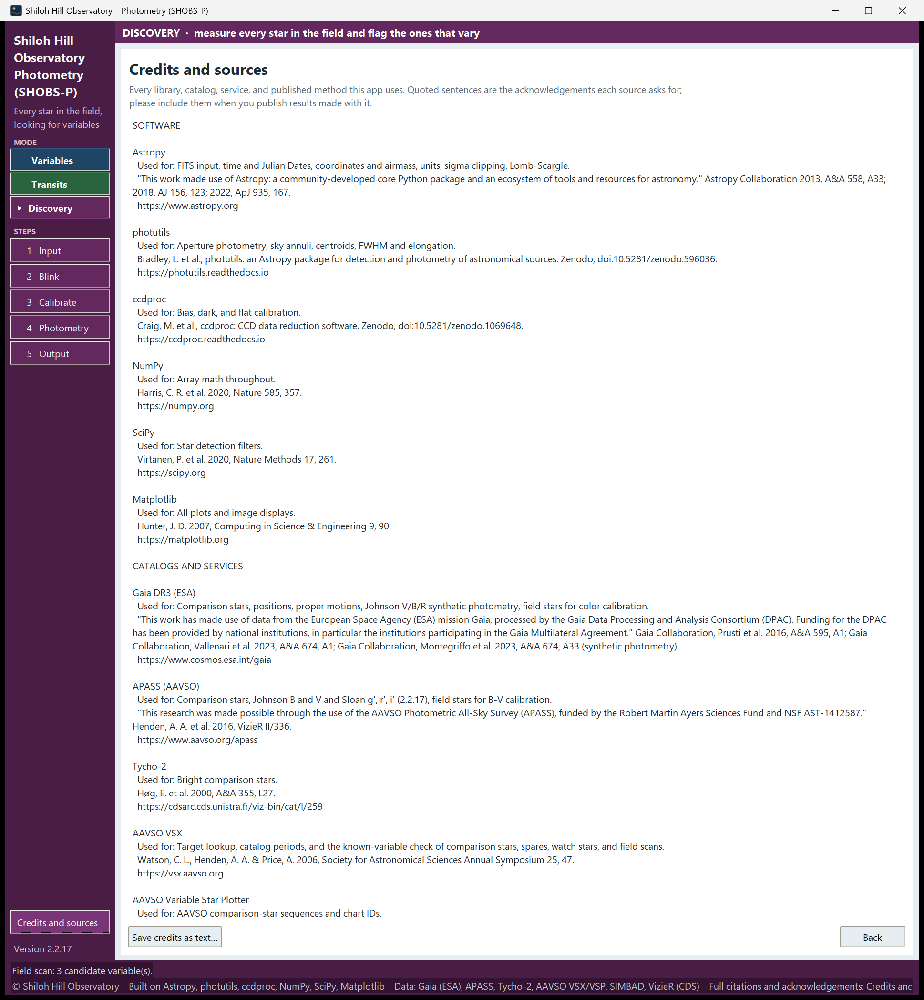

# 26. Credits and how to cite SHOBS-P

SHOBS-P stands on a great deal of other people's work: Python libraries, star catalogs, online services and
published methods. When you publish results made with it, please credit those sources, and SHOBS-P itself.

## The Credits and sources page

To see every source SHOBS-P uses:

1. Click **Credits and sources** at the bottom of the sidebar.
2. Read the list. It has three parts:
   - **SOFTWARE**: Astropy, photutils, ccdproc, NumPy, SciPy and Matplotlib.
   - **CATALOGS AND SERVICES**: Gaia DR3, APASS, Tycho-2, AAVSO VSX, the AAVSO Variable Star Plotter, SIMBAD,
     the NASA Exoplanet Archive, ExoFOP and VizieR.
   - **METHODS**: the published methods behind the period search, the color transformations, the transit model,
     the MCMC sampler, the red-noise estimate, the error bars, the timing methods and more.

   For each source the page says what SHOBS-P uses it for and gives the reference. Sentences in quotes are the
   acknowledgements each source asks for, in its own words.
3. To keep a copy, click **Save credits as text…**. It writes `SHOBS-P_credits.txt` (into the Output folder if one is
   set).
4. Click **Back** to return to the step you came from.


<!-- SCREENSHOT 26-credits-page: any mode, the Credits and sources page, scrolled to show the end of the Software part and the start of Catalogs and services, with the Save credits as text… and Back buttons visible; whole window. -->

The status bar's second line is a short version of the same credits, always on screen.

### What to include in a paper or article

Include the quoted acknowledgement and reference of each source your result actually used. For example:

- any result: Astropy, photutils, NumPy, and the catalogs your comparison stars came from (the Photometry page says
  which catalog each magnitude came from);
- a light curve with comparison stars from the AAVSO sequence: the AAVSO Variable Star Plotter;
- a transit fit: the NASA Exoplanet Archive (for the planet's parameters) and the transit and limb-darkening
  methods;
- a field scan: VSX and SIMBAD (for the known-variable check).

When in doubt, include the whole list from the saved text file in an appendix or a data note.

An AAVSO report or an ExoFOP upload does not need these credits; they are for published work.

## How to cite SHOBS-P

SHOBS-P is archived on Zenodo. Each release has its own DOI, so you can cite the exact version you used. One DOI
always points to the latest version:

**DOI: [10.5281/zenodo.23417064](https://doi.org/10.5281/zenodo.23417064)**

A reference in the usual software style:

> Shiloh Hill Observatory (2026). *SHOBS-P: Shiloh Hill Observatory Photometry* (Version 2.2.17) [Computer software].
> Zenodo. https://doi.org/10.5281/zenodo.23417064

In BibTeX:

```bibtex
@software{shobs_p,
  author    = {{Shiloh Hill Observatory}},
  title     = {{SHOBS-P: Shiloh Hill Observatory Photometry}},
  version   = {2.2.17},
  year      = {2026},
  publisher = {Zenodo},
  doi       = {10.5281/zenodo.23417064},
  url       = {https://doi.org/10.5281/zenodo.23417064}
}
```

Always give the version you used. It is at the bottom of the sidebar (**Version 2.2.17**), and in the
`#SOFTWARE=SHOBS-P 2.2.17` line of every report SHOBS-P writes.

To cite one specific release rather than the latest, open the DOI above. The Zenodo page lists every version with
its own DOI; use the one for your version.

### CITATION.cff

The program's GitHub repository contains a file **CITATION.cff** with the same information in a standard,
machine-readable form: title, author (Shiloh Hill Observatory), version, release date, DOI, license and a short
description. On the repository's GitHub page, the **Cite this repository** button (in the right-hand sidebar) turns
it into an APA or BibTeX reference you can copy. Reference managers such as Zotero can read it too.

## License

SHOBS-P is free software under the GNU General Public License, version 3 or later. You may use it, share it and
change it under that license's terms. It comes with no warranty. The full text is in the **LICENSE** file in the
program folder.

## How SHOBS-P was made

SHOBS-P was designed, tested and checked against real observations at Shiloh Hill Observatory. Most of the code was
written with the help of an AI assistant (Anthropic's Claude), working to the observatory's specifications and
checked against its data.

Bug reports, questions and ideas are welcome on the project's GitHub Issues page (see
[24. Troubleshooting](24-troubleshooting.md)).

---

Previous: [25. Glossary](25-glossary.md) · Back to the [table of contents](README.md)
